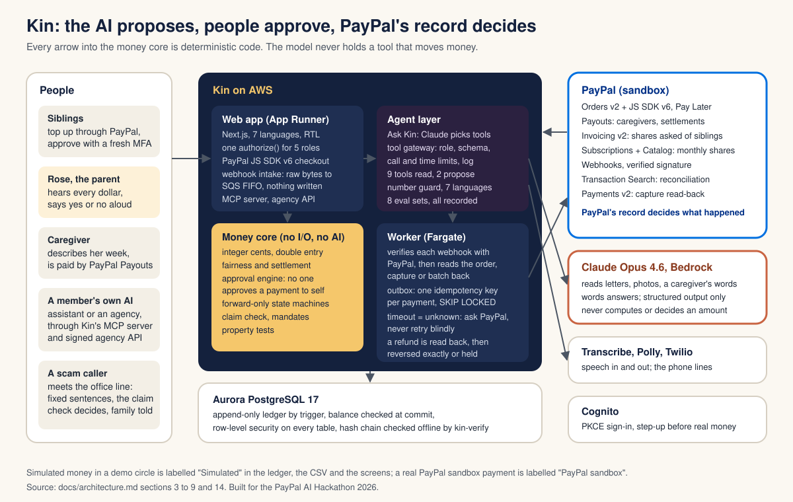
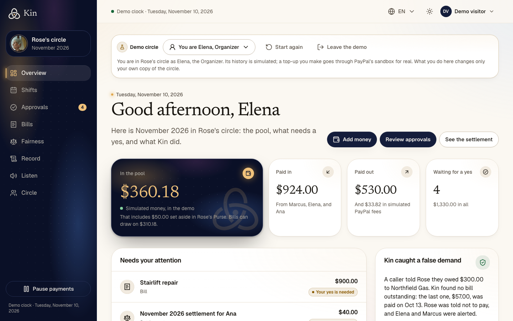
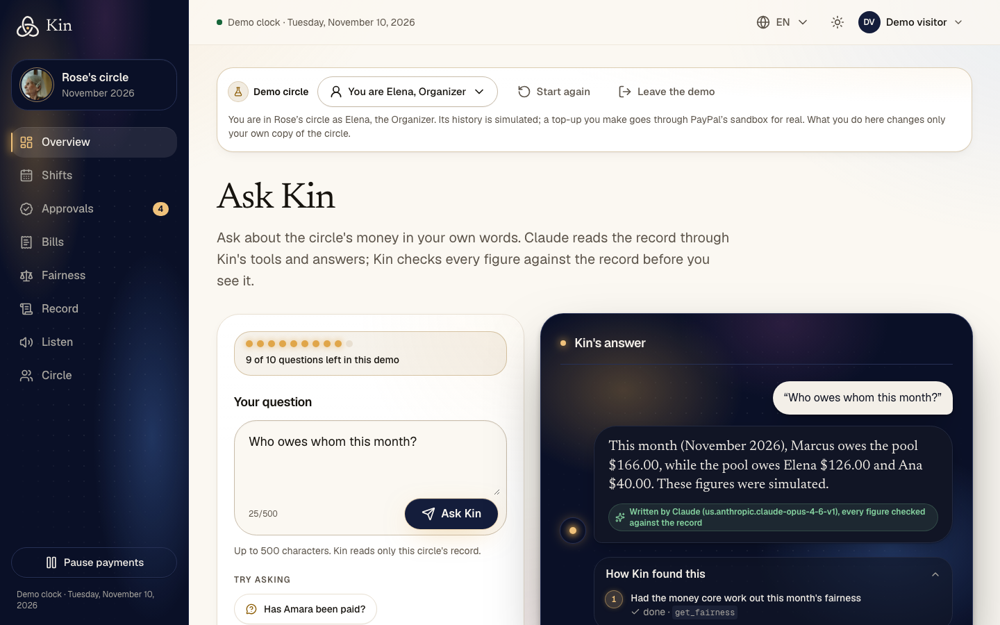
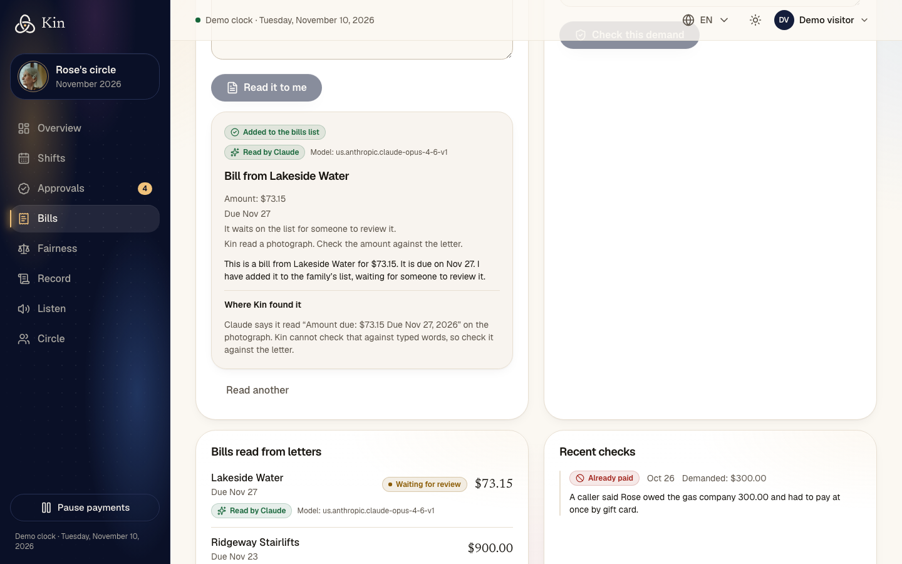
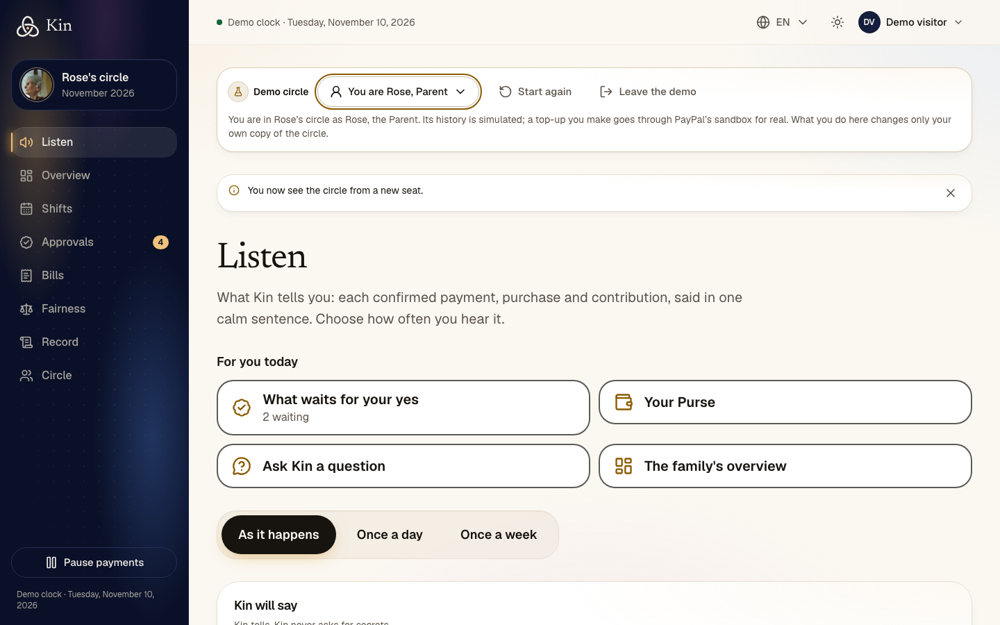
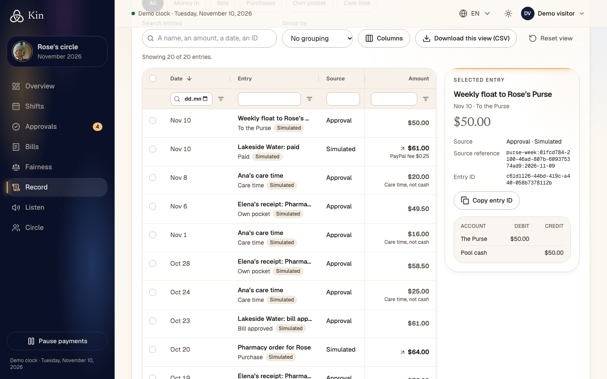

# Kin

**Nothing about Mom's money without Mom.** Kin is a shared money layer for families caring for an aging parent: siblings pay into one family pool through PayPal, Claude reads the bills and the caregiver's week and proposes each payment, the family approves, PayPal moves the money, and Kin tells the parent about every dollar, out loud. Built for the PayPal AI Hackathon 2026, in the PayPal sandbox with test money.

- **Live demo:** https://mzdg4f3stk.us-east-1.awsapprunner.com. Press **Try the demo** for your own copy of Rose's circle (Rose, 81, her three children and her caregiver). No account is needed.
- **Video:** under three minutes, linked from the Devpost entry.
- **Licence:** MIT (`LICENSE`).



**The rule throughout:** the AI proposes, people approve, and PayPal's own record decides what happened. Claude never holds a tool that moves money, never computes an amount, and every figure it says is checked against the record before anyone hears it.

## What is live and what is simulated

Nothing here moves real money: every PayPal call goes to the PayPal sandbox. In a demo circle the family's history is simulated and every such entry is labelled **Simulated** in the ledger, the CSV and the screens; a top-up a visitor makes goes through PayPal's real sandbox checkout and is labelled **PayPal sandbox**.

| Part | Status | What it does |
| --- | --- | --- |
| Top-ups to the pool | **Live, PayPal sandbox**, in demo circles too | Orders v2 and the PayPal JavaScript SDK v6 ("Add money"). Recorded only after the worker reads the order back from PayPal; verified webhooks confirm it again. First run through the hosted app on 16 October 2026. |
| Caregiver and settlement payouts | **PayPal sandbox in real circles**, simulated in demo circles | Payouts, recorded as paid only when the batch read back from PayPal shows the item `SUCCESS`; run end to end through Kin's code on 8 November 2026. A demo circle's payout is simulated and charges no fee, unless the worker is given `KIN_DEMO_SANDBOX_PAYEE_EMAIL`: it then pays an approved demo caregiver payout through the sandbox to Kin's own test account, never to an address a visitor typed. |
| Requests to siblings by invoice | **PayPal sandbox in real circles**, simulated in demo circles unless configured | Invoicing v2: create, send, read back, cancel. Counted as paid only when PayPal reads the invoice paid and the capture completed. Run end to end on 8 November 2026 ($166.00 sent, paid and credited once; `packages/paypal/src/fixtures/invoice-sandbox-2026-11-08.json`). |
| Monthly shares | **Wired, not yet run through Kin against the sandbox**; simulated in demo circles | A real circle's share is a PayPal Subscription (Catalog product and plan) the member approves at PayPal, with charges read back. The adapter is unit-tested against PayPal's documented shapes; a subscription has been created in the sandbox only by a script. |
| Refunds of a top-up | **Built, not yet run against the sandbox** | A `PAYMENT.CAPTURE.REFUNDED` or `REVERSED` webhook is verified, the refund and the capture are read back, and the top-up is reversed in the ledger only when the reversal is exact (a full refund with its fee returned). A partial refund, or one where PayPal kept its fee, is held for a person (decision 97). |
| Refills the parent approves | **Simulated** | Bought from a stand-in seller. A real circle cannot raise a refill yet. |
| Claude on Amazon Bedrock | **Live** | Opus 4.6 through InvokeModel. See "The AI". |
| Speech | **Live** | Amazon Transcribe and Polly: spoken approvals, letters read aloud, what Kin tells the parent. |
| Phone lines (`apps/voice`) | **Hosted on App Runner**; a call through a real Twilio number is not yet verified | The family office line and Kin's call to the parent about a shift, on Twilio's Programmable Voice webhook contract, tested with signed simulated calls (`pnpm --filter @kin/voice run simulate-call`). The web app has a simulator for each. No model is in the call path. |
| Sign-in | **Live** | Amazon Cognito (PKCE). Demo visitors need no account. |
| Not built | | OAuth for Kin's MCP server (it takes delegation tokens a member grants), the PayPal Agent Toolkit and PayPal's MCP server, shipment tracking, disputes, creating a refund, Log in with PayPal, photographing a receipt. |

## Judge quick start

**The hosted demo, in about ten minutes, with no account.** Open https://mzdg4f3stk.us-east-1.awsapprunner.com and press **Try the demo**. You are Elena, the organizer, in your own isolated copy of the circle. The banner's **You are Elena** menu switches seats; **Start again** gives you a fresh copy.

1. **PayPal for real (2 clicks).** On the overview press **Add money**, then **Pay with PayPal**: PayPal's sandbox checkout opens. Pay with the sandbox buyer below. Open **Record**: the top-up appears labelled **PayPal sandbox** with PayPal's fee, beside rows labelled **Simulated**.
2. **Claude reads a letter.** Open **Bills** and press **Try a sample letter photo**: Claude reads the payee, amount and due date, each shown beside the words it was read from. Below it, the caregiver's preview turns "Monday and Tuesday, 4 hours each" into a bill.
3. **Ask Kin, an agent with limits.** Open **Ask Kin** from the overview. Ask "Who owes whom this month?" and open **How Kin found this** to see the tools Claude chose. Then ask "Pay Amara now": it cannot, because no tool it holds pays. A demo visitor has ten questions.
4. **Approvals and fairness.** **Approvals** shows what waits for whose yes; nobody approves a payment to themselves. **Fairness** shows each sibling's share, what they gave in money and care time, and the settlement the money core plans.
5. **Rose's seat.** Switch to **Rose, Parent**. She lands on **Listen**: what Kin tells her, in very large type, read aloud. From there, her **Purse** and her **wishes** (`/dashboard/circle/wishes`).
6. **Kin protects her.** **Bills → Try the office line** plays a scam call answered by Kin's fixed sentences and checked against the record. **Is it really you?** (`/dashboard/presence`) texts the real grandson before anything is sent.
7. **Open Kin.** **Circle → Connected assistants** plays a live MCP session: an outside assistant reads the record, then tries to approve a payment and is refused. `/developers` documents the MCP server and the signed agency API (`/api/v1/openapi.json`).
8. **The record proves itself.** **Record** is an AG Grid audit view with CSV export; **Check the record** recomputes the hash chain and downloads it as JSON for `kin-verify`.

**PayPal sandbox buyer for the top-up.**

<!-- owner: paste the judges' sandbox buyer email and password here -->

A judge can also use any PayPal sandbox personal account of their own, from https://developer.paypal.com/dashboard/accounts.

**Run it locally.** See "Getting started" below.

## Screens

| | |
| --- | --- |
|  |  |
| **The family's overview.** The pool card says the money is simulated in the demo and what bills can draw on. | **Ask Kin.** Claude chose the fairness tool; the badge names the model and says every figure was checked. |
|  |  |
| **A letter read from a photograph.** The amount is kept because Claude quotes where it read it. | **Rose's first screen.** What Kin tells her, in large type, read aloud. |



## PayPal APIs the code calls

Every call is in `packages/paypal`, the only code that talks to PayPal, except the browser SDK and the demo pharmacy's saved-wallet order.

- **Orders v2** (`/v2/checkout/orders`: create, read, capture) with the **PayPal JavaScript SDK v6** for top-ups, including Pay Later where PayPal offers it, and **Payments v2** to read a capture (`/v2/payments/captures/{id}`) and a refund (`/v2/payments/refunds/{id}`) back.
- **Payouts** (`/v1/payments/payouts`: create and read the batch back; `/v1/payments/payouts-item/{id}` for one item), with the execution's idempotency key as the batch ID and request ID.
- **Subscriptions** (`/v1/billing/subscriptions`: create, read, transactions, suspend, activate, cancel, revise) with **Catalog Products** (`/v1/catalogs/products`) and **Plans** (`/v1/billing/plans`) for monthly shares, and the parent's wishes, which suspend and resume her own subscriptions.
- **Invoicing v2** (`/v2/invoicing/invoices`: create, send, read back, cancel; `/v2/invoicing/search-invoices` by number) for requests to siblings.
- **Transaction Search** (`/v1/reporting/transactions`) for the nightly reconciliation of each real Purse payment.
- **Webhooks**: Kin subscribes to `PAYMENT.CAPTURE.COMPLETED`, `PAYMENT.CAPTURE.REFUNDED`, `PAYMENT.CAPTURE.REVERSED`, the `BILLING.SUBSCRIPTION.*` events, `PAYMENT.SALE.COMPLETED`, `INVOICING.INVOICE.PAID` and `INVOICING.INVOICE.CANCELLED`, and verifies every delivery with `/v1/notifications/verify-webhook-signature` on the exact bytes before applying it. Registration is a script (`/v1/notifications/webhooks`). Payouts are confirmed by reading the batch, not by payout-item events.
- **OAuth** (`/v1/oauth2/token`) for the app's access token.
- **Vault** (`/v3/vault/setup-tokens`, `/v3/vault/payment-tokens`) is exercised only by a sandbox script; the demo pharmacy charges a saved wallet with `vault_id`.

Not called anywhere: creating a refund (Kin only reads one back), Shipment tracking, Disputes, Log in with PayPal, the Agent Toolkit and PayPal's MCP server. The Agent Toolkit and the MCP server have no Payouts tool, and Kin's rule is that the model never holds a PayPal write; Kin exposes its own MCP server instead.

## The AI

Claude Opus 4.6 on Amazon Bedrock (InvokeModel, through `@anthropic-ai/bedrock-sdk`), reached only through `packages/agent`. Claude reads and words; it never decides an amount, a payee or whether a payment happened.

- **Reading.** A caregiver's description of visits becomes days and minutes, each with the caregiver's own words as evidence, and the server values every day. A letter, typed or photographed, becomes a payee, an amount and a due date for a person to review; every field is traced to the words it came from, and a photographed amount is kept only if it appears in the words Claude says it read. Extraction has no tools, and what a letter says is data, never instructions.
- **Ask Kin** (`/dashboard/ask`) is an agent loop: Claude chooses among eleven tools, up to six calls a question. The gateway checks the person's role through the one authorization function, validates each argument against a schema, and bounds calls, time and result size. Nine tools read (the pool and the month's spending by category, bills, fairness, the claim check, proposals, the record, and a payout, top-up or subscription status read from PayPal); `propose_refill` and the parent's `propose_gift` raise proposals that wait for a yes, unless the parent's own standing permission already covers that refill. The trace shows each tool and what it did, and never claims a proposal that was not raised. The same tools reach a member's own assistant through Kin's MCP server at `/api/mcp`, under a scope that can never approve.
- **The number guard** compares every figure the model writes, in digits or in words, in seven languages, with the record, and falls back to fixed wording on a mismatch. The badge then says why ("Claude's wording named a figure the record does not hold").
- **Evaluations against the real model**, with dated results in `packages/agent/evals/results/`: Ask Kin 15 of 15, visit reading 12 of 12 and document reading 8 of 8 (two of them photographs, one carrying a printed prompt injection) on 10 November 2026; shift wording 22 of 22, account reading 8 of 8, gifts 12 of 12, sealed offers 12 of 12 and wishes 14 of 14 from 8 to 10 November. They cost money, so CI does not run them.

### AI tools used

- **Claude Opus 4.6 on Amazon Bedrock:** Ask Kin and the calendar assistant (tool use); reading visits, letters and photographs, scam-call accounts, sealed offers, wishes and gifts (structured output); wording spoken sentences, audit findings and shift questions.
- **Amazon Transcribe and Amazon Polly:** speech to text and text to speech.
- **Claude Code:** the coding assistant used to build Kin.

## How we use AG Grid

AG Grid Community (v36) is the family's audit tool, not decoration. The **Record** page is one grid over the append-only ledger, with a custom theme (`components/data-grid/grid-theme.ts`) and custom cell renderers for the day, the entry and the amount: sort and floating filters on every column (a date filter by calendar day, an amount filter parsed to exact cents), a quick-filter search, a column chooser, a pinned totals row, grouping by person, category or month with subtotals, multi-row selection with a live selected total, and a CSV export of exactly the filtered and sorted view. Column and filter state is kept per person. The same grid, on the proof columns, is the **audit trail** (`/dashboard/record/audit/view`) with a line showing that debits equal credits, and the **statement** shows the year in a grid with its total pinned. All sums are integer cents from one pure function in `packages/domain`. The grid is translated into seven languages, runs right to left in Arabic and Hebrew, follows reduced motion, prints in full, and on a phone becomes stacked cards driven by the same grid state.

## Architecture

The diagram above is the summary. `docs/architecture.md` has the detailed diagrams: the [system context](docs/architecture.md#3-system-context), the [services and stores](docs/architecture.md#4-services-and-stores), the [money core and its state machines](docs/architecture.md#7-the-money-core), the [PayPal integration](docs/architecture.md#8-paypal-integration) and the [AWS layout](docs/architecture.md#141-layout). Section 21 is the decision record and section 23 says how certain each part is.

## Security model

- **Three layers of access.** The Cognito account group, the member's role checked by the one authorization function in `packages/auth` (organizer, contributor, parent, caregiver, observer), and PostgreSQL row-level security on every table, with a catalog test that proves it and an isolation test that reads every table from another circle and must find nothing.
- **A fresh multi-factor check** before a yes to real money, even in an active session, and no member is the sole approver of a payment to themselves.
- **The ledger is append-only and balances**, enforced by triggers even against the table owner. A hash chain over the entries, with heads kept at each check, lets `kin-verify` (`packages/verify`) prove offline that a past entry was not changed.
- **PayPal's record decides.** Money is recorded only after a verified webhook or a direct read from PayPal. A call that times out makes the execution `unknown`: Kin asks PayPal and waits, never retrying blindly. Every movement has a recorded approval and an idempotency key, unique in the database.
- **The agent cannot move money**, and the number guard stops a wrong figure reaching a person.
- **The browser is untrusted**: it never decides access, computes money or holds a secret. Secrets are in AWS Secrets Manager.
- **Headers on every response:** HSTS, `frame-ancestors 'none'` and `X-Frame-Options: DENY` (no other site can frame a yes to money), `nosniff`, and a permissions policy that lets only Kin's pages use the camera and microphone.
- **Card data never touches Kin.** PayPal's checkout collects it, so Kin holds no card numbers and is outside PCI card-data scope.

**Not verified, stated plainly.** The fresh multi-factor check is proven against the end-to-end tests' stand-in for Cognito, not against Cognito itself, where multi-factor is optional; if Cognito does not send the claim, a real circle's approval fails closed. The content security policy does not yet restrict scripts (that needs nonces on Next.js's inline scripts). Rate limits are kept in each server's memory. The demo pharmacy (`apps/demo-merchant`) takes orders without authentication and is not deployed.

## Who holds the money

Kin does not take custody of the family's money in a bank account of its own. In this sandbox build every top-up lands in Kin's PayPal account, and Kin's ledger attributes it to the circle. A production launch would use PayPal's multiparty or partner platform (or a licensed partner), so that each circle's funds are held and moved under PayPal's licences, not Kin's. Until then, the ledger's per-circle attribution, the rule that a payout is bounded by the circle's confirmed balance, and row-level security keep one circle's money apart from another's. See `docs/architecture.md` decision 70 and section 22.3.

## Tech stack

- TypeScript throughout, in one pnpm workspace
- Web: Next.js 16, React 19, Tailwind CSS 4, shadcn/ui and Radix, AG Grid Community for the record; seven languages including Arabic and Hebrew (right to left)
- Payments: PayPal REST APIs (Orders, Payments, Payouts, Subscriptions, Invoicing, Transaction Search, webhooks) and the PayPal JavaScript SDK v6, sandbox only
- AI: Claude Opus 4.6 on Amazon Bedrock (InvokeModel) through the Anthropic Bedrock SDK
- Speech: Amazon Transcribe streaming and Amazon Polly
- Phone: Twilio Programmable Voice webhook contract, hosted on App Runner
- Data: PostgreSQL (Aurora Serverless v2 in AWS, PostgreSQL 17 in Docker locally), Drizzle ORM
- Auth: Amazon Cognito with PKCE
- Background work: a Node worker reading an SQS queue (ElasticMQ locally) and an outbox table
- Infrastructure: AWS CDK; App Runner for the web app and the voice service, ECS Fargate for the worker
- Tests: Vitest and Playwright

`docs/tech-stack.md` explains each choice.

## Project structure

```
apps/
  web/            Next.js site, dashboard, HTTP API and PayPal webhook intake
  worker/         PayPal event inbox, payouts, refills, receipts, Cognito email sender
  voice/          the phone lines: Twilio voice webhook service (hosted on App Runner)
  demo-merchant/  the stand-in pharmacy: catalog, orders, delivery, saved-wallet charge
packages/
  domain/         ledger, fairness, state machines, approval rules, claim check (pure code, no I/O)
  db/             schema, migrations, row-level security, repositories, demo provisioning
  paypal/         the only code that talks to PayPal
  agent/          the only code that calls the model; prompts, number guard, evaluation sets
  auth/           sessions, PKCE, step-up checks, circle access decisions
  speech/         Transcribe and Polly adapters
  documents/      reading a letter into a stored, checked reading
  telephony/      the office-line conversation and its fixed sentences
  verify/         kin-verify: independent check of an exported ledger's hash chain
  notify/         email sending (Gmail SMTP)
  config/         typed configuration
infra/            AWS CDK stacks
docs/             product description, architecture, tech stack, feature proposals, submission draft
```

`AGENTS.md` holds the engineering rules, including the dependency rule between packages and the money and security invariants.

## Getting started

### Prerequisites

- Node.js 24 or later
- pnpm 12 (the version is pinned in `package.json`)
- Docker, for the local database, the queue stand-in and the tests

### Install and run the web app locally

```bash
pnpm install

# Root settings: fill in the KIN_DATABASE_* lines (choose any local passwords)
cp .env.example .env

pnpm db:up                           # PostgreSQL in Docker
pnpm --filter @kin/db run migrate    # schema and roles

# Web app settings: copy the database passwords from .env,
# keep KIN_DEMO_CIRCLES=on and set KIN_DEMO_SESSION_KEY to a random string of 32+ characters
cp apps/web/.env.example apps/web/.env.local

pnpm --filter @kin/web dev
```

Open http://localhost:3000 and press **Demo**. Keep port 3000: it is the callback origin registered for sign-in.

### Configuration

Every setting is listed, with comments, in `.env.example` and `apps/web/.env.example`. The groups are:

| Variables | Needed for |
| --- | --- |
| `KIN_DATABASE_*` | The database (always) |
| `KIN_DEMO_CIRCLES`, `KIN_DEMO_SESSION_KEY` | The Demo button |
| `KIN_AUTH_ISSUER`, `KIN_AUTH_LOGIN_URL`, `KIN_AUTH_CLIENT_ID`, `KIN_WEB_ORIGIN` | Signing in, from a deployed Cognito user pool |
| `KIN_PAYPAL_CLIENT_ID`, `KIN_PAYPAL_CLIENT_SECRET`, `KIN_PAYPAL_WEBHOOK_ID`, `KIN_QUEUE_ENDPOINT`, `KIN_PAYPAL_INBOX_URL` | Top-ups and payouts (PayPal sandbox app) |
| `PAYPAL_SANDBOX_*`, `PAYPAL_TRIAL_CURRENCY` | The PayPal sandbox check script |
| `KIN_DEMO_SANDBOX_PAYEE_EMAIL`, `KIN_DEMO_SANDBOX_PAYOUTS_PER_DAY` | Optional: pay an approved demo caregiver payout through the PayPal sandbox to Kin's own test account (otherwise simulated) |
| `KIN_DEMO_INVOICE_RECIPIENT_EMAIL` | Optional: send a demo circle's invoice requests as real sandbox invoices to Kin's own test account (otherwise simulated) |
| `KIN_BEDROCK_REGION`, `KIN_BEDROCK_API`, `KIN_BEDROCK_MODEL` | Claude features, including Ask Kin; unset turns them off |
| `KIN_SPEECH_REGION` | Listening and speaking; unset turns them off |
| `KIN_SENDER_EMAIL`, `KIN_GMAIL_APP_PASSWORD` | Sign-in codes by email in AWS |

Bedrock and speech use the standard AWS credential chain (for example `AWS_PROFILE`).

### Top-ups locally

Top-ups need the queue stand-in and the worker beside the web app, plus a PayPal sandbox buyer account:

```bash
pnpm db:up
pnpm queue:up                        # SQS stand-in; prints the two queue settings
pnpm --filter @kin/worker dev
pnpm --filter @kin/web dev
```

### Other scripts

```bash
pnpm db:down / pnpm queue:down                       # stop the containers
pnpm --filter @kin/db run demo:reset -- <visitor-id> # fresh demo circle for a visitor
pnpm --filter @kin/paypal run sandbox:check          # exercise the PayPal sandbox app
pnpm --filter @kin/agent run eval                    # visit prompt evaluation set (calls the real model)
pnpm --filter @kin/agent run eval:documents          # document prompt evaluation set (calls the real model)
pnpm --filter @kin/agent run eval:agent              # Ask Kin evaluation set: tool choice, refusals, injection (calls the real model)
# each writes its dated results to packages/agent/evals/results/
```

## Tests

On 10 November 2026, `pnpm check` (lint, strict typecheck and tests) passed with **3,303 unit and integration tests** across 16 workspaces and one live-sandbox test skipped: `apps/web` 780, `packages/domain` 769 (including property tests of the ledger, fairness, refunds and approval rules), `packages/db` 466 (against a real PostgreSQL, including isolation between circles and each role's limits), `packages/agent` 275, `apps/worker` 198, `packages/telephony` 175, `packages/auth` 149, `packages/paypal` 109, and the rest in the other packages and `infra`. **45 Playwright spec files (596 tests)** cover every screen at four viewports and at 320 pixels with no horizontal overflow, the security headers, and WCAG 2.2 AA with axe on the home page, the overview, the record, Ask Kin and the parent's Listen screen; all 596 passed (one, the refill-permission test, passed only on a rerun under heavy parallel load). CI runs the key journeys on every push.

```bash
pnpm check        # lint, typecheck and unit/integration tests in every workspace
pnpm test:e2e     # Playwright against the production build of the web app
```

Before the first end-to-end run, install the browser with `pnpm --filter @kin/web exec playwright install chromium`. The database, web and end-to-end tests start their own throwaway PostgreSQL in Docker, so Docker must be running. The end-to-end tests use a local stand-in for Cognito and need no AWS access.

## Deployment

The infrastructure is AWS CDK in `infra/`, with these stacks: KinGuardrails, KinOps, KinNetwork, KinData (Aurora, Cognito), KinCi (GitHub OIDC role), KinWeb (App Runner), KinWorker (Fargate, created when PayPal is configured) and KinVoice (App Runner).

- GitHub Actions `ci.yml` runs on every pull request and push to `main`: `pnpm check`, the key end-to-end journeys (`pnpm test:e2e:key`; `pnpm test:e2e` runs all of them), Docker builds of the web, migration, worker and voice images with a smoke request, and `cdk synth`.
- `deploy.yml` runs after CI passes on `main`: it deploys the stacks, runs the database migration task, rolls out the web, worker and voice images, and smoke-tests the live app. GitHub reaches AWS through OpenID Connect, with no stored keys.
- There is no staging environment: a merge to `main` redeploys the URL judges use. Hold merges during the judging window (1 to 15 December 2026).

To run the CDK by hand: `AWS_PROFILE=<profile> KIN_ALERT_EMAIL=<address> pnpm --filter @kin/infra run <synth|diff|deploy>`. See `AGENTS.md` section 3 for bootstrapping and for switching on email, PayPal, Claude and speech in AWS.

## Documentation

- `docs/project-description.md`: the product, the people it is for, and the full feature set it aims at
- `docs/architecture.md`: services, data model, money flow, PayPal, AI, voice, security, testing, decisions and what is verified
- `docs/tech-stack.md`: tool choices and their reasons
- `docs/feature-proposals.md`: proposed features, not yet approved or built
- `docs/submission/devpost-description.md`: the Devpost write-up

## License

MIT. See `LICENSE`.
