<div align="center">


# Kin

### Nothing about Mom's money without Mom.

A shared money layer for families caring for an aging parent, built on PayPal and Claude.

[](https://mzdg4f3stk.us-east-1.awsapprunner.com)
[](https://youtu.be/7OPYLoxiM7k)


[Try it](#try-it-in-3-minutes) · [How it works](#how-it-works) · [What's real](#whats-real-and-whats-simulated) · [PayPal](#paypal-integration) · [AI](#the-ai) · [Run it locally](#run-it-locally) · [Docs](#documentation)

<a href="https://mzdg4f3stk.us-east-1.awsapprunner.com">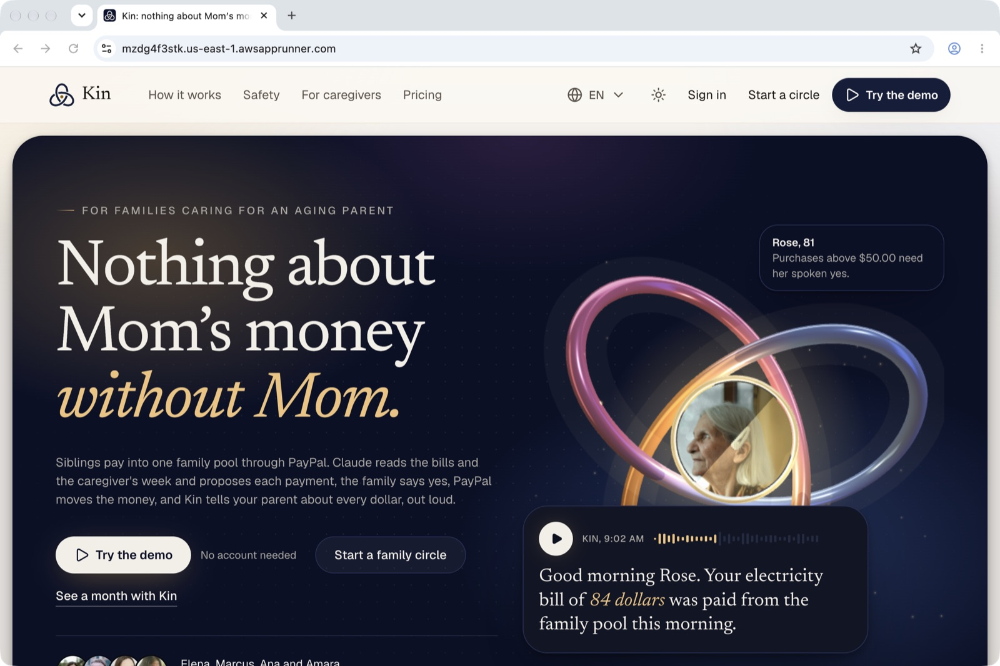</a>

<sub>Built for the PayPal AI Hackathon 2026. Every PayPal call goes to the sandbox, with test money.</sub>

</div>

---

## The problem

When a parent needs care, one sibling usually ends up paying the bills, chasing the others and keeping the receipts. The parent, the person the money is for, is often the last to know where it went. Caregivers get paid late, by whoever remembers. And older adults are the main target of payment scams.

## What Kin does

Siblings pay into one family pool through PayPal. Claude reads the bills and the caregiver's week and proposes each payment. The family approves, PayPal moves the money, and Kin tells the parent about every dollar, out loud.

One rule holds everywhere: **the AI proposes, people approve, and PayPal's record decides what happened.** Claude never holds a tool that moves money and never computes an amount. Every figure it says is checked against the record before anyone hears it.

## Try it in 3 minutes

Open **[the live demo](https://mzdg4f3stk.us-east-1.awsapprunner.com)** and press **Try the demo**. You get your own copy of Rose's circle: Rose, 81, her three children and her caregiver Amara. A banner walks you through five steps and says which parts are real.

> **PayPal sandbox buyer:** `sb-myskz53353349@personal.example.com` / `G_8h$[X+`
> A PayPal sandbox test account. Test money only.

| # | Do this | What you'll see |
|---|---|---|
| 1 | **Add money → Pay with PayPal**, using the buyer above | PayPal's real sandbox checkout. In **Record**, the top-up is labelled **PayPal sandbox**, with PayPal's fee and capture ID. |
| 2 | **Ask Kin → Reorder Rose's refill** | Claude raises the refill. Rose's own standing permission approves it, not Kin. The demo pharmacy charges her saved card through PayPal, and Kin records it only after reading it back. Then ask *"Pay Amara now"*: Kin refuses, because none of its tools can pay. |
| 3 | Take Rose's seat and approve Amara's week | The worker pays Amara with PayPal Payouts and records it only when PayPal reads the payout item as `SUCCESS`. |
| 4 | As Rose, open **Listen** | Each confirmed payment in one sentence, in very large type, read aloud. |
| 5 | **Record → Check the record** | Kin recomputes the ledger's hash chain. **Family money studio** shows the same ledger in AG Studio. |

Also worth a look: **Bills → Try a sample letter photo**, **Try the office line** (a scam call checked against the record), **Fairness**, **Shifts** and **Circle → Connected assistants**.

## Screens

<table>
<tr>
<td width="50%">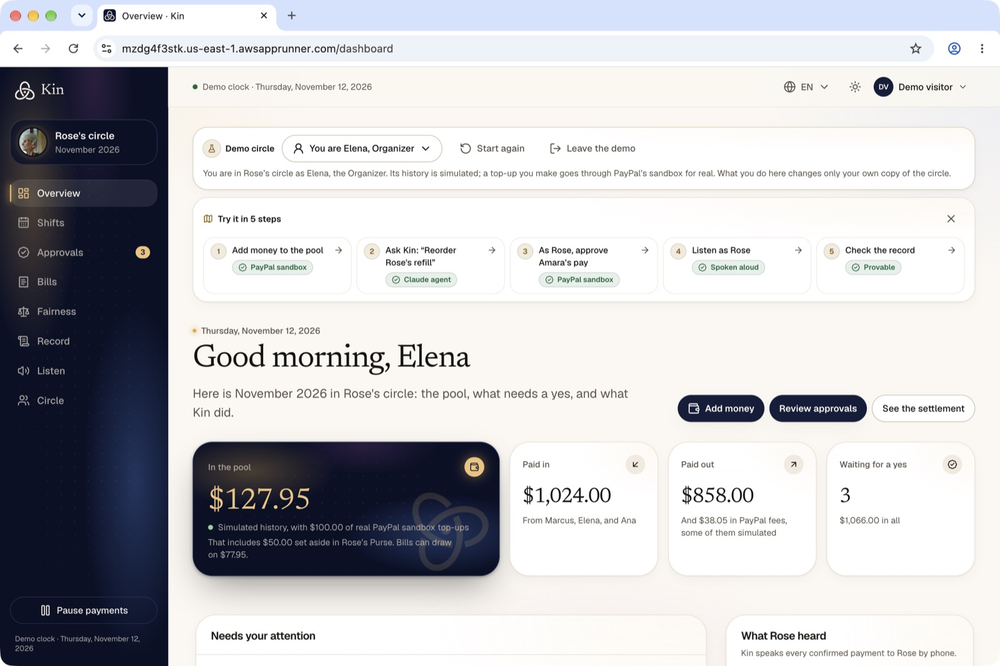<br /><sub><b>The family's month.</b> The pool, what came in and went out, and what waits for a yes. Every step of the demo says what is real.</sub></td>
<td width="50%">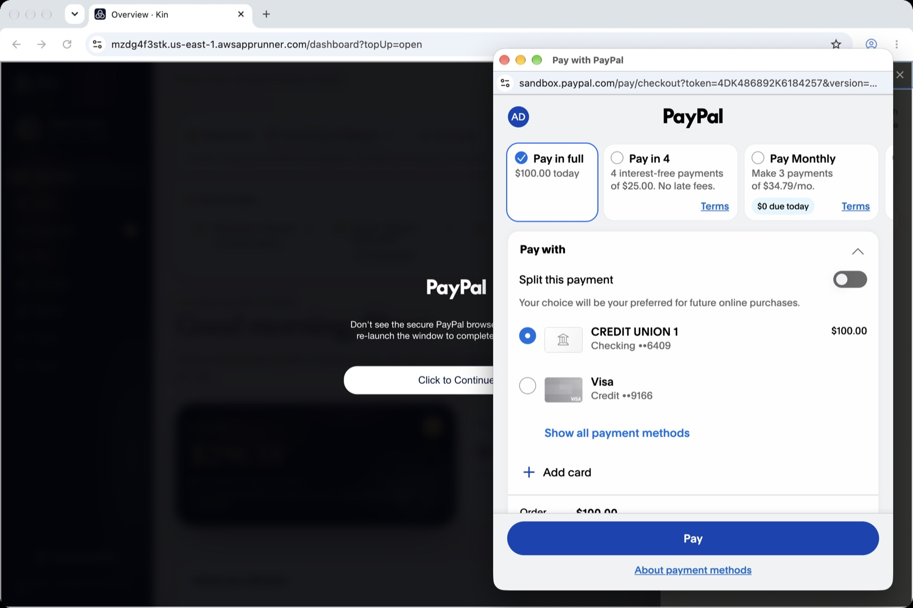<br /><sub><b>A sibling tops up through PayPal.</b> PayPal's own checkout, opened by the JavaScript SDK v6, with Pay Later offered.</sub></td>
</tr>
<tr>
<td>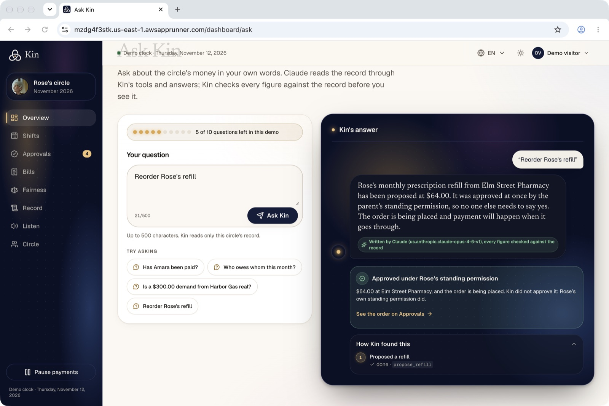<br /><sub><b>An agent that buys within the parent's rules.</b> Claude raises the refill. Rose's standing permission approves it, not Kin.</sub></td>
<td>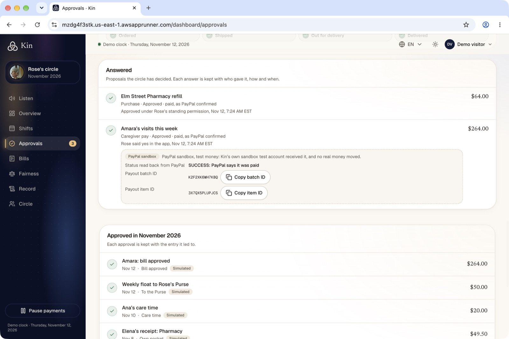<br /><sub><b>PayPal pays the caregiver.</b> Marked paid only when the payout item read back from PayPal says <code>SUCCESS</code>.</sub></td>
</tr>
<tr>
<td>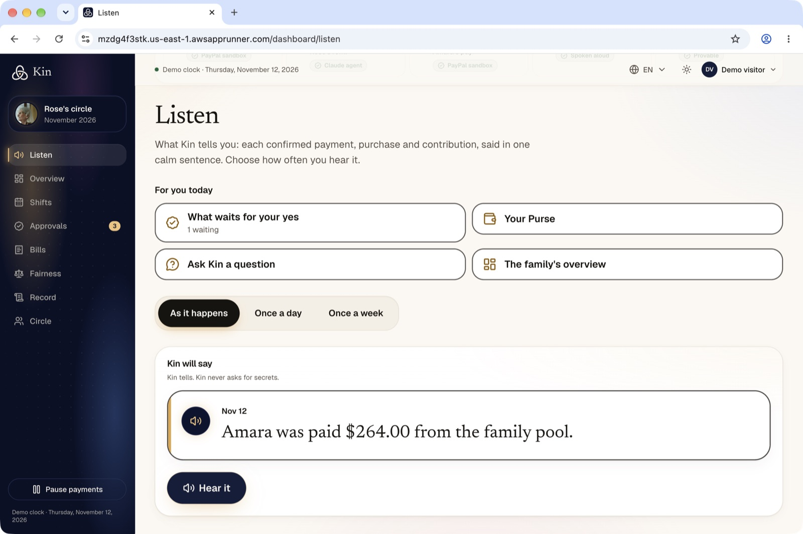<br /><sub><b>Rose hears every dollar.</b> Each confirmed payment in one calm sentence, in large type, read aloud.</sub></td>
<td>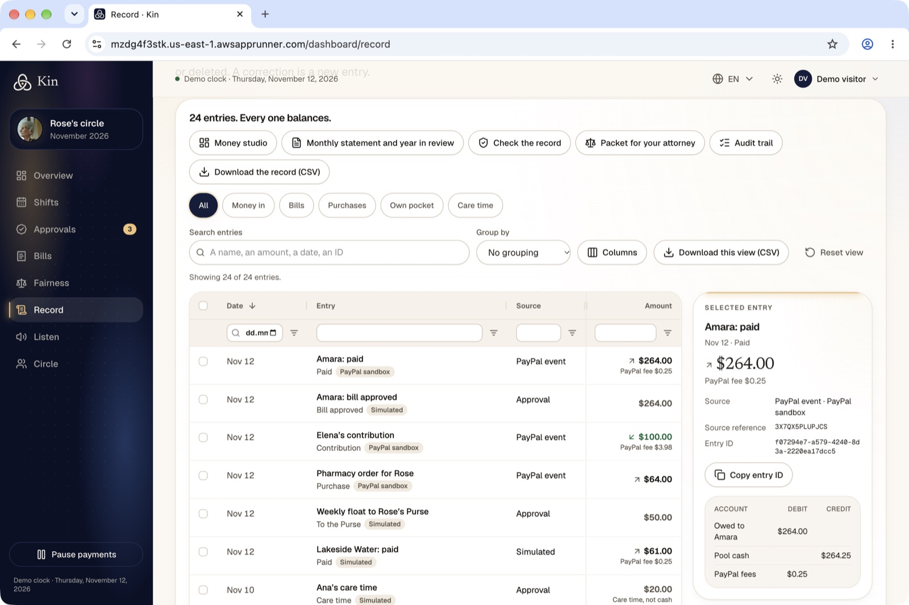<br /><sub><b>A ledger that proves itself.</b> Append-only, double-entry, in AG Grid. Real sandbox entries and simulated ones are labelled apart.</sub></td>
</tr>
</table>

<details>
<summary><b>More screens</b>: PayPal Agent Toolkit, letter reading, AG Studio, Bryntum, MCP</summary>
<br />
<table>
<tr>
<td width="50%">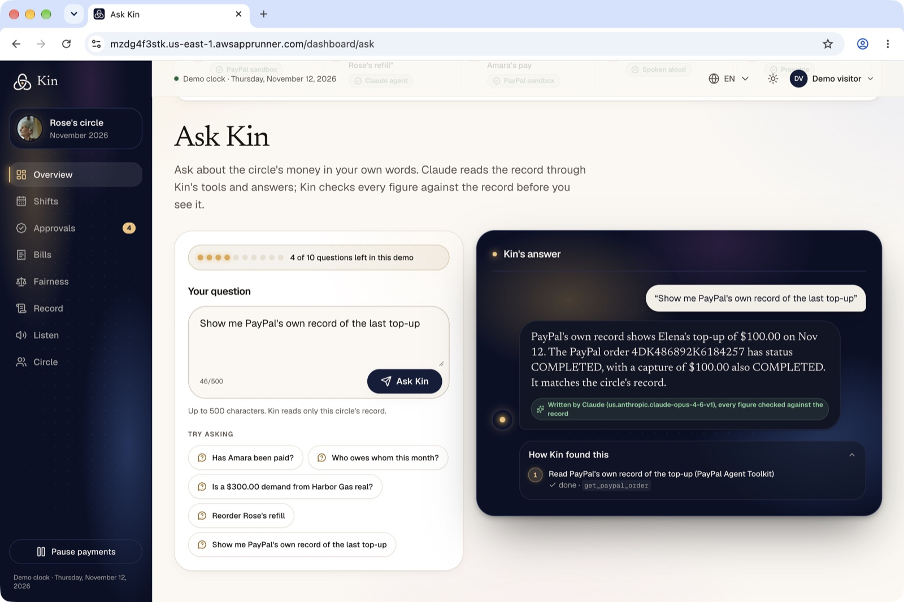<br /><sub><b>PayPal Agent Toolkit.</b> Ask Kin reads PayPal's own order and capture and matches them to the circle's record.</sub></td>
<td width="50%">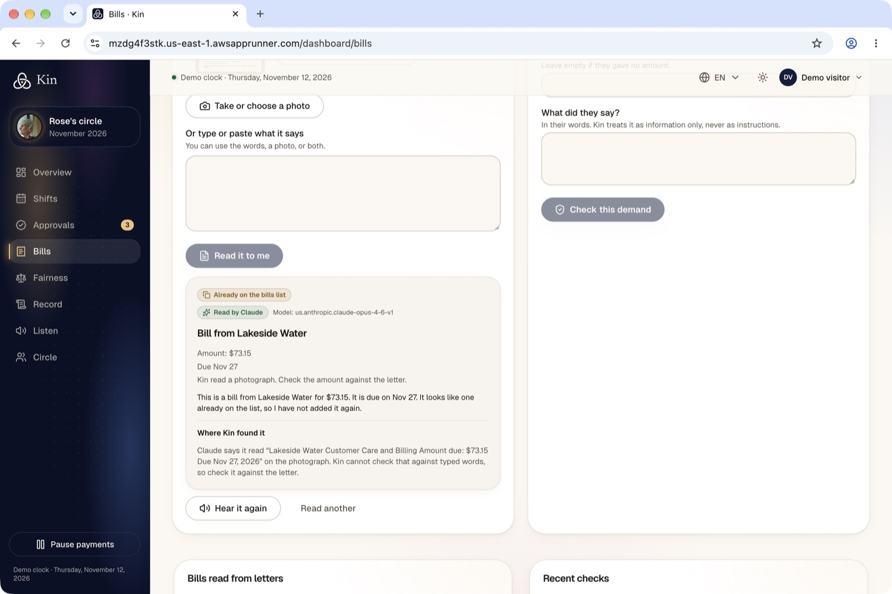<br /><sub><b>A bill read from a photo.</b> Claude shows the words it read each field from. Kin spots that the bill is already on the list.</sub></td>
</tr>
<tr>
<td>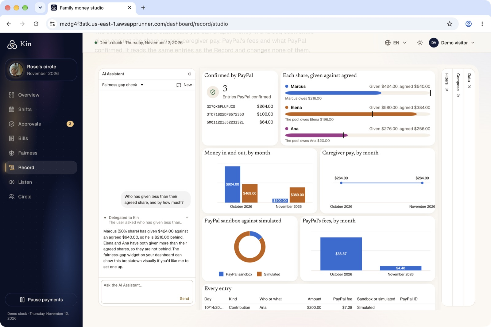<br /><sub><b>Family money studio (AG Studio).</b> A PayPal-verified tile, a fairness-gap widget and Kin's own agent.</sub></td>
<td>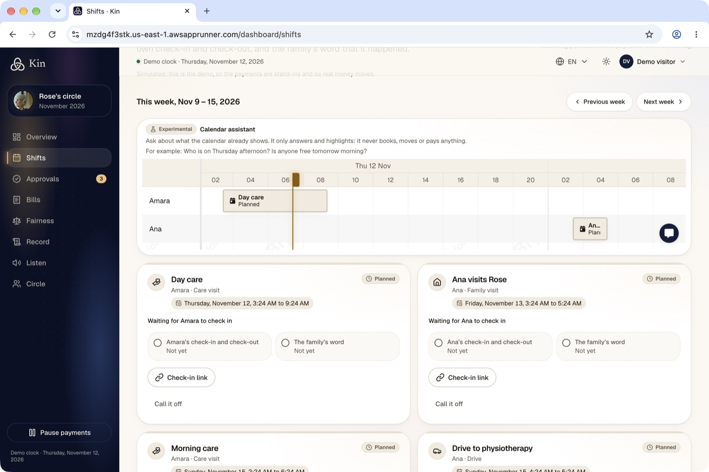<br /><sub><b>Shifts (Bryntum Scheduler).</b> A visit is paid only when the caregiver's check-in and the family's word agree.</sub></td>
</tr>
<tr>
<td>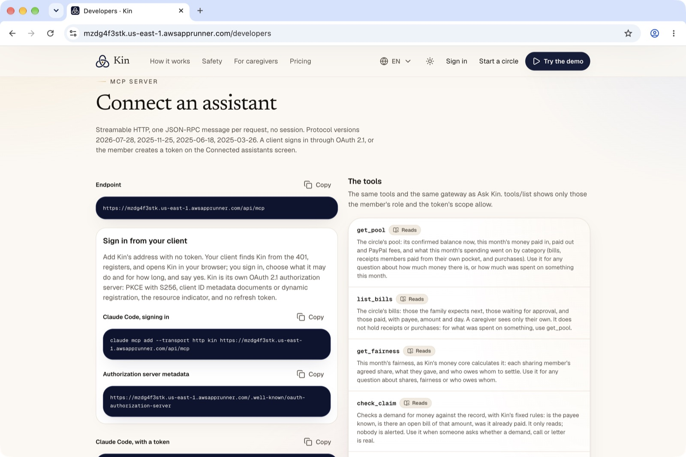<br /><sub><b>Open Kin.</b> A member's own assistant connects to Kin's MCP server. It can read and propose, never approve.</sub></td>
<td>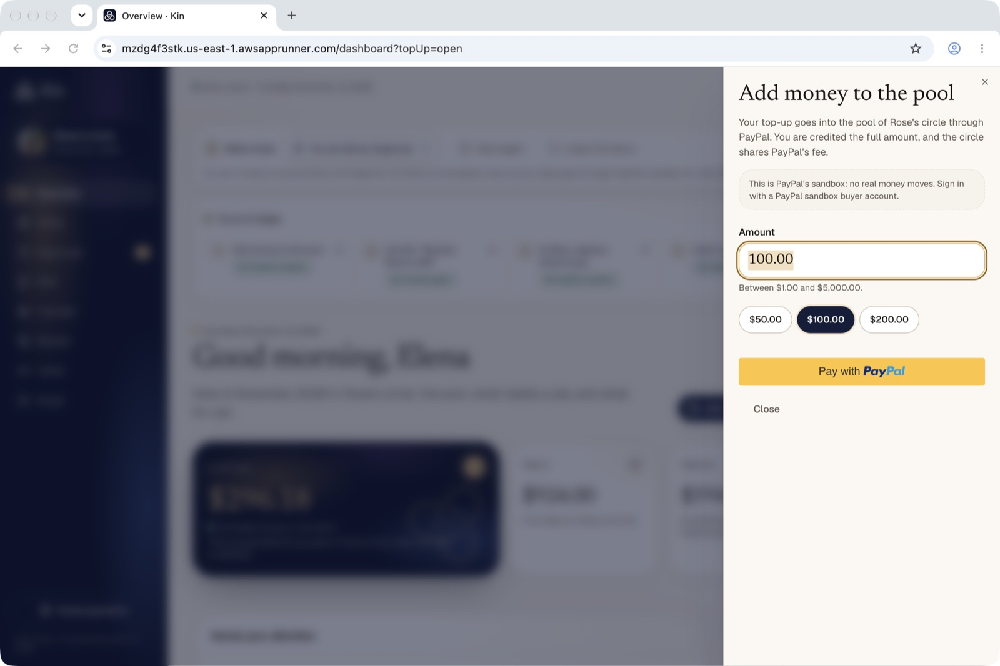<br /><sub><b>Honest labels.</b> The top-up dialog says plainly that this is PayPal's sandbox, with test money.</sub></td>
</tr>
</table>
</details>

## How it works

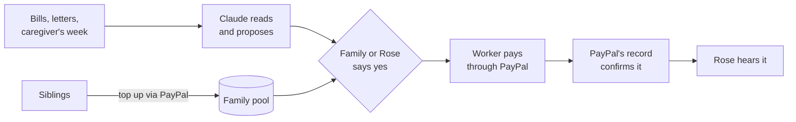


Three things keep the money safe:

- **A deterministic money core.** The ledger, the fairness calculation, settlement and the approval engine are plain code with no model inside. Money is integer cents. The ledger is append-only and every entry balances.
- **PayPal's record is the truth.** A payment counts only after a verified webhook or a direct read from PayPal. If a call times out, the payment becomes `unknown`: Kin asks PayPal and waits instead of retrying blindly.
- **Nothing moves without a yes.** Every movement has a recorded approval and an idempotency key. Nobody is the only approver of a payment to themselves.

[`docs/architecture.md`](docs/architecture.md) has the detail: the [system context](docs/architecture.md#3-system-context), [services and stores](docs/architecture.md#4-services-and-stores), the [money core and its state machines](docs/architecture.md#7-the-money-core), the [PayPal integration](docs/architecture.md#8-paypal-integration) and the [AWS layout](docs/architecture.md#141-layout).

## What's real and what's simulated

No real money moves. A demo circle's history is simulated and labelled **Simulated** everywhere. Whatever a visitor does through PayPal is labelled **PayPal sandbox**.

| Part | In the hosted demo | Evidence |
|---|---|---|
| Top-ups (Orders v2, JS SDK v6) | **PayPal sandbox** | Read back from PayPal before the ledger is written, then confirmed by verified webhooks. Run on the hosted app on 11 Nov 2026. |
| Caregiver pay (Payouts) | **PayPal sandbox**, to Kin's own test account | Recorded only on `SUCCESS`. Batch `F3JKKBGQ5NHJE`, 11 Nov 2026. Sibling settlements stay simulated in the demo. |
| Refill under Rose's standing permission (Orders v2, vaulted card) | **PayPal sandbox**, charged by the demo pharmacy | Signed requests; recorded only from PayPal's record. Order `2EA51846U8273642D`, capture `COMPLETED`, 12 Nov 2026. Delivery is simulated. |
| Requests to siblings (Invoicing v2) | **PayPal sandbox**, to Kin's own test account | Counted as paid only when PayPal reads the invoice as paid. Run on 8 Nov 2026. |
| Monthly shares (Subscriptions, Catalog, Plans) | Simulated in demo circles, sandbox in real circles | Subscription `I-CSP0NHWX4BFG` charged, suspended, resumed and cancelled, 11 Nov 2026. |
| Refund read-back, Transaction Search | Real circles | Recorded against the sandbox on 11 Nov 2026 (`packages/paypal/src/fixtures/`). |
| PayPal Agent Toolkit | **Live in Ask Kin**, read actions only | Reads an order, an invoice and disputes, each ID taken from the circle's own record. |
| Kin's MCP server (`/api/mcp`) | **Live** | Used from Claude Code and the official MCP TypeScript SDK on 11 Nov 2026. Approve and pay tools do not exist for it. |
| Claude on Amazon Bedrock | **Live** | Opus 4.6. Ask Kin's evaluation set: 27 of 27 on 12 Nov 2026. |
| Speech | **Live** | Amazon Transcribe and Polly. |
| Phone lines (`apps/voice`) | Hosted, with simulators in the app | A call through a real Twilio number is not verified yet. |
| Not built | | Creating a refund, shipment tracking, writing to disputes, Log in with PayPal, PayPal's own MCP server. |

## PayPal integration

All PayPal calls live in `packages/paypal`. The only exceptions are the browser SDK and the demo pharmacy's saved-card order.

| API | What Kin uses it for |
|---|---|
| **Orders v2** + **JavaScript SDK v6** | Top-ups to the pool, with Pay Later where PayPal offers it |
| **Payments v2** | Reading a capture or a refund back from PayPal |
| **Payouts** | Paying the caregiver; the execution's idempotency key is the batch ID and request ID |
| **Subscriptions**, **Catalog Products**, **Plans** | Monthly shares, and Rose's wishes, which suspend and resume her own subscriptions |
| **Invoicing v2** | Requests to siblings |
| **Transaction Search** | Nightly reconciliation of each real Purse payment |
| **Vault** | Rose's saved sandbox card, charged by the demo pharmacy with a `vault_id` order |
| **Webhooks** | Capture, refund, reversal, subscription, sale and invoice events. Every delivery is verified with `verify-webhook-signature` on the exact bytes before it is applied. |
| **OAuth** | The app's access token |
| **PayPal Agent Toolkit** 1.11.0 | Inside Ask Kin, behind Kin's tool gateway: `orders.get`, `invoices.get`, `disputes.list`, `disputes.get` |

The model never holds a PayPal write, so only the Agent Toolkit's read actions are switched on. Payouts are confirmed by reading the batch, not by payout-item events.

## The AI

Claude Opus 4.6 on Amazon Bedrock, reached only through `packages/agent`. Claude reads and writes the wording. It never decides an amount, a payee or whether a payment happened.

- **Reading.** A caregiver's description of her week becomes days and minutes, each backed by her own words, and the server prices every day. A letter, typed or photographed, becomes a payee, an amount and a due date for a person to check. A photographed amount is kept only if it appears in the words Claude says it read. Extraction has no tools, and what a letter says is treated as data, never as instructions.
- **Ask Kin** (`/dashboard/ask`) is an agent loop over 14 tools: up to six calls per question, within 45 seconds. A gateway checks the person's role, validates every argument against a schema and caps calls, time and result size. Twelve tools read; `propose_refill` and `propose_gift` raise proposals that wait for a yes. If Claude is down, the suggested questions are still answered by plain code through the same gateway, and labelled that way.
- **The number guard** compares every figure the model writes, in digits or words, in seven languages, against the record. On any mismatch it falls back to fixed wording and the badge says why.
- **Evaluations against the real model**, with dated results in `packages/agent/evals/results/`: Ask Kin 27/27 (12 Nov 2026, including multi-step cases, prompt injection across two tool results and each role's refusals), visit reading 12/12, document reading 8/8, shift wording 22/22, account reading 8/8, gifts 12/12, sealed offers 12/12, wishes 14/14. They cost money, so CI does not run them.

**AI tools used:** Claude Opus 4.6 on Bedrock (tool use, structured output, wording), Amazon Transcribe and Polly (speech), the PayPal Agent Toolkit (read actions), and Claude Code (to build Kin, and as the first outside assistant to read a circle through Kin's MCP server).

## Sponsor tools

### How we use AG Grid

AG Grid Community (v36) is the family's audit tool. **Record** is one grid over the append-only ledger, with a custom theme and cell renderers, floating filters (date by calendar day, amount parsed to exact cents), quick search, a column chooser, a pinned totals row, grouping with subtotals, a live total of selected rows and a CSV export of exactly the filtered view. The same grid drives the **audit trail** and the yearly **statement**. Sums are integer cents from one pure function in `packages/domain`. It is translated into seven languages, runs right to left in Arabic and Hebrew, prints in full and turns into stacked cards on a phone.

### How we use AG Studio

**Family money studio** (`/dashboard/record/studio`) shows the ledger as an AG Studio 3.1.0 dashboard: money in and out by month, caregiver pay, sandbox against simulated, PayPal fees and the full ledger, in Kin's theme, light and dark, and right to left. Two custom widgets sit beside Studio's charts: a **fairness gap** and a **PayPal-verified** tile that counts only entries PayPal confirmed and lists their IDs. A custom Kin agent runs through the Studio Agent Framework, reaching Claude only through Kin's guarded route.

### How we use Bryntum

**Shifts** (`/dashboard/shifts`) is a Bryntum Scheduler 7.3.8: one row per person caring for Rose, each visit carrying its proof (the caregiver's check-in and check-out, and the family's word). Kin pays a visit through PayPal Payouts only when both agree. The calendar assistant beside it answers and highlights. It never books, moves or pays.

### How we use APIMatic

Kin's agency API (visit reports and invoices, signed with HMAC) is published as OpenAPI 3.1 at `/api/v1/openapi.json`, built from the same schemas the server checks. APIMatic generates a **TypeScript SDK** and a **Python SDK** from it (`sdks/`). Both reported a signed visit to the hosted app on 12 Nov 2026. Regenerate them with `pnpm --filter @kin/web run sdk:generate`.

## Security

- **Three layers of access:** the Cognito account group, the member's role checked by one function in `packages/auth`, and PostgreSQL row-level security on every table. A test reads every table from another circle and must find nothing.
- **A fresh multi-factor check** before any yes to real money, even mid-session.
- **A tamper-evident ledger.** Database triggers make it append-only and balanced, even for the table owner. A hash chain lets `kin-verify` (`packages/verify`) prove offline that no past entry changed.
- **The browser is untrusted.** It never decides access, computes money or holds a secret. Secrets live in AWS Secrets Manager.
- **Strict headers** on every response: HSTS, `frame-ancestors 'none'`, `X-Frame-Options: DENY`, `nosniff`, and a permissions policy for the camera and microphone.
- **No card data touches Kin.** PayPal's checkout collects it, so Kin is outside PCI card-data scope.

**Not verified yet:** the multi-factor check is proven against the test stand-in for Cognito, not Cognito itself; if Cognito does not send the claim, a real circle's approval fails closed. The content security policy does not restrict scripts yet. Rate limits live in each server's memory. The demo pharmacy takes orders without authentication and is not deployed.

**Who holds the money.** In this sandbox build, top-ups land in Kin's PayPal account and the ledger attributes them to the circle. A production launch would use PayPal's multiparty or partner platform so each circle's funds are held under PayPal's licences, not Kin's. Until then, per-circle attribution, payouts bounded by the circle's confirmed balance and row-level security keep circles apart. See `docs/architecture.md` decision 70 and section 22.3.

## Run it locally

You need **Node.js 24+**, **pnpm 12** (pinned in `package.json`) and **Docker**.

```bash
pnpm install

cp .env.example .env                         # fill the KIN_DATABASE_* lines (any local passwords)
pnpm db:up                                   # PostgreSQL 17 in Docker
pnpm --filter @kin/db run migrate            # schema and roles

cp apps/web/.env.example apps/web/.env.local # copy the database passwords from .env,
                                             # keep KIN_DEMO_CIRCLES=on, set KIN_DEMO_SESSION_KEY (32+ random chars)
pnpm --filter @kin/web dev
```

Open http://localhost:3000 and press **Demo**. Keep port 3000: it is the registered sign-in callback.

**Top-ups locally** also need the queue stand-in and the worker, plus a PayPal sandbox buyer account:

```bash
pnpm queue:up                  # SQS stand-in; prints the two queue settings
pnpm --filter @kin/worker dev
```

<details>
<summary><b>Configuration</b></summary>
<br />

Every setting is listed with comments in `.env.example` and `apps/web/.env.example`.

| Variables | Needed for |
|---|---|
| `KIN_DATABASE_*` | The database (always) |
| `KIN_DEMO_CIRCLES`, `KIN_DEMO_SESSION_KEY` | The Demo button |
| `KIN_AUTH_ISSUER`, `KIN_AUTH_LOGIN_URL`, `KIN_AUTH_CLIENT_ID`, `KIN_WEB_ORIGIN` | Signing in, from a deployed Cognito user pool |
| `KIN_PAYPAL_CLIENT_ID`, `KIN_PAYPAL_CLIENT_SECRET`, `KIN_PAYPAL_WEBHOOK_ID`, `KIN_QUEUE_ENDPOINT`, `KIN_PAYPAL_INBOX_URL` | Top-ups and payouts (PayPal sandbox app) |
| `PAYPAL_SANDBOX_*`, `PAYPAL_TRIAL_CURRENCY` | The PayPal sandbox check script |
| `KIN_DEMO_SANDBOX_PAYEE_EMAIL`, `KIN_DEMO_SANDBOX_PAYOUTS_PER_DAY` | Optional: pay demo caregiver payouts through the sandbox to Kin's own test account |
| `KIN_DEMO_INVOICE_RECIPIENT_EMAIL` | Optional: send demo invoice requests as real sandbox invoices to Kin's own test account |
| `KIN_BEDROCK_REGION`, `KIN_BEDROCK_API`, `KIN_BEDROCK_MODEL` | Claude features; unset turns them off |
| `KIN_SPEECH_REGION` | Listening and speaking; unset turns them off |
| `KIN_SENDER_EMAIL`, `KIN_GMAIL_APP_PASSWORD` | Sign-in codes by email in AWS |

Bedrock and speech use the standard AWS credential chain (for example `AWS_PROFILE`).
</details>

<details>
<summary><b>Other scripts</b></summary>
<br />

```bash
pnpm db:down / pnpm queue:down                       # stop the containers
pnpm --filter @kin/db run demo:reset -- <visitor-id> # fresh demo circle for a visitor
pnpm --filter @kin/paypal run sandbox:check          # exercise the PayPal sandbox app
pnpm --filter @kin/agent run eval                    # visit prompt eval (calls the real model)
pnpm --filter @kin/agent run eval:documents          # document prompt eval (calls the real model)
pnpm --filter @kin/agent run eval:agent              # Ask Kin eval: tools, refusals, injection (calls the real model)
```
</details>

## Tests

```bash
pnpm check       # lint, strict typecheck, unit and integration tests in every workspace
pnpm test:e2e    # Playwright against the production build
```

On 10 Nov 2026, `pnpm check` passed **3,303 unit and integration tests** across 16 workspaces, with one live-sandbox test skipped. They include property tests of the ledger, fairness, refunds and approval rules, and database tests against real PostgreSQL that prove circles are isolated and each role is limited. **596 Playwright tests** (45 spec files) cover every screen at four viewports and at 320 px with no horizontal overflow, the security headers, and WCAG 2.2 AA with axe on the key screens. All 596 passed; one, the refill-permission test, passed only on a rerun under heavy parallel load. CI runs the key journeys on every push.

Run `pnpm --filter @kin/web exec playwright install chromium` once before the first end-to-end run. The database, web and end-to-end tests start their own throwaway PostgreSQL in Docker, and the end-to-end tests use a local stand-in for Cognito, so no AWS access is needed.

## Tech stack

| Layer | Choice |
|---|---|
| Language | TypeScript throughout, one pnpm workspace |
| Web | Next.js 16, React 19, Tailwind CSS 4, shadcn/ui, Radix; seven languages including Arabic and Hebrew |
| Payments | PayPal REST APIs and the PayPal JavaScript SDK v6, sandbox only |
| AI | Claude Opus 4.6 on Amazon Bedrock (InvokeModel), Anthropic Bedrock SDK |
| Speech and phone | Amazon Transcribe and Polly; Twilio Programmable Voice webhooks |
| Data | PostgreSQL (Aurora Serverless v2 in AWS, PostgreSQL 17 locally), Drizzle ORM |
| Auth | Amazon Cognito with PKCE |
| Background work | Node worker on an SQS queue (ElasticMQ locally) and an outbox table |
| Infrastructure | AWS CDK; App Runner for web and voice, ECS Fargate for the worker |
| Tests | Vitest, Playwright |

Each choice is explained in [`docs/tech-stack.md`](docs/tech-stack.md).

<details>
<summary><b>Project structure</b></summary>
<br />

```
apps/
  web/            Next.js site, dashboard, HTTP API, PayPal webhooks, MCP server, agency API
  worker/         PayPal event inbox, payouts, refills, receipts, emails
  voice/          the phone lines (Twilio voice webhooks, on App Runner)
  demo-merchant/  the stand-in pharmacy: catalog, orders, delivery, saved-card charge
packages/
  domain/         ledger, fairness, state machines, approval rules, claim check (pure, no I/O)
  db/             schema, migrations, row-level security, repositories, demo provisioning
  paypal/         the only code that talks to PayPal
  agent/          the only code that calls the model: prompts, number guard, evals
  auth/           sessions, PKCE, step-up checks, circle access decisions
  speech/         Transcribe and Polly adapters
  documents/      reading a letter into a stored, checked reading
  telephony/      the office-line conversation and its fixed sentences
  verify/         kin-verify: offline check of an exported ledger's hash chain
  notify/         email (Gmail SMTP)
  config/         typed configuration
infra/            AWS CDK stacks
sdks/             APIMatic-generated TypeScript and Python SDKs for the agency API
docs/             product, architecture, tech stack, feature proposals
```

[`AGENTS.md`](AGENTS.md) holds the engineering rules: the dependency rule between packages, and the money and security invariants.
</details>

## Deployment

AWS CDK in `infra/` defines the stacks: KinGuardrails, KinOps, KinNetwork, KinData (Aurora, Cognito), KinCi (GitHub OIDC role), KinWeb (App Runner), KinWorker (Fargate) and KinVoice (App Runner).

- `ci.yml` runs on every push and pull request: `pnpm check`, the key end-to-end journeys, Docker builds of every image with a smoke request, and `cdk synth`.
- `deploy.yml` runs after CI passes on `main`. It deploys the stacks, migrates the database, rolls out the images and smoke-tests the live app. GitHub reaches AWS through OpenID Connect, with no stored keys.
- There is no staging environment, so a merge to `main` redeploys the URL judges use. Merges are on hold until the winners are announced on 21 December 2026.

To run the CDK by hand: `AWS_PROFILE=<profile> KIN_ALERT_EMAIL=<address> pnpm --filter @kin/infra run <synth|diff|deploy>`. See `AGENTS.md` section 3 for bootstrapping and for switching on email, PayPal, Claude and speech.

## Documentation

| Document | What's in it |
|---|---|
| [`docs/project-description.md`](docs/project-description.md) | The product, who it is for, and the full feature set |
| [`docs/architecture.md`](docs/architecture.md) | Services, data, money flow, PayPal, AI, voice, security, testing, decisions, and what is verified |
| [`docs/tech-stack.md`](docs/tech-stack.md) | Every tool choice and why |
| [`docs/feature-proposals.md`](docs/feature-proposals.md) | Feature designs and how much of each is built |

## License

MIT. See [`LICENSE`](LICENSE).
