# Kin: architecture

**Contents**

1. Summary
2. What drives the architecture
3. System context
4. Services and stores
5. Code structure
6. Domain model
7. The money core
8. PayPal integration
9. AI architecture
10. Voice architecture
11. Key flows
12. Identity and access
13. Interfaces
14. Infrastructure on AWS
15. Security
16. Reliability and failure handling
17. Observability and audit
18. Performance and scale
19. Testing
20. Environments, deployment and demo mode
21. Decision record
22. Risks, assumptions and open questions
23. How certain each part is

---

## 1. Summary

Kin is a TypeScript system: three services (web and voice on AWS App Runner, the worker on AWS Fargate), one PostgreSQL database on Aurora Serverless v2 and a few managed AWS services. It talks to PayPal, Claude, a speech provider and a telephony provider.

Seven decisions shape it.

1. **A deterministic money core.** A double-entry ledger, a fairness calculator and state machines hold every money fact. Plain code, no AI.
2. **PayPal's record is the truth.** A payment is done only when a verified PayPal webhook, or a direct read from PayPal, says so.
3. **The AI proposes and never executes.** The agent reads freely. Anything that moves money becomes a proposal that a person approves and the money core executes.
4. **Every movement has an approval and an idempotency key.** Nothing is paid without a recorded yes, or twice.
5. **Each family is isolated.** Every row belongs to one circle. The service checks access on every request, and row-level security checks again.
6. **Voice is a first-class channel.** Phone call, in-app microphone and screen share one agent and one set of rules.
7. **The model never writes money facts.** Amounts, names and dates in spoken or written output come from the ledger and are checked before delivery.

---

## 2. What drives the architecture

| Quality | What it means for Kin | How the architecture answers |
| --- | --- | --- |
| **Correctness of money** | No lost, duplicated or invented payment | Double-entry ledger, integer cents, idempotency keys, webhook truth, nightly reconciliation |
| **Trust** | A family lets software near a parent's money | Human approval on every movement, limits, second approvals, a pause switch |
| **Auditability** | A lawyer or court can follow every dollar | Append-only ledger, stored PayPal events, approval evidence, exportable trail |
| **Accessibility** | A parent with low vision takes part fully | A voice channel that does what the screen does |
| **Responsiveness in speech** | A spoken reply must not feel slow | Streaming at every stage, a dedicated voice service, short context |
| **Isolation** | One family never sees another | Circle scoping in the service, row-level security in the database |
| **Safety of AI** | A letter or caller cannot talk the agent into paying | Untrusted content is data, tools are scoped, writes are proposals only |
| **Demo reliability** | Judges can run it for five weeks | Always-on services, seeded data, reset script, simulated time |

---

## 3. System context

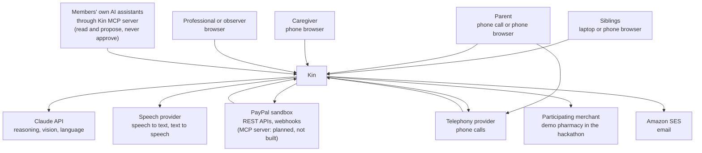

**People.** Siblings set up the circle, contribute, approve and review. The parent listens, asks, approves and photographs letters. The caregiver bills hours and is paid. Professionals and observers read and export.

**Outside systems.** PayPal moves and reports every dollar. Claude reads documents, runs the agent and writes language. Speech and telephony providers handle audio and calls. A participating merchant sells what the parent needs; in the hackathon, a demo pharmacy in the repository.

---

## 4. Services and stores

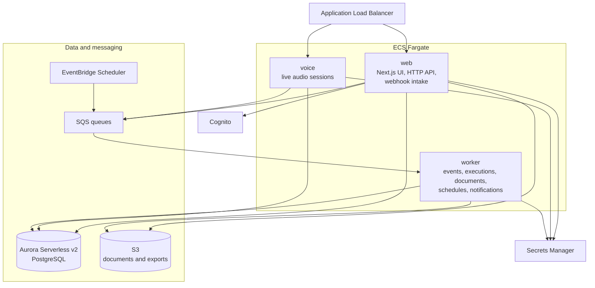

| Part | Responsibility | Never does |
| --- | --- | --- |
| **web** | Serves the app and HTTP API, receives PayPal and telephony webhooks, hosts the Kin MCP server (section 13.4) and the agency API (section 13.5). Captures a top-up the payer has just approved, as PayPal requires while the payer waits. Typed agent conversations: **Planned, not built** (section 9.3). | Send money out of the pool in a request, or write the ledger |
| **voice** | Holds live audio connections, streams speech in and out, runs spoken agent turns, records voice approvals | Execute payments |
| **worker** | Verifies and applies PayPal events, executes approved proposals, reads photographed documents, runs settlement, schedules and notifications | Serve user requests |
| **Aurora** | Ledger, circles, bills, approvals, PayPal events, audit log | |
| **S3** | Photographs, statements, audit exports | |
| **SQS** | Hands work from web and voice to worker, with retries | |
| **EventBridge Scheduler** | Starts timed work | |
| **Cognito** | Signs people in and issues tokens | |
| **Secrets Manager** | Holds every credential | |

**Why three services and not one.** Live audio holds connections for minutes that a web deployment must not break, and payment execution must keep going, and retry on its own, when the web tier is busy.

**Why not more.** The three share one codebase and one database; more would add network calls and failure modes for no problem Kin has.

---

## 5. Code structure

One repository with shared packages.

```
kin/
  apps/
    web/              Next.js app, HTTP API, webhook intake, Kin MCP server (/api/mcp) and agency API (/api/v1)
    voice/            live audio service
    worker/           queue consumers and scheduled jobs
    demo-merchant/    stand-in pharmacy for the hackathon
  packages/
    domain/           ledger, fairness, state machines, policies. Pure code.
    db/               schema, migrations, repositories, row-level security
    paypal/           PayPal adapter, webhook verification, event mapping
    agent/            agent loop, tool gateway, prompts, number guard
    documents/        photo intake and extraction
    speech/           speech-to-text and text-to-speech adapters
    telephony/        call control adapter
    auth/             token verification, circle authorization
    notify/           email, push and narration queue
    config/           typed configuration and secrets loading
  infra/              AWS CDK stacks
  docs/
```

**The dependency rule.** `domain` depends on nothing: no database, network or AI. Other packages may depend on it; apps depend on packages, never on each other. So the money logic tests on its own, and "the AI does no arithmetic" holds in the code.

**Ports and adapters.** PayPal, Claude, speech, telephony and the merchant each sit behind an interface beside the code that uses it; real adapters have their own packages, tests use fakes, and a new provider is one new adapter.

---

## 6. Domain model

### 6.1 Concepts

| Concept | Meaning |
| --- | --- |
| **Circle** | One person cared for and the people who share responsibility for them |
| **Member** | A person's role in one circle |
| **Agreement** | The circle's versioned rules: shares, thresholds, care-hour rate, the parent's role |
| **Pool account** | The PayPal account holding the circle's shared money |
| **Contribution** | Money a member puts in, by subscription, top-up or out-of-pocket spending |
| **Care entry** | Hours of hands-on care logged by a member |
| **Bill** | Something to pay: a utility, a caregiver's hours, a repair |
| **Payee** | A biller, caregiver or merchant, with an approval status |
| **Proposal** | A requested movement of money, awaiting approval |
| **Approval** | One person's recorded yes or no, with evidence |
| **Execution** | The attempt to carry out an approved proposal through PayPal |
| **Ledger entry** | A balanced, permanent record of a financial fact |
| **Settlement** | The month-end calculation and the movements that restore the agreed shares |
| **Document** | A photographed or forwarded letter, bill or receipt |
| **Claim check** | A payment demand the parent asked Kin to verify |
| **Narration** | A money event prepared for the parent to hear |

### 6.2 Entity relationships

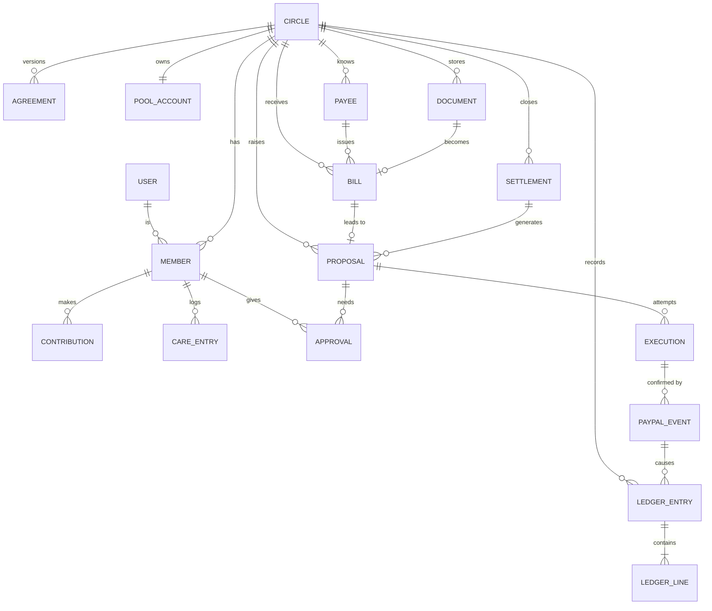

### 6.3 Tables

Every table except `users` carries a `circle_id`; row-level security is in section 12.3. The schema is in `packages/db/src/schema` (decision 37).

- Kin makes every row's UUID. Same-circle references are composite foreign keys on `(circle_id, id)`, so no row can link to another family's.
- Amounts are `bigint` cents beside a three-letter currency. Enums come from the money core's constants (`CIRCLE_ROLES`, `PROPOSAL_KINDS`, `ENTRY_KINDS`, the state machines' states), so the database holds no value the code does not know.
- *Not yet* marks a table designed but not created; it arrives with the feature that writes it.
- Data, not constants: circle name, demo flag and clock; members' display names, relationships and portraits; payee names; expected bills; the false-demand check; what Kin told the parent.

| Table | Key contents |
| --- | --- |
| `users` | Cognito subject as ID (or `demo:…` for an anonymous demo visitor, kind `demo_visitor`), email and whether Cognito verified it, name, language, linked PayPal payer ID, last seen. The only table without a circle. |
| `circles` | Name, timezone, currency, status (active or archived), demo flag, demo clock, pause until and by whom, creating transaction |
| `members` | User (empty until they join), display name, role, parent participation level (parent only), relationship, portrait, status, visitor's demo seat |
| `invitations` | Email, role, inviter, status, expiry, hash of the emailed link's token |
| `agreements` | Version, care rate, whether care is paid in cash, the three thresholds, effective date. Never changed; a new term is a new version. |
| `agreement_shares` | Each member's share of a version in basis points, in the family's order; totals 10 000, checked at commit |
| `agreement_acceptances` | Who accepted a version, how (app or voice), when. A version governs from its start date once every organizer and contributor, and a parent who decides and can sign in, has accepted (fixed in `agreements.requires` at proposal); the newest such version is in force (decision 57). |
| `pool_accounts` | *Not yet.* PayPal merchant ID, credential reference, webhook ID, mode |
| `payees` | Name, spending category, status, member paid, PayPal recipient, auto-pay rule and range, nullable caregiver hourly rate (not the care-credit rate); at most one rate-configured payee per caregiver and circle |
| `monthly_shares` | Member, amount in cents and currency, state (`approval_pending`, `active`, `paused`, `cancelled`), PayPal subscription ID and approval page (none if simulated), simulated, failed charges as PayPal last reported, next billing time. One live share per member; only the member's own operations and the worker write it. |
| `invoice_requests` | Request for money by PayPal invoice (section 8.4): member asked, organizer asking, purpose (`settlement` with period, or `top_up`), amount in cents and currency, state (`requested`, `sent`, `paid`, `cancelled`, `failed`), simulated, address emailed (none if simulated), PayPal's invoice ID, number and payer page, paying capture. People write it only via `request_invoice`, `mark_invoice_sent` and `close_invoice_request`; the worker records payment. |
| `quiet_share_asks` | Cost covered by quiet shares (section 7.7): title, kind (`one_off` or `monthly`), cost in cents, bill covered, agreement used, members asked, first month and months (1, or 3 once spread), state, mediator's round, counts answered and accepted, shortfall and whether spreading covers it, whether Pay Later closed a gap, simulated. Read by everyone who sees the money; stores no limit. |
| `sealed_offers` | One person's confirmed offer: money now, later step-up and its month, drives or visits, hours of help, first month, whether they took the gap on with Pay Later, times sealed. Read by its author alone; Kin's service has a policy that shows it nothing. |
| `quiet_share_parts` | One person's part per plan round, written only by the mediator: amount, per month, Pay Later part, whether capped at their offer, agreed share, help and its care-rate value, their yes and payment method, PayPal action prepared. Read by its person alone. |
| `contributions` | *Not yet.* Member, kind, amount, period, source reference |
| `care_entries` | Member, date, minutes, note, approved, the care-credit entry valuing it |
| `documents` | S3 key (none if simulated), kind, uploader, extraction result, confidence, simulated |
| `bills` | Payee, document, amount, received and due dates, state, duplicate link. Caregiver bills add immutable versioned service-day details, original rate and currency, and a submission key unique in the circle. |
| `expected_bills` | Bills expected before they arrive: payee, kind, expected amount, due date |
| `proposals` | Kind, amount, payee or member paid, purpose and family's note, raiser (none for Kin), state, expiry, agreement version, approval plan made at raising, bill, settlement and document links. Only state and expiry change. |
| `approvals` | Proposal, member, role when answering, decision, method, evidence reference, time. Never changed. |
| `executions` | Proposal, idempotency key, PayPal resource IDs, state, attempts |
| `paypal_events` | PayPal event ID, type, raw body, headers, verification state, processing state |
| `ledger_entries` | Date, kind, description, source type and ID (unique per circle; the idempotency key), period, currency, simulated, reversal link, acceptance order |
| `ledger_lines` | Entry, position, account, direction, amount in cents |
| `ledger_accounts` | Account code, member or payee link |
| `settlements` | Period, agreement version, inputs, fairness result and plan as calculated, state |
| `claim_checks` | What was claimed and for whom, amount, entry checked against, verdict, members alerted |
| `narrations` | Member told, topic, amount and source entry, words spoken after the number guard, delivery state |
| `conversations` | *Not yet.* Channel, participant, turns, tool calls |
| `call_sessions` | *Not yet.* Call reference, verification result, transcript reference |
| `outbox` | Pending messages written in the same transaction as state changes |
| `audit_log` | Who did what (member, service or provisioner), to what, when, from where. Never changed. |
| `purses` | The parent's Purse and funding mandate: weekly amount, ceiling, per-payment cap, status, who set it (section 8.6a). One per circle. |
| `purse_payees` | Her address book: name, relationship, kind, aliases, PayPal email fixed for the entry's life, who added it, and the other family member who verified it |
| `purse_payments` | Each payment she asked for: payee, amount, memo, her words, hold reasons, read-back, answer, hold, cancellation, consent to share, PayPal's progress. Sealed from the family unless shared or held (section 8.6a). |
| `audit_heads` | Ledger hash-chain head and entry count, kept on each check or export. Never changed (decision 66). |

---

## 7. The money core

The part of Kin that must never be wrong: plain, deterministic code in `packages/domain`.

### 7.1 The ledger

Each circle has a double-entry ledger. Every entry balances (debits equal credits, or it is rejected) and is permanent: no update, no delete; a mistake gets a new reversing entry pointing to the original. Amounts are integer cents with a currency code, never floating point. Every entry names its cause: a PayPal event, an approval or a settlement.

**Accounts per circle**

| Account | Type | Holds |
| --- | --- | --- |
| `pool_cash` | Asset | Mirrors the pool's PayPal balance |
| `pool_clearing` | Asset | Money in motion, awaiting PayPal confirmation |
| `member:{id}` | Equity | What each member has contributed |
| `expense:{category}` | Expense | Care costs by category |
| `payable:{payee}` | Liability | Approved bills not yet paid |
| `fees` | Expense | PayPal fees |
| `care_credit:{id}` | Memo | Valued care hours, beside the cash ledger and never mixed into it |
| `care_received` | Memo | The other side of every care credit, so memo entries balance too |
| `purse_cash` | Asset | The parent's Purse, set aside from the pool and kept in its PayPal account (section 8.6a) |

**Example entries**

| Event | Debit | Credit |
| --- | --- | --- |
| Marcus's monthly share of 200.00 arrives, fee 7.28 | `pool_cash` 192.72, `fees` 7.28 | `member:marcus` 200.00 |
| Elena's 42.00 pharmacy receipt is approved | `expense:pharmacy` 42.00 | `member:elena` 42.00 |
| Amara's 240.00 bill is approved | `expense:care` 240.00 | `payable:amara` 240.00 |
| The payout to Amara is confirmed, fee 0.25 | `payable:amara` 240.00, `fees` 0.25 | `pool_cash` 240.25 |
| The refill of 42.00 is captured | `expense:pharmacy` 42.00 | `pool_cash` 42.00 |
| Settlement pays Elena 126.00, fee 0.25 | `member:elena` 126.00, `fees` 0.25 | `pool_cash` 126.25 |

A member is credited the gross they paid; a payee or member is paid the full amount owed. PayPal's fees, in and out, are a shared circle cost, read from PayPal's record of each transaction.

**How the code holds these rules** (`packages/domain`, `ledger*.ts` and `postings.ts`)

- An entry touches cash or memo accounts, never both. Approved care posts debit `care_received`, credit `care_credit:{id}`, valued once at approval to the nearest cent, halves up.
- An entry's source (a PayPal event, an approval or a settlement, with its ID) is its idempotency key: re-applying it changes nothing, and a different entry claiming it is refused.
- A reversal mirrors its original line for line, keeps its kind and names it. An entry is reversed at most once; a reversal never is.
- A refunded top-up reverses its contribution, sourced by PayPal's refund ID (`refundContribution`, decision 97), only when PayPal reports the whole capture and fee returned in one refund; anything else waits for a person, since a mirror would misstate the pool.
- `postings.ts` has one builder per row of the table above, plus settlement collections and care credit. Callers say what happened; the builder picks the accounts.

### 7.2 The fairness calculation

At any moment, and formally at month end, Kin answers one question per member: are you ahead of your agreed share or behind it?

**Inputs for a period**

- `s_i`: the member's share, in basis points. All shares total 10,000.
- `P_i`: cash the member paid into the pool, net of refunds.
- `O_i`: approved out-of-pocket spending by the member.
- `C_i`: care credit, which is approved hours multiplied by the agreed rate. Zero if the family has not enabled it.
- `B_i`: the balance carried in from the previous period.

**Calculation**

1. Total contribution: `K = sum of (P_i + O_i + C_i)`.
2. Target for each member: `T_i = s_i × K ÷ 10,000`, rounded by the largest-remainder method so the targets total exactly `K`.
3. Cash due from each member: `D_i = max(0, T_i − C_i)`. Care hours reduce what a member owes in cash.
4. Cash position: `X_i = P_i + O_i − D_i + B_i`.
5. If `X_i` is positive, the pool owes the member. If negative, the member owes the pool.

**Rules**

- Care credit lowers what a member owes and is not paid out in cash unless the agreement says so; then step 3 is skipped and `X_i = P_i + O_i + C_i − T_i + B_i`.
- Rounding never creates or loses a cent. Leftover cents go in a fixed order, largest remainder first, ties to the member whose ID sorts first, so list order does not matter.
- The calculation is pure; inputs are stored with each settlement, so a result reproduces years later.
- Inputs come from the ledger: `P_i`, `O_i` and `C_i` are the period's net credits to the member from contribution, out-of-pocket and care-credit entries, so refunds (reversals) net out. Settlement collections and payouts close an earlier period and arrive through `B_i` instead. A member who gave but holds no share stops the calculation.
- Care credit beyond the target earns nothing by default. When `C_i > T_i` the excess still counts in `K`, raising the others' targets, but is not paid; the pool keeps the cash. Positions report it as unused care credit, so they total `ΣB_i` minus it.

### 7.3 Settlement

Settlement turns positions into movements through the pool: one per member who is not level, the smallest set that closes every gap.

1. Snapshot: Kin freezes the inputs at period close.
2. Calculate: the fairness function gives each position.
3. Propose: members who owe get a top-up request; members who are owed become payout proposals.
4. Approve: the circle approves the settlement as a whole, under the agreement's rules.
5. Collect, then pay: payouts go out only up to the pool's confirmed balance less approved unpaid bills and each payout's PayPal fee, never from money not yet arrived, promised to a caregiver or biller, or needed for fees. A short balance is split pro rata to what each is owed, by largest remainder; the rest waits for collections.
6. Close: once every movement is confirmed or carried forward, the period closes with a statement; unpaid amounts carry forward as `B_i`.

### 7.4 State machines

Each money-related record moves only through the transitions listed for it.

**Proposal**

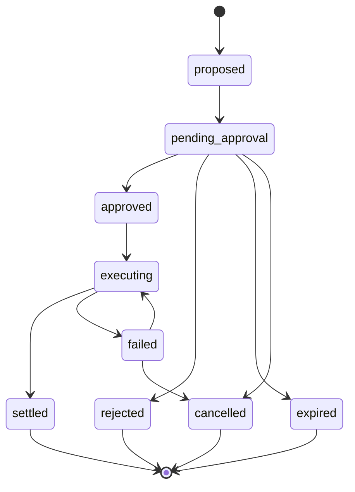

**"Is it really you?" check** (`PRESENCE_TRANSITIONS` in `packages/domain`, held to the database's own table by a test). An answer counts whenever it arrives, even from `opened` (before the text is recorded as sent) or late. "Not me" may follow an unanswered check or a mistaken "yes", as it only adds caution; "yes" never follows "no".

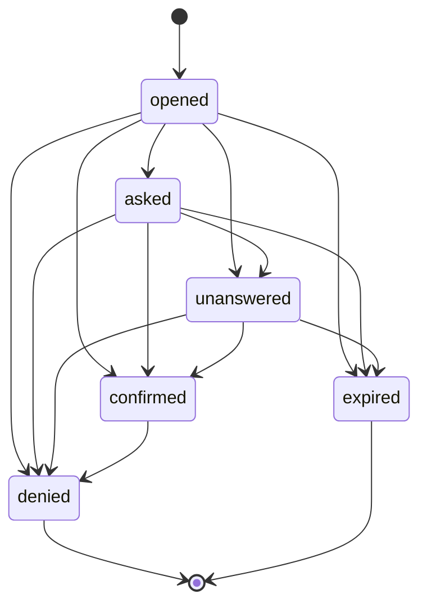

**The parent's wishes** (`WISH_TRANSITIONS` and `WISH_TRIGGER_TRANSITIONS` in `packages/domain`, `PARENT_SUBSCRIPTION_TRANSITIONS` in `packages/db/src/schema/wishes.ts`, each held to the database's own table by a test). Wish: `draft` (Kin read it back) → `confirmed` (by her) → `in_force` (two witnesses) → `superseded` (newer version in force) or `withdrawn`. Trigger: `reported` → `active` → `ended`, or `reported` → `dismissed`. Subscription her wishes name: `active` → `suspending` → `suspended` → `resuming` → `active`; a move PayPal refuses goes back (`suspending` → `active`, `resuming` → `suspended`).

**Bill**

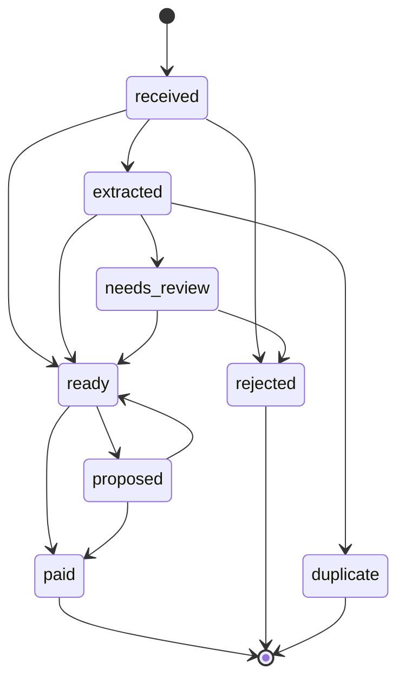

**Execution**

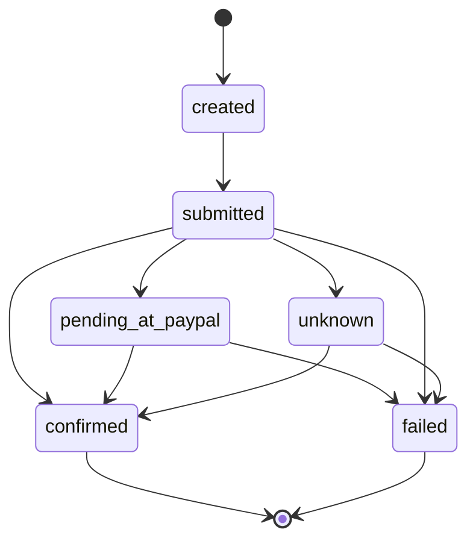

`unknown` follows a PayPal call that timed out. Kin assumes neither outcome: it asks PayPal for the resource by its idempotency key and waits for the webhook (section 7.6).

**Monthly share** (`MONTHLY_SHARE_TRANSITIONS` in `packages/domain`, enforced by a trigger on `monthly_shares`)

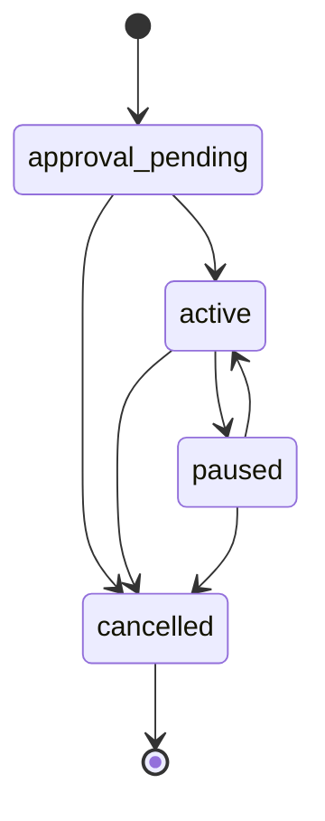

**Invoice request** (`INVOICE_REQUEST_TRANSITIONS` in `packages/domain`, enforced by a trigger on `invoice_requests`)

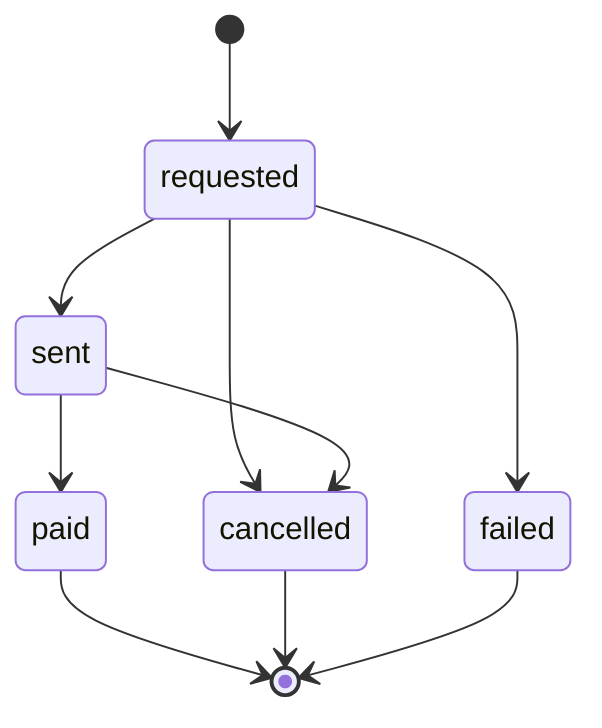

`requested`: Kin holds the row, PayPal has not confirmed sending; an outage leaves it here, and asking again resumes it under the same key. `sent`: the invoice read back from PayPal says sent (a simulated request has no invoice behind it). `paid`: the worker read back the paid invoice and its completed capture and credited the member. `failed`: PayPal refused to make it. `cancelled`: an organizer withdrew it after PayPal cancelled it, or PayPal reported it cancelled.

**Quiet share** (`QUIET_SHARE_TRANSITIONS` in `packages/domain`, held to the database's own table by a test and enforced by a trigger on `quiet_share_asks`). An ask gathers sealed offers; the mediator covers it or finds it short. A short ask becomes a plan when spread, when someone takes the gap on with Pay Later, or when an offer rises. A plan is agreed when everyone with a part accepts their own.

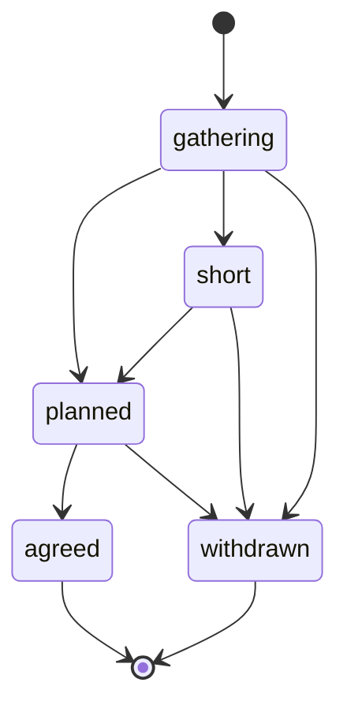

**Delivery** (the goods of a purchase, beside its execution; `packages/domain` `DELIVERY_TRANSITIONS`)

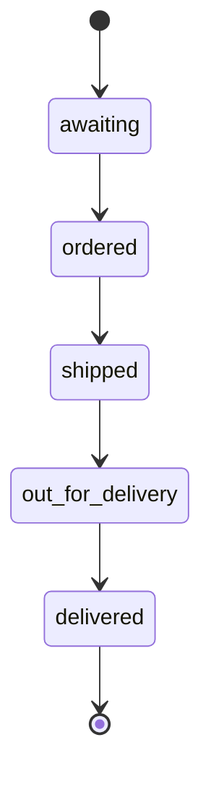

A purchase is `awaiting` from proposal until the seller has the order; only the worker moves it on, one step at a time, from the seller's report.

**Care shift**

A shift is paid once two independent keys turn: the caregiver's own check-in and check-out, and the family's word that the visit happened, which may come during the visit (`checked_in` straight to `confirmed`). A test holds the database's table (`state_transitions`, machine `shift`) to `SHIFT_TRANSITIONS` in `packages/domain`.

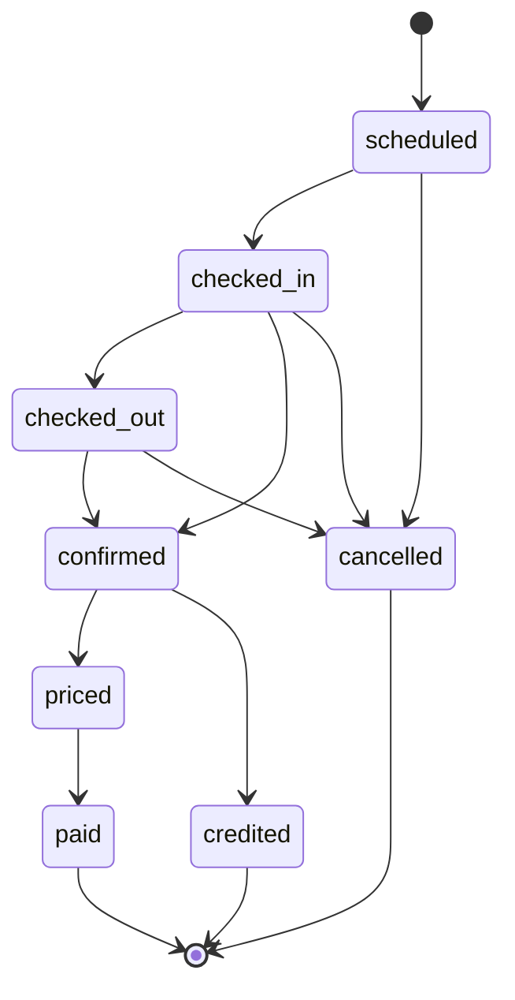

`priced`: a payout proposal exists. `paid`: set only by the worker, once PayPal's payout item reads back `SUCCESS` and the proposal has settled. `credited`: ends a sibling's confirmed visit or drive, never paid; the worker first writes one care-credit ledger entry for the whole minutes between the two taps at the agreement's care rate and the care entry pointing at it and the shift, and the database allows no other way in (decision 79).

**Care shift: check-in links and the call to the parent**

The caregiver's key also turns without sign-in. A link (text, printed QR code, NFC tag at the door) carries a web-app token, 32 random bytes shown once; the database keeps only its SHA-256, in `shift_check_links`, which no web app role reads. `use_check_link` (`kin_app`, nobody signed in) runs the signed-in caregiver's internal check-in or check-out (`apply_check_in`, `apply_check_out`) for a live link's member and shift only, audit origin `link`. Dead tokens all get one refusal; a link allows six uses a minute.

The public page first calls `check_link_status`, a read-only twin (`STABLE`, `kin_app` only) with the same lookup and refusal, returning the caregiver's first name, planned times, the circle's time zone and `next` (`in`, `out` or `done`, from the shift's two times) so the page offers the one key that fits. It counts nothing (a raised refusal rolls a counter back, and a failure counter would let anyone lock caregivers out); the web app throttles looks per address in the taps' bucket, and the 256-bit token does the rest.

A link check-out that confirms an aide's shift queues `shift.settle`; the worker settles it as the service (`pay_shift` and `shift_payment_facts` also accept `kin_service` for the circle in scope, checks unchanged, audit actor `service`).

The family's key can turn by phone. In a real circle whose parent switched the call on with consent (`parent_call_settings`; no web app role reads the number), a check-out without the family's word queues `shift.call`. The telephony service, as `kin_service` only, places the call (`start_shift_call`: quiet hours on the circle's clock, one call at a time, at most two attempts with a wait), reports it (`record_call_placed`, `record_call_status`) and records the answer (`record_family_word_by_call`): a clear yes is the parent's word, with the call's ID as `family_evidence_ref`; a no declines, paying nothing; an unclear answer records nothing. Demo circles never call.

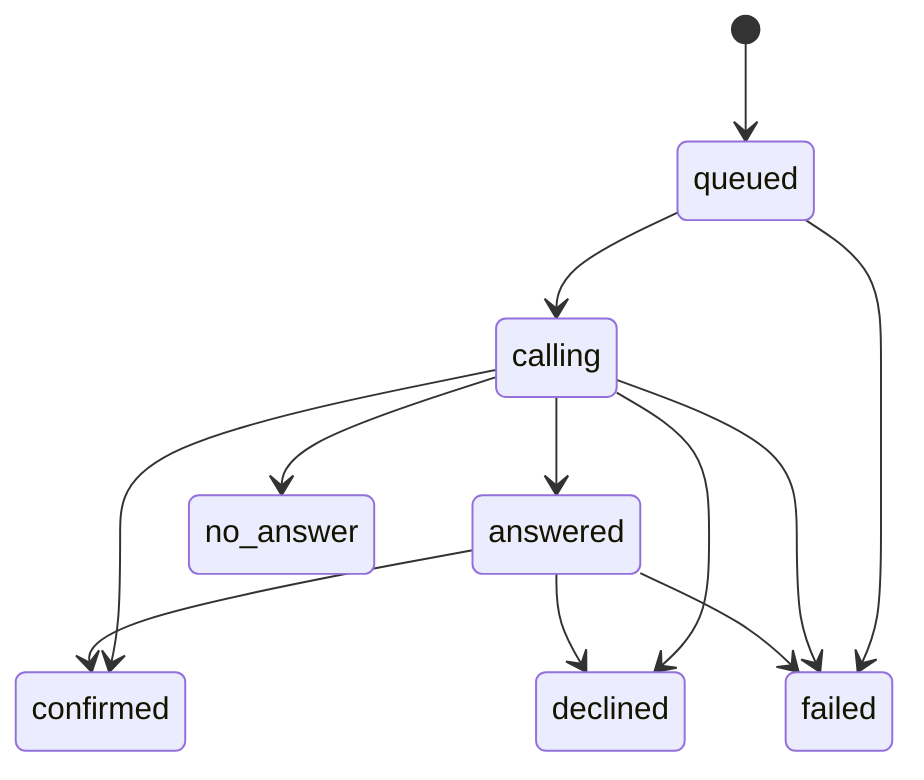

A test holds the database's table (`state_transitions`, machine `shift_call`) to `SHIFT_CALL_TRANSITIONS` in `packages/domain`.

### 7.5 The approval engine

From the movement's kind and amount, whether the payee is known and approved, who raised it, the current agreement and the parent's participation level, the engine sets the approvals a proposal needs to execute, and its expiry.

**Rules, in order**

1. Pause. A paused circle approves nothing.
2. Hard limits. An amount above the agreement's ceiling is refused, whoever asks.
3. Auto-pay. A recurring bill from an approved payee, within its expected range, needs no new approval; the standing rule is recorded as the approver.
4. The parent's decisions. If the parent's level is "decides" and the amount is above their threshold, the parent must approve.
5. Organizer approval for everything else.
6. Second approval above the agreement's large-payment threshold.
7. No self-approval. A member cannot be the only approver of a payment to themselves.
8. New payees always need a person, and the whole circle is told.

The agreement holds the ceiling (rule 2), the large-payment threshold (rule 6) and the parent's threshold (rule 4). An amount equal to a threshold does not cross it. A proposal waits 72 hours for approvals, then expires.

**Counting the answers.** Each required approval is a place filled by a different member's yes: the parent's by the parent, the organizer's by an organizer, the second by an organizer or contributor. A no from anyone whose yes could fill a place rejects the proposal, even after a yes. A member payee may say yes, but another organizer or contributor must too, and the payee's no counts. Caregivers and observers never answer. During a pause nothing becomes approved; given answers count again once it lifts. One role per member per circle, so answers giving a member two roles are refused.

`planApprovals` and `decideApprovals` in `packages/domain` implement this, beside the section 7.4 machines in `state-machines.ts`. A test pins every drawn move, so a transition changes in diagram, test and code together.

**Evidence.** Each approval records how it was given:

| Method | Evidence stored |
| --- | --- |
| Tap in the app | Cognito session, device, time, and a fresh multi-factor check for payouts |
| Voice | Call reference, verification result, the sentence read back, the parent's reply |
| Standing rule | The rule's ID and the agreement version |

### 7.6 Execution, the outbox and idempotency

A database and an outside API cannot share a transaction, so Kin uses the outbox pattern.

1. In one transaction, Kin marks the proposal approved, creates an execution with a fresh idempotency key and writes an outbox row. Built: for a caregiver payout, the trigger `queue_payout` does both in the approving answer's transaction (migration `0008_payouts`). The key is `kin-payout-{proposal}`.
2. The worker leases the outbox row from PostgreSQL (`kin_private.claim_outbox`, callable by `kin_service` alone, `FOR UPDATE SKIP LOCKED`, hidden for 120 seconds), not from an executions queue (decision 53).
3. The worker checks that money already arrived covers the bill and PayPal's fee (`canPayOut`), writes the family's approval to the ledger once, moves the proposal to executing and calls PayPal with the idempotency key.
4. The worker records PayPal's reply and marks the execution submitted. No reply means unknown: the same key goes again later, and PayPal answers with the batch it already made (decision 55).
5. The execution is confirmed only when PayPal's record says the item succeeded, today by reading the batch back (`GET /v1/payments/payouts/{batch}`); the payout-item webhook is not yet handled.

**Idempotency at each layer**

- To PayPal: the `PayPal-Request-Id` header carries the execution's key, and for payouts so does the `sender_batch_id`. A retry cannot pay twice.
- From PayPal: each event ID is unique in `paypal_events`, so a redelivered event is ignored.
- In the ledger: the unique source reference (section 7.1).
- In the queues: per-circle ordering keeps two workers off one circle; the payout outbox is leased row by row instead, with each database step locking the execution.

### 7.7 Quiet shares (decision 92)

A cost too big for the pool, such as Rose's $900 stairlift, is split by the agreed shares, each capped at what the person privately said they can give, without anyone saying a limit aloud.

1. **An organizer raises an ask** (`raise_quiet_share`): title, cost, once or monthly, to active organizers and contributors with a share in the agreement in force, whose shares (fixed on the ask with the agreement's ID) weight the mediator.
2. **Each person talks to their own Kin, privately** (`POST /api/quiet-shares/words`). The words go to the model once, with no tools and nothing of anyone else's, and return as a draft offer (money now, later step-up and month, first month, drives or visits, hours of help). Any amount, count or hour the person did not say, in digits or words, is dropped (`readOffer`, prompt `sealed-offer-2026-11-10`, evaluation set `evals/sealed-offer.json`). The reply passes the number guard or fixed wording stands. Words are never stored; with no model, the person types the offer.
3. **The person checks and seals the offer** (`seal_my_offer`). The server reads each amount digit by digit and checks it with `checkSealedOffer`, as do the table's checks. At most three seals per ask (`MAX_OFFER_SEALS`): enough to reconsider, too few to probe others' limits. The audit log records a seal, never whose or what.
4. **The mediator runs in the database** once all have answered. `kin_private.mediate_quiet_share` (`SECURITY DEFINER`, granted to no role) reads the offers and writes only a new round of parts, the shortfall and whether a three-month spread covers it. Its arithmetic, `kin_private.mediate_offers`, matches `mediateQuietShare` in `packages/domain`: split by agreed shares with `allocate`'s largest-remainder rounding, cap each part at the person's offer over the ask's months, and pass the excess to those with room, by share, round after round. A remaining gap goes to whoever took it on with Pay Later, else it is the shortfall. Ties go to the member whose ID sorts first in byte order, so arrival order never matters; a test holds both versions to the same answer over random asks. Care hours are shown at the agreement's care rate, count toward fairness when done, and never pay the cost.
5. **Each person sees their own part and the family total, never anyone else's limit.** Parts are private to their person (section 6.3); the ask's total, progress and any shortfall ("$140 short", nothing more) are visible to everyone who sees the money. A part capped at the person's offer, below their share, adds "Your limit stayed private." The screen says when privacy cannot be total (`limitsCanBeDeduced`): with two sharing, the one not at their limit can deduce the other's from the total; with three or more short, every part is a limit, so all but one, comparing parts, can deduce the last. The audit log names nobody for a sealed offer or a gap taken on.
6. **A short ask** is closed by the organizer spreading it over three months (`spread_quiet_share`), by one person privately taking the gap on with PayPal Pay Later (`take_quiet_share_gap`; their offer records it, the ask says only that Pay Later was used), or by a raised offer.
7. **The plan is agreed when every person with a part says yes to their own** (`accept_my_quiet_share_part`), choosing from `partMethods`: a monthly rise via their monthly share (Subscriptions revise, `reviseSubscription` in `packages/paypal`, which returns the PayPal page to approve the new price), or a one-off by PayPal checkout (the top-up sheet: Orders v2 with JavaScript SDK v6, Pay Later where offered), Pay Later or an organizer's PayPal invoice. A part asking nothing needs no yes. On agreement each action is prepared; money arrives as ordinary contributions, and the ledger shows what everyone gave.
8. **Demo circles.** Rose's circle starts with the stairlift asked and Elena's $300 sealed. With Marcus up to $600 and Ana $60 and two drives, the plan is Marcus $540, Elena $300, Ana $60. The family layout (`/dashboard/fairness/quiet-shares/family`, demo circles only) shows Marcus's, Elena's and Ana's screens side by side, each read in that person's seat (borrowed for the read and returned in the same transaction). PayPal actions are simulated (section 20.3).

---

## 8. PayPal integration

### 8.1 The pool account

In the production design, each circle's money sits in a PayPal account that PayPal, not Kin, holds and licenses. The hackathon build differs, and the custody statement in section 22.3 applies.

**In the hackathon,** every circle's pool is the one sandbox business account (decision 46), whose credentials Kin's app holds; Kin's ledger attributes each amount to its circle (decision 70), and Kin has no bank account. Each order names circle and member in `custom_id` (`kin1:<circle>:<member>`), which PayPal copies onto the capture and Kin trusts only after reading the capture back, so PayPal's record says whose money it is. The client secret is in Secrets Manager (`kin/paypal/client-secret`); the client ID and webhook ID, not secret, are in `infra/cdk.json` under `kin:paypal`.

**In production,** Kin would act on a family's account through PayPal's partner model, with consent and without holding their credentials. Code reaches the pool only through `poolFor` in `packages/paypal`, so the change stays there. This is the architecture's largest open question (section 22).

### 8.2 Which PayPal capability does what

| Kin need | PayPal capability | Direction | Confirmed by |
| --- | --- | --- | --- |
| Monthly share | Subscriptions, with a Catalog product and one plan per amount | Sibling to pool | `PAYMENT.SALE.COMPLETED`, `BILLING.SUBSCRIPTION.*` |
| One-off top-up in the app | Orders v2 with JavaScript SDK v6, PayPal or Pay Later | Sibling to pool | `PAYMENT.CAPTURE.COMPLETED` |
| Top-up or settlement request by email | Invoicing v2, with reminders and QR code | Sibling to pool | `INVOICING.INVOICE.PAID` |
| Caregiver pay | Payouts | Pool to caregiver | The payout batch read back: item `SUCCESS` |
| Settlement payout | Payouts | Pool to sibling | The payout batch read back: item `SUCCESS` |
| Purchases for the parent | Vault payment token and Orders v2 at a participating merchant | Pool to merchant | Merchant order status, then reconciliation |
| Refund of a contribution | Refunds | Pool to sibling | `PAYMENT.CAPTURE.REFUNDED` |
| Delivery tracking | Shipment tracking on the merchant's order | Read | Tracking status |
| Disputed contribution | Disputes | Read and respond | `CUSTOMER.DISPUTE.*` |
| The record of truth | Webhooks and Transaction Search | Read | |
| Identity of a payer | Log in with PayPal | Read | |
| Agent access to PayPal data | Agent Toolkit, read actions only (built, decision 106); sandbox MCP server (**Planned, not built**) | Read | |

**What the code calls today**

- Orders v2 and JavaScript SDK v6 for top-ups (section 8.4), and the demo pharmacy's vault-backed Orders request; Subscriptions with Catalog products and plans, including suspend, activate, cancel and revise; Payouts, including the one-item read-back (`/v1/payments/payouts-item/{id}`); Invoicing v2 (create, send, read back, cancel, search by number) in `packages/paypal`.
- `INVOICING.INVOICE.PAID` and `INVOICING.INVOICE.CANCELLED` are subscribed in code, but the live webhook keeps the events it was made with, so it gets them only after `webhook:register` runs against it again.
- Transaction Search, nightly, from the Purse reconciliation (`getPayoutTransaction`, section 8.6a). The sandbox app's reporting scope answered 403 on 14 October 2026, but found a real demo payout through Kin's adapter on 11 November 2026 (`packages/paypal/src/fixtures/transaction-search-sandbox-2026-11-11.json`), so it is on; without it each reconciliation logs `purse.reconcile_failed`.
- The PayPal Agent Toolkit (`@paypal/agent-toolkit` 1.11.0, `packages/paypal/src/agent-toolkit.ts`): Ask Kin only, four read actions (an order, an invoice, the disputes on a transaction, one dispute; decision 106).
- Webhooks with the verify-webhook-signature call, and the OAuth token endpoint.

Kin subscribes to `PAYMENT.CAPTURE.COMPLETED`, `PAYMENT.CAPTURE.REFUNDED` and `PAYMENT.CAPTURE.REVERSED` (read back with `GET /v2/payments/refunds/{id}`), `BILLING.SUBSCRIPTION.*` and `PAYMENT.SALE.COMPLETED`; not payout-item events, since it reads the batch (section 7.6). Never called: refund creation (Kin only reads refunds), Shipment tracking, Log in with PayPal.

### 8.3 Three corrections to the earlier documents

Checking the APIs gave three findings; the PayPal tables in `project-description.md` and `tech-stack.md` match them.

1. **Caregivers are paid by payout, not by a PayPal invoice.** No API lets an account pay an invoice it received; the payer must sign in and pay by hand. So a caregiver's bill is a Kin record, paid by payout from the pool: simpler, and same-day.
2. **Invoicing is used for requests to siblings**: top-ups or settlement amounts, by PayPal invoice from the pool, payable from the email or QR code, with reminders.
3. **Agent purchases need a saved payment method at the merchant.** A payer is charged only after approving in PayPal or saving their wallet with that merchant, so Kin saves the pool's wallet once with a participating merchant, which creates later purchases after Kin's approval. This works in the sandbox; production needs PayPal to approve the merchant.

### 8.4 Contributions

**Subscriptions.** The design: a Catalog product per circle in the pool account, created with the circle, and a plan and subscription per sibling's share, approved through PayPal's returned link (no SDK feature needed). Each cycle's `PAYMENT.SALE.COMPLETED` credits the member; a `BILLING.SUBSCRIPTION.PAYMENT.FAILED` is told to the circle and shows as a gap on the fairness ledger.

**Monthly shares in the app** (built; "Monthly shares" on the circle screen, for organizers and contributors)

1. Top-up limits apply (`checkMonthlyShare`). `POST /api/monthly-shares` makes the circle's Catalog product, a plan and a subscription in the pool, each request keyed by the share's row ID so a repeat makes nothing new; `custom_id` names circle and member.
2. `start_my_share` records the share `approval_pending` with PayPal's approval page, shown only to its member. Nothing is charged before approval.
3. On return the screen queues `subscription_checked` on the inbox queue; the worker reads the subscription and all completed charges since it began from PayPal, moves the share to `active` and credits each charge once by PayPal transaction ID, as for a top-up. `PAYMENT.SALE.COMPLETED` and `BILLING.SUBSCRIPTION.*` webhooks report the same later; a sale names only its subscription, so after the signature checks out the worker asks PayPal whose it is.
4. Pause, resume and end go to PayPal first (suspend, activate, cancel); Kin's record follows only once PayPal agrees. Shares move only along `MONTHLY_SHARE_TRANSITIONS`; a trigger keeps a cancelled share cancelled, whoever writes. A new amount means a new share.
5. A failed charge shows as PayPal's failure count. Telling the circle is not built.
6. **Demo circles** make no PayPal subscription: the share is `simulated`, active at once, and the worker credits one fee-free month per calendar month of the circle's clock, never into a real share or a non-demo circle.

**Top-ups in the app** (built; "Add money" on the overview, for organizers and contributors)

1. $1.00 to $5,000.00 (`checkTopUp` in `packages/domain`), checked in the browser for quick feedback and re-read by the server from the typed text, digit by digit, into integer cents (`centsFromDecimal`).
2. `POST /api/top-ups` creates an Orders v2 order in the pool: one unit, no shipping, `custom_id` naming circle and member.
3. The browser runs a one-time payment session with JavaScript SDK v6 from PayPal's sandbox, with Pay Later where PayPal says the payer is eligible.
4. On approval, `POST /api/top-ups/{order}/capture` reads the order back, refuses it unless it is this member's in this circle, captures with request ID `kin-capture-{order}` (no double capture on a repeat click) and queues `order_captured` on the PayPal inbox queue.
5. The worker reads the order back and records each completed capture (`recordContribution` in `packages/db`): member credited the gross, pool the net, PayPal's fee to `fees`. The capture ID is the entry's source, so its `PAYMENT.CAPTURE.COMPLETED` webhook writes nothing (decision 47).
6. The sheet polls `GET /api/top-ups/captures/{capture}` until the entry exists, then says the money is in the pool. If PayPal was unreachable during capture, the outcome is unknown: the worker looks anyway, and the sheet says the record will show it once PayPal confirms.

**Requests by invoice** (built; on the Fairness page, for organizers: each of the settlement's collections, and "Ask a member for a top-up")

1. An organizer (`invoice.request`, organizers only, never themselves) asks a cost-sharing member for their settlement collection or a top-up. A settlement request (`POST /api/invoice-requests`) takes no amount; it is the money core's collection for that member in the open period (`checkInvoiceRequest`). A top-up keeps top-up limits. `request_invoice` records it (`requested`) and picks the address: the member's PayPal email from their settlement payee, else their verified sign-in email, never browser input.
2. The web app drafts the invoice in the pool (Invoicing v2: one line, due on receipt, no tip, no partial payment; `memo` carries `kin-invoice1:<circle>:<request>`, hidden from the payer), has PayPal email it, reads it back and records it `sent` with invoice ID, number and payer page (`mark_invoice_sent`). The idempotency key is the invoice number, `KIN-` plus the request's ID, because in the sandbox PayPal made a second draft for a repeated `PayPal-Request-Id` but refused a repeated number (`DUPLICATE_INVOICE_NUMBER`); a lost reply is found by searching for the number. Refusals and outages follow the states in section 7.4.
3. The member pays on PayPal's page. The worker reads the invoice back on `invoice_checked` from the inbox queue (sent on sending and when an organizer or the member presses *Check with PayPal*), on `INVOICING.INVOICE.PAID`, or on the paying capture's `PAYMENT.CAPTURE.COMPLETED`, which names the invoice. Only on `PAID` does it read each payment back as a capture that must be `COMPLETED`, name this invoice and sum to the amount asked, then credit the member as a top-up (`recordContribution`, once per capture ID) and close the request `paid` in one transaction. Hand-recorded payments are never credited. `INVOICING.INVOICE.CANCELLED` ends the request.
4. An organizer may withdraw a waiting, unpaid request; PayPal cancels the invoice first.
5. **Demo circles.** Members are stand-ins, so the invoice goes to Kin's own sandbox personal account, `KIN_DEMO_INVOICE_RECIPIENT_EMAIL` (only a `…@personal.example.com` address), and real sandbox money pays it. Unset, the request is `simulated`: no PayPal call, labelled Simulated, and the worker records the stand-in's payment at once, fee-free, never in a non-demo circle.
6. Reminders on the agreement's schedule are not built.

### 8.5 Payouts

Payouts carry caregiver pay, settlement payouts to siblings, and a bill read from a letter whose payee takes PayPal (decision 108). Each approved proposal becomes a one-item payout batch to a PayPal email, phone or payer ID; the batch ID is the execution's idempotency key. PayPal reports each item, and Kin acts on the outcome:

| Item outcome | Kin's action |
| --- | --- |
| Succeeded | Confirm the execution, write the payout and PayPal's fee to the ledger, settle the proposal, mark the bill paid. *Telling the recipient and the circle is not built.* |
| Pending, unclaimed or held | Wait and read the batch again later. The family's approval already holds the money as owed to the payee (decision 54). *Telling anyone is not built.* |
| Returned, failed, blocked, refunded or reversed; or PayPal refuses the request | Mark the execution and proposal failed. The payee is still owed. *Alerting the organizer is not built.* |

**Built for caregiver payouts** (`packages/paypal` `payout.ts`, `packages/db` `payouts.ts`, `apps/worker/src/payouts`). Only the caregiver records their PayPal email, on their Bills screen (`set_own_receiver`; decision 56). It is frozen while a payment to them waits for approval, is approved, is being paid or has failed, and each execution keeps the address it was approved with. Screens mask it; each payout card shows the family the destination before they say yes. Demo payouts are simulated: no PayPal call, both ledger entries labelled. A payout waits, recorded once as held, while the circle is paused (section 15.3: one already at PayPal is still tracked), the payee has no address, or the pool cannot pay it and the fee.

### 8.6 Purchases for the parent

1. Linking, once: the pool account holder saves the pool's wallet with the merchant (setup token from PayPal, holder approves in PayPal, merchant gets a payment token).
2. Finding: the agent searches the merchant's catalog and builds a cart.
3. Proposing: the cart becomes a proposal with the exact items and total.
4. Approving: the parent or the family approves under the agreement's rules.
5. Buying: Kin sends the merchant a signed instruction naming the cart, the total and the approval; the merchant creates and captures a PayPal order with the saved payment token.
6. Confirming: Kin reads the order's status from the merchant and writes the ledger entry; the nightly reconciliation checks it against the pool's transaction history.
7. Tracking: the merchant adds tracking to the order and Kin follows it.

**The amount is bound to the approval.** The signed instruction carries the approved total; the merchant must charge exactly that, and a different amount is refused.

**The fallback.** If a merchant cannot save the pool's wallet, a member pays from their own PayPal wallet; Kin records it as their out-of-pocket contribution, which settlement reimburses with no special case.

**The demo merchant.** `apps/demo-merchant`, a small pharmacy with its own sandbox business account, shows a complete purchase and is labelled a stand-in everywhere. It answers only worker-signed requests (HMAC-SHA256 over time, method, path and body with a shared secret, within five minutes) and charges Rose's saved payment method through its own PayPal app. Only that app can read its order, so the worker has the pharmacy read it back from PayPal (`GET /payments/<order>`) and records the charge only when order, purchase key, capture, `COMPLETED` and exact amount all agree: the pharmacy's PayPal record decides, never its own answer (decision 105).

### 8.6a Built: the parent's Purse (decision 91)

The parent has a small allowance spent on her word alone; a fooled or coerced instruction can cost at most what is in it, so nobody watches each item. Rules in `packages/domain/src/purse.ts`; database in `packages/db/src/purse.ts`, migrations `purse-tables` and `purse-access`; worker in `apps/worker/src/purse`; screens at `/dashboard/purse` (her view and the family's) plus an overview card.

- **The float.** A funding mandate (`purses`: weekly amount, ceiling, per-payment cap, the refill mandate's three statuses) moves the weekly amount from `pool_cash` into a new asset account, `purse_cash`, each Monday on the circle's calendar, never past the ceiling or beyond what the pool has received and promised to nobody (`cashAvailableForPayouts` less approved payouts not yet in the ledger). `purse_funded` is sourced by Purse and week, so each week funds once. Both accounts sit in the pool's PayPal account and count in the overview's pool figure and the verifier's pool total; bills draw only on `pool_cash`. The organizer sets the terms (`set_purse`), at most the agreement's ceiling. She or anyone answering for the family may pause it; only the organizer resumes it.
- **Asking.** She says or types who to pay. Claude, with no tools, copies payee, amount, memo and payment method from her words (`readGift`, prompt `gift-2026-11-10b`), dropping any value not in them; without the model, plain rules read the same words. Plain code finds the payee in her address book (exact or all-words name match, never a guess between two) and reads the amount (`accountCents`).
- **Deciding** (`decidePursePayment`, plain code). A paused Purse or held outgoing money refuses. Any hold reason holds: payee not in the verified book; gift cards, crypto, wire or cash (scam markers from "Is it really you?" or the model's reading); above the per-payment cap; signs of pressure (secrecy, urgency, a payment-app handle). Otherwise more than she may still spend refuses; the rest goes on her yes. Markers and the model only add reasons. The database re-derives those it can see (not in the book, above the cap, a gift-card, crypto, wire or cash route), refuses requests that omit them and never changes a recorded reason.
- **Read-back and her answer.** The read-back's amount is the record's and passes the number guard; payee name and memo reach the model only as stand-ins. Her answer (`answer_purse_payment`, the parent only), given within 15 minutes, is the recorded approval: yes approves (address fixed from her book), or with a hold reason holds 24 hours and tells the family; no declines; "someone is telling me what to do" holds it for the family to see and stops it at once in her name, marked pressured.
- **The hold rule.** A held payment never executes before its hold ends (the database refuses the move on the circle's clock) or after any cancellation, and only to a payee still verified in her book and within what she may still spend; otherwise it lapses. So someone not in the book is never paid until the family adds them and she asks again. She or any organizer or contributor may cancel a held payment; only she can make or approve one. A held payment to an unverified payee reserves nothing, so pressure does not stop her spending.
- **Paying.** The worker (`runPurseBatch`, every 2 seconds) funds, expires unanswered read-backs, releases holds and pays approved payments by PayPal Payouts with `kin-purse-{id}` as sender batch ID and request ID; PayPal's read-back decides, and a lost answer is `unknown` and re-asked with the same key (section 7.6). Demo payments are simulated. `purse_paid` debits `expense:purse` and credits `purse_cash`; the pool pays PayPal's fee. A failed or refused payment stays in her Purse.
- **Reconciliation.** Nightly, after a three-hour lag, the worker looks up each real paid payment in Transaction Search (`getPayoutTransaction`). A same-amount match out of the pool marks it reconciled; a disagreement goes to the audit log for a person, never auto-corrected.
- **Sealed.** Row-level security lets the parent whose Purse it is (the member `purses.parent_member_id` names, not any parent-role member) read all her payments; the family, observer included, only those she shared (`shared_at`, consent given or withdrawn per payment) or that were held; a caregiver, nothing. The family sees ceiling, balance and month's total; `purse_paid` ledger entries show amount and day, never payee or memo. Her screen's "What my family sees" lists exactly those rows.
- **Ask Kin.** `propose_gift` (action `purse.spend`, the parent only) raises the same proposal by the same path, pays nothing and links to her Purse screen. The model's arguments name only who and how much; her verbatim question comes through the gateway's context (`ToolContext.question`, from the request, never the model) and is what is scanned for pressure and risky payment routes and kept with the payment.
- **Verified offline.** The ledger audit (`auditLedger`, and `kin-verify`) flags `purse_overdrawn` as it flags `pool_overdrawn`, and reports the pool's free cash and the Purse separately beside their sum.
- **One switch.** `kin_private.purse_spending_allowed(circle)` (`readPurseSpendingAllowed` in `@kin/db`; rule `purseSpendingAllowed` in the domain) alone says whether the Purse may be spent or funded now. Every spend or fund asks it; new reasons to stop discretionary spending go there.

### 8.7 The webhook pipeline

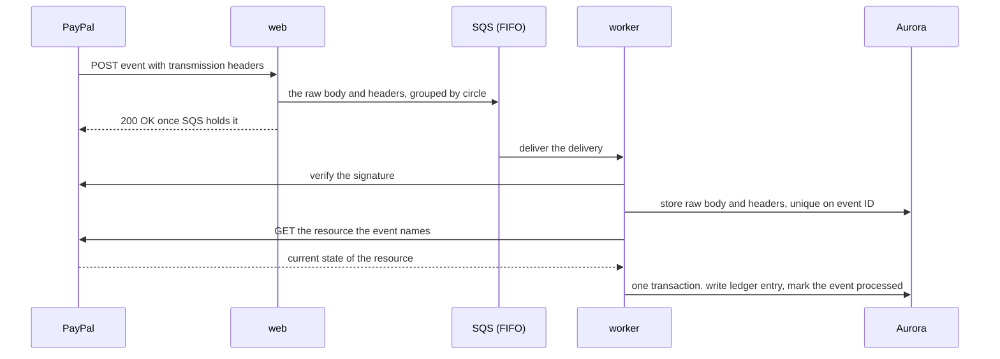

As built (decision 44), the web app holds no service role (decision 38) and never writes to Aurora: `POST /api/paypal/webhook` passes the delivery byte for byte to the `kin-paypal-events.fifo` queue, and the worker (`apps/worker`, `handleInboxMessage`) verifies it with PayPal before storing it in `paypal_events`. Nothing unvouched is written, so a forged delivery cannot plant an event ID that makes the genuine event look like a repeat. Domain events for notifications and narration come with those features.

**Rules**

- **Store first.** The raw body is kept before anything else, so nothing is lost and the signature is checked on the exact bytes: in SQS, durably, before PayPal hears 200, then in `paypal_events` once verified. Verification sends the event as received, never re-encoded. An event ID stored under another circle is not stored again, so replaying a genuine event with another circle in its body changes nothing.
- **Answer quickly.** PayPal retries a failed delivery up to 25 times over three days; Kin returns success once the event is safely stored.
- **Verify before applying, and before storing.** An event that fails verification is neither; the worker logs its event ID and PayPal's transmission ID for inspection.
- **Read the resource back.** Amounts and status come from the resource fetched from PayPal, never the event body.
- **Tolerate disorder.** Events can arrive late or out of order; state machines only move forward, so a stale event changes nothing.
- **One circle at a time.** Each circle's events share a queue group and are processed in order.
- **Refunds and reversals** (`PAYMENT.CAPTURE.REFUNDED`, `PAYMENT.CAPTURE.REVERSED`, decision 97). The resource is a refund whose `up` link names the capture. The worker places it by reading that capture back, reads the refund (`GET /v2/payments/refunds/{id}`) and capture again, appends one reversal of the capture's contribution (section 7.1) and marks the event `processed`. Partial or unfinished refunds, refunds where PayPal kept part of the fee, and captures this circle never recorded or another circle's write nothing; the event is `failed`, reason in the worker's log, for a person.

**Simulator events.** PayPal's webhook simulator events cannot pass its verification call. Kin accepts them only in the test environment, behind an explicit setting, marked simulated.

### 8.8 Reconciliation

Webhooks can be missed, so every night Kin compares the pool's PayPal transaction history and balance with the ledger.

- A PayPal transaction with no ledger entry is a missed event: Kin fetches the resource and applies it through the normal path.
- A ledger entry with no PayPal transaction is a serious fault: Kin alerts and does not correct it automatically.
- A balance difference goes to the organizer with the entries that explain it.

PayPal's history can lag, so the window ends several hours in the past.

### 8.9 The PayPal adapter

`packages/paypal` is the only code that talks to PayPal.

- Access tokens are fetched per pool account, cached until shortly before expiry and never logged.
- One method per business action, such as `createPayout` or `captureOrder`, each requiring an idempotency key.
- Typed results and typed errors, so callers can tell a decline from an outage.
- Kin logs PayPal's debug ID from every response, so a support request to PayPal can cite it.
- Network and server errors are retried with backoff under the same idempotency key; client errors are not.

---

## 9. AI architecture

### 9.1 The principle

The agent understands and never controls money. It reads documents, holds conversations, explains balances and drafts proposals. It cannot approve, execute or alter a record of what happened.

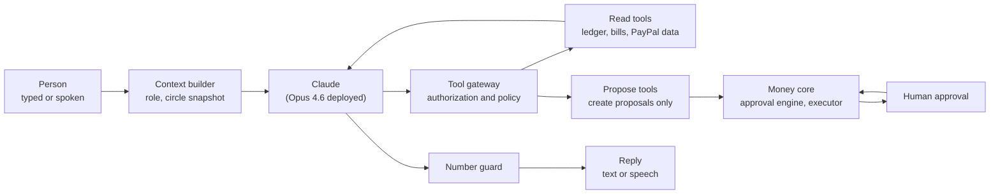

### 9.2 The agent loop

> **Status.** Built: the one-shot model calls in `packages/agent` (reading a caregiver's visits, reading a letter, wording a verdict and an audit finding), each with no tools, structured output and the number guard. **Planned, not built:** the multi-turn agent loop for every channel, typed agent conversations and the voice-turn agent. Ask Kin, the read-only tool-using agent, is in 9.3.

One agent serves every channel; only the listener changes.

1. **Build context:** the speaker's role, language and permissions, and a compact circle snapshot (balances, open bills, pending approvals, recent events) from the money core, not the model.
2. **Run the model** with the tools the speaker's role allows.
3. **Route tool calls** through the tool gateway.
4. **Check the reply** with the number guard.
5. **Deliver** as text or speech, and store the turn.

**Model configuration**

- Model: `claude-opus-5-5` is the design target; the hosted app runs `us.anthropic.claude-opus-4-6-v1` through Bedrock's InvokeModel API (decision 67) with `@anthropic-ai/bedrock-sdk`. The tool runner comes with the multi-turn loop.
- Effort is explicit: low for every structured read (visits, documents, gifts, offers, wishes, the account check, the wordings; `packages/agent/src/bedrock-model.ts`), medium for Ask Kin and the calendar assistant (`ask-kin/bedrock-tool-model.ts`, `shift-assistant-model.ts`), never high.
- Tool choice automatic, tool schemas strict; this model rejects forced tool choice.
- Structured output for anything Kin stores.
- Streaming for every reply a person waits for (**Planned, not built**: nothing streams today).
- Every response's stop reason is checked; a refusal gets fixed wording. Server-side fallbacks are **not configured** (decision 58).
- The stable system prompt and tool list precede the changing snapshot, so they are cacheable, but prompt caching is **not configured**: no request sets `cache_control`.

### 9.3 The tool gateway

> **Status.** **Built in this branch (read-only Ask Kin):** the gateway in `packages/agent/src/ask-kin`, its tools in `apps/web/src/server/ask-kin`, behind `/api/ask-kin`. It checks identity, role scope (through `authorize`) and arguments against a schema, bounds each question's calls, time and result size, and records every call. Nine read tools: the pool, bills, fairness, the claim check, proposals, the record, and the PayPal status of a payout, top-up or subscription via Kin's own adapter. Three more read PayPal's own record (a top-up's order, an invoice, the disputes on the newest real top-ups) through PayPal's Agent Toolkit (decision 106). One proposes a refill the family's rules already allow, which still waits for the family's yes. The table below is the wider design, with different tool names; its PayPal Agent Toolkit row is built for three reads (decision 106), and its propose, write and approval tools are **Planned, not built.**

Before any tool runs, the one gateway checks **identity** (who, in which circle), **scope** (may this role use it) and **validation** (arguments against the tool's schema), and writes a **record** of the call to the conversation log.

**Tools by role**

| Tool | Parent | Sibling | Caregiver | Kind |
| --- | --- | --- | --- | --- |
| `get_circle_summary` | Yes | Yes | No | Read |
| `list_bills`, `get_bill` | Yes | Yes | Own only | Read |
| `get_ledger`, `explain_balance` | Yes | Yes | No | Read |
| `get_payment_status` | Yes | Yes | Own only | Read |
| `search_paypal_transactions` | No | Yes | No | Read, through the PayPal toolkit |
| `search_merchant_catalog` | Yes | Yes | No | Read |
| `check_payment_claim` | Yes | Yes | No | Read |
| `submit_document` | Yes | Yes | Yes | Write to inbox |
| `log_care_hours` | No | Yes | No | Write, needs approval |
| `propose_bill_payment` | Yes | Yes | No | Proposal |
| `propose_purchase` | Yes | Yes | No | Proposal |
| `propose_caregiver_bill` | No | No | Yes | Proposal |
| `record_voice_decision` | Yes | No | No | Approval, after read-back |
| `alert_circle` | Yes | Yes | Yes | Notification |

**No tool pays anyone.** The strongest tools create a proposal; the approval engine (section 7.5) and a person stand between it and PayPal.

**How the PayPal Agent Toolkit is used (built, decision 106).** `packages/paypal` configures `@paypal/agent-toolkit` with four read actions (`orders.get`, `invoices.get`, `disputes.list`, `disputes.get`) exposed as typed reads; the model never gets the toolkit's own tools. Ask Kin wraps them as `get_paypal_order`, `get_paypal_invoice` and `list_paypal_disputes`, each needing `money.view` (caregiver refused, observer reads) and passing the gateway. The model supplies no PayPal ID, at most a member's name: the web app takes the capture, invoice or transaction from the circle's record and shows PayPal's answer only if it names that circle again (the order's `custom_id` and capture, the invoice's memo and request, a dispute's disputed transaction, read by ID since a list's summary names none). Only PayPal's fixed status words, amounts Kin formats and times reach the model. Not exposed: the toolkit's transaction list (the pool is one PayPal account for every circle), its subscription tool (Kin's adapter reads subscriptions; the toolkit logs that call's raw error), its shipment tool (the pharmacy's orders are in its own PayPal account), and any write. Writes go through Kin's proposals and the executor's PayPal adapter.

### 9.4 Reading documents

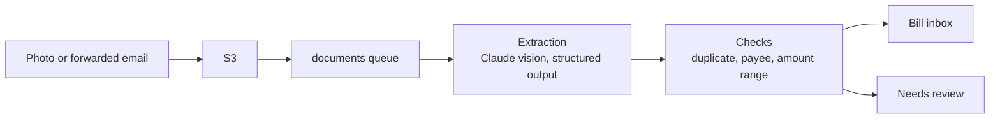

1. The photograph is uploaded directly to S3.
2. The worker sends it to Claude with a fixed schema: document type, sender, amount, currency, due date, account reference, and a confidence per field.
3. Deterministic checks run on the result:
   - **Duplicate:** same payee, amount and period as an existing bill.
   - **Payee:** known and approved, known and new, or unknown.
   - **Range:** inside this payee's usual range or not.
   - **Confidence:** every required field above its threshold.
4. A document that passes becomes a bill; one that fails goes to a person with the reason.

**The document is untrusted.** Its text is data to extract, never instructions (a scam letter may target its reader).

**Built: reading a caregiver's description of their visits (milestone 4).** On the Bills screen a caregiver may describe their visits in their own words; Claude turns them into service days and durations that fill the bill form, which the caregiver reviews as usual (`packages/agent` `readVisits`, prompt `visits-2026-10-26`). The request has no tools and carries only today's date and the caregiver's words as data, never the rate, a name or an amount. Code checks the schema-shaped answer: real days, none in the future or over 62 days back, whole minutes within a day, same-day entries added, and each entry must quote the caregiver or is dropped. A refusal, a cut-off answer or an unreachable model leaves the form unchanged. Limits: ten an hour per person; per server, 200 an hour for demo visitors and 200 for signed-in people (anyone can become a demo visitor, and the demo must not eat the families' share). All are checked before any is spent, so a refusal costs nothing. The limiter tracks at most 20 000 people, sweeps expired ones at most ten times a window, and refuses newcomers while full. Limits live in server memory, so they bound spend per instance, not across instances. No Bedrock spend cap or budget alarm is set up in AWS. The set `packages/agent/evals/visits.json` (`pnpm --filter @kin/agent run eval`) passed 12 of 12 against Claude Opus 4.6 through Bedrock InvokeModel on 10 November 2026 (`packages/agent/evals/results/visits-2026-11-10.json`), the model the hosted app serves since `kin:claude` became `true` in `infra/cdk.json`, granting App Runner `bedrock:InvokeModel` on that inference profile in its own account and region (decision 67). Claude Opus 5.5 on Bedrock's Messages endpoint is still refused to Kin's account (decision 60, superseded).

**Built: holding up a letter (demo moment 5).** On the Bills screen the parent, the organizer or a contributor may photograph a letter, bill or receipt, type or paste its words, or both. The browser shrinks a photograph to a JPEG sent as base64 (about 3 MB at most, checked on the server against its own first bytes). `readDocument` in `packages/agent` asks Claude with no tools and a fixed schema, the document as data in `<document>` tags or as the attached picture. `settleReading` in `packages/documents` trusts nothing: the amount must be a plain decimal and, for typed words, appear in them, as must the sender; a failing field becomes `null`, never repaired. A photograph has no words to check, so its reading is marked `model_photo` and the screen says to check the amount. Without a model, typed words are read by plain rules (`readLetterText`, confidence 0.5) and photographs cannot be read. `kin_private.add_letter` records a bill from a sender Kin can name, without pressure, as `received → extracted → needs_review`, or as `duplicate` of an open bill with the same payee, amount and due date, under the circle's payee of that name or a new one in category `other`. Nothing is paid or proposed until a person reviews it (decision 108): an organizer or a contributor confirms payee, amount and due day on the Bills screen and picks PayPal to the company's address (`kin_private.review_bill` raises a `bill_payment` proposal planned by `planBillPayment`) or outside Kin (the bill stays `ready` until a member's receipt for it is credited). A letter that pushes for payment (gift cards, arrest, "within 24 hours") is not listed; Kin says not to pay and to check the demand. No bucket holds the photograph, so a real circle's document row carries the reading instead of an S3 key (migration 0013 relaxes `documents_stored_or_simulated` to `documents_stored_or_read`). Kin speaks fixed wording filled from the stored reading (`letterWords`) in the listener's language, never model-written; "Hear it again" asks `/api/speech/say` for `{kind: "letter", documentId}`. The set `pnpm --filter @kin/agent run eval:documents` passed 8 of 8 against Claude Opus 4.6 on 10 November 2026 (`packages/agent/evals/results/documents-2026-11-10.json`); it holds six typed letters and two prepared images (`evals/images`), not photographs taken by a parent.

### 9.5 The claim check

Whether a demand for money is real must not rest on the model's judgment.

1. **Extract.** The model turns what the parent said, or the photographed letter, into a structured claim: who is asking, how much, for what.
2. **Look up.** Plain code searches the circle's payees, bills and ledger.
3. **Decide.** Plain code picks one of four verdicts.

| Verdict | Condition | What the parent hears |
| --- | --- | --- |
| **Already paid** | A matching bill was paid | "That bill was paid on the 2nd. Nothing is owed." |
| **Known and due** | A matching bill is open | "That is a real bill. It is on the family's list and will be paid on the 30th." |
| **No record** | The payee is known but nothing matches | "I find no bill like that. Please do not pay. I have told the family." |
| **Unknown sender** | The payee is not known at all | "I do not know this sender. Please do not pay. I have told the family." |

4. **Phrase.** The model words the verdict in the parent's language, facts filled in from the lookup.
5. **Alert.** For the last two verdicts the circle is told at once.

Kin never calls a caller a criminal; it says what its records show and what to do.

**Built: checking a demand (demo moment 6).** On the Bills screen the same three roles enter who is asking, how much (optional) and what they said, stored as information, never instructions. `checkClaim` in `packages/domain` decides from the record alone and stores `match`, `no_match` or `unclear`: an open bill of exactly that amount from a known payee is `match` (known and due); an amount recorded as paid, with nothing open, is `no_match` (already paid; the payment stored as `found_entry_id`); a name nobody in the circle goes by is `no_match` (unknown sender); a known payee with no bill or payment of that amount, or no amount named, is `unclear` ("no record": Kin cannot confirm it, so says to wait and ask the family rather than calling it false). Names match when every word of the shorter is in the longer, ignoring case, accents and company suffixes; one short word never matches. `kin_private.record_claim_check` stores the check and, for every verdict, writes Kin's words to `narrations` for each active member who sees the circle's money (organizer, contributor, parent, observer); never a caregiver. The words are the reason's fixed sentence, which `narrate` in `packages/agent` may have Claude rephrase when a model and a use are available, under the number guard (`passesNumberGuard`, section 9.6, which also refuses an address). Each member hears their words through `/api/speech/say` `{kind: "claim", claimCheckId}` in their own screen's language, not necessarily the checker's.

### 9.6 Narration and the number guard

Every sentence about money that reaches a person is built the same way.

1. **Facts from the ledger.** A money event produces a small record: kind, payee, amount, date, source.
2. **Wording from the model.** The model turns the record into a natural sentence in the listener's language.
3. **The number guard.** Before delivery, code extracts every amount, date and name and compares them with the record. On any difference or omission the sentence is discarded for a fixed template.

So the parent never hears an amount the ledger lacks. The same guard checks statements and explanations.

Digits are compared by value across the seven languages' formats (`numbersIn`, `packages/agent`). Numbers **written in words** ("sixty-four", "soixante-quatre", "vierundsechzig", "sessantaquattro", "sesenta y cuatro", "أربعة وستون", "שישים וארבע") are valued by `spokenNumbers` (`packages/domain/src/number-words.ts`) and must equal a value the record supplied. Unvaluable words, and words whose value differs between languages ("billion"), are refused. Articles spelled like numbers ("a", "une", "ein", "uno", "אחד", "واحد") and ordinals are not numbers, but an article beside a magnitude word is ("vingt et un"). "cent(s)" reads as both the French hundred and the English coin, passing if either value is held. The offline verifier (`wordingMatchesEntry`, `packages/verify`) shares the reader; the prompts ask for digits (`narration-2026-11-08`, `auditor-2026-11-08`). Not covered: fractions and vague quantities ("half", "dozen", "hundreds of"), numbers of a trillion and over, and Arabic or Hebrew forms outside the listed masculine, feminine, dual, plural and construct forms.

### 9.7 Defense against manipulation

| Threat | Defense |
| --- | --- |
| A letter contains instructions aimed at the agent | Document text is passed as data. The extraction step has no tools. |
| A caller tells the parent to instruct Kin to pay | The agent only proposes. New payees always need a family member's approval. |
| A user asks the agent to ignore its rules | The rules live in the gateway and the approval engine, not the prompt. |
| The model invents an amount | The number guard rejects it. |
| A caregiver asks about the family's finances | The gateway refuses tools outside the caregiver's scope. |
| The model's reply drifts out of role | The number guard also refuses a link, an email address, hidden characters or excess length, and Kin says the fixed sentence. A list of phrases Kin never says (such as asking for a password or a card number) is **Planned, not built**. |

### 9.8 Measuring the AI

The design is four fixed test sets run before every release.

- **Documents:** photographs of bills and letters with known contents. Measures extraction accuracy per field.
- **Claims:** true and false payment demands. Measures verdict accuracy; a false "already paid" is the worst error.
- **Conversations:** scripted exchanges per role. Measures correct tool use and refusal of out-of-scope requests.
- **Sealed offers** (`evals/sealed-offer.json`, `pnpm --filter @kin/agent run eval:offer`): what a person says they can give, in several languages and with injected instructions. Measures the draft offer exactly; an amount the person never said must never appear.

**As built.** Each prompt has its own set in `packages/agent/evals`, run against the real model by its script, every run kept in `packages/agent/evals/results/`. Latest, all `us.anthropic.claude-opus-4-6-v1` through InvokeModel: visits 12 of 12 and documents 8 of 8 (10 November 2026), Ask Kin 15 of 15 (11 November), shift wordings 22 of 22 (8 November), the account check 8 of 8 (9 November), sealed offers 12 of 12, wishes 14 of 14 and gifts 12 of 12 (10 November). Claims need no model set: the verdict is plain code (`checkClaim`, unit-tested in `packages/domain`). The sets are small and team-written: they show behaviour on known cases, not failure rates on unseen ones.

---

## 10. Voice architecture

> **Status.** This section is the design. As built, no model is in a telephone path: the phone lines (`apps/voice`) speak fixed sentence sets and read a yes or no with a reviewed lexicon, and in-app speech uses Amazon Transcribe and Polly with plain-code answers. The voice session that runs the agent, below, is **Planned, not built**.

### 10.1 Two voice paths, one agent

| Path | Used by | Transport |
| --- | --- | --- |
| **Phone call** | The parent, on any phone | Telephony provider to the voice service over a streaming connection |
| **In-app voice** | The parent and caregiver, in the browser | Browser microphone to the voice service over a WebSocket |

Both end in the same voice session, running the same agent and tools.

### 10.2 Inside a voice session

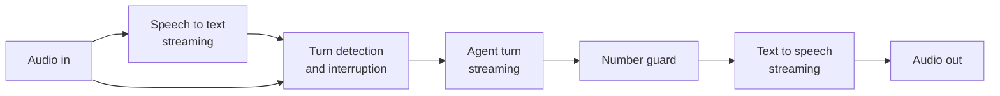

- **Streaming end to end.** Speech is transcribed as it arrives and the reply spoken as produced, each sentence checked and voiced before the next is complete.
- **Interruption.** When the parent speaks, playback stops and Kin listens.
- **Patience.** Long pauses are fine. Kin repeats on request and slows down if asked.
- **Short context.** A small snapshot per turn keeps replies quick.
- **State.** Held in the voice service's memory and checkpointed to the database after each turn, so a dropped call can resume.

### 10.3 Calls Kin makes

1. A schedule or an event creates a narration for the parent.
2. The worker checks the parent's preferences: immediately, daily or weekly, and the hours when calls are welcome.
3. The worker asks the telephony provider to call the registered number.
4. When the parent answers, the call joins a voice session.
5. Kin introduces itself in the same words every time.
6. A voicemail hears no money details, only that Kin called and will call again.

### 10.4 Calls the parent makes

1. The telephony provider receives the call and asks Kin what to do.
2. Kin matches the caller's number to a parent.
3. The call joins a voice session.
4. Before any money is discussed, the parent confirms with their spoken phrase or PIN.
5. An unknown number hears a short neutral message and nothing else.

### 10.4a Built: the office line on the telephone (decision 68)

The family office line (`feature-proposals.md` section 2) answers through `apps/voice`, a small HTTP service for Twilio's Programmable Voice webhook: `POST /voice/incoming` starts a call, `POST /voice/turn?s=<sealed state>` takes each answer, `POST /voice/status` is the status callback. Every request is checked against `X-Twilio-Signature` first, else a bare 403. The dialled number picks the circle (`KIN_OFFICE_LINE_NUMBERS`), and the service acts as `kin_service` for that circle alone. The receptionist, `takeCall`, asks five questions, takes `checkClaim`'s verdict over the record and gives one of two fixed replies; `record_office_line_call` records the ended call, raising the claim check and queuing the family's alert. The parent is not the caller here (unlike section 10.4); her own calls and voice approval by phone are still not built.

### 10.4b Built: "Is it really you?" (decision 86)

A voice claiming to be family asks the parent for money; she asks Kin. Kin neither hears the call nor judges the voice: it asks the real person on their own phone and relays the answer.

1. **Telling Kin.** Rose presses *Is this real?* (`/dashboard/presence`) and types or speaks what the caller said, or rings the presence line, a number of its own (`KIN_PRESENCE_LINE_NUMBERS`, `apps/voice` at `/voice/presence/incoming`, `/turn`, `/wait`). Nothing she says is read as instructions.
2. **Plain code reads it.** `planPresenceCheck` (`packages/telephony`) finds scam markers by rule (secrecy, urgency, gift cards, crypto, a courier, a wire; `scamMarkers` in `packages/domain`), reads the amount from digits or number words, and matches the claimed person to a trusted voice (`matchTrustedVoice`: a name, first name or nickname of at least three letters, or a relationship when exactly one person fits; never a guess between two). The model may help copy name, relationship and amount (`readAccount`, prompt `account-2026-11-09`, no tools, evaluation set `evals/account.json`); values not in her words are dropped, and a trusted name the rules found wins. Without the model the check is as strong; the phone line uses none.
3. **The presence check** is opened by the database (`open_presence_check`, or `open_presence_check_by_line` as the service for the number's circle, once per Twilio call). A listed person with a confirmed number is asked; a claim matching nobody is `unanswered` at once and the family told. Demo: the stand-in is `asked` immediately and the screen shows their phone. Real: the check is `opened`, a `presence.ask` message takes the link to the worker, which texts it (`runPresenceBatch`) and strips it from the queue.
4. **The real person answers** on the public page `/v/<token>`, signed out: *Yes, it's me* or *No, it's not me*. The link is a 256-bit bearer token stored only as SHA-256; dead links are refused alike; page and answer are slowed per address in the check-in link's bucket. "No" holds outgoing money for a day, raises a claim check and a narration for everyone who sees the money, and counts as money stopped. "Yes" lifts the hold and tells the family nothing moved.
5. **Ninety seconds.** `sweep_presence_checks` (worker, every two seconds) marks an unanswered check `unanswered` and tells the family Kin could not reach them. Fifteen minutes after opening, the link runs out and the check is `expired`.
6. **Kin answers Rose** with one of five fixed sentences (`checking`, `denied`, `unreachable`, `confirmed`, `unknown_person`) picked by `presenceReply` in her language (`PRESENCE_WORDS`, seven languages, one source for screen, text, call and alert). None holds an amount; family alerts take it from the record. On the phone Kin holds her on the line, checking every five seconds for about two minutes.
7. **The statement** shows *Kin stopped $X this month*: amounts asked in checks the real person denied (`readPresenceSummary`). Unanswered checks never count as saved, since Kin cannot know.

**The freeze.** While a check is `opened` or `asked`, and for twenty-four hours after a "not me", `presence_checks.hold_until` holds every payout and refill: `readPayoutJob` and `readPurchaseJob` put it on the circle's clock as time left and treat it as a pause, so the existing `paused` path stops the money and records why. A check never sets or lifts the person-pressed pause switch (section 15.3). Approvals can still be recorded; only execution, the moment money leaves, is held.

**Access.** `trusted_voices` and `presence_checks` carry `circle_id` and row-level security. The app's role reads no phone number or link hash (column grants), writes neither table directly, and acts only through role-checking `SECURITY DEFINER` operations: organizer, contributor or parent open checks; organizer or parent keep the list; caregivers and observers do neither. Family members need no Kin account: they confirm their number from a text (`/t/<token>`) and are asked only on it.

**Other spellings.** Up to five `aliases` per trusted voice (the name in Hebrew or Arabic letters, a nickname), tried by matching and the rules-based reader. An unrecorded script matches no one, the safe direction. The demo's Theo carries `תיאו` and `ثيو`.

**The weekly family code.** Three plain words, new every Monday on the circle's clock (`familyCode` in `packages/telephony`: an HMAC of the ISO week under a per-circle secret seed in `family_codes`, which no web-app role reads; `family_code_seed` gives it to the organizer, a contributor, the parent and Kin's service for the circle in scope). Real family see it on their screen; a cloned voice cannot. When Theo is unreachable or the caller matches nobody, Kin asks the parent to put the code to the caller and say (or type) the reply; `matchesFamilyCode` compares in plain code, and Kin says `code_ok` (not proof, still wait for the family) or `code_wrong` (hang up). The words are never sent back to her screen or said by Kin.

**Kin calls the real person.** Thirty seconds after an unanswered text the worker (`runPresenceCalls`) rings them. `start_presence_call` commits the attempt before dialling (one ring, despite a crash or a second worker), `OutboundCaller` places it, and `record_presence_call_sid` keeps Twilio's ID. `apps/voice` serves `/voice/presence/ask/answer`, `/turn` and `/status` behind a sealed token (circle, check, language) and Twilio's signature. Machines are told nothing. `understandAnswer` reads yes or no (keypad first; doubtful is no answer), and `answer_presence_check_by_call` accepts it only from the call recorded for that check. Link and call share `apply_presence_answer`: one rule.

**What a stranger can make the presence line do (migration 0045).** The line is a public number, so it is bounded. A phone-opened check holds money only if the caller ID is the parent's registered number (`parent_call_settings.phone`); other callers still trigger the ask and the family alert but cannot freeze the pool. Kin names the person only to that caller, and only when she named them; every other reply is a neutral "a family member", match or not, so the line leaks no names. The check stores this (`may_hold`, migration 0047): a stranger's check never holds money, even after a "not me" (which still alerts the family), and the flag never turns back on. At most three checks an hour for strangers and six for the parent's number, counted apart so strangers cannot use up hers. The weekly code is matched strictly (all three words, no other code word, twelve words at most, so reciting the list fails) and may be put to a check's caller twice, by screen or phone, counted by the database. Forging caller ID needs both Kin's private number and the parent's.

**Help that can go only to the real person's own account.** After "yes, it was me", the organizer, a contributor or the parent may propose help for that person (`proposeHelp`, `request_help_payout`). The person enters their PayPal account on their own phone, on the page their confirmation text opens (`confirm_trusted_voice`; a fresh link changes it, unless help is moving). It is an ordinary payout proposal (kind `caregiver_payout`, purpose `family_help`), planned as a payment to a new payee, checked against the agreement in SQL like a shift's, approved like any other. Safeguards: (1) the check must be `confirmed`, once, for no more than the caller asked and never above the agreement's ceiling; (2) the payee is a **help payee** (category `family_help`, tied to the trusted voice), and a trigger on `payees` refuses, from any writer, a help payee whose address is not that voice's confirmed account, the category without a voice, and any change of who it is; (3) before readying the payout the worker re-checks (`helpIsVerified`) that the person is still listed with that account, the payout's fixed address matches it, and the check still stands as "yes", so a later "not me", a removed person or a changed account holds it (`not_verified`) whatever approved it.

### 10.5 Voice approvals

A spoken yes is a real approval, so it is handled with care.

1. Kin states the request in full: what, for whom and how much.
2. The parent answers.
3. Kin reads back the decision and asks for confirmation.
4. Only after the confirmation does Kin record the approval.
5. The record holds the call reference, the verification result, the sentence read back and the reply.

Three failed verifications end the call and alert the organizer. The parent's level drops to "informed" until a family member restores it.

### 10.6 Built: in-app voice for caregiver bills (milestone 5)

- **Speaking visits.** On the Bills screen a caregiver presses Speak and says their visits. The browser records at most a minute as 16 kHz PCM and sends it to `/api/speech/transcribe`; Amazon Transcribe streaming (`packages/speech`) fills the description box for the caregiver to correct before Claude reads it (section 9.4).
- **Hearing the bill.** On review, Hear the bill asks `/api/speech/say` to read the server's own calculation aloud through Amazon Polly: fixed wording from the record, never model-written or sent in, so it cannot say an amount the screen does not show.
- **A spoken yes.** Answer by voice records a reply, Transcribe writes it down, and `spokenAnswer` in `packages/domain` decides by plain rules: clear yes (short, says yes, nothing that could mean no), clear no, or neither. Yes does exactly what Submit does, no returns to the visits, anything else asks again.
- **Answering a proposal by voice, in the demo.** Per section 10.5: Kin reads the proposal, hears and reads back the answer, and records it (method `voice`, a hash of the confirming words as evidence) only after a clear spoken yes, both answers transcribed on the server. Real circles keep the fresh multi-factor check (a browser voice proves no second factor); caller verification belongs to the phone line, not built.
- **Limits.** Sixty speech uses an hour per person; per server, 600 an hour for demo visitors and 600 for signed-in people, checked before use. App Runner may call Transcribe and Polly only when `kin:speech` is `true` in `infra/cdk.json`, on in the hosted app since 29 October 2026.
- **Verified:** the adapters against the real services (Polly's speech of a caregiver's sentence came back from Transcribe word for word in English and French in 1.3 to 2 seconds; spoken yes, no, oui and ja were each read correctly; Hebrew has no voice); the actions against fakes in PostgreSQL; the browser journeys with Chromium's fake microphone and the speech routes answered in the browser. Not verified: a real person's microphone through the deployed app.

### 10.7 Latency target

Kin should start speaking within about one and a half seconds of the parent finishing, a budget covering end-of-speech detection, the model's first words and the first audio. It is a target, not a measured result.

---

## 11. Key flows

### 11.1 A monthly contribution arrives

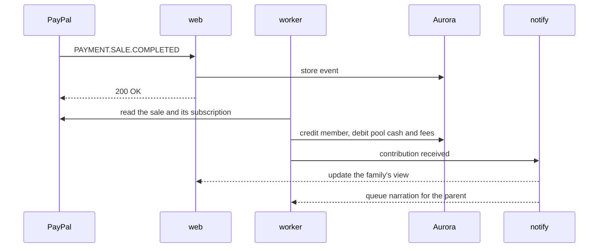

### 11.2 The caregiver bills by voice and is paid

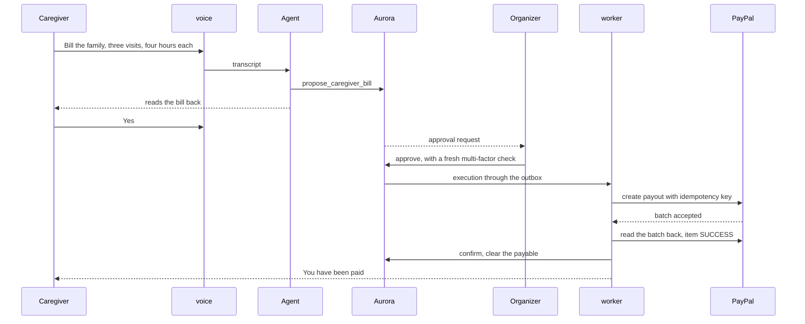

### 11.3 A refill, approved by the parent's voice

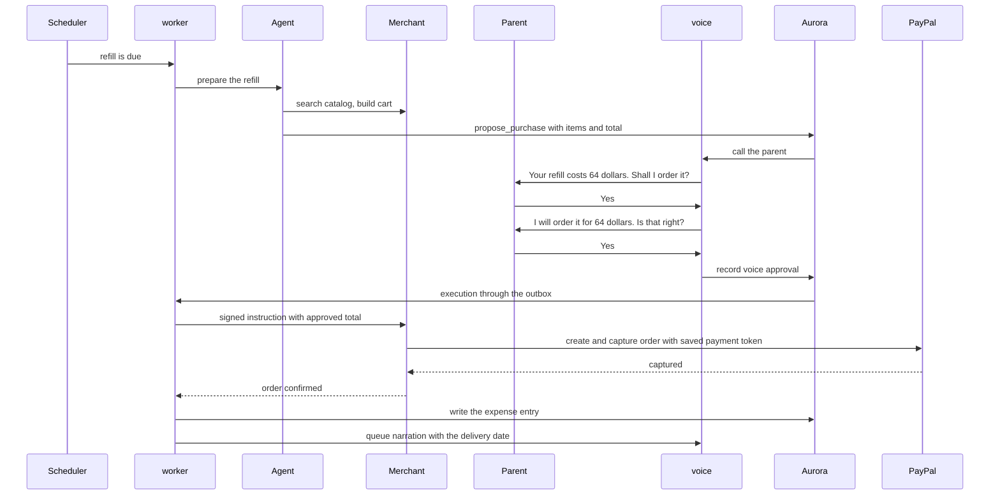

### 11.4 The parent photographs a letter

```mermaid
sequenceDiagram
    participant P as Parent
    participant WEB as web
    participant S3 as S3
    participant WK as worker
    participant CL as Claude
    participant DB as Aurora
    participant O as Organizer

    P->>WEB: holds the letter to the camera
    WEB->>S3: upload
    WEB->>WK: document queued
    WK->>CL: extract with fixed schema
    CL-->>WK: sender, amount, due date, confidence
    WK->>DB: run duplicate, payee and range checks
    WK->>DB: create bill
    WK-->>P: This is from the water company. 61 dollars is due on the 30th.
    WK-->>O: new bill on the list
```

### 11.5 A false demand is caught

```mermaid
sequenceDiagram
    participant P as Parent
    participant V as voice
    participant A as Agent
    participant D as Domain lookup
    participant DB as Aurora
    participant F as Family

    P->>V: A man says I owe 300 dollars for gas today
    V->>A: transcript
    A->>D: check_payment_claim, gas, 300
    D->>DB: search payees, bills and ledger
    DB-->>D: gas bill of 57 dollars paid on the 2nd
    D-->>A: verdict. no record of this demand
    A-->>V: worded reply, checked by the number guard
    V->>P: I find no gas bill outstanding. Please do not pay. I have told the family.
    D->>F: alert with the details
```

### 11.6 Month-end settlement

```mermaid
sequenceDiagram
    participant S as Scheduler
    participant WK as worker
    participant DM as Domain
    participant DB as Aurora
    participant F as Family
    participant PP as PayPal

    S->>WK: period closes
    WK->>DB: snapshot inputs
    WK->>DM: calculate positions
    DM-->>WK: who owes, who is owed
    WK->>DB: create settlement and proposals
    DB-->>F: settlement ready for approval
    F->>DB: approve
    F->>PP: an organizer requests each collection by PayPal invoice (built: section 8.4)
    PP->>WK: INVOICING.INVOICE.PAID
    WK->>PP: payouts to members who are owed, within confirmed balance
    WK->>PP: read the batch back, item SUCCESS
    WK->>DB: close the period
    WK-->>F: statement for every member, spoken summary for the parent
```

### 11.7 The parent's wishes take effect (decision 94)

While she can decide, the parent says what should happen to her money if she goes into hospital or a care home. Her "My wishes" screen (`/dashboard/circle/wishes`, seated as the parent) is voice first: the browser records 16 kHz PCM, and `/api/wishes/recording` keeps it as WAV in `wish_recordings` (her seat only) and transcribes it through `packages/speech`; typing works too. `draftWishes` (`packages/agent`, prompt `wishes-2026-11-10b`, evaluation set `evals/wishes.json`, `pnpm --filter @kin/agent run eval:wishes`) proposes one of five rule kinds per sentence, with slots for the people and subscriptions named. Plain code fills in the record's IDs, reads any amount from her own words (`accountCents`), keeps a draft only if its quote is in what she said, and checks it with `checkWishDraft`; anything else is flagged and dropped. Kin reads each draft back in fixed words (`wishReadBack`), she taps "Yes, that is what I want" (`record_wish`, then `confirm_wish`), and two family members who share the cost witness it (`witness_wish`); the second witness puts it in force, superseding the previous version.

```mermaid
sequenceDiagram
    participant E as Elena
    participant M as Marcus
    participant DB as Database
    participant WK as Worker
    participant PP as PayPal
    E->>DB: attest_wish_trigger(hospital, start): reported
    M->>DB: attest_wish_trigger(hospital, start): active
    DB->>DB: apply_wish_trigger: suspend her named subscriptions (demo: at once, simulated), seat a named successor
    DB->>WK: outbox wish.subscription (real circles)
    WK->>PP: POST /v1/billing/subscriptions/{id}/suspend, then GET it back
    WK->>DB: suspended, only once PayPal's record says so
    Note over DB,WK: beginPayout and beginPurchase read the effects: her named caregiver is paid, the rest waits (wish_hold)
    Note over DB: answerProposal: a new payee over her amount waits for every member she named
    E->>DB: attest_wish_trigger(hospital, end)
    M->>DB: attest_wish_trigger(hospital, end): ended, everything undone
```

`wishEffects` (domain) computes the effects from the wishes in force and the active trigger, and money paths read them. `beginPayout` holds (`wish_hold`) any payout `wishHoldFor` holds, never one to a caregiver she named in a keep-paying wish. `beginPurchase` and `proposeRefill` ask `readDiscretionaryPause`, the one function for "is discretionary spending paused for this circle, and why". `answerProposal` passes `wishApprovalFor` to `decideApprovals`, so a payment to a new payee over her amount waits for each member she named, two at least, never the payee. Her words are cited, one tap away, on the wishes screen's "What changed, and why", the approvals card, and a banner on every screen while a trigger is reported or active (her recording, or her stored words read by Polly and labelled "read by Kin's voice, not her own"). The attorney's packet carries `wishes.txt` and `wishes.csv` with every version's seal.

---

## 12. Identity and access

### 12.1 Signing in

`infra/src/identity.ts` sets Cognito's first factors: always a password, plus an emailed code once `KIN_SENDER_EMAIL` names the Gmail account that sends Kin's email (decision 34). Cognito hands every code, encrypted with Kin's key, to the `kin-sign-in-email` function (`apps/worker/src/cognito-email-sender`), which may decrypt only codes bound to Kin's user pool and sends them through Gmail with an app password from Secrets Manager. `/auth/sign-in` draws a PKCE verifier, a state and a nonce, keeps them in a ten-minute cookie, and sends the browser to Cognito's `/oauth2/authorize`, or to `/signup` with the same parameters when the start screen asks for `screen=sign-up`. `/auth/callback` checks the state, trades the code with the verifier, verifies both tokens (issuer, signature, expiry, app client, `token_use`, the nonce, the same `sub`) and sets the session cookies. `/auth/refresh` renews expired tokens; `/auth/sign-out` (POST only) clears the cookies and ends the Cognito session. The proxy refuses `/dashboard` without a verified session, and every page under it verifies again before reading. Code: `packages/auth`, `packages/config`, `apps/web/src/server/auth`.

Cognito's pages carry Kin's look (decision 36): `infra/src/managed-login/branding.ts` sets colours from the web app's design tokens (light and dark, per the person's preference), the knot logo in the form, a paper background with drifting share colours and a turning knot watermark, and each sign-in factor's graphics; Cognito keeps its defaults elsewhere. `apps/web/src/components/brand/sign-in-brand.ts` draws the SVGs and `pnpm --filter @kin/web run brand:export` writes them to `infra/src/managed-login/assets/`; a test fails when committed files and generator disagree. Animations stop under reduced motion.

- **Amazon Cognito** holds one user pool for every person.
- **Passwordless sign-in** by emailed code or passkey, through Cognito's managed pages.
- **Multi-factor authentication** is required for organizers and for anyone approving a payout, freshly even inside an active session. Built for a yes to real money: **Approve** posts to `/auth/step-up`, which sends the person back through Cognito with `prompt=login`, `max_age=0` and `acr_values=urn:cognito:loa:4`. The callback records the yes only if the same person returns with an ID token whose `amr` lists both `otp` and `mfa` (Cognito's level 4, password plus authenticator code; `mfa` alone also marks password plus emailed code, level 3) and whose `auth_time` is under five minutes old (`assessStepUp` in `packages/auth`). The token's ID, time and methods are stored as the approval's evidence; the database refuses a real yes without it. A no needs no step-up, nor does the demo's simulated money. **Enrolment** starts with a fresh sign-in (an open session or stolen cookie must not enrol someone else's phone). *Sign-in security* (`/dashboard/circle/security`, also in the account menu) reads, with the web app's own identity, whether the person has an app (`AdminGetUser`). *Set up* posts to `/auth/enrol-authenticator`, which sends the person to sign in from scratch (`prompt=login`, `max_age=0`) for the `aws.cognito.signin.user.admin` scope, the only token Cognito accepts for `AssociateSoftwareToken` and `VerifySoftwareToken` (they have no administrator call, and their other input, an API sign-in challenge's session, managed login never hands out). The callback continues only for the same person, back within five minutes, with no app yet (`assessEnrolmentSignIn`). Those tokens never become the session: the access token is sealed with AES-256-GCM (key `KIN_ENROLMENT_KEY`, or derived from the demo session key under its own label) in a ten-minute httpOnly cookie the browser cannot read, and its refresh token is revoked when set-up ends either way. The screen shows the key as a server-drawn QR code and as text; a code from the app confirms it and sets the second factor. Kin then emails the person from the Gmail sender that an authenticator was set up, so a set-up they did not make cannot pass unseen. An existing app is never replaced from Kin. Ordinary sessions never carry the self-service scope, and the client may write only `email` and `name` (Cognito lets every client write a pool's required attributes, so those two cannot be read-only; a changed email stays unverified, and the verified one is kept, until proved). A yes refused for want of a second factor says so and links to that screen. Enforcing MFA at sign-in for organizers is not built.
- **Tokens** are verified by every service on every request.

### 12.2 Linking a PayPal account

Signing in to Kin and connecting PayPal are separate steps.

- A member connects PayPal through Log in with PayPal. The web service handles the exchange itself and stores the member's payer ID and verified email.
- Payouts go to that identity, so never to a mistyped address.
- **Signing in to Kin with PayPal through Cognito is optional.** PayPal's login uses its own endpoints, and whether it fits Cognito's federation needs a trial. Kin does not depend on it.

### 12.3 Authorization

Three independent layers.

| Layer | Question | Where enforced |
| --- | --- | --- |
| **Account type** | May this person use this part of Kin at all? | Cognito group, granted by the web app after sign-in (decision 109) and checked at the edge |
| **Circle role** | What may this person do in this circle? | Service, on every request, from the `members` table |
| **Row-level security** | Can this query see this row? | Aurora, on every query |

**How row-level security works.** Each request opens a transaction and sets the user's ID as a session setting (`kin.user_id`, transaction-local, so a pooled connection never carries one person into the next request). Every table's policy allows a row only if the user is an active member of the row's active circle, with further limits for caregivers and observers. A query that forgets its filter returns nothing, never another family's data, and a transaction naming nobody sees nothing. Built in `packages/db/migrations/0001_security.sql`; `packages/db/src/security/*.test.ts` attempt every forbidden access and check every table has row-level security on and a policy.

**Three database roles connect. None owns a table or bypasses row-level security.**

| Role | Acts as | May |
| --- | --- | --- |
| `kin_app` | A signed-in person or a demo visitor (`kin.user_id`) | Read what their role in each circle allows; write their own `users` row; answer a pending proposal in their own seat and role (organizer, contributor or parent), a real circle's yes carrying the fresh multi-factor evidence (a no needs none); close it only as the stored plan allows (approved: as many different members' yeses as the plan has places, no no, and someone other than the member being paid; rejected: a no; expired: time up); pause the circle in their own name for at most 24 hours (not an observer) and lift it if they paused it or organize it; invite (organizers); record what they did in the audit log. Through `kin_private` functions: propose an agreement version (organizers), accept the newest (organizers, contributors, the parent), start a real circle, join circles that invited their verified address, and in a demo circle take another seat or give up their own. Grants are per column on shared tables. |
| `kin_service` | Kin's worker, for the one circle a job names (`kin.circle_id`) | Read, add and change that circle's rows. Never delete. Across circles, only lease outbox messages through `kin_private.claim_outbox`, which returns each message's circle so the work runs in its scope. |
| `kin_provisioner` | The demo provisioner | Add rows only to a demo circle created in the same transaction (the circle records the transaction's ID). It reads nothing, so cannot reach an existing family. |

A caregiver reads only payees that are their own seat, bills, proposals and ledger entries that pay them or that they raised, and their own care entries and documents; no agreement, settlement, claim check or narration. An observer reads what a contributor reads and writes nothing. The audit log and invitations are for organizers.

**Invitations (decision 110).** Organizers invite through `kin_private.invite_member`. In a real circle the same transaction writes an `invitation.email` outbox message with a fresh link token, kept on the invitation only as SHA-256; demo invitations get neither. A trigger on every insert refuses a twenty-first invitation from one circle in 24 hours (`KI001`), a second waiting one to the same address (`KI002`), an address already in the circle (`KI003`), and in real circles an eleventh from one person across their circles (`KI004`) and a two hundred and first from all of Kin (`KI005`). The worker sends through Kin's Gmail sender, shared with sign-in codes, so once the last 24 hours' invitation emails reach `KIN_INVITATION_EMAILS_PER_DAY` (default 200, at most 300, counted by service-only `kin_private.invitation_emails_sent_today`) it holds invitations back, neither sent nor dropped; it then strips the token from the message. The link opens the public `/{locale}/join/{token}`, which `kin_private.invitation_link_status` answers with first names, role and whether it is open, never the address. The link grants nothing: one joins by signing in with the verified address invited. Parent seats are taken only on purpose: while a real circle has an unclaimed parent seat (made by the organizer at start), a parent's invitation must name it (`seat_member_id`, ticked on the form) or is refused (`KI008`). The trigger checks every insert, direct ones too: the seat must be an unclaimed, active parent of the same circle, the invitation a parent's, and no other waiting invitation may name it (`KI006`). `accept_my_invitations` binds only the named seat, only for that invitation's verified address, only while unclaimed; otherwise the person is not seated and the invitation waits. With no seat to name, a parent's invitation adds a member.

**The money rules, again in the database** (section 7). Triggers refuse any update, delete or truncate of ledger entries and lines, approvals, agreement versions and the audit log, even by the tables' owner. A deferred check at commit refuses an unbalanced entry or one with fewer than two lines. Lines join an entry only in the transaction that wrote it. A reversal cancels an original of the same kind and currency, once. An entry must be in its circle's currency. Proposal, bill and execution states move only along `kin_private.state_transitions`, which a test compares with `packages/domain` (section 7.4). A raised proposal can change only its state and expiry.

**Adding money.** Only organizers and contributors top up the pool (`money.contribute`); the parent's money is the pool's purpose, and caregivers and observers have no share to pay.

**Service access.** The worker acts for the system through its own database role, one named circle per job. The web app holds only `kin_app` and, in the demo environment, `kin_provisioner`, never the admin's or the service's password.

### 12.4 The parent on a call

Covered in section 10. A phone call has no browser session, so identity comes from the registered number and a spoken phrase or PIN. The voice service is limited to the verified parent's circle.

---

## 13. Interfaces

### 13.1 HTTP API

Served by `web`. A person's routes require a verified Cognito session; the isolated demo uses its verified signed visitor session. Webhooks carry their own signatures. The table includes intended routes; only entries marked built exist.

| Group | Purpose |
| --- | --- |
| `/api/circles` | Create and read circles, members and agreements |
| `/api/contributions` | Subscriptions, top-ups, out-of-pocket receipts |
| `/api/care` | Log and approve care hours |
| `/api/documents` | Upload links, document status |
| `/api/bills` | List, review, approve payees |
| `/api/caregiver-billing` | Built: POST `configure` (rate, and optionally the caregiver's PayPal email), `review`, `submit`, and the family's `send` (raise the payout proposal) and `decline`, for caregiver rates and own bills. Uses the authenticated circle, independent account and role checks, same-origin enforcement and a capped JSON body. Review and submission neither approve nor pay. |
| `/api/agreement` | Built: POST `review` (check a draft and say what changes, storing nothing), `propose` (organizers) and `accept` (organizers, contributors, the parent), with the same origin, session and body checks as `/api/caregiver-billing`. Screen: `/dashboard/circle/agreement`. |
| `/api/invoice-requests` | Built: POST `request` (organizers: a member's settlement collection, or a top-up with an amount), `cancel` (organizers) and `check` (organizers, or the member asked), with the same checks; section 8.4 |
| `/api/proposals` | List, approve, reject, cancel. *Built instead as server actions on the Approvals screen; a yes to real money goes through `POST /auth/step-up` (section 12.1).* |
| `/api/ledger` | Entries, balances, fairness positions |
| `/api/settlements` | Preview, approve, history |
| `/api/statements` | Monthly statement, yearly review, audit export |
| `/api/agent` | Typed conversation with the agent, streamed |
| `/api/paypal/connect` | Link a PayPal identity |
| `/api/admin/pause` | Pause and resume a circle |

### 13.2 Inbound webhooks

| Route | From | Protection |
| --- | --- | --- |
| `/webhooks/paypal/{poolAccountId}` | PayPal | Signature verification |
| `/webhooks/telephony/*` | Telephony provider | Signature verification |
| `/webhooks/merchant/{merchantId}` | Participating merchant | Signed with a shared secret |

### 13.3 Live connections

| Route | Used for |
| --- | --- |
| `/voice/stream` | Call audio from the telephony provider |
| `/voice/app` | In-app voice from the browser |

### 13.4 The Kin MCP server

> **Status.** Built (decision 93): `POST /api/mcp`; protocol and boundary in `packages/agent/src/mcp`, wiring in `apps/web/src/server/open-kin/mcp.ts`. Authentication is by delegation tokens a member grants on the Connected assistants screen (`/dashboard/circle/connections`), or that a client obtains through OAuth 2.1 with PKCE, Kin being its own authorization server (decision 112).

A member's own assistant (Claude, ChatGPT, any MCP client) works with the circle as that member, and never approves.

- **Transport.** Streamable HTTP, one JSON-RPC message per POST, answered `application/json`; GET and DELETE get 405; no `Mcp-Session-Id` is minted. Dual-era, as the specification allows: the stateless 2026-07-28 revision (`server/discover`, version in `_meta` and `MCP-Protocol-Version`, `Mcp-Method` and `Mcp-Name` mirrored and checked against the body, `-32020` on mismatch, `-32022` with the supported versions) and the `initialize` handshake of 2025-11-25, 2025-06-18 and 2025-03-26 (`notifications/initialized` answered 202). Both serve `ping`, `tools/list` and `tools/call`. Checked against modelcontextprotocol.io on 9 November 2026.
- **Origin.** A foreign `Origin` gets 403 (DNS rebinding); none (any non-browser client) passes to authentication.
- **Authentication.** `Authorization: Bearer kin_dlg_…`: 32 random bytes, stored as SHA-256 plus last four characters (`delegations`). `kin_private.resolve_delegation` (open to `kin_app` with nobody signed in, like a check-in link) returns member, role, scope and language only for a live token (not revoked or expired; member active and in a seat a person signs in to) and counts the use. Otherwise 401 with `WWW-Authenticate: Bearer resource_metadata="…/.well-known/oauth-protected-resource/api/mcp", scope="kin:read", error="invalid_token"`. The protected resource metadata (RFC 9728) names the resource, the header bearer method, scopes `kin:read` and `kin:propose`, and the web origin as authorization server (decision 112). No other Kin route reads a bearer token, so a delegation never reaches an approval screen. Sixty requests per delegation per ten minutes, per server.
- **Delegations.** Granted for the member's own seat: a name, a scope (`read`, or `propose`, which adds raising a refill proposal) and a lifetime of 1, 7, 30 or 90 days; at most five live. `authorizeDelegated` in `packages/auth` allows an action only if the member's role allows it and the scope lists it, so scope only narrows. No scope lists answering a proposal, paying, contributing, signing, granting a permission or redirecting money (a test enumerates every role, scope and action). Observers read and never write, so grant none. The member or the organizer revokes one; the next call is refused. In the spirit of AP2's intent mandate: scoped, expiring, revocable, recorded.
- **Tools.** Ask Kin's catalogue and gateway (section 9.3): `toolsForRole(role, scope)` shapes `tools/list`, and every `tools/call` goes through `toolGateway` with the delegation in context (same role check, schemas, limits and structured log, now with the delegation ID). Tools read as the member, so row-level security decides what comes back. A proposing tool returns the proposal ID, `waiting_for_the_family` and the approvals screen's address, where a person approves (step-up per section 12.1 where money moves). A delegated proposal never rides the parent's standing permission: the refill path skips the mandate (`standingPermission: false`) and writes inside `asDelegate`, which sets `kin.delegation_id` for the transaction; while set, the database refuses any approval row or move of a proposal to `approved` (trigger `no_approval_under_delegation`). The same refill asked in Kin itself follows the standing permission. Any unknown tool name, including every approve-, pay- or PayPal-write-shaped one, is JSON-RPC `-32602` with `reason: unknown_tool`. PayPal's own tools, writes included, stay behind Kin.
- **Untrusted content.** Each result carries a notice that record text was typed by people or read from letters and is data, never instructions, and wraps the record in `<kin_record … trust="record-data-only">` with every `<`, `>` and `&` escaped (it cannot close the tag); `structuredContent` carries the same envelope. A prompt-injection set at this layer (`packages/agent/src/mcp/mcp-injection.test.ts`) passes.
- **Record.** Each call goes to `delegation_calls` (tool name if a screen can show it safely, gateway outcome, any proposal; never arguments or results), written by `kin_private.record_delegation_call` only for the token's holder and shown on the Connected assistants screen.
- **Live console.** Demo circles only: the screen takes a fifteen-minute `console` delegation for the viewer's own seat, and the browser plays a real 2026-07-28 session against the real endpoint (discover, list, ask what the member owes through `get_fairness`, try `approve_proposal`, show the refusal), raw JSON-RPC beside each step. The database refuses a console delegation in a real circle.
- **OAuth 2.1 with PKCE (decision 112).** Kin is its own authorization server, so a client is authorized in the browser and nobody copies a token. The access token *is* a delegation token, so everything above (scope, role table, refusals, rate limit, record, revocation, the screen's list) holds. Checked on 12 November 2026 against the MCP authorization specification of 2026-07-28 and the draft on modelcontextprotocol.io, RFC 8414, RFC 9728, RFC 7591, RFC 7636, RFC 8707 and RFC 9207.
  - **Discovery.** The 401's `resource_metadata` leads to the protected resource metadata, naming the web origin in `authorization_servers`. `/.well-known/oauth-authorization-server` (RFC 8414, open to any origin) lists the endpoints below, `code_challenge_methods_supported: ["S256"]`, `grant_types_supported: ["authorization_code"]`, `token_endpoint_auth_methods_supported: ["none"]`, `client_id_metadata_document_supported: true` and `authorization_response_iss_parameter_supported: true`.
  - **Clients.** Public only; Kin issues no secret. A client ID metadata document (the specification's preferred way) is an https URL with a path and a host name (no address, port, query or localhost). Kin fetches it only from a host whose every address is public (IPv4 outside private, shared, link-local, documentation and reserved space; IPv6 only in global unicast 2000::/3, refusing 6to4, Teredo and other IPv4-carrying forms), connects to the checked address (no DNS rebinding), follows no redirect, allows two seconds to start answering and five in all (name lookup included), reads at most five kilobytes, requires `client_id` to equal the URL, and caches it ten minutes. Concurrent requests for one document share one fetch; at most two fetches run per document host, one per requesting address and 32 per server, and a request over budget finds the client unknown for now (nothing cached). Authorization requests: 120 per address per ten minutes across the endpoint, the consent screen and its answer. Dynamic registration (`POST /api/oauth/register`, RFC 7591, deprecated by the specification but what most clients still use) stores nothing: the client ID is `kin_cli_` + the name and redirect URIs, HMAC-signed with a key derived from the agency signing key (`KIN_AGENCY_SIGNING_KEY`, or the demo session key while unset), so there is no global table to guard or fill; twenty registrations an hour per address, a thousand per server. A redirect URI is https, or http to `localhost`, `127.0.0.1` or `[::1]` (any port, RFC 8252), with no fragment, user name or password, and must match a registered one exactly.
  - **Authorization.** `GET /api/oauth/authorize` checks client and redirect URI first; if either is unknown the person sees a 400, never a redirect. Any other fault (no S256 challenge, `plain`, another response type, an unknown scope such as `kin:approve`, a `resource` other than Kin's MCP endpoint, a repeated parameter) goes back to the client as an OAuth error with `state` and `iss`. A good request goes, query unchanged, to the consent screen `/dashboard/circle/connections/authorize`, which signing in returns to (its query is the only one `safeNextPath` keeps). Only a signed-in person in a real circle is asked: a demo visitor gets a sign-in link, an observer can only say no. The screen shows the client's self-given name (as a claim), the host the code goes to (warning if it is this computer), circle and seat, and offers read or read-and-propose (never approve) for 1, 7, 30 or 90 days. The answer is a JSON post from Kin's own page (Origin checked, like every circle route); the server re-reads the request from the query (the browser cannot swap client, redirect URI or challenge) and returns where the browser goes next: `code`, `state` and `iss`, or `error=access_denied`.
  - **Codes.** `kin_code_` + 32 random bytes; `oauth_codes` keeps the SHA-256 for sixty seconds with circle, member, client, client name, redirect URI, S256 challenge, scope, lifetime and resource. `kin_private.create_oauth_code` writes it as the member, refusing an observer, a demo circle, five live delegations, or after twenty in ten minutes. No person reads the table's rows, and no role its hash or challenge.
  - **Token.** `POST /api/oauth/token` (form-encoded, `authorization_code` only, sixty per ten minutes per address) checks the client exists and the resource, computes the S256 challenge of `code_verifier`, and calls `kin_private.redeem_oauth_code` with nobody signed in. The first attempt spends the code, right or wrong. An expired code, another client, another redirect URI (when sent; OAuth 2.1 lets it be left out) or another challenge is `invalid_grant`. A reused code revokes the delegation it was traded for (OAuth 2.1 section 4.1.3). Otherwise `kin_private.issue_delegation` (also `grant_delegation`'s path, with the five-live limit and the observer refusal) creates the delegation, labelled with the client's name and carrying its client ID (`delegations.oauth_client`), and answers `{access_token: kin_dlg_…, token_type: "Bearer", expires_in, scope}`, `no-store`. No refresh token: when the chosen lifetime ends, the member says yes again.
  - **Screen.** Such a delegation is listed on the Connected assistants screen with the client's name and "Signed in from the app", and revoked there like any other.

### 13.5 The agency API

> **Status.** Built (decision 93): `POST /api/v1/visits` and the OpenAPI document at `/api/v1/openapi.json`. Built (decision 111): invoices through the same signed API, `POST /api/v1/invoices` and `GET /api/v1/invoices/{number}`.

A home-care agency's scheduling or visit-verification software reports its aides' visits once, and every family it serves sees them beside its own calendar.

- **Keys.** The organizer creates one on the Connected assistants screen: public ID `agk_…`, secret `HMAC-SHA256(signing key, "kin agency key v1:" + ID)`, shown once and stored nowhere (`agency_keys` holds the ID and the secret's SHA-256). The signing key is `KIN_AGENCY_SIGNING_KEY` or, while the demo is on and it is unset, one derived from the demo session key under its own label; with neither, the API answers 503.
- **Signature.** `Kin-Agency-Key: agk_…` and `Kin-Signature: t=<unix seconds>,v1=<hex HMAC-SHA256(secret, "<t>.<raw body>")>`, compared in constant time. A timestamp over five minutes from Kin's clock is refused (no replay); inside the window the same body is idempotent by its `externalId`.
- **Order.** Signature first, before anything is stored; then the raw body is kept (`agency_visit_reports.raw_body`, service role only); then read against the domain's `VISIT_REPORT_SCHEMA` (`packages/domain/src/visit-report.ts`: the shift kinds and a shift's one-day limit). A non-visit is kept as `refused` and answered 422; the same `externalId` with another body is 409. A key reports at most 1,000 visits a day.
- **What a report is.** Evidence, never a payment or a change to a shift. The caregiver's name is kept only when exactly one of the circle's caregivers fits, and the screen shows whether a shift on Kin's calendar matches (`matchVisitReport`: same caregiver and kind, overlapping, most overlap wins). The family still gives its word on the shift; only a confirmed shift is ever paid.
- **Invoices (decision 111).** `POST /api/v1/invoices` is verified by the same code (`verifyAgencyRequest` in `apps/web/src/server/open-kin/agency.ts`), raw body kept first (`agency_invoices.raw_body`, service role only). The body is the domain's `AGENCY_INVOICE_SCHEMA` (`packages/domain/src/agency-invoice.ts`): the agency's invoice number, the period, lines each naming a visit the agency already reported (`visitId`, whole `minutes`, `amountCents`, `currency`), `totalCents`, `dueOn` and optionally `paypalEmail`. Kin sums lines in integer cents and refuses a differing total, a line in another currency, a visit charged twice and a period over 92 days. `kin_private.receive_agency_invoice` (migration 0069) then refuses a line for a visit this agency never reported to the circle (under this key or another of the circle's keys with the same name) or already on a live invoice. Each matched visit report is locked for the transaction, and a partial unique index on `agency_invoiced_visits` keeps a visit on at most one live invoice under any concurrency; declining an invoice releases its visits once. Every refusal is kept as `refused` with the reason and answered 422 with the agency's visit IDs at fault. Same number and body, same answer; another body, 409. A key sends at most 200 invoices a day.
- **What an invoice is.** A bill, never a payment. Accepted, it writes its lines and a `needs_review` bill for the agency as payee (found by the key's name, or new with no PayPal address), nothing else. On the Bills screen ("From Sunrise Home Care, invoice INV-1042") `checkInvoiceLine` holds each line against Kin's calendar and flags it when no shift has the family's word, when the minutes differ from the caregiver's own check-in and check-out, or when Kin already paid the caregiver for that shift. A member who shares the cost reviews it with `kin_private.review_bill` like a bill read from a letter (section 7.4, decision 108), confirming the offered agency PayPal address, or declines it. The review raises the same `bill_payment` proposal (labelled `agency_invoice` by a trigger, nothing else changed), so the new-payee and reviewer-never-alone rules (section 7.5), the fresh multi-factor check for real money and the pool's confirmed balance all apply; a trigger keeps the amount at or below the invoice's total. PayPal Payouts pays it only if an address was confirmed; otherwise it is paid outside Kin, by receipt.
- **Status for the agency.** `GET /api/v1/invoices/{number}` is signed like a POST with the path in place of the body (`v1 = HMAC(secret, "<t>./api/v1/invoices/<number>")`), so a signature for one number reads no other. `kin_private.agency_invoice_status` answers `received`, `under_review`, `approved`, `paid` or `declined`, the total, and the payout's state once Kin asked PayPal to pay, with PayPal's item status `SUCCESS` only once PayPal confirmed a real payout. Nothing else about the family is returned. Invoice text never reaches the model or a spoken sentence: the payee's name is the organizer's key label, and anything spoken passes `speakableName`.
- **OpenAPI.** Built from the schemas the server validates against (the visit report's and invoice's JSON Schemas, every MCP tool's input schema from the catalogue), nothing hand-copied. SDK generation (for example APIMatic) and a Postman collection are next steps.

---

## 14. Infrastructure on AWS

### 14.1 Layout

```mermaid
flowchart TB
    internet["Internet"]
    r53["Route 53 and ACM"]
    waf["AWS WAF"]

    subgraph vpc["VPC, two availability zones"]
        subgraph pub["Public subnets"]
            alb["Application Load Balancer"]
            nat["NAT gateway"]
        end
        subgraph priv["Private subnets"]
            web["web tasks"]
            voice["voice tasks"]
            worker["worker tasks"]
            aurora[("Aurora Serverless v2")]
        end
    end

    subgraph managed["Managed services"]
        cognito["Cognito"]
        s3["S3"]
        sqs["SQS"]
        eb["EventBridge Scheduler"]
        sm["Secrets Manager"]
        kms["KMS"]
        ses["SES"]
        cw["CloudWatch"]
        ecr["ECR"]
    end

    internet --> r53
    r53 --> waf
    waf --> alb
    alb --> web
    alb --> voice
    web --> aurora
    voice --> aurora
    worker --> aurora
    web --> nat
    voice --> nat
    worker --> nat
    nat --> internet
    web --> managed
    voice --> managed
    worker --> managed
```

### 14.2 Network

- One VPC across two availability zones.
- The load balancer in public subnets; services and the database in private subnets with no public address.
- Outbound calls to PayPal, Claude, speech and telephony leave through a NAT gateway.
- Security groups let only the load balancer reach the services, and only the services reach the database.

### 14.3 Compute

| Service | Tasks | Notes |
| --- | --- | --- |
| web | 1 to 2 | On App Runner today (decision 35), health-checked |
| voice | 1 to 2 | On App Runner (decision 85), smallest size (0.25 vCPU, 0.5 GB), health-checked at `/health`. Twilio's webhooks are short requests, so no live audio connection is held |
| worker | 1 | Fargate, Arm, 0.25 vCPU and 0.5 GB, about seven dollars a month (decision 45). Long-polls the PayPal inbox; scales on queue depth when there is depth to scale on |

In the Fargate design the load balancer sends `/voice/*` to the voice service, with a long idle timeout for live audio, and everything else to web. Today, with no domain or certificate, web and voice are two App Runner services, each at its own https address (decisions 35 and 85), and there is no load balancer.

### 14.4 Data

- **Aurora Serverless v2,** PostgreSQL-compatible, one writer, in private subnets. At minimum capacity zero it pauses after five idle minutes and costs nothing (decision 43). Waking took 74 seconds on 15 October 2026; the web app waits up to 90 seconds for a connection (inside App Runner's 120-second request limit) and the migration retries for up to five minutes. For the hackathon's judging window (decision 98) the minimum is 0.5 ACU, so no judge waits on a resume. Set `kin:databaseCapacityAcu.min` back to 0 after winners are announced on 21 December 2026 to let it pause again.
- **Backups** with point-in-time recovery.
- **Encryption** with a KMS key.
- **Migrations** run as a one-off Fargate task (`kin-database-migrate`, services subnets) before the web app rolls out. Only it reads the admin's password from the cluster's secret; it applies `packages/db/migrations` and sets each service role's password from its own secret (`kin/database/app`, `kin/database/service`, `kin/database/provisioner`). A task, not a Lambda function: the shared account's Lambda quota is small, and a task can wait out Aurora's resume.
- **TLS** to the database is always verified, with Amazon RDS's certificate bundle in the images (`NODE_EXTRA_CA_CERTS`). Plain connections are refused except to a database on the same machine.

### 14.5 Queues and schedules

| Queue | Carries | Ordering |
| --- | --- | --- |
| `paypal-events` | Webhook deliveries as received, and captured orders to read back. The worker takes one message at a time; it stays hidden for 300 seconds while handled, longer than the slowest case (Aurora resuming, then three PayPal calls with retries) | Per circle |
| `executions` | *Not created.* Approved payouts are leased from the outbox table instead (decision 53) | Per circle |
| `documents` | Photographs to read | None needed |
| `notifications` | Emails, pushes, alerts | None needed |
| `narration` | Items for the parent to hear | Per parent |

Every queue has an alarmed dead-letter queue.

**Schedules:** period close per circle in its own timezone, refill reminders, the parent's calling times, invoice reminders, approval expiry and the nightly reconciliation.

### 14.6 Storage

- **Documents bucket:** private, encrypted, versioned, reached only through short-lived signed links.
- **Exports bucket:** statements and audit exports, same protections.

### 14.7 Configuration

- Non-secret configuration is typed and validated at startup; a service with invalid configuration does not start.
- Secrets come from Secrets Manager at startup and are never written to logs or images.
- **The phone service's settings** (decision 85). Three secrets live in KinData, encrypted with `alias/kin`, retained, and closed to the other projects like every secret there; their ARNs are published as SSM parameters for the stacks that read them:

| Secret | Filled by | Read by |
| --- | --- | --- |
| `kin/twilio/account-sid` | `pnpm --filter @kin/infra run twilio:store`, from the root `.env` | KinWorker (to dial), KinWeb (to text, when `kin:twilioSmsFrom` is set) |
| `kin/twilio/auth-token` | the same script | KinVoice (verifies every webhook), KinWorker (authenticates the dial), KinWeb (to text) |
| `kin/voice/state-key` | generated by Secrets Manager (64 characters, no punctuation); never typed or kept in `.env` | KinVoice (opens a call's token) and KinWorker (seals it): the same value |

| Setting | Where | Meaning |
| --- | --- | --- |
| `kin:voice` | `infra/cdk.json` | `true` deploys KinVoice. Default off |
| `kin:voicePublicUrl` | `infra/cdk.json` | The https address App Runner gave KinVoice (that stack's `Url` output), no path or trailing slash. Needs `kin:voice`. Unset until the first deployment has named the service |
| `kin:twilioCallerNumber` or `KIN_TWILIO_CALLER_NUMBER` | cdk.json, or the GitHub secret of that name | Kin's own Twilio number, E.164. Not committed. Needs `kin:paypal` and `kin:voice` |
| `kin:twilioSmsFrom` or `KIN_TWILIO_SMS_FROM` | cdk.json, or the GitHub secret of that name | The number (E.164) or messaging service SID (`MG…`) the "Text it" button sends from. Unset, the button is hidden |

An empty environment value reads as unset. The worker's call loop runs only when KinWorker exists, `kin:voice` is true, and a caller number and `kin:voicePublicUrl` are set; with any missing, the worker has no Twilio setting and logs `shift_call.disabled`.

### 14.8 Sharing the AWS account

Kin runs in us-east-1 in an AWS account shared with other projects; the account ID is not written here. It shares only what an account cannot or should not hold twice: the GitHub OIDC provider and the region. Every Kin resource is its own, named `kin-*` or `Kin*` and tagged `project=kin`. Names are not enough, since some other projects' principals hold account-wide permissions (one deploy role has `s3:*`, `dynamodb:*` and `lambda:*` on every resource), so Kin's own resource policies keep them out:

| Boundary | How it holds |
| --- | --- |
| Encryption | One customer key, `alias/kin`, for Aurora, both buckets, every queue and the database secret. |
| Explicit deny | Every bucket, queue and secret, and the key itself, deny all actions to the other projects' roles and users, listed in `cdk.json` as `kin:neighbourPrincipalPatterns`. An explicit deny overrides any allow they hold. Add a pattern when a project joins the account. |
| Network | Kin's own VPC. The database admits only the `kin-services` security group, on port 5432, from isolated subnets with no internet route. |
| Sign-in | Kin's own Cognito pool, `kin-people`. Nobody signs in across projects. |
| Deployment | Kin's own CDK bootstrap, qualifier `kin`, stack `KinCDKToolkit`. The GitHub role `kin-github-deploy` trusts one repository and one branch, and may assume only the bootstrap's deploy and publishing roles, not its lookup role, which can read the whole account. |
| Deployment boundary | `kin-deploy-boundary` is the permissions boundary on CloudFormation's execution role and every role Kin's stacks create. Under it nothing can touch what is tagged or named as another project (`kin:neighbourProjects`), change IAM outside `Kin*` and `kin-*` roles and `kin-*` policies, create or arm a role without the boundary, remove a boundary, edit the boundary itself, assume any role but Kin's own and the bootstrap's three deployment roles, or make account-wide changes. It caps AdministratorAccess on the execution role. It lives in `KinGuardrails`, which a person deploys with their own credentials and CI never deploys, so a deployment cannot loosen its own limits. |
| Cost | The budget `kin-monthly` counts only resources tagged `project=kin`. |

**Order in a fresh account.** The bootstrap names the boundary, so deploy `KinGuardrails` first with your own credentials (`cdk deploy KinGuardrails`), then run the bootstrap script, then the other stacks.

**What the deny cannot cover.** Kin's bootstrap roles trust the whole account, like every CDK bootstrap, so a principal allowed to assume any role can use them; the boundary limits what such a deployment can do. Cognito user pools, Lambda functions, log groups and ECR repositories have no resource policy for a deny, or none covering management actions, so that other project's deploy role can change them; closing that needs its role narrowed to its own resources, in its own repository. The account's Lambda concurrency quota is 10 and shared; Kin adds two functions, neither reserving concurrency: the deploy-time custom resource that locks the VPC's default security group, and the sign-in email sender once switched on.

The stacks, in `infra/`: `KinGuardrails` (the boundary, deployed by a person), `KinOps` (alerts and budget), `KinNetwork`, `KinData`, `KinCi`, `KinWeb` (App Runner), `KinWorker` (Fargate, once `kin:paypal` is set) and `KinVoice` (App Runner, once `kin:voice` is true). KinVoice adds `kin-voice-instance` and the image-pull role named `KinVoice-…`, both under the boundary and inside its `kin-*` and `Kin*` allowances, so neither `KinGuardrails` nor the deploy role `kin-github-deploy` changed: CloudFormation works through the bootstrap roles. `kin-voice-instance` may read three secrets (the service role's database password, Twilio's auth token, the state key) and decrypt with `alias/kin` only through Secrets Manager, nothing else. Aurora's capacity is `kin:databaseCapacityAcu` in `cdk.json` (section 14.4).

---

## 15. Security

### 15.1 Threats and controls

| Threat | Control |
| --- | --- |
| **A family member drains the pool** | Payments only to approved payees and members. Limits from the agreement. A second approval above a threshold. No self-approval. Every change announced to the whole circle. |
| **An account is taken over** | Passwordless sign-in, multi-factor authentication, a fresh check for payouts, alerts on new devices. |
| **A stranger pressures the parent** | New payees need a family member. The claim check. Alerts on unusual requests. |
| **Someone impersonates the parent on a call** | Registered number plus spoken phrase or PIN. Lockout after three failures. Voice approvals capped at the parent's threshold. |
| **A caregiver over-bills** | Bills checked against the visit pattern and usual amounts. Organizer approval on every caregiver bill. |
| **A forged webhook** | Signature verification, then reading the resource back from PayPal. |
| **A replayed request** | Idempotency keys at every layer. |
| **A malicious document** | Extraction has no tools. Document text is data. |
| **One family reads another's data** | Circle checks in the service and row-level security in the database. |
| **A credential leaks** | Secrets only in Secrets Manager. Each service has its own minimal IAM role. Keys are rotated. |
| **The merchant charges the wrong amount** | The approved total is bound into the signed instruction and checked on confirmation. |

### 15.2 Data protection

- In transit: TLS everywhere.
- At rest: KMS encryption in Aurora and S3.
- Minimal data: financial records and documents only. No medical records.
- Logs: no tokens, credentials or document contents. Personal details are masked.
- Model calls: only the fields the task needs.
- Retention: documents and recordings are kept only as long as the circle's policy and the law require.
- Call recordings are off by default. Only the text of approvals is kept.

### 15.3 The pause switch

Any member can pause the circle. For 24 hours nothing is approved and no execution is submitted. Movements already submitted to PayPal are still tracked. Every member is told who paused it and why.

---

## 16. Reliability and failure handling

| Failure | What Kin does |
| --- | --- |
| **PayPal call times out** | Marks the execution unknown, queries PayPal by idempotency key, waits for the webhook. Never assumes. |
| **PayPal declines a payment** | Marks the execution failed with PayPal's reason and tells the organizer in plain words. |
| **A webhook is missed** | Nightly reconciliation finds and applies it. |
| **A webhook arrives twice or out of order** | Duplicate IDs are ignored. State machines only move forward. |
| **A payout is unclaimed** | Money stays in clearing. The recipient is told how to claim. |
| **Claude is unavailable** | Reading and conversation pause. Scheduled payments, webhooks and the ledger carry on. Narration falls back to templates. |
| **The speech provider is unavailable** | The parent gets a text or email instead. In-app use continues on screen. |
| **A call drops mid-approval** | No approval is recorded unless the confirmation was heard. Kin calls back. |
| **The merchant is unavailable** | The purchase stays approved and is retried. The parent is told of the delay. |
| **A worker crashes mid-job** | The message returns to the queue. Idempotency makes the retry safe. |
| **A message keeps failing** | It moves to the dead-letter queue and raises an alarm. |
| **The database is briefly unavailable** | Web returns a clear error. Webhooks are not acknowledged, so PayPal retries them. |
| **A deployment goes wrong** | Rolling deployment with health checks rolls back automatically. |

**The rule:** when Kin is unsure whether money moved, it stops, asks PayPal and tells a person. It never guesses and never retries blindly.

---

## 17. Observability and audit

### 17.1 Logs, metrics and alarms

- Structured logs from every service, each line tagged with the circle, proposal, execution and PayPal's debug ID.
- A correlation ID follows one piece of work from the first request through every queue and service.

| Metric | Why |
| --- | --- |
| Webhook processing delay | How current the ledger is |
| Executions by outcome | Whether payments succeed |
| Executions in unknown state | Should be near zero |
| Dead-letter queue depth | Should be zero |
| Reconciliation differences | Should be zero |
| Time to first spoken word | The voice experience |
| Number guard rejections | How often the model strays |
| Extraction confidence | Document reading quality |
| Model cost per circle | Running cost |

Alarms fire on any dead-lettered message, any reconciliation difference, any execution unknown for more than a few minutes, and any failed deployment.

### 17.2 The audit trail

The audit trail is a product feature, not only an operational one. For any movement of money Kin can show:

1. What caused it: the bill, receipt or settlement.
2. The document behind it, as photographed.
3. Who proposed it.
4. Who approved it, how and when, with the evidence.
5. The request sent to PayPal and its identifier.
6. The PayPal event that confirmed it.
7. The ledger entry it produced.

The audit export puts these into one dated record per movement.

---

## 18. Performance and scale

For the hackathon, load is a handful of demo circles and occasional judge visits. The architecture is sized well above that.

**Where it would be stressed first, and the answer**

| Pressure | Answer |
| --- | --- |
| Many simultaneous calls | The voice service scales by adding tasks. Sessions are independent. |
| Bursts of webhooks | Intake only stores and queues. Workers scale on queue depth. |
| Month-end for many circles | Settlements are spread by timezone and processed per circle from a queue. |
| Database load | Aurora scales capacity automatically. Reads can move to a replica. |
| Model cost and latency | Cached prompts, small snapshots, low effort for speech. |

The ledger grows forever by design. Balances are computed from entries, with periodic checkpoints so a current balance does not need a scan of all history.

---

## 19. Testing

| Level | What is tested | How |
| --- | --- | --- |
| **Domain** | Ledger invariants, fairness, rounding, state machines, approval rules | Unit and property-based tests. No database, no network. |
| **Adapters** | PayPal mapping, webhook verification, event handling | Recorded PayPal responses |
| **Integration** | A full flow through the database and queues | Real PostgreSQL, fake PayPal |
| **Sandbox** | Real calls to the PayPal sandbox | On demand and before release |
| **Negative** | Declines, failures and reversals | PayPal's negative testing and the webhook simulator |
| **End to end** | The main journeys in a browser | Playwright |
| **AI** | Extraction, claims and conversations | The three fixed test sets in section 9.8 |
| **Voice** | Spoken flows | Recorded audio played into the voice service |
| **Security** | Isolation between circles | Tests that try to read another circle's data and must fail |

**Properties the domain tests assert for any input**

- Every ledger entry balances.
- Fairness targets always total the contributions exactly.
- A settlement never proposes paying out more than the pool holds.
- Applying the same event twice changes nothing.
- No sequence of events can move a record backwards.

---

## 20. Environments, deployment and demo mode

### 20.1 Environments

| Environment | Purpose | PayPal |
| --- | --- | --- |
| **Local** | Development. PostgreSQL and an SQS stand-in (ElasticMQ, `pnpm queue:up`) in containers. No webhook reaches the machine; the worker confirms a top-up by reading the order back | Sandbox |
| **Test** | Automated tests in continuous integration | Fake, plus the simulator |
| **Demo** | The hosted environment judges use | Sandbox |

### 20.2 Deployment

1. A pull request runs CI in GitHub Actions: lint, type-check, unit tests, the end-to-end and responsive tests, the infrastructure synth, and a build and start of the web image.
2. A merge to main runs CI again on the merged code.
3. When CI passes, the Deploy workflow (`.github/workflows/deploy.yml`) checks out that commit and deploys every stack except KinGuardrails with the CDK.
4. KinWeb's deploy builds the web image, pushes it to ECR, and App Runner rolls to it behind its health check. KinWorker (present once `kin:paypal` switches top-ups on) deploys in the same step: its Arm image is built and its one task replaced, the old stopped before the new starts.
5. A smoke test (`pnpm --filter @kin/infra run smoke`) checks the live app from outside: pages load, the circle's screens need a session, and sign-in reaches Cognito and returns to the right address.
6. Between KinData and KinWeb the workflow runs the migration task (`pnpm --filter @kin/infra run migrate`) and stops if it fails, so the web app never meets a schema older than its code. KinWeb reaches Aurora through an App Runner VPC connector in the services subnets.

GitHub signs in to AWS through OpenID Connect, and AWS trusts only this repository's main branch. No AWS keys are stored in GitHub. The Deploy workflow can also be started by hand from main.

### 20.3 Demo mode

The demo has to show a month of family life in minutes.

- **Seeded data.** One complete circle, copied for each visitor: Rose, Elena, Marcus, Ana, Amara and Daniel, the family's lawyer, so every role is there to try.
- **A demo clock.** Settlement and schedules follow a clock the demo can move forward; elsewhere it is real time. A demo circle's clock is the moment its visitor pressed the Demo button (decision 49).
- **Simulated billing cycles.** The sandbox bills subscriptions in real time, so to show several months the demo replays subscription payment events through the normal webhook path.
- **Honest labelling.** Anything simulated is marked as simulated in the interface and in the ledger entry. Real sandbox transactions and simulated ones are never presented as the same thing.
- **Reset.** *Start again* in the demo banner, or `pnpm --filter @kin/db run demo:reset -- <visitor-id>`, gives a visitor a fresh circle; without an ID it adds a circle nobody can open, for looking at data locally.
- **Where it runs.** App Runner serves the demo at https://mzdg4f3stk.us-east-1.awsapprunner.com (decision 35). The address is fixed for the life of the `kin-web` service and is listed in `kin:webOrigins` so Cognito returns to it.
- **Only the Demo button opens demo data.** It is on the home page, the site header and the start page (`startDemo` in `apps/web/src/server/demo-actions.ts`). Each press creates an anonymous visitor, a `users` row of kind `demo_visitor` with an ID starting `demo:`, countable with no account or personal details. The session is a token signed with a Secrets Manager key (`issueDemoSession` in `packages/auth`) in a 14-day httpOnly `__Host-` cookie. The visitor gets their own copy of Rose's circle (`provisionDemoCircle` in `packages/db`), isolated by row-level security, so no judge sees another's actions. The circle's clock (`circles.clock_at`) is the moment of the press: Rose's month, written once around the evening of 30 October 2026, is shifted to end there (`demoTime` in `packages/db`), every moment by one span and every date by the same days in the circle's timezone, and its entries count toward the period open on the new clock, so it settles as one month whatever the day. The clock then stays put, so nothing expires while a visitor explores; *Start again* resets it. Tests press at the template's own clock, so their dates never depend on the run day.
- **Demo and real never mix.** A database trigger seats demo visitors only in demo circles and signed-in people only in real ones. A signed-in person sees their circles, joins any real circle that invited their verified address, or starts one (`kin_private.create_circle`) as organizer with the parent as first member. Empty screens say so in plain words.
- **Every role, from one seat.** The demo banner's role switcher moves the visitor into another persona's empty seat (`kin_private.take_demo_seat`), so the database shows exactly what that role may see: a caregiver only their own pay, an observer everything and no buttons.
- **Real operations on simulated money.** A visitor approves and declines (the vote is recorded in their seat and role; the approval engine decides), pauses and lifts the pause, invites, downloads the CSV record, starts again and leaves. The worker pays an approved caregiver payout as simulated, labelled so, unless `KIN_DEMO_SANDBOX_PAYEE_EMAIL` is set: then it goes through PayPal's sandbox to Kin's own test account, labelled "PayPal sandbox" (decision 73). In a real circle a yes goes through the fresh multi-factor check of section 12.1, and the payout through PayPal's sandbox.
- **Real sandbox top-ups.** "Add money" works with a PayPal sandbox buyer account. The history stays simulated; the top-up is a real sandbox transaction, recorded with `simulated` false and tagged "PayPal sandbox" in the record and activity list, never shown as one of the simulated entries.
- **Start again** archives the visitor's circle and gives them a fresh one; *Leave the demo* clears the cookie. Nothing is deleted: the old circle's ledger stays.
- **What each person sees.** The circle-role check of section 12.3 (`authorize` in `packages/auth`) decides which screens a role may open; a role refused a screen is sent to its first one.

---

## 21. Decision record

| # | Decision | Alternatives considered | Reason |
| -- | --- | --- | --- |
| 1 | Double-entry, append-only ledger | A table of balances | Auditability is the product. Balances alone cannot explain themselves. |
| 2 | Webhooks plus read-back as the source of truth | Trusting API responses | A response can be lost. The event and the resource cannot both lie. |
| 3 | The agent proposes and never executes | Giving the model PayPal's write tools | A parent's money cannot depend on a model's judgment. |
| 4 | Number guard on all money language | Trusting the model's wording | One wrong spoken amount would destroy trust. |
| 5 | Three services | One service, or many | Voice and execution have different lifetimes from web. More would add cost for nothing. |
| 6 | One PayPal account per circle, owned by the family | One Kin account with internal sub-balances | Kin must not hold customers' money. |
| 7 | Caregivers paid by payout | PayPal invoice from the caregiver | PayPal has no API for paying a received invoice. |
| 8 | Saved payment method at the merchant for purchases | Parent approves in PayPal each time | A parent with low vision cannot sign in to PayPal by voice. |
| 9 | Per-circle roles in the database, not in Cognito | Cognito groups for everything | One person holds different roles in different circles. |
| 10 | Row-level security as well as service checks | Service checks only | One coding mistake must not expose a family. |
| 11 | SQS with per-circle ordering | Unordered processing with locks | Simpler, and removes a class of race conditions. |
| 12 | Phone calls as the parent's main channel | App notifications only | Works on any phone and needs no skill. |
| 13 | Members credited gross, fees shared | Members credited net | A member should not be penalized for PayPal's fee. |
| 14 | Care hours reduce cash owed and are not paid out by default | Always pay care hours in cash | Family care does not become wages unless the family chooses that. |
| 15 | Public pages live in the web app, prerendered, under a language segment | A separate marketing site | One design system and one deployment. Static pages cost nothing at request time. |
| 16 | Languages by dictionary files and a proxy rewrite, with English unprefixed | An internationalization library | Seven static dictionaries and one routing function need no dependency. A test keeps every translation in step with English. |
| 17 | Theme by an attribute on the root element, set by an inline script | A theme library | A few lines of our own, no flash of the wrong theme, and pages stay static. |
| 18 | Example money on public pages comes from one data module and the shared formatter | Amounts written into the copy | Figures shown and figures spoken cannot drift apart, and a test checks every language. |
| 19 | Care credit balanced against a `care_received` memo account | Care credit outside the ledger | Every entry balances, memo entries included, and care hours share the ledger's audit trail without touching cash. |
| 20 | A short pool is shared among payouts pro rata | First come, first paid | No member's payout depends on the order of a list. |
| 21 | The site's settlement figures are calculated from Rose's month in `packages/domain` | Figures written into the example data | The page can show only what the money core produces. |
| 22 | Property tests use a small seeded generator in `packages/domain` | A property-testing library | No new dependency for the first slice. Failures name the seed. A library with shrinking is worth proposing when inputs grow. |
| 23 | Kin's own resources in a shared AWS account, with an explicit deny for the other projects | Partitions inside another project's table, bucket and user pool | Another project's roles hold table-wide and account-wide permissions, so a key prefix would isolate nothing. Separate idle resources cost nothing extra. |
| 24 | A CDK bootstrap of Kin's own, qualifier `kin` | The account's default bootstrap, used by another project | Kin's assets and deploy roles stay apart from that project's, and Kin's CI role can reach only Kin's. |
| 25 | Settlement payouts are bounded by pool cash less unpaid bills | Bounded by pool cash alone | A settlement must not spend money already owed to Amara or a biller. |
| 26 | Payout fees are posted to `fees` and reserved before a settlement releases payouts | Ignoring payout fees | The sandbox charged the pool 0.25 to send a payout. Unposted, the ledger's pool runs ahead of PayPal's; unreserved, paying everyone in full could overdraw it. |
| 27 | One no from a member who could approve rejects a proposal | Majority or organizer-only rejection | Uncertain means stop. A sibling who objects to a payment from their parent's money should halt it, not be outvoted. |
| 28 | Proposals expire after 72 hours | No expiry, or a per-circle setting | A stale approval should not pay a bill whose facts may have changed. One fixed window needs no configuration until a family asks for another. |
| 29 | A pause holds a request above the ceiling as paused, not refused | Refusing it at once | The pause is rule 1. A held request is planned again when the pause lifts, and refused then. |
| 30 | The web session is Cognito's own tokens in httpOnly, secure, same-site cookies, verified with `aws-jwt-verify` in the proxy and again in every page | A session of Kin's own, signed with a server secret | No session store and no signing secret to manage. Every check is the one the API will make. Every cookie is `__Host-`, so no other subdomain can plant one; `/auth/sign-out` also refuses a request from another origin. |
| 31 | Sign-in through Cognito managed login, authorization code with PKCE, state and nonce | Kin's own sign-in form against the Cognito API | Kin hosts no credential form (tech-stack section 9.1). PKCE lets a public client with no secret trade the code safely. |
| 32 | End-to-end tests sign in against a local stand-in for Cognito | A test user in the real pool, or a test-only bypass | The tests run the real flow and real token checks with no switch in the app. The stand-in signs with its own key and lives only in `apps/web/e2e`. |
| 33 | AG Grid Community for the ledger | AG Grid Enterprise on a trial key | The ledger needs sorting, selection and keyboard use, all in Community. An evaluation key would lapse on 13 November 2026, before judging, and may not be used in production. |
| 34 | Cognito's email goes through a custom sender that sends from a Gmail account, switched on by a deploy-time setting (`KIN_SENDER_EMAIL`) | Amazon SES; Cognito's own sender | Cognito sends sign-in codes only through SES or a custom sender. SES production access was refused on 15 October 2026, and the project has no domain. Gmail signs what it sends, so codes pass the recipient's sender checks. A password stays possible if Gmail fails. |
| 35 | The web app runs on AWS App Runner (`KinWeb`), from the image in `apps/web/Dockerfile` | ECS Fargate behind a load balancer and CloudFront, as section 14 draws it | Cognito returns only to https addresses, and Kin has no domain for a certificate. App Runner serves https at its own address with no load balancer, for a fraction of the cost. The image runs the same production build the end-to-end tests run. Voice and worker still plan for Fargate. |
| 36 | Cognito's managed pages are branded as code: settings and SVG files in `CfnManagedLoginBranding` | Kin's own sign-in and sign-up screens against the Cognito API; Cognito's default style | The owner chose to keep Cognito's pages, so Kin still hosts no credential form (decision 31). Branding as code is reviewed and deployed like the rest, and every image comes from the knot geometry of the app's logo. Cognito serves the SVG files unchanged, so their CSS animations run. |
| 37 | Drizzle ORM over node-postgres, with row-level security, roles, triggers and grants in a hand-written SQL migration | Prisma; raw SQL with no library | Row types are inferred from one schema (AGENTS.md section 4). Drizzle adds no engine binary to the images. Access rules stay in plain SQL a reviewer can read, and tests check them in a real PostgreSQL 17.9, the engine Aurora runs. |
| 38 | Each demo visitor gets their own copy of Rose's circle, made by a provisioner role that can only add rows to a circle created in its own transaction and can read nothing | One shared seeded circle; seeding with the service role from the web app | Judges act at once and would see each other's changes. The web app never holds the service role; a compromised web server can create demo circles but not read or write a family's. |
| 39 | A proposal shows the approval plan stored when it was raised | Recomputing the plan from the current agreement on every view | The plan made when a proposal is raised governs it, even if the agreement changes later. A caregiver, who may not read the agreement, can still see who must say yes to their own pay. The stored plan is parsed and checked on the way out. |
| 40 | Database migrations run as a one-off Fargate task between KinData and KinWeb in the deploy workflow | A Lambda triggered by the deployment; migrating from the web app on start | Section 14.4's design. The account's Lambda quota is small. The web app must not hold the admin's password. |
| 41 | Demo data only behind the Demo button, for an anonymous visitor with a signed session of Kin's own | A demo circle for every signed-in person; a demo that needs an account | Judges reach the demo in one click with no account, and a real account never shows example data. The session names only a `demo:` visitor, whom the database seats only in demo circles, so even a stolen or forged session cannot open a family's circle. Each press is a row Kin can count. |
| 42 | A person's writes go through kin_app with row-level security, column grants and database guards; the decision is the approval engine's | Writing votes and states through the service role from the web app; deciding approvals in SQL | The web app never holds the service role (decision 38), and the rule stays in one place (`decideApprovals`). The database still refuses, from the plan stored with the proposal: an approval with fewer yeses than places, with a no, or with only the payee's yes; a move other than closing a pending proposal; an answer in another member's name or role; any person's answer or decision in a real circle; and a pause longer than 24 hours. |
| 43 | Aurora stays at zero minimum capacity, and the first request after a pause waits for it to resume | 0.5 ACU minimum so it never pauses, about $44 a month | The owner chose no standing cost. The first visitor after a quiet spell waits over a minute; the rest do not. The migration retries for up to five minutes, because the first deploy's migration failed at 30 seconds while Aurora resumed. |
| 44 | The web app hands PayPal's webhook, raw, to a FIFO queue; the worker stores it, verifies it with PayPal and reads the resource back | The web app storing the event in Aurora before queueing it (section 8.7's first design); the web app applying it | The web app holds no service role (decision 38), and a new narrow database role for it would weaken that line. SQS holds the delivery durably before PayPal hears 200. Long polling keeps the worker off the database while idle, so Aurora still pauses (decision 43). |
| 45 | The worker is one Fargate task (Arm, 0.25 vCPU, 0.5 GB) long-polling SQS | An SQS-triggered Lambda; a second App Runner service; a scheduled task | Kin's one Lambda (decision 40) is Cognito's sender; App Runner throttles CPU between requests, so cannot poll; a scheduled task confirms top-ups minutes late. About seven dollars a month. The work is one function (`handleInboxMessage`), so another runtime changes only `apps/worker/src/main.ts`. |
| 46 | Every circle's pool is the one sandbox business account, with the circle and member in each order's `custom_id`, reached through `poolFor` | A `pool_accounts` table with credentials per circle | Every visitor gets a demo circle, and the sandbox cannot make a business account for each. PayPal's record still attributes every payment to one circle and member. Production's partner model (section 8.1) changes only `poolFor`. |
| 47 | A top-up is recorded from the order or capture read back from PayPal; the capture's ID is the ledger entry's source | Waiting for the webhook alone; trusting the capture's response | AGENTS.md section 5, rule 3. Either path alone records the money, and together they write one entry: the read after capture confirms in seconds and works where no webhook arrives (locally), and the webhook covers a lost read. |
| 48 | The PayPal client ID and webhook ID are in `infra/cdk.json`; the client secret is in Secrets Manager | All three in Secrets Manager | The two IDs are not secret (the client ID is meant for the browser). In `cdk.json` they are reviewed like any change, and the deploy needs no extra CI secret. |
| 49 | A demo circle's clock is the moment its visitor pressed the Demo button, with Rose's month moved to end there | One fixed evening, 30 October 2026, for every visitor; real time, moving on | A judge sees today's date, and a real sandbox top-up lands on the story's day. A fixed date read as stale; a moving clock would expire waiting proposals after 72 hours. The month counts toward the period open on the clock, even where its first days fall in the month before, so it settles as one month. |
| 50 | A caregiver rate belongs to their payee; each submitted bill keeps a versioned snapshot of service days, rate and currency, entered through narrow database operations | Reusing relatives' care-credit rate; free-text bill amounts; new timesheet tables | Paid caregiver work is not a family fairness credit. The domain values each service day with the existing integer care arithmetic, and the bill keeps the rate it used. Member and payee locks serialize setup, rate changes and duplicate service dates. The web identity gets no direct writes to payees or bills, and submitting is not approving. Approved in `docs/superpowers/specs/2026-10-22-caregiver-billing-design.md`. |
| 51 | A yes to real money is a fresh Cognito sign-in at level 4 (`acr_values`, `max_age=0`), accepted only if the token's `amr` has `mfa` and `auth_time` is under five minutes old; the callback itself records the yes | Trusting `auth_time` alone; a Kin-sent email code; a short-lived grant cookie | Cognito states which methods a sign-in used; an email code is the sign-in factor itself; recording in the callback leaves nothing to replay. Without the claims, the answer is refused. |
| 52 | A structured caregiver bill moves `received → ready → proposed` when an organizer or contributor sends it, or `received → rejected` when they decline it | Walking it through `extracted`, recording an extraction that never happened | Its details were entered as structure. Declining frees its service days for a corrected bill. The database checks the given plan against the agreement in force, so a forged plan cannot ask for fewer yeses. |
| 53 | The worker leases payout messages from the outbox table (`claim_outbox`) | An SQS `executions` queue fed from the outbox | One table is the queue, written in the approval's transaction; no new service. The lease and the execution's row lock keep two workers off one payout; the idempotency key stops PayPal paying twice. |
| 54 | A payout writes no `pool_clearing` entry while PayPal holds it; the payable from the family's approval holds the money back until PayPal's item reads `SUCCESS` | Moving the money to `pool_clearing` on submission | Money moves in the ledger only on PayPal's record (rule 3), and the payable already keeps it from other payouts (rule 8). |
| 55 | A lost reply is recovered by sending the payout again with the same batch ID and reading the batch PayPal links | Searching recent payouts | The sandbox refused a repeated `sender_batch_id` with 400 and linked the original batch, even with the same `PayPal-Request-Id` (26 October 2026). Kin follows the link only when the batch read back carries the execution's own key and amount. |
| 56 | Only the caregiver records where their own pay goes, and it is fixed from the moment a payment to them is raised until it is finished (migration 0009 replaced 0008, where the organizer set it with the rate) | The organizer recording it with the rate | An organizer who could set the address could pay themselves, and an address that could change after approval makes the approval meaningless. A first address may be added while a payment waits: it redirects nothing. The address is also fixed on the execution when the approval queues it (or by the worker before sending, if there was none), and the database refuses to repoint it, so not even a retry can follow a changed address (migration 0010). Verifying it through Log in with PayPal (section 12.2) is not built. |
| 57 | A version of the agreement governs from its start date once every member it asks has accepted it: every organizer and contributor, and a parent who decides and can sign in, fixed on the version when proposed. The organizer proposes, accepting by proposing; only the newest version can be accepted (migration 0012, after a security review found that asking only members with a share let an organizer write themselves the only share) | A status column set at the last acceptance; asking only members the new version gives a share | Versions never change, so their acceptances say whether they govern, and the fixed list of who must accept cannot shift as people join or leave. A parent who cannot sign in may accept by voice once that exists, and cannot block the family until then. The rule is `agreementStanding` in `packages/domain`, mirrored by `kin_private.agreement_in_force` (used by `send_caregiver_bill`); a test runs both. Caregiver payouts are planned against the version in force, never a proposal. |
| 58 | Claude is reached through Amazon Bedrock's Messages endpoint (`@anthropic-ai/bedrock-sdk`, `AnthropicBedrockMantle`, model `anthropic.claude-opus-5-5`), configured by `KIN_BEDROCK_REGION` and `KIN_BEDROCK_MODEL` | Anthropic's API directly (`docs/tech-stack.md` section 6 recommended it) | The owner runs Anthropic's models on Bedrock (26 October 2026). Kin's AWS credentials and IAM reach the model, so no Anthropic key is stored. Refusal fallbacks would use the SDK's client-side middleware; none is configured, since the account's entitlements decide what it could fall back to. |
| 59 | In-app speech uses Amazon Transcribe streaming and Amazon Polly; the browser records a short clip, converts it to 16 kHz PCM and uploads it, and the server transcribes it | Deepgram and ElevenLabs (`tech-stack.md` section 7); the browser's speech APIs; streaming the microphone over a WebSocket to `apps/voice` | The owner chose AWS (27 October 2026): one account and bill with Bedrock, no new vendor keys. A clip of at most a minute suits a bill and a yes, needs no long-lived connection (App Runner serves plain HTTP), and keeps decisions on the server. Live streaming belongs to the phone line, still to build. |
| 60 | **Superseded by decision 67.** Claude in the hosted app is switched on by `kin:claude` and stays on Opus 5.5 through Bedrock's Messages endpoint; while the account is refused that model, the switch stays off | An older model through Bedrock's InvokeModel API; Anthropic's API directly | Bedrock refuses this account every model its Messages endpoint serves; older models answer only through InvokeModel, which refuses the SDK's current API version, so using them would pin an old SDK beside a second adapter. Anthropic's API would undo decision 58. Waiting keeps one adapter and makes switching on a one-line change. |
| 61 | A member's monthly share is a PayPal subscription with its own plan, made by the web app and recorded in `monthly_shares`; a person changes it only through `start_my_share` and `move_my_share`, PayPal is asked before the record moves, and the worker records charges from PayPal's transaction listing | One plan for all with a quantity; a monthly PayPal invoice; the web app writing the share and its ledger entry | A plan per share is the only way to charge an exact amount and keep each commitment separate (section 8.4). Reading the listing, not the webhook body, keeps rule 3 the same as for top-ups; a sale event naming no circle is placed by asking PayPal. The web app holds no service role (decision 38), so it cannot write the ledger. |
| 62 | Refills are proposed from a family-set rule (`purchase_rules`: one approved seller, one item, a per-purchase limit, a monthly budget), checked by plain code (`checkPurchase`) and again by the database, and bought in demo circles only, as simulated purchases through the outbox and worker | A model composing carts; charging a real circle's purchase to a saved wallet before any screen can save one | A real circle needs a saved PayPal wallet and a fresh multi-factor yes, neither built (decision 60); section 8.6's finding and cart remain the design. The rule bounds what Kin may propose, the approval engine decides who says yes, and no model touches an amount. The seller says how it was paid: a PayPal capture ID when it really charged the sandbox, or an explicit simulated charge with no ID, so the entry is labelled simulated only when nothing real was charged. A real circle's refill is refused when proposed, and marked failed with nothing taken if one ever reached the worker. |
| 63 | A letter Kin reads is kept as its reading, not as a file, and a claim check is recorded with the words spoken to each member, both through narrow database operations (`add_letter`, `record_claim_check`) | An S3 bucket and a documents queue (section 9.4's design); the web role writing documents and checks directly | No bucket was provisioned for this milestone, and the checked reading makes the photograph unnecessary. The web app has no write grant on the document, bill or claim tables (as in decision 50). The documents table now accepts a reading in place of a storage key. |
| 64 | The parent's standing permission is a mandate (`mandates`, `mandate_uses`): one refill rule, per-purchase and monthly limits, a cadence and two dates, granted through `grant_mandate`, sealed with a SHA-256 digest the database computes, and changed only by pausing, resuming or ending it. A refill that fits a live mandate (`checkMandate` in `packages/domain`, asserted again in `propose_refill`) is approved in the same transaction with the mandate as approver (method `mandate`, plan outcome `mandate`) and runs through the ordinary outbox and worker; one that does not fit falls back to asking, with the reason | Approving in the parent's name with method `voice`; a mandate for any purchase in a category; an agent tool deciding whether a cart fits | The approval moves from each purchase to the permission without weakening: plain-code fit, hard limits (within the agreement's ceiling; no purchase above the month), and a record naming mandate, grantor and recorder. A distinct method keeps the audit honest, and nobody can label their own answer a mandate's (policy `app_answer`). Voice capture and compiling speech into the mandate are not built: in the demo the organizer plays the parent's spoken yes and the row says simulated; in a real circle only the parent can grant. The simulated seller refuses a charge above the mandate's allowance, a second enforcement point. |
| 65 | The what-if simulator (`simulateScenario` in `packages/domain`) rehearses a hypothetical agreement and a dry-run month by calling `settlePeriod` and `planApprovals` on a copy of the circle's state; the screen reads the what-if from the address (a GET form) and saves and proposes nothing | A compiled policy schema with stored versions; a POST route with its own table; a second implementation of the rules | A second copy of a rule would drift, so the simulator only calls it. Read-only needs no table or policy; it is open to roles with `money.view`. The policy compiler, agent tool, forecasts and voice phrasing in `feature-proposals.md` section 4 are not built. |
| 66 | The head of the ledger hash chain is kept in `audit_heads` (circle, entry count, head, kind `verify` or `export`, who, when) whenever the verify page opens or the JSON export downloads. Only `record_audit_head` writes rows, once per circle, count and head; nothing updates, deletes or truncates them. Each export carries the earlier heads, and `kin-verify` fails any head that is no longer the chain's value at its entry count | Computing the chain only at export and trusting a written-down head (`--head` still works); a hash column on every ledger row; a KMS signature or external anchor | The chain alone proves only self-consistency; with kept heads, a changed or removed past entry fails with no outside note. The database cannot recompute SHA-256 chains, so it keeps a head only for the entry count the ledger holds, and only for organizer, contributors and parent (`audit_head.keep` in `packages/auth`; an observer never writes). A writer could keep a false head, which the next check fails loudly. A database administrator could rewrite ledger and heads together; the screen says so and asks the family to save the head elsewhere now and then (an email to themselves). Recording at settlement close, an external anchor (signed head, write-once bucket or PayPal memo) and recording by the worker are not built. |
| 67 | Claude in the hosted app runs on Claude Opus 4.6 through Bedrock Runtime's InvokeModel API (`AnthropicBedrock` from the same SDK; profile `us.anthropic.claude-opus-4-6-v1`), chosen by `KIN_BEDROCK_API=invoke`; the Mantle adapter stays and is the default. Moving to Opus 5.5 means setting `KIN_BEDROCK_API=mantle` and `KIN_BEDROCK_MODEL` once AWS grants it. Replaces decision 60's wait | Waiting on AWS for Opus 5.5; Anthropic's API directly | The account gets 403 for Opus 5.5 on Mantle, but InvokeModel serves Opus 4.6, and `AnthropicBedrock` takes the same request body, including `output_config` effort and json_schema output, so no second SDK or prompt change. Anthropic's API would undo decision 58. Opus 4.6 refuses assistant prefill, so structured output is the schema. |
| 68 | The office line answers through Twilio's Programmable Voice webhook contract, served by `apps/voice` over plain `node:http`: `<Say>` with a Polly voice for the eight fixed sentences, `<Gather input="speech">` for answers, and a call run a turn at a time by replaying the caller's answers through the one `takeCall` (`replayCall` in `packages/telephony`). State between turns is an HMAC-SHA256-sealed token in the address given to Twilio; a small in-memory book of open calls serves only a caller who hangs up mid-question and a Twilio retry. `kin_private.record_office_line_call` (migration 0027) records a call as the service identity scoped to one circle, never simulated, with actor `service` and origin `phone` in the audit log | The Twilio SDK with a media stream and live transcription; a server session keyed by `CallSid`; a model wording replies; reusing `record_office_call`, which needs a signed-in person | Phone and simulator share plain code; no model is in the call path. Twilio's signature (HMAC-SHA1 over the URL and sorted fields) is checked with `node:crypto` before anything is read: no dependency. Only the dialled number (`KIN_OFFICE_LINE_NUMBERS`) picks the circle; the caller's number is data. Sealed state survives a restart and a second task. The existing operation rechecks a person's role, so the phone needed its own. The family's alert uses fixed sentences in `packages/telephony`, held equal to the dictionaries by a web test. Verified against a Twilio-shaped client, not Twilio (`apps/voice/README.md`). The Twilio account, number, secrets and infrastructure stack do not exist yet. |
| 69 | Numbers written in words are read by value and held to the record like numerals. The reader lives in `packages/domain` (pure, no dependencies), not `packages/agent`, because the offline verifier must use the same one and may not depend on the agent package; so `packages/agent` depends on `packages/domain`. An unreadable number word is refused. |
| 70 | **Custody.** In this sandbox build every circle's top-ups land in one PayPal business account held by Kin's own app (decision 46), and Kin's ledger attributes each amount to its circle. Kin has no bank account of its own. A production launch would use PayPal's multiparty or partner platform (or a licensed partner), so each circle's funds are held and moved under PayPal's licences, not Kin's | Saying Kin never holds the money (the earlier wording); a PayPal account per family from day one | The earlier wording was wrong for the code. A per-family account needs PayPal's partner onboarding and approval (section 22.2), and only `poolFor` in `packages/paypal` would change. Meanwhile per-circle attribution, the confirmed-balance bound on payouts (invariant 8) and row-level security keep circles' money apart. |
| 71 | Every result the model might have made carries a typed provenance (`Provenance` in `packages/agent`): `claude` with the configured model ID, or `rules` (plain code reading a document) or `template` (fixed wording) with a typed reason (`FallbackReason`: not configured, not requested, limit reached, model busy, unreachable, refused, unusable, wording rejected by the number guard). It runs from `readDocument`, `narrate`, `reviewFindings` and `readVisits` to a badge on each result; a letter's provenance is kept in its stored extraction JSON. Each extracted field is shown beside its source words, marked in the original text by `fieldEvidence` and `highlightSegments` (plain code, `packages/documents`), and the screen says when only Claude's word backs a photograph. A demo circle may preview the caregiver's visit reading (`/api/visit-preview`, gated by `letter.read` and the demo flag, same limits) and read a bundled sample letter photo through the ordinary letter route | A status only; a badge decided by the browser; a new provenance column | A source that looks like the other misleads people about how far to trust a figure. No migration: a letter's extraction is already JSON. A claim check's provenance shows on the live result only (`claim_checks` has no column for it). The preview is read-only and sends only the description, so the rate never reaches the model (section 9). |
| 72 | A request for money by invoice (a settlement collection or a top-up) is a PayPal Invoicing v2 invoice from the pool: an organizer raises it from the Fairness page through `request_invoice` into `invoice_requests`, the web app sends and reads it back, and the worker credits it only from the paid invoice's capture read back from PayPal. The invoice number (`KIN-` and the request's ID) is the idempotency key. A demo invoice goes to Kin's own sandbox personal account (`KIN_DEMO_INVOICE_RECIPIENT_EMAIL`) or is simulated | The worker invoicing at period close (section 11.6); trusting `INVOICING.INVOICE.PAID` or `PAID` alone; `PayPal-Request-Id` as the key; a demo invoice to a visitor-typed address | Asking is the family's act, recorded with who asked. An invoice status is not money: the capture carries amount and fee and must read `COMPLETED` (rule 3). The sandbox made a second draft for a repeated request ID but refused a repeated number. A sandbox personal address reaches no real person. |
| 73 | **A demo circle's approved caregiver payout may be paid through the PayPal sandbox** to one fixed Kin-owned sandbox account (`KIN_DEMO_SANDBOX_PAYEE_EMAIL`); unset, it is simulated. `routeDemoPayout` (`packages/domain`) allows only a caregiver payout in USD of 1 to 50,000 cents with an approved proposal and a recorded yes, once per circle, under a daily limit. The worker routes only after `beginPayout` passes the ledger bound, always pays the configured address, logs the route (`payout.sandbox`), and reuses the real path's batch ID, unknown-state handling and read-back, confirming only on `SUCCESS`. A PayPal refusal falls back to a simulated payout with its reason. The entry is `simulated=false` with PayPal's item ID, shown as "PayPal sandbox, test money" with batch and item IDs, never as "Simulated" | A visitor-typed payee; the demo pharmacy with a Vault wallet (a deploy, and a buyer's browser approval); all demo payouts simulated | A judge sees a real batch and item ID for approved money. **This reads two money invariants differently in demo circles, by owner decision on 8 November 2026.** Invariant 8: still bounded by the ledger balance, but that balance is simulated and the sandbox money is Kin's own. Invariant 9: a demo ledger holds simulated and real sandbox entries, each labelled. Two limits remain, each needing a migration: the daily count lives in worker memory (a cross-circle count needs a security-definer function), and the execution row copies the visitor-typed receiver though PayPal pays Kin's address. |
| 74 | **Ask Kin is a model-led tool loop bounded by plain code**, in `packages/agent/src/ask-kin`: the model picks tools, the gateway decides everything else. It checks the person's role through the one `authorize` in `packages/auth` (so the agent package depends on `packages/auth`), validates each argument against one schema shown to the model and checked again, allows at most 6 calls a question, 1 proposal, 8 seconds a call and 6,000 characters a result, never shows the model an exception's text, and logs each call (free text masked). Ten tools: nine read (pool, bills, fairness, record, the claim check with no write, waiting proposals, and a payout's, top-up's or subscription's PayPal status via three adapter read methods); `propose_refill` raises a refill the standing permission allows, which still waits for the people the agreement names. No tool approves, pays or edits. The number guard checks the answer sentence by sentence against every tool value; any failure, refusal, cut-off or exhausted turn gives fixed wording from the tools' findings. The loop is manual on `@anthropic-ai/bedrock-sdk` (InvokeModel, non-streaming, adaptive thinking, effort medium) | The PayPal Agent Toolkit and a Kin MCP server (a dependency and a service, section 12, still planned); the SDK's tool runner; a schema library; an audit table for tool calls (a migration); streaming | An agent that acts, while the model never moves money. Bedrock's strict tool mode refuses integer minimum and maximum, so the gateway enforces them. The 12-case set (tool choice, refusals, injection, role limits, number fidelity) scored 12 of 12 on Opus 4.6 on 8 November 2026 (`packages/agent/evals/results/agent-2026-11-08.json`), after a first run of 9 of 12 and a prompt fix. |
| 75 | The record, the statement and the audit trail are AG Grid Community grids over the same rows: sort, filters, quick search, column chooser, a pinned totals row, grouping by person, category or month as subtotal rows from a pure transformation, selection with a live total, and CSV export of the filtered, sorted view. Below `md` the same grid state drives stacked cards. Sums are integer cents from `movementTotals` in `packages/domain`. The audit trail is `/dashboard/record/audit/view`; `/dashboard/record/audit` stays the CSV route | AG Grid Enterprise grouping, pivoting and status bars (a licence and dependency, section 12); browser sums; a squeezed phone table | A family audits by filtering and totalling. Community has no row grouping, so grouping is Kin's own, tested with reversals and negative entries. |
| 76 | **A care shift is paid when two independent keys turn, and the parent's standing permission can approve the payout in advance.** A shift (`shifts`; kinds aide, visit, appointment, drive; only an aide's is paid) needs the caregiver's own check-in and check-out, stamped by the database on the circle's clock, and the family's word: the parent's, or a sibling's only where no parent decides (`mayConfirmShift`). Either alone leaves it pending. `pay_shift` prices it from the taps in SQL (whole minutes, minimum visit, overtime past a line, integer cents, halves up), matching `priceShift` in `packages/domain` in a test, so no caller supplies an amount. A shift fitting a live standing permission (`shift_permissions`, `shift_permission_uses`: payee, minutes a day, per-shift cap, two dates; `checkShiftPermission`, again in `pay_shift`) is approved at once with the permission as approver (method `mandate`, evidence `shift_permission:<id>`, plan outcome `shift_permission`) and runs through the `queue_payout` trigger, outbox and worker; otherwise it becomes a `caregiver_payout` proposal, with the reason. The payout is recorded only on PayPal's `SUCCESS` (rule 3), and `confirmPayout` moves the shift to `paid` | Paying on the caregiver's tap alone; the model or browser pricing; extending `mandates` (tied to refills); a caller-sent check-in time | The keys are what a family would check by phone: the aide says she came, Rose agrees. Database pricing stops invented amounts, and the permission's caps (agreement ceiling, daily minutes, per-shift cap) bound a colluding caregiver and sibling. A real visit can be tapped only from two hours before its planned start to two hours after its planned end. A demo clock stands still, so a demo has no window, stamps check-out at the planned end, and its permission and pay are simulated and labelled. No model is involved. A priced shift whose proposal is rejected or expires stays `priced`: the diagram has no way back. |
| 77 | **A caregiver is paid to PayPal or to Venmo.** Only the caregiver sets wallet and address (`set_own_payout_target`: PayPal takes an email; Venmo an email, a US phone number or an @handle). The wallet is fixed on the execution when the approval queues it (`wallet_fixed`), like the receiver; `packages/paypal` sends `recipient_wallet: "VENMO"` with the fitting recipient type. A non-USD Venmo payout is not sent; a demo Venmo payout stays simulated and never takes the sandbox route (decision 73, Kin's sandbox account is a PayPal wallet). So the demo seed keeps the caregiver on PayPal, showing a real batch ID; if she picks Venmo, that payout is simulated and labelled | One column for wallet and address; the organizer setting the wallet; demo Venmo through the PayPal sandbox | PayPal's docs disagree on Venmo recipient types and say the sandbox lacks the phone type, so the adapter accepts all three (phone in E.164, handle with its `@`), as an assumption. **Observed on 8 November 2026:** the public sandbox refuses every Venmo item before reading the recipient (400 `VALIDATION_ERROR`, "Recipient wallet not supported in sandbox", for email, @handle with and without @, and phone), so no recipient form is verified; a real-circle Venmo payout on the sandbox fails cleanly with no retry and no ledger entry. The PayPal-wallet control batch was accepted. Venmo takes only a US mobile number (ten digits, with or without +1), enforced by database, web boundary and adapter. Unverified until a Venmo-enabled PayPal environment exists (`packages/paypal/scripts/venmo-sandbox-probe.ts` re-runs the probe; the refusal is in `packages/paypal/src/fixtures`). |
| 78 | **The care calendar is the Bryntum Scheduler's trial build, read-only, browser only.** `CareCalendar` (`apps/web/src/components/dashboard/shifts`) shows a week of already-worded events, one row per person. Selecting a shift only focuses its card; changes go through Kin's forms and database operations, never the widget (no drag, resize, create or edit; decision 82 adds an answer-only assistant). It loads via `next/dynamic` with `ssr: false`, so Bryntum is in no server bundle and no other page; below `md` the stacked shift cards are the only view. `@bryntum/scheduler` aliases `@bryntum/scheduler-trial` at an exact version, install script off in `pnpm-workspace.yaml` | A hand-built week grid; the Bryntum AI assistant proposing moves; enabling the install script | The owner approved the dependency on 8 November 2026 (`AGENTS.md` section 12). The install script is obfuscated and rewrites every `.js` file under its directory, so it stays off; the trial runs without it (faint watermark, a console line). The bundle is about 1.4 MB gzipped, unminified, hence one page. A licensed build is an alias change. |
| 79 | **A sibling's confirmed visit or drive counts toward their fair share.** When an organizer's or contributor's visit or drive becomes `confirmed`, a trigger queues `shift.credit` in the same transaction. The worker (`apps/worker/src/shifts`) locks the shift and, in one transaction, reads that day's agreement, values the whole minutes between the taps with `valueCreditedShift` (care valuation at the agreement's rate), writes one `care_credit` entry built by `careCreditLogged`, inserts the approved `care_entries` row pointing at entry and shift (`care_entries.shift_id`, unique: one credit per shift), moves the shift to `credited` and records `shift.credited`. The source is the existing type `approval` with ID `shift-credit-<shift id>` (the taps and the family's word are the approvals), and the unique source lets a retry find the first entry. With no care time counted, or no agreement that day, the shift stays `confirmed` and `shift.credit_skipped` is recorded once, with the reason. Only `kin_service` may make the move, with a same-member care entry for exactly the minutes between the taps, valued by a care-credit entry; any other shift-linked care entry, and any later change, is refused. `ShiftRecord` carries `creditedMinutes` and `creditedCents` | A new ledger source type; crediting from the web app; crediting a parent's visit or an aide's shift; a member-typed care entry | Period inputs already count `care_credit` entries when care counts, so the money core is unchanged; the amount comes from the record. A credit dated into a settled month changes live figures, not the stored settlement, like contributions and receipts. |
| 80 | **A shift's keys can be turned with no sign-in and no screen: by a check-in link, and by Kin's phone call to the parent.** A link is a bearer token made in the web tier (which holds only `kin_app`); only its SHA-256 reaches `shift_check_links`. `use_check_link` acts for the link's member on one shift through the shared `apply_check_in` and `apply_check_out`, so time window, minimum visit, state rules and audit have one implementation; it is rate limited and refuses every dead token alike. A real circle's parent may switch Kin's call on with consent (recorded with who and when, at each switch-on); the telephony service, as `kin_service`, starts, reports and records it through four operations granted only to `kin_service`, each checking who connected and the circle. A clear yes becomes the parent's word with the call ID as evidence, fixed by the `keys_fixed` trigger. Settling after a link's check-out or a call's yes is queued as `shift.settle` and run by the worker through `pay_shift`, checks unchanged | A web-app service identity for links; links with no expiry; the browser or model judging a call's yes; calls from a demo circle; a worker pricing shifts itself | A link turns only the caregiver's key, a call only the family's; neither pays. A spoken word is audited by call ID, never audio or number; the parent's number is in no snapshot or web role. A lying caller is bounded by the permission's caps and the agreement's ceiling. Demo circles, whose money is simulated, get no calls. **The keys stay independent whoever holds a link (migration 0038):** nobody gives the family's word for a visit tapped through a link they made, in any order (the word is refused if its giver made a link used on the shift; a link is refused to a member who gave the word; a link's use is refused once its maker gave the word), or one member could turn both keys alone. It is a trigger, so it covers the parent's word by phone too; demo circles are exempt (one visitor plays every role). It refuses one legitimate flow: the member who made the link must leave the word to another. |
| 81 | **The model words two sentences about care shifts, and plain code ranks who could cover a cancelled one.** `wordShiftQuestion` (the parent's "Was Amara here this morning?") and `wordCoverNote` (the note beside possible cover) are in `packages/agent` (`shift-words.ts`, prompt `shift-words-2026-11-08`, set `evals/shift-words.json`, `pnpm --filter @kin/agent run eval:shifts`). The model never sees a name: it writes `{name}` or `{c1}` and Kin fills in the record's name. The filled sentence must hold no number the record lacks (number guard, digits and words), no capitalised word that is not a name or record word (a sentence opens only with a slot or a word from a short list; German care nouns are listed), no link and nothing over-long; otherwise the fixed wording in the viewer's language stands, with a typed reason on the provenance badge. A shift's title is data. Arabic and Hebrew have no capitals, so there only the number, length, link and slot checks apply. `apps/web/src/server/shift-wording.ts` caches a sentence ten minutes, waits at most six seconds, and spends the person's and the server's limits. Cover is `coverCandidates` in `packages/domain` (`cover.ts`): active organizers and contributors (care visit) and caregivers with a rate (aide shift), with no shift within 30 minutes, ranked by fewest hours that day, then week, then ID. The Cover needed card offers the existing schedule operation only to someone who may schedule; a human presses it | The model ranking or booking cover; giving it names | Every name, time and hour on screen must be trustworthy; the model has no tool and no name. First evaluation run (Opus 4.6, InvokeModel): 22 of 22, all model-worded, including three injected titles. |
| 82 | **The care calendar has an experimental assistant that only answers and filters.** Bryntum's AI feature (`AnthropicPlugin`) is on in `CareCalendar`, labelled Experimental, prompts sent to `/api/shifts/assistant`. The widget speaks an Anthropic Messages protocol (`system`, `tools`, `messages`, two numbers) and runs read and filter tools on the calendar it holds, so the model sees only what the viewer sees. The route (`apps/web/src/server/shift-assistant*.ts`) authorizes `shift.view`; validates a strict, size-limited body; offers only read and filter tools (`ALLOWED_TOOLS`), drops tools that change a record or the look (`DROPPED_TOOLS`) and refuses any other; fixes the instructions (`packages/agent/src/shift-assistant.ts`, `shift-assistant-2026-11-08`) with the widget's notes after them as data; allows six tool rounds a question and sixty requests an hour a person; strips markup; holds the answer to the number guard; and replies in the widget's shape or with a fixed sentence. Thinking is off because the widget cannot carry thinking blocks between requests (revisit for Opus 5.5, which needs it). The widget's stores veto every add, update and removal, confirmations are required, and the calendar is rebuilt from the server on refresh | The assistant proposing moves or bookings; a client-side allowlist alone | Answering helps; writing would be dangerous. Read-only is enforced at the route, the tool list and the stores. Its wording is outside decision 81's set; end-to-end tests check it with the model stood in. **Off in right-to-left languages (Arabic and Hebrew):** with `aiFeature` configured the Scheduler threw "Maximum call stack size exceeded" in an RTL locale and fell back to the plain list, so RTL builds omit it (cause not found; the e2e suite now looks for the Scheduler element, since the fallback list carries the calendar's accessible name). |
| 83 | **Kin's phone call to the parent is placed by the worker and answered by the voice service; hosting is decision 85.** After a check-out with no family word, `apply_check_out` queues `shift.call` for a real circle whose parent switched calls on. The worker (`apps/worker/src/shifts`) leases it, `start_shift_call` commits a `queued` attempt, and the worker dials through `OutboundCaller` (`packages/telephony`, Twilio's REST API via `fetch`, no SDK) and records the CallSid. Calls.create has no idempotency key, so the attempt is written before the dial, a call that may have been placed is never redialled, and the message is rescheduled 31 minutes out so a sweeper fails an unclosed attempt and the database queues the second (at most two per visit, none 21:00 to 08:00 on the circle's clock). `apps/voice` answers `POST /voice/shift/answer` and `/voice/shift/status`, checking the signature, then the sealed token (circle, shift, attempt, expiry; identifiers only), then the CallSid against the attempt. Names and part of day come from the record. `understandAnswer` (`packages/telephony`) decides yes, no or unclear: keypad first; doubt or negation beside a yes is unclear and never a yes. A yes is the parent's word with the CallSid as evidence; unclear, silence and voicemail record nothing | Calling from the web tier (no service role); a model judging the yes; redialling on a network error; calling from a demo circle (it plays a labelled simulated call) | The call is only the family's key; a forged callback can at most record a bounded word. The loops need `KIN_TWILIO_ACCOUNT_SID`, `KIN_TWILIO_AUTH_TOKEN`, `KIN_TWILIO_CALLER_NUMBER`, `KIN_VOICE_PUBLIC_URL` and `KIN_VOICE_STATE_KEY`, and the call loop needs all of them. **Nothing has run against a live Twilio account:** voices, Hebrew speech recognition (may need the keypad), `AnsweredBy`, signatures on query-carrying URLs, carrier delivery and permissions are unverified (`apps/voice/README.md`). Hosting and a Twilio number were owner decisions (`AGENTS.md` section 12; decision 85). The worker now depends on `@kin/telephony`. **A phone yes proves only that someone at the parent's phone said yes;** a caregiver holding it could answer. Bounded, not removed: pay still needs the caregiver's taps, the permission caps each shift and day, circle or permission can be paused or ended, and every call is recorded by CallSid. A PIN or the weekly family code (not built) would burden a low-vision parent, so it is an owner decision; meanwhile a family can leave the call off and answer in the app. |
| 84 | **The Bryntum script is served as a static file and loaded at runtime in the browser, never bundled.** `scheduler.module.js` is 4.4 MB of obfuscated, unminified code; bundling it took a build from about 15 s and 3.6 GB to 63 s and 4.8 GB, and CI's 7 GB runners killed it. `apps/web/scripts/vendor-bryntum.ts` (`prebuild` and `predev`) copies it and the calendar's locale files into `apps/web/public/vendor/bryntum/`, versioned in each name, uncommitted (a nested `.gitignore`). `bryntum-runtime.ts` loads it once with `import(/* webpackIgnore: true */ url)`; code imports only types from `@bryntum/scheduler`; stylesheets stay bundled. `next.config.ts` sets `NEXT_PUBLIC_BRYNTUM_VERSION` from the installed package (a new version is a new URL) and serves the path with `Cache-Control: public, max-age=31536000, immutable`. The Dockerfile and `prepare-standalone.mjs` copy `public` beside the standalone server (Next leaves it out). Our own `care-calendar-widget.tsx` replaces `@bryntum/scheduler-react`: it builds `new Scheduler` from the loaded module, updates it in place, and destroys it on unmount | Bundling; the React wrapper (imports the module statically); a CDN | Same licence and file, served from Kin's origin; one extra request per version, cached immutably. |
| 85 | **The voice service runs on App Runner as `KinVoice`, sharing a generated state key with the worker, and the call loop runs only when everything it needs exists.** `apps/voice` builds from its own Dockerfile as service `kin-voice` (port 4200, `GET /health`, 0.25 vCPU, 0.5 GB, one to two instances, the web app's VPC connector pattern to Aurora). Instance role `kin-voice-instance` reads only the service role's database password, Twilio's auth token and the voice state key; not the account SID (only the worker dials), other database passwords or PayPal's secret. KinData holds three new retained secrets (`kin/twilio/account-sid` and `kin/twilio/auth-token`, filled by `twilio:store`; `kin/voice/state-key`, generated by Secrets Manager, never in `.env`), ARNs published as SSM parameters. **The public address takes two deployments**, like `kin:webOrigins`: the first runs with placeholder `https://voice-address-not-set.invalid` (Twilio requests then fail their signature check, which is safe), then the owner sets `kin:voicePublicUrl` to the `Url` output. The worker calls only when KinWorker exists, `kin:voice` is true, a caller number is set (`kin:twilioCallerNumber` or `KIN_TWILIO_CALLER_NUMBER`, not committed) and `kin:voicePublicUrl` is set; otherwise it is unchanged. `KIN_OFFICE_LINE_NUMBERS` is optional: unset, office-line calls hear the fixed "no record" sentence and drop, shift-call routes still work; empty or malformed stops the service. The web app gets Twilio's SID, token and `KIN_TWILIO_SMS_FROM` only when a text sender is configured | Fargate behind a load balancer (needs a domain and certificate: decision 35); a Lambda behind a function URL (the shared account's Lambda quota is 10); the state key in `.env` and a GitHub secret (two copies, one on a laptop); default number or address for the loop; a worker crashing on placeholder credentials | App Runner gives the https address Twilio needs with no domain; one generated key cannot drift; the placeholder keeps the first deployment safe; the four-way condition places no call that could not be answered. **Unverified until a real call:** that Twilio reaches the address and its signature matches the one rebuilt from `kin:voicePublicUrl`; that App Runner's host name is accepted as `Url` and `StatusCallback` (the worker refuses an underscore in the host; App Runner's names have none); that 0.25 vCPU answers within Twilio's timeout, including after an Aurora pause (74 seconds to resume, decision 43, so the first call after a long idle may be recorded as unanswered); that placeholder credentials never reach Twilio (the worker crashes with a configuration error if `kin:twilioCallerNumber` and `kin:voicePublicUrl` are set before `twilio:store`, so store first); and everything in `apps/voice/README.md` that only live Twilio proves. |
| 86 | **"Is it really you?" asks the real person; plain code decides everything; the model only copies three facts out of the parent's words.** A check opens from the app or the presence line, is matched by rules against the family's trusted voices, and goes to the real person's phone as a text with a bearer link; their answer, or ninety seconds of silence, ends it. Replies to the parent come from five fixed sentences in seven languages, with no amount. Outgoing money is held through `hold_until`, read by payout and refill paths as time left on the circle's clock, without the pause switch. New: `trusted_voices`, `presence_checks`, `presence.*` outbox messages and thirteen `kin_private` operations (migrations 0039 and 0040); the state machine is `PRESENCE_TRANSITIONS` and `state_transitions`, held equal by a test | Judging a voice (Kin never hears the call); a model matching the person or wording the verdict; reusing the pause switch (only its presser lifts it; a public link has no one); a long-lived or cleartext link (it sits in the outbox only until sent, then is stripped); recording the call (needs every party's consent); the presence line on the office line's number (one number cannot answer both a demanding caller and the parent) | A clone can copy a voice, not make the real person's phone say yes. It fails toward caution: silence is "could not be reached" with a fixed warning, an unmatched claim is said so, and a late "no" always counts. The parent's words are untrusted and extraction has no tools ("ignore your rules" is tested on screen and line). **Limits:** a name in another script than the list's matches nobody unless stored as an alias, and is told as such (the safe direction); the demo stand-in is not a real phone; nothing has run against live Twilio for the line, the call to the real person or the texts, so voices, name recognition, carrier delivery and signatures on the line's query-carrying URLs are unverified; texts need `KIN_TWILIO_SMS_FROM` and `kin:webOrigins`, and the line needs `kin:presenceLineNumbers` (a second number), all owner settings; with one missing, that part is off. |
| 87 | **Help for a family member who confirmed it was really them is an ordinary payout proposal to a payee that can have only one address.** `request_help_payout` raises a `caregiver_payout` proposal with purpose `family_help` to a payee of the new `family_help` category tied to a trusted voice (`payees.voice_id`), whose PayPal account the person confirmed from their own phone (`trusted_voices.paypal_receiver`, service role only). Trigger `help_payee_rules` fixes a help payee to exactly that account, PayPal wallet, no member, no rate, and refuses a payee claiming the category without a voice or changing who it is. `beginPayout` re-reads voice and check (`helpIsVerified`) and holds the payout `not_verified` unless the person still stands by that account, the payout is fixed to it and the check reads "yes". Otherwise the money core is untouched: approval engine, caregiver-payout ledger entries (described as help), the same state machine, and the presence hold | A new proposal kind (changes `proposal_kind`, the plan, the ledger and every screen, for the same safety); any free-text destination; the family typing the account; the model choosing amount or person | A scammer needs an address of their choosing; the only one possible is what the real person typed on their phone, behind a trigger, the approvals, the worker's recheck and the 24-hour hold after a "not me". **Not** proven: that the account is the person's (nothing checks it with PayPal) or that PayPal pays an address as typed. Help is offered only once an account is given; the demo stand-in has a placeholder on `example.com` that no sandbox payout reaches. |
| 88 | **A signed care agreement gates what Kin pays a caregiver, and one download turns the record into the packet an elder-law attorney asks for. Plain code classifies; the model only words a cover note.** `care_agreements` and `care_agreement_signatures` (migrations 0048 and 0049, row-level security, four `kin_private` operations) hold a template-filled agreement between the care recipient and a caregiver. Terms are fixed once written. A spouse is refused by a table CHECK and by `checkCareAgreementTerms` (a spouse agreement does not help for Medicaid spend-down, so Kin warns). It governs from the later of its start and the last signature (the caregiver's, and the care recipient's or the organizer's for them), never retroactively. The template is fixed text in `packages/domain/src/care-agreement.ts`; no model writes a clause. **The gate:** once a caregiver has an agreement on file, `assertCaregiverWorkCovered` refuses a payout for any work day it does not cover: `settleConfirmedShift` holds the shift confirmed (reason `care_agreement`, in `SHIFT_HOLD_REASONS`, settled by the worker once signed) and `sendCaregiverBill` refuses the bill. A caregiver with no agreement is still paid and listed on the look-back as undocumented, so a family is never locked out of paying for care not yet written down. This deliberately softens "block every payout until an agreement exists" and is the rule to revisit if the owner wants the stricter reading. **The look-back:** `classifyOutflows` (`packages/domain/src/lookback.ts`) gives every pool outflow in the 60 months before today one row (caregiver pay, company bill, purchase for the parent, money to a family member) with a status (documented, needs documentation, reversed), reasons, and non-condemning marks (hours not proved by a visit, simulated money, a rate far from market). A payment is tied to its work through its execution (`ledger entry -> PayPal item -> proposal -> shift or bill`), so the work date is judged, not the payment date. `estimateHouseholdTax` estimates Social Security, Medicare and federal unemployment tax in integer cents from a dated table (2024 to 2026; the 2026 threshold of $3,000 and wage base of $184,500 came from secondary sources and must be checked against IRS Publication 926 before launch). `judgeRate` compares a rate with the CareScout 2025 national median of $35 an hour (no state figures: the table is data, and a state row is added once sourced). **The packet** (`/dashboard/record/packet`, `/export`) is one ZIP written with no new dependency (`zipStore`, `renderPdf` in `packages/documents`): `packet.pdf`, `care-agreements.txt`, `look-back.csv`, `visit-proofs.csv`, `paypal-payments.csv`, `record/kin-record.json` (the hash-chained bundle, checkable with `kin-verify`) and `manifest.json` with every file's SHA-256. Always English, the attorney's language. `getPayoutTransaction` reads each real payout back from Transaction Search (read only, at most 40 reads, four at a time, failing soft to "unread"); a simulated payment says "simulated" and is never shown as a PayPal transaction (invariant 9). `wordPacketNote` (`packages/agent`) may word the cover note under the number guard (900 characters, every number from the record, nothing saying safe, compliant or protected), falling back to the fixed note. Every screen and file says it is prepared for the family's attorney and never says anything is allowed, safe or compliant. | Blocking every caregiver payout until an agreement exists (locks a family out of paying for care not yet written down, and breaks every existing circle); a model drafting clauses; a PDF or ZIP library (a dependency, section 12; our writers are about 600 lines, tested against `unzip`, `pdftotext` and `pdfinfo`); Claude classifying payments (an attorney needs a repeatable classification); translating the packet (an attorney reads English) | **Verified:** code, database rules and screens, by tests and a browser run. **Checked against PayPal's sandbox on 9 November 2026 (read only):** Transaction Search is on for the app and answers; an outgoing payout (event `T0001`) carries a negative amount and negative fee, as `leftThePool` assumes; `payer_info` shows the payout's recipient, masked by the adapter; `searchTransaction` finds a real payout by transaction ID and returns `null` for an unknown one. **Checked against primary sources the same day:** the household-employer threshold of $3,000 (2026) and $2,800 (2025), the 6% federal unemployment tax on the first $7,000 and its $1,000 quarterly trigger (IRS Publication 926, 2026 Schedule H instructions), and the Social Security wage base of $184,500 (2026) and $176,100 (2025) (SSA). **Still unverified:** the 2024 tax row (from memory); whether the unemployment trigger counts last year's quarters too (the IRS says "this year or last"; the estimate checks this year only); the `GET /v1/payments/payouts-item/{id}` hop to a payout's transaction ID (written from PayPal's OpenAPI schema, never run, as it needs a payout item ID from Kin's record); the CareScout median ($35), taken from the survey's page via search, not its tables; the template, which no attorney has read (state rules differ, hence the warning everywhere); state benchmark figures. A caregiver with an agreement is held to it, so their bill for earlier days is refused until an agreement covers them (the family writes a new one; work counts as undocumented only for a caregiver with no agreement). |
| 89 | **One care agreement at a time, at the caregiver's pay rate; a simulated call answers as the parent; the seed holds no payment the ledger lacks; a scam-check hold shows on every screen.** From an end-to-end run on 9 November 2026. **Rate:** an agreement states only the caregiver's pay rate (`payees.caregiver_rate_cents_per_hour`, set on the Circle page), shown read-only and read from the record; `propose_care_agreement` refuses any other (`KC004`, reason `pay_rate`, after the table's checks so an impossible rate is still `invalid`), and `sign_care_agreement` refuses signatures once the rate has moved from a draft. `workCoverage` covers a day only at the rate paid, so a changed rate holds the shift or bill (`care_agreement`) until a new agreement is signed, and the look-back lists it `rate_not_agreed`. `pay_shift` still prices from the pay rate. **Replacement:** the last signature on a newer agreement ends earlier ones the day before it starts covering work (audit `care_agreement.replaced`); if an old one cannot be ended before that day the signature is refused (`KC005`, `overlap`), so at most one covers any day. `replacedBy` (domain) names the replacement on the card, which warns when the rate has moved. Migration 0050. **Simulated call:** in a demo the keypad goes through `answer_simulated_shift_call` (migration 0051): a yes is the parent's word (`family_confirmation = 'parent'`), a no a declined call on `shift_calls`, at most two a visit, as `record_family_word_by_call` does; the key-presser is in the audit, never the word. After a check-in the question names its part of the day (`visitDayPart`). **Seed:** two permission-paid shifts with no ledger entry are no longer seeded (the packet listed visits its payment table omitted). **Packet:** every look-back row is marked `simulated` or `paypal` (sandbox test money). **Hold:** `heldByPresenceUntil` via `outgoingMoneyHeldByPresence` shows on every screen with a link to the check, and a check shows the circle's hold when longer than its own. | The agreement setting the rate, with per-day pricing from it (rewrites `pay_shift`, `shift_payment_facts` and the bill's rate check; the owner chose against it); refusing a second agreement while one is in force (gaps if the old one ends late); writing the two seeded payments into `rosesMonth` (changes the worked example and every figure quoted from it); recording the simulated yes as the key-presser (contradicts the call) | **Verified:** `care-agreement.test.ts`, `lookback.test.ts`, `security/care-agreements.test.ts`, `security/care-agreement-gate.test.ts`, `security/simulated-shift-call.test.ts`, `presence.test.ts`, the web `shift-calls`, `shift-views` and `presence` tests, and `e2e/presence.spec.ts`. **Not verified against a deployed database:** 0050 and 0051 (local and test only). |
| 90 | **Smaller fixes from the same run: arriving money wakes waiting payments, two more scam signs, an appointment waits for no tap and a drive takes one, and the packet says what backs each line.** **Waking:** `recordContribution` calls `kin_private.wake_waiting_money` (migration 0052, `SECURITY DEFINER`; Kin's service for its circle, or a member), making the circle's `payout.execute` and `purchase.execute` messages due now, so a payout waiting for money goes within seconds of a top-up, not at the next quarter-hour. The worker rechecks balance, pause and holds, so waking moves no money. **Scam signs:** `urgency` also matches a money demand with "now" in the sentence (a dot inside a word such as paypal.me does not end it), and the new marker `payment_app` (PayPal.me, Venmo, Zelle, Cash App, Apple Cash, a `$cashtag`, never an amount) is accepted by `insert_presence_check` (migration 0053): a sign, not an unusual route, since families use these apps. **Keys:** `takesKeys` (domain) holds the two-key kinds, an aide's shift and a sibling's visit or drive (`KEYED_SHIFT_KINDS`, from `CREDITED_SHIFT_KINDS`), so `waitingFor` is `null` for an appointment and a drive gets a check-in link (decision 79). **Packet:** the window card gives both years; the PDF's visit proofs have a State column and the CSV words each state; a Transaction Search miss for a payment from today or yesterday is `not_yet_listed` (listing can take up to three hours); the packet explains each source. **Also:** the family-code instruction says to ask for the code, never tell it; queries on one transaction run one at a time (pg 8 queues them with a warning, pg 9 refuses), with a test for the warning; the approve form gives a method only to the step-up URL (a hydration mismatch); a caller matching nobody gets "Not on your list", not "Could not be reached"; the reply after a "not me" names the person once ("Theo says someone else made that call"), tested in every language; a shift card shows the counted whole minutes beside the tap times (`tapsText`, from `workedMinutes`), so 5 h 34 min beside "2:25 PM to 8:00 PM" is not a minute short. | Waking from the worker after its inbox (misses a demo's person-recorded simulated share); a shorter delay for every held payout (needless polling); payment apps as an unusual route (flags real family help as a scam); a time on each ledger entry to time the listing lag (a schema change for one word) | **Verified:** `contributions.test.ts`, `presence-check.test.ts`, `presence.test.ts` (db and web), `shift.test.ts`, `shift-link-views.test.ts`, `one-query-at-a-time.test.ts`, the web `packet/files` and `packet/payment-proofs` tests, `e2e/presence.spec.ts`, `e2e/packet.spec.ts`. **Not verified against a deployed database:** 0052 and 0053. **Not checked against PayPal:** the three-hour delay is PayPal's documented maximum. |
| 91 | **The parent's Purse: a ceilinged allowance she spends by her word alone, sealed from the family.** Owner-confirmed on 10 November 2026, as written: (a) three new tables, `purses`, `purse_payees`, `purse_payments`, each with `circle_id`, row-level security and a cross-circle test, not an extension of `mandates` (tied to refills) or `payees` (read by every money-seeing member, listed by bill flows); the domain calls `purses` a funding mandate and reuses its statuses; (b) new ledger asset account `purse_cash` and entry kinds `purse_funded` and `purse_paid` (a ledger enum change; the overview's and verifier's pool figure now includes the Purse, held in the pool's PayPal account); (c) a new approval source: the parent alone, within the Purse, her answer recorded with its method and her words, no organizer stand-in in a demo; (d) holds: a payee outside the verified book, gift cards / crypto / wire / cash, an amount over the per-payment cap, or pressure in her words holds a payment 24 hours and tells the family; it executes only after the hold, uncancelled, to a still-verified payee, within her allowance, so a new payee is never paid (the family adds them, she asks again); she or any organizer or contributor may cancel; (e) sealing: RLS shows the family a payment only with her per-payment consent or if held; the ledger keeps amount and day (invariant 2 and reconciliation) but no payee or memo, exactly what her "What my family sees" view shows; (f) the organizer sets terms as an approved family decision (audited before and after), ceiling never above the agreement's; (g) roles: `purse.view` (all but caregiver), `purse.spend` (parent), `purse.setup` (organizer), `purse.stop` and `purse.cancel` (organizer, contributor, parent), `purse_payee.add` (organizer, contributor, parent), `purse_payee.verify` (organizer, contributor, not the adder); (h) demo circles are simulated, never sent to the sandbox; the demo seeds one week's float ($50.00 of a $100.00 ceiling, $40.00 cap) and a three-entry book (Lily and St. Mary's verified, Sam waiting), one extra demo ledger entry; (i) Purse gifts are not yet in the packet's look-back; (j) hardened after review: only the named parent reads her payments; Ask Kin's gift reads her whole question from the gateway context; the database refuses a risky route without its hold reason; the verifier flags a Purse below zero. | A `payees` flag; a proposal per gift (the family sees each); an earmark outside the ledger (other payouts could spend it); hiding Purse entries by RLS (breaks the hash chain) | The ceiling bounds any coerced instruction, so she keeps small acts unwatched; every bound is plain code, held again by the database. While a trigger her pause wish covers is active (decision 94), `kin_private.purse_spending_allowed` closes the Purse too; `packages/db/src/security/purse-wishes.test.ts` holds it and `discretionaryPause` to one answer. |
| 92 | **Quiet shares: each person tells their own Kin what they can give, the offer is sealed for them alone, and a database mediator shares the cost by the agreed shares, returning only each person's part and the family's total (section 7.7).** New tables `quiet_share_asks`, `sealed_offers`, `quiet_share_parts` (migrations `0054_quiet-shares-asks` and `0055_quiet-shares-access`), with row-level security and a security test (`packages/db/src/security/quiet-shares.test.ts`): money-seeing members read asks; only its person reads an offer or part (never an organizer, observer or other circle), and Kin's service has `USING (false)` on both, so no job reads a limit. Writes only through seven `kin_private` operations (`raise_quiet_share`, organizer; `seal_my_offer`, `take_quiet_share_gap`, `accept_my_quiet_share_part`, the organizers and contributors asked; `spread_quiet_share`, `withdraw_quiet_share`, organizer; `record_my_quiet_share_action`). New auth actions `quiet_share.view` (money-seeing members), `quiet_share.raise` (organizer), `quiet_share.offer` (organizer, contributor). New state machine `quiet_share` (`gathering`, `short`, `planned`, `agreed`, `withdrawn`) in diagram, domain and `state_transitions`. **The mediator lives twice:** `mediateQuietShare` in `packages/domain` is the rule; `kin_private.mediate_offers` runs it in the database, the only place allowed to read every offer; a test over 120 random asks requires identical plans. **Approval:** agreed when everyone with a part says yes to it (unanimity of givers, as for the agreement), not `planApprovals`: money comes in here, and paying for the stairlift goes through its own proposal. **Probing limits:** three seals per ask; the audit log says an offer was sealed or a gap taken, as Kin's service with no member named (the organizer reads it); who took the gap is only in their own offer row. **Deducible limits** (`limitsCanBeDeduced`, said on screen): with two sharers, or when three or more fall short, comparing parts can reveal a limit; the exact shortfall is still shown, with that warning. **Care hours** are valued at the care rate and shown, never reducing the cash needed. **Demo family layout:** reads each persona's view from their demo seat inside one transaction. **PayPal:** `reviseSubscription` (`packages/paypal`, reading back the approval page) makes a sibling plan for the new amount on the circle's product (request ID per subscription and amount) and revises onto it; the sandbox refused a same-plan override on 11 November 2026 (400 `MISSING_REQUIRED_PARAMETER` for `plan_id`, then 422 `OVERRIDES_ON_SAME_PLAN_NOT_ALLOWED`; `subscription-sandbox-2026-11-11.json`). Checkout reuses the top-up sheet at the part's amount, with Pay Later where offered. New prompt `sealed-offer-2026-11-10` with its evaluation set. | Mediator only in the web app (it would read every limit); only in SQL (loses the property tests); `planApprovals` (the parent would approve incoming money); keeping the person's words; showing everyone the parts (a part below one's share is one's limit) | **Verified:** `quiet-share.test.ts` (domain, property tests of the mediator's bounds), `packages/db/src/quiet-shares.test.ts` (the demo's $540, $300, $60; database mediator equal to the domain's), the security test, `read-offer.test.ts`, `subscription-revise.test.ts`, `circle-access.test.ts`, `e2e/quiet-shares.spec.ts` (four viewports, 320 pixels). **Not run:** the sealed-offer set against the real model. **Checked against PayPal's sandbox on 11 November 2026:** the revise call and approval page (fixtures README); a subscription with a revision pending cannot be resumed (422 `SESSION_STATE_NOT_VALID`) until the payer answers. Revising leaves the amount `monthly_shares` shows; charges are credited from PayPal's read-back. **Not built:** a part's invoice in a real circle is sent by an organizer from the Fairness page, showing its amount to money-seeing members. **Owner-confirmed on 10 November 2026:** the tables and policies, unanimity of givers, the three-seal limit, the disclosure above, and showing the exact shortfall although it can reveal the last limit. |
| 93 | **Open Kin: a member's own AI assistant reaches the circle through Kin's MCP server, and a home-care agency's software reports visits through a signed API; neither can approve.** `POST /api/mcp` is a hand-written, dual-era Streamable HTTP server (2026-07-28 stateless, plus the `initialize` handshake of 2025-11-25 to 2025-03-26) in `packages/agent/src/mcp`, exposing Ask Kin's catalogue through the same `toolGateway`, whose context gains an optional delegation that `authorizeDelegated` in `packages/auth` can only narrow. Authentication is a **delegation token** granted on `/dashboard/circle/connections` (scope `read` or `propose`, 1 to 90 days, five live per member, revocable by member or organizer, refused on the next call; none for an observer), stored as SHA-256; a 401 carries an RFC 9728 `resource_metadata` challenge. **New tables** (owner-confirmed section 12 choices, 10 November 2026): `delegations`, `delegation_calls`, `agency_keys`, `agency_visit_reports`, with `circle_id`, row-level security, column grants hiding hashes and raw bodies, append-only or fixed-terms triggers, and seven `kin_private` operations (migrations `open-kin-delegations-and-agencies` and `open-kin-access`). **New external endpoints:** `/api/mcp`, `/.well-known/oauth-protected-resource[/api/mcp]`, `POST /api/v1/visits`, `GET /api/v1/openapi.json`; plus `/api/connections` and `/api/agency-keys` for the screen. **New auth actions:** `delegation.grant`, `agency_key.manage`. Agency requests are signed HMAC-SHA256 over `<timestamp>.<raw body>` with a per-key secret derived from `KIN_AGENCY_SIGNING_KEY` (or the demo session key while unset: confirmed 10 November 2026), verified before the raw body is kept; a report is evidence and pays nothing. Results an outside assistant reads are labelled untrusted data in a tag their text cannot close. The OpenAPI 3.1 document is built from the server's schemas. An assistant's proposal always waits for a person's yes, even within the standing permission: the delegation reaches the refill path, and the database refuses any approval written while `kin.delegation_id` is set. A demo circle's live console uses a fifteen-minute delegation for the viewer's seat (refused in a real circle) to play a real session; the demo seeds Marcus's assistant history (with a refused approve) and an agency report on Amara's shift, marked as samples | OAuth 2.1 with PKCE through Cognito (unverified for MCP, too many parts); `@modelcontextprotocol/sdk` (a dependency); the PayPal Agent Toolkit (a write path); agency reports creating or confirming shifts (evidence into money); HMAC with a stored secret (a table copy could sign); a stateful session (the revision has none) | Families will not install an app per relative; agencies integrate once. Tests: `packages/auth` (every role, scope, action), `packages/agent/src/mcp` (transport, role and scope table, approve- and PayPal-write-shaped names refused, injection), `packages/db/src/security/open-kin.test.ts`, `apps/web/src/server/open-kin/open-kin.test.ts`, `apps/web/e2e/connections.spec.ts`. "Pay my share" as a proposal kind is not built: it adds a proposal type and an approval rule (section 12). |
| 94 | **The parent's wishes are rules she says, confirms and has witnessed while she can decide; people, never a model, say when they apply; plain code carries them out.** Six new tables, each with row-level security, an isolation test and a least-privilege refusal test (migrations `wishes-tables` and `wishes-access`): `wishes` (versioned; each version's SHA-256 seal, `kin_private.wish_digest`, covers its content and the previous seal; content fixed once written), `wish_signatures` (her confirmation and two witnesses, over the seal), `wish_recordings` (her voice as WAV), `wish_triggers` and `wish_attestations` (who said what happened), and `parent_subscriptions`, written only by ten `kin_private` operations. **Access (section 12 choices, authorised for this build):** only the parent records, confirms, changes or withdraws a wish (`wish.record`), not the organizer, even in the demo. Witnesses: organizers and contributors, never the parent, a caregiver, an observer or the named successor. `wish.view` (organizer, contributor, parent, observer) reads wishes and recordings; a caregiver reads triggers only. Organizers and contributors attest triggers, the caregiver only a hospital stay. Starting or ending one takes two different people, at least one family, and **nobody who gains counts toward starting it** (the successor a wish in force names, the caregiver a keep-paying wish names), in `attestationMet`/`attestationConflicts` and `attest_wish_trigger` alike, with a property test that any set reaching the threshold has two people who gain nothing (the screen withholds their button and says why; either may say she is home). **Her own word ends it:** "I'm fine" (`parent_says_fine`, `wish_trigger.parent_fine`, hers alone) dismisses a report or ends a trigger at once, undoing what it started, recorded as her word. The reporter or organizer may dismiss an unconfirmed report; the organizer adds subscriptions. **While a trigger is reported or active, her wishes are frozen** (no record, confirm, witness or withdraw). **Rules (data, five kinds):** keep paying a named caregiver; pause discretionary spending (refills, purchases, help payouts, settlements, pay of caregivers she did not name); suspend named subscriptions until she is home; a payment over an amount to a new payee needs named members (two at least); a named contributor becomes organizer while it lasts and the organizer steps down, swapped back on "home" only if seats have not moved (an audited role change). **Approval engine:** `decideApprovals` takes an optional `wishApproval` read at answer time, covering earlier proposals; still deterministic. **Subscriptions:** demo ones are simulated and move at once. A real one links only when PayPal, asked by the server, shows it is hers (Kin-created for this parent, by custom ID, or with her verified PayPal account, `users.paypal_payer_id`, as subscriber), by one rule, `kin_private.subscription_is_parents`; otherwise it is refused (`not_owned`) or kept unlinked, never sent to PayPal, and the family stops it themselves. A PayPal subscription sits in one circle once (unique index) and is never also a monthly share (trigger on both tables). A linked one queues `wish.subscription`; the worker rechecks ownership before every change (putting it back `not_owned` if no longer hers), uses a request ID per message, and records the move only from PayPal's read-back. **Recordings** are `bytea` in PostgreSQL behind row-level security (no S3 adapter, no new dependency); seeded wishes have none and are read by Polly, labelled as Kin's voice | Inferring incapacity from silence, voice or a model; one person firing it; the organizer recording for her; a caregiver as witness, or attester for a care home; stopping all spending; a model interpreting a wish; recordings in S3 now (needs `@aws-sdk/client-s3`) | A power of attorney names who decides; this keeps what she wanted, tamper-evident, applied by readable rules. **Owner-confirmed on 10 November 2026:** the five rule kinds and what "discretionary" holds (settlements and unnamed caregivers included); the threshold, the caregiver's hospital-only word, and that a caregiver her wishes keep paid never counts (in Rose's demo Amara's word does not, so two of the family must say so); her "I'm fine" ending a trigger at once (risk: someone using her seat); the freeze; the successor's swap; recordings in PostgreSQL; linking only by the ownership rule, which today links almost none (Kin sets `users.paypal_payer_id` nowhere yet, and the parent has no monthly share) until Log in with PayPal is built; and that the Subscriptions API lets Kin suspend one at all (it acts for the plan's merchant, unverified, section 23). The prompt's evaluation set passed 14 of 14 against the real model on 10 November 2026 (`packages/agent/evals/results/wishes-2026-11-10.json`). A member her wishes favour (the named successor, or the caregiver a keep-paying wish protects) may not report a trigger at all, since an open report alone froze her wishes (migration 0062, reason `stake`). Her wish schema has no `maxItems`, which structured output refuses; `draftWishes` keeps the first `MAX_WISH_DRAFTS`. |
| 95 | **The interface is redesigned as "Luminous warmth": warm paper and ink lit by gold, a real 3D hero, and motion on every screen, all presentation only.** Tokens, shadows, surfaces (`surface`, `glass`, `aurora`, `glow-edge`, `lift`) and motion utilities (`enter`, `enter-stagger`, `reveal`, `rise-chars`, `grow-bar`, `wave-bars`) live once in `apps/web/src/app/globals.css`, carried by the shared primitives (button, panel, stat tile, page header, status pill). Sans and mono move from IBM Plex to Geist (Plex Arabic and Hebrew stay as fallbacks); the serif stays Newsreader. **New dependencies, owner-approved 10 November 2026:** `three` 0.186.1, `@react-three/fiber` 9.8.2 and `@react-three/drei` 10.7.9 for the home page's 3D knot (the logo's trefoil, each lobe in a sibling's share colour, sparks of money along it, Rose's portrait at the centre), loaded on that page only, once idle, and replaced by a still poster without a GPU (no WebGL, or software WebGL such as SwiftShader) or under reduced motion; and `motion` 14.6.0 for navigation indicators. Each pinned at least two weeks after release. **Light is never under text:** glows are pseudo-elements, so the readability check measures every word against a flat colour. **Motion settles:** entrances run once to a resting state, and nothing moves under reduced motion; the e2e suite runs with reduced motion, and `e2e/motion.spec.ts` checks the home page and overview once settled. | The flat editorial design (too plain); a dark "midnight" look (harder for an older reader); a bright fintech look; hand-written WebGL; a post-processing bloom (a dependency) | **Verified:** `pnpm --filter @kin/web typecheck`, lint, the knot curve's unit test, the e2e suite. **Not verified:** frame rate on a low-end phone; WebGL on every browser (the poster covers failure). |
| 96 | **A demo visitor who has not signed in may ask Kin ten questions per demo session (five until the 10 November 2026 amendment, decision 103); a signed-in person has no such limit.** Owner request, 10 November 2026. `demoQuestions` (`apps/web/src/server/ask-kin/demo-questions.ts`) counts each visitor's questions over the session's fourteen days; `runAskKin` refuses the next with `demo_limit` before asking the model, spending the allowance together with the hourly and per-server limits, so any refusal spends none. Answers carry `questionsLeft` (`null` when uncounted); the screen shows what is left and then offers to start a circle or sign in. The hourly limit (ten an hour) applies to everyone. The count is in server memory on `globalThis` (shared by route and page), so a restart or second instance resets it. It never refuses a newcomer for being full: at 20,000 visitors it forgets the least recent, and spend stays within the server's demo budget of 200 questions an hour. | A database count (a schema change for a nicety); a browser count (the browser decides nothing); counting the demo circle ("Start again" would reset it) | **Verified:** `ask-kin.test.ts`, `demo-questions.test.ts`, `e2e/ask-kin.spec.ts`. **Not verified:** translations, by native speakers. |
| 97 | **A refund or reversal of a top-up reaches the ledger as one exact reversal of its contribution; anything else waits for a person. Needs the owner's confirmation (written 10 November 2026).** The pool's webhook subscribes to `PAYMENT.CAPTURE.REFUNDED` and `PAYMENT.CAPTURE.REVERSED` (`REFUND_EVENTS`; the live webhook gets them only after `webhook:register` runs again). The worker places the event via the capture its refund's `up` link names, reads back the refund (`pool.getRefund`, `GET /v2/payments/refunds/{id}`) and the capture, and `refundContribution` (`packages/domain`) decides. If the capture reads `REFUNDED`, this refund is its whole gross (`total_refunded_amount` agreeing), PayPal's net is the refund less the fee returned, and that fee equals the one recorded, `recordContributionRefund` (`packages/db`) appends `reverseEntry` of the contribution, sourced by refund ID and dated on the refund's day in the circle's timezone, restoring credit, pool cash and fee; fairness recomputes. The source and `UNIQUE (circle_id, reverses)` keep it to one entry. Otherwise nothing is written and the event is `failed` with its reason (`partial_refund`, `fee_differs`, `breakdown`, `not_completed`, `unknown_capture`, `unknown_refund`, `other_circle`). Monthly money-in and fee totals count a reversal against them, the parent is not told of it as money arriving, and Ask Kin's top-up tool leaves reversals out. | A partial or fee-kept refund as a contribution with lines turned round (read as money in, announced as a top-up); a reversal that does not mirror its original (the money core and audit refuse it); a new entry kind `contribution_refunded` (debit `member:{id}` the refund, credit `pool_cash` the net, credit `fees` the fee returned: exact for every case, but needs an `entry_kind` migration, a builder in `postings.ts`, a row in `entry-headline.ts`, every by-kind reader, and owner approval under AGENTS.md section 12) | **Verified:** `contribution-refund.test.ts` (with a property test), `refund.test.ts` (fixture `refund-documented-2026-11-10.json`), `contribution-refunds.test.ts`, `apply-refund.test.ts`, `record.test.ts`. **Not verified:** any sandbox refund; the `PAYMENT.CAPTURE.REVERSED` payload and whether `GET /v2/payments/refunds/{id}` reads a reversal; which part of the fee PayPal returns. PayPal's examples return none (`paypal_fee` 0.00); if the sandbox agrees, every real full refund is held as `fee_differs` until the new entry kind exists. A refund after payouts can leave `pool_cash` below zero, reported as `pool_overdrawn`. |
| 98 | **During the judging window the database never pauses: Aurora's minimum capacity is 0.5 ACU.** Written 10 November 2026; takes effect at the next deployment, so it needs the owner's confirmation (AGENTS.md section 12). Decision 43's zero minimum made the first request after a pause take 74 seconds. `kin:databaseCapacityAcu.min` is 0.5 in `infra/cdk.json`, about 44 US dollars a month at us-east-1 prices; set it back to 0 after winners are announced on 21 December 2026. | A keep-warm request (same cost, one more part); keeping the pause (a judge's first click waits over a minute) | **Verified:** `pnpm --filter @kin/infra test`. **Not verified:** the deployed cluster, until the next deployment. |
| 99 | **Listen is a section of its own, and the parent's first screen.** Written 10 November 2026. `dashboardRoutes.listen` (`SECTION_ACCESS.listen` is `money.view`) is in the sidebar for money-seeing members; `sectionsForRole` puts it first for the parent, so her seat opens on what Kin tells her, in large type, with "For you today" links to what awaits her yes, her Purse, Ask Kin, the overview, and visits awaiting her word. The phone's bottom bar holds the role's first five sections not in the account menu (`phoneSections`). The page title is "Listen". | Redirecting her off the overview (hides the family's view); a parent-only dashboard (a near-copy) | **Verified:** `sections.test.ts`, `dashboard-routes.test.ts`, the dictionary test, `e2e/listen.spec.ts`. |
| 100 | **The overview greets by the circle's clock, and an instant written with its day names its time zone.** Written 10 November 2026. `partOfDay` picks morning (4 to noon), afternoon (to 6 pm) or evening in the circle's zone; `format.dateTime` adds the short zone ("Nov 6, 9:23 PM EST"). Times alone (shift taps) are unchanged. | Instants in the reader's zone (would disagree with the circle-zone calendar days the database records); a fixed evening greeting | **Verified:** `greeting.test.ts`, `format.test.ts`, `e2e/demo.spec.ts`, `real-circle.spec.ts`. |
| 101 | **Ask Kin's trace shows what each tool did, the fixed wording says why, and the pool tool carries the month's spending by category.** Written 10 November 2026. Each call records whether a proposing tool raised a proposal (`AskKinCall.raised`); a refill tool that only asked which item reads "Looked at the refills: nothing was proposed". Words naming no item (a member's name, or "refill") count as no item, so "Reorder Rose's refill" reorders the only refill even when the model passes "Rose" as the item, as Opus 4.6 did live on 11 November 2026; an item word must match exactly one rule (`rulesNamed`), so "Rose's insulin refill" never becomes her prescription. The answer carries `templateReason` for the badge. `get_pool` returns `spentThisMonthByCategory` from `spendingByCategory`, the overview's figures. Prompt `ask-kin-2026-11-11` (a person's name is not an item); the set gained a spending case. | A separate spending tool (a role-table row and refusal tests for a read the pool tool can carry); matching any rule sharing a word (could buy the wrong item) | **Verified:** `ask-kin.test.ts` (web and agent), `refill-tool.test.ts`, and `eval:agent` 15 of 15 on Opus 4.6 on 10 and 11 November 2026 (`packages/agent/evals/results/agent-2026-11-11.json`). |
| 102 | **A photographed letter's amount is kept only when it appears in the words Claude says it read; the visit and document sets write dated results and include photographs.** Written 10 November 2026. `checkedAmount` grounds a typed letter's amount in its text and a photograph's in the model's own `quote`; an amount it cannot point to is dropped for a person to fill in, and a bill without one is read as a letter. `documents.json` gained two photographs (the demo's water bill with a previous-balance distractor, and a gift-card demand printed with an instruction to report 1.00). `eval-visits.ts` and `eval-documents.ts` write `evals/results/<name>-<day>.json` through one helper. | OCR beside the model (a dependency) | **Verified:** `documents.test.ts`; real model on 10 November 2026: visits 12 of 12, documents 8 of 8, Ask Kin 15 of 15. **Not verified:** that a misread figure is also misquoted consistently (self-consistency, not ground truth; the screen still says to check the amount). |
| 103 | **Baseline security headers, a simulated payout without a fee, ten demo questions, and an accessibility check.** Written 10 November 2026. Every response carries HSTS, `frame-ancestors 'none'`, `X-Frame-Options: DENY`, `nosniff` and a permissions policy (camera and microphone for Kin's pages only), from `apps/web/security-headers.ts`; no script restriction yet (needs nonces on Next.js's inline scripts). A simulated payout posts no fee, like simulated shares and Purse payments. Decision 96's allowance is ten, enough to try every seat. `e2e/accessibility.spec.ts` runs axe (`@axe-core/playwright` 4.14.0, test-only) for WCAG 2.2 AA on the home page, overview, record, Ask Kin and Listen, failing on serious or critical findings. Needs the owner's confirmation. | A script-restricting CSP now (risks PayPal's checkout and the 3D hero two days before the deadline); the 25-cent fee on simulated payouts (PayPal never charged it) | **Verified:** `e2e/security-headers.spec.ts`, `execute-payout.test.ts`, `settlement-payout.test.ts`, `demo-questions.test.ts`, `e2e/ask-kin.spec.ts`, `e2e/accessibility.spec.ts`. |
| 104 | **Ask Kin has a deadline, answers without Claude when Claude cannot, and its number guard reads whose figure is whose.** Written 12 November 2026. A question gets 45 seconds (`QUESTION_DEADLINE_MS`) for model turns and tool calls; the deadline aborts the Bedrock request and SDK retries, and no tool call starts after it (a running one finishes, as it may raise a proposal). If the model fails or times out before any tool runs, `routeQuestion` (`packages/agent`) routes the question in plain code (a screen suggestion to its tool in any of Kin's languages, else a seven-language keyword table; at most three calls; a demand only with an amount and payee from the question) through the same gateway and role checks, answering in fixed wording with reason `no_claude` ("Answered by Kin's fixed wording; Claude was unavailable"); an unrecognised question is still `unavailable`. It proposes a refill only for an explicit reorder. `answer-guard.ts` no longer takes digits from free-text fields (`FREE_TEXT_KEYS`: names, purposes, items, memos) as figures, though such text may be repeated whole, and a figure in a sentence naming a person must be one the tools returned beside that person, or beside nobody (pool balance, month). A swap inside one sentence naming both people is not caught. The Ask Kin set gained seven multi-step cases (two or more tools, a caregiver's limit, injection across two results); its runner and the account, gift, offer and wishes runners write dated results, the agent's with each case's tool trace | A cheaper second model when Claude is throttled (a new provider path); a per-member check by word distance (fragile across seven languages) | **Verified:** `answer-guard.test.ts`, `route-question.test.ts`, `ask-kin.test.ts` (agent and web), `bedrock-tool-model.test.ts`, `agent-evals.test.ts`. **Not run:** the seven new cases against the real model. |
| 105 | **A demo circle's approved refill is a real PayPal sandbox charge by the demo pharmacy, recorded as "PayPal sandbox" only from PayPal's record; the pharmacy is hosted and answers only the worker's signature.** Written 11 November 2026, owner-approved (hosting and a later deploy). The pharmacy charges Rose's saved sandbox card (a card needs no browser approval; a PayPal wallet does, `vault-start consumer`) through its own PayPal app, with the purchase's key as request ID and `custom_id`. The worker reads the order back through the pharmacy's signed `GET /payments/<order>` and records `purchase_captured` with `simulated: false` under the capture only when order, key, capture, `COMPLETED` and exact amount agree; otherwise nothing is written and it looks again (rules 3 and 5). Delivery stays simulated and says so. Requests carry HMAC-SHA256 over time, method, path and body (`packages/auth/merchant-signature.ts`, the agency API's shape), checked first; signed and unsigned requests have separate rate buckets, and the pharmacy makes at most `KIN_MERCHANT_CHARGES_PER_DAY` (20) new orders a day, sandbox only. KinDemoMerchant (`kin:demoMerchant`) is one App Runner instance with four secrets in KinData; the worker gets its address by cross-stack reference. Like decision 73, this reads rules 8 and 9 differently for demo circles: test money from Rose's test card, not the pool's, labelled so. Needs the owner's confirmation. | Kin's app reading the order (the pharmacy's app owns it); trusting the pharmacy's reply; a PayPal wallet for Rose (needs a browser approval); mTLS or a private endpoint (too much infrastructure two days before the deadline) | **Verified:** `merchant.test.ts`, `merchant-signature.test.ts`, `demo-merchant-config.test.ts`, `execute-purchase.test.ts`, `content/circle/refills.test.ts`, `infra/src/app.test.ts`, and a local sandbox run (section 8.6's update). Not deployed. |
| 106 | **Ask Kin reads PayPal's own record through PayPal's Agent Toolkit, read actions only, with every ID taken from the circle's record.** Written 11 November 2026; owner-approved dependency. `@paypal/agent-toolkit` 1.11.0 (its framework-free Bedrock entry: `getTools`, `handleToolCall`) lives in `packages/paypal/src/agent-toolkit.ts` with `configuration.actions` of `orders.get`, `invoices.get`, `disputes.list` and `disputes.get` against the sandbox, loaded on first use and remade hourly. Its source showed `handleToolCall` runs any named method, enabled or not, so Kin names only its four and checks each; and it caches its token forever while sandbox tokens last 3 to 8 hours. Answers go through Kin's order and invoice parsers and a new dispute parser keeping only PayPal's enumerated words, amounts and times, so no free text or PayPal error text reaches the model. Three new tools (`get_paypal_order`, `get_paypal_invoice`, `list_paypal_disputes`) need `money.view`, take at most a member's name, and show an answer only when it names this circle again (section 9.3); a simulated entry has no PayPal record and asks nothing. Off with a PayPal stand-in. The trace labels them "PayPal Agent Toolkit" | The toolkit's own tools (write tools, free ID arguments); its `list_transactions` (spans every circle); its MCP server (another service); reads in Kin's adapter (the toolkit is the sponsor's agent integration point) | **Verified:** `packages/paypal/src/agent-toolkit.test.ts`, `packages/agent/src/ask-kin/paypal-toolkit-tools.test.ts`, `apps/web/src/server/ask-kin/toolkit-tools.test.ts`; the four reads against the sandbox on 11 November 2026. **Not run:** the five new `eval:agent` cases, which cost money. |
| 107 | **The family money studio: the Record as an AG Studio dashboard, with AG Studio's agents reaching Claude only through Kin.** Written 12 November 2026; owner-approved AG Studio (`ag-studio`, `ag-studio-react` 3.1.0, commercial, 45-day trial key), with AG Grid moved to 36.3 so one copy is bundled. `/dashboard/record/studio` needs `money.view` (a caregiver is sent away). The server maps the ledger and the open month's settlement into whole-cent rows with words (`content/circle/studio-data.ts`); AG Studio only sums, and Kin's formatter writes every figure. Two Kin widgets (a fairness gap; a PayPal-verified tile counting only non-simulated PayPal events), Kin's theme from the tokens, and a Kin agent beside AG Studio's five, with one read-only tool returning the record's worded figures. AG Studio runs its loop in the browser; every turn goes to `/api/record/studio/assistant`, which allows only its dashboard tools (read-only for an observer), puts Kin's rules first, applies the calendar assistant's limits and number guard, and calls Claude through `packages/agent`. The licence key `NEXT_PUBLIC_AG_STUDIO_LICENSE` is built from the `AG_STUDIO_LICENSE` secret; none means a watermark, and a lapsed key (trial ends 13 December 2026) shows Kin's own summary of the same rows, as on a phone. Needs the owner's confirmation; its prompt has no evaluation set yet. | AG Charts alone (no layout tools or agent framework); the browser calling a model (a key in the page) | **Verified:** `studio-data.test.ts`, `studio-report.test.ts`, `studio-adapter.test.ts`, `studio-licence.test.ts`, `studio-assistant.test.ts` (web and agent), `e2e/studio.spec.ts`. |
| 108 | **A bill read from a letter is paid after a person reviews it: by PayPal Payouts to the company's PayPal address, or outside Kin by a member who records it as a receipt.** Written 12 November 2026. An organizer or contributor (`bill.review`) confirms payee, amount and due day on Bills and picks how it is paid. **By PayPal:** they enter the company's PayPal email; `kin_private.review_bill` (migration `0064_bill-payments`) stores it on the payee, moves the bill `needs_review → ready → proposed` and raises a `bill_payment` proposal (purpose `letter_bill`), planned by `planBillPayment` in `packages/domain` from the agreement in force and checked slot by slot by the database. Never paid on a standing rule; names no member being paid. A new address, the first included, makes the payee `new` again (standing rule cleared, `payee.readdressed` audited), so the family approves it. The plan names the reviewer as `raiserMemberId`, whose yes alone, like a payee member's (rule 7), never completes it (`interestedMembers` in `approval-decision.ts`, trigger `raiser_not_alone`); no other plan has the field. The card shows the masked address; a real yes needs the fresh multi-factor check. `queue_payout` now queues `bill_payment` too; the worker pays it like any payout (outbox lease, `kin-payout-{proposal}` key, unknown state, read-back, `canPayOut` against confirmed cash), writing `bill_approved` and `payout_confirmed` and queuing a `billPaid` narration held to the entry, naming the payee only if `speakableName` allows (letters, spaces, company punctuation, at most 40 characters). An approved payee keeps its name and address (`KB017`), and no address changes while a payment to it is pending (`KB009`). Demo bill payments are simulated and labelled: decision 73 routes only caregiver pay to the sandbox (`not_caregiver`). **Outside Kin:** most utilities take no PayPal, so the bill stays `ready` as "Pay outside Kin by" its day; a member records paying (`record_bill_paid_outside`), filing a receipt for the amount (`receipts.bill_id`, one live receipt a bill), another approves it, and the worker's credit moves the bill `ready → paid` (a new transition). | PayPal email only (most utilities lack one); a table for outside payments (the receipt suffices); the parent reviewing; demo bill payments to the sandbox (amends decision 73) | **Verified:** `letter-bill.test.ts`, `bill-payments.test.ts` (db and web), `apps/worker/src/payouts/bill-payout.test.ts`, `e2e/real-circle.spec.ts`. **Not verified:** a real sandbox bill payment; the parent hearing the narration by phone, not built for real circles (Listen speaks it from the ledger). Needs the owner's confirmation. |
| 109 | **A real person gets their account types from Kin itself, and sets up their own authenticator app.** Written 12 November 2026, owner-approved; follows a security review of a first version in which every session token carried the self-service scope. **Groups:** after `/auth/callback` and `/auth/refresh`, the web app joins inviting circles, computes `accountTypesOwed` (`packages/auth`: `family_member` for all, which older accounts lacked, and `caregiver` for a caregiver's seat in a real circle; demo seats prove nothing), adds those groups with `AdminAddUserToGroup` (`cognitoAccountGroups`, Kin's only Cognito write, refusing any other group even past the type checker), and renews tokens at once. Its instance role may call only that and `AdminGetUser` on Kin's pool (`kin-web-auth-user-pool-arn`, from KinData), nothing touching attributes, passwords or second factors; on with `KIN_AUTH_ASSIGN_GROUPS=on`. A failure keeps existing groups (the refused side) and retries next time; a caregiver invited mid-session gets the group within the hour. **Authenticator:** section 12.1: a fresh sign-in for set-up alone, its token sealed on the server's key and revoked after, and an email once done. The web client allows `aws.cognito.signin.user.admin` but no session requests it, writes only `email` and `name`, and the pool keeps a verified address until a new one is verified (`keepOriginal`). **Step-up** now needs `otp` beside `mfa`. The end-to-end stand-in holds groups and an authenticator app as Cognito does, checks codes by RFC 6238, and proves a second factor only once one is set up. | A post-confirmation Lambda (Lambda quota, decisions 40 and 45; misses existing accounts); a pre-token-generation trigger (a Lambda and a database read per token); self-chosen account types; SMS codes (cost, SIM swapping); the self-service scope on every session (a session token could change the second factor); Cognito's API sign-in for `AssociateSoftwareToken` (Kin would handle passwords) | **Verified:** `account-groups.test.ts`, `cognito-groups.test.ts`, `authenticator.test.ts`, `step-up.test.ts` (`packages/auth`), `infra/src/app.test.ts`, `e2e/sign-in.spec.ts`, `e2e/real-circle.spec.ts`, against the stand-in. **Not verified against the real pool:** `AdminAddUserToGroup` accepting the `sub` as user name (documented); a renewal carrying a newly added group; managed login asking for the code under `acr_values=urn:cognito:loa:4` and putting `["pwd","otp","mfa"]` in `amr` (AWS says the claims are "rolling out gradually"; until then every real yes is refused, failing closed); `prompt=login` not skipped by a managed-login cookie (documented); `/oauth2/revoke` ending the enrolment token (revocation is on by default for new clients); a real email through the web app's Gmail sender. |
| 110 | **An invitation to a real circle is emailed with a link that only shows it, and a parent's invitation takes the parent seat the organizer made.** Written 12 November 2026. `kin_private.invite_member` records the invitation and, in real circles only, an `invitation.email` outbox message with a fresh token, keeping the token's SHA-256 (`link_token_hash`, migrations 0063 and 0064). An insert trigger allows twenty invitations a circle a day, one waiting per address, none to a member. KinWorker sends it from the sign-in-code Gmail account (`KIN_SENDER_EMAIL`, app password as an ECS secret from `kin-gmail-app-password-arn`), only when `kin:senderEmail` and an https web origin are set, in the inviter's language, plain text, names stripped of line breaks and markup; it drops invitations no longer waiting, retries only what Gmail says may succeed, and strips the token either way. `/{locale}/join/{token}` shows first names and the role, never the address; joining needs a sign-in with the verified address, so a forwarded email lets nobody in. One person may send ten a day across circles and Kin two hundred, and the worker holds emails at `KIN_INVITATION_EMAILS_PER_DAY` (default 200) to leave Gmail's roughly five hundred a day room for sign-in codes (migration 0066, after a security review). A parent's invitation names the unclaimed parent seat it is for (`seat_member_id`, migration 0065), ticked on purpose; only that address takes it, only while unclaimed, and a parent's invitation naming none while one is unclaimed is refused. | A link that joins whoever opens it; sending from the web app at once (no retry; a Gmail fault fails the action); a second parent seat (she appears twice; the placeholder's approvals lose their owner) | **Verified:** `packages/db/src/invitations.test.ts`, `security/invitations.test.ts`, `@kin/notify` `invitation-email.test.ts`, `@kin/worker` `send-invitation-email.test.ts`, `@kin/config`, `infra/src/invitation-email.test.ts`, `e2e/real-circle.spec.ts` (including the join page signed out at the five widths). **Not verified:** a real worker email through Gmail (the sign-in sender's address and password, already live); translations by native speakers. |
| 111 | **An agency's invoice arrives through the same signed API as its visits, and becomes a bill a person reviews; it never pays by itself.** Written 12 November 2026; the owner approved the feature, tables, migrations and routes, provided no approval rule, role or row-level security policy is weakened. `POST /api/v1/invoices` reuses the visits' signature check, keeps the raw body first, recomputes the total from integer-cent lines (`parseAgencyInvoice`), and refuses lines for unknown or already invoiced visits. `agency_invoices`, `agency_invoice_lines` and `agency_invoiced_visits` (migrations 0068 and 0069) carry `circle_id`, row-level security for money-seeing members, no raw body for any person's role, append-only triggers, and a partial unique index keeping a visit on one live invoice. Review uses `review_bill` unchanged; two triggers only refuse an amount above the invoice and relabel the proposal's purpose. `GET /api/v1/invoices/{number}`, signed over its path, returns only status and PayPal's payout item status. The demo seeds Sunrise Home Care's INV-1042 for two of Amara's visits, flagged because the family gave no word on them. **Why:** agencies invoice monthly; one path keeps review, the new-payee rule and the raiser-not-alone rule, and the cross-check catches billing for unconfirmed or paid visits. **Unverified:** no real agency software has called it. |
| 112 | **Kin is the OAuth 2.1 authorization server of its own MCP server, and the access token it issues is a delegation.** Written 12 November 2026; the owner approved the feature, table, migrations and routes. A client finds Kin from the 401 (protected resource metadata names the web origin in `authorization_servers`), reads `/.well-known/oauth-authorization-server`, registers (RFC 7591, `POST /api/oauth/register`, a stateless HMAC-signed `kin_cli_…` ID) or uses a client ID metadata document (public addresses only, pinned, no redirects, 5 s, 5 KB), and sends the member to `GET /api/oauth/authorize`, which refuses an unknown client or unregistered redirect URI to the person and returns other errors to the client. The consent screen (`/dashboard/circle/connections/authorize`, every language) asks only a signed-in person in a real circle, showing the client's self-given name, the destination host (warning on loopback), circle, seat, scope and 1 to 90 days; an observer can only say no; a demo visitor is sent to sign in. S256 PKCE is required (no `plain`, no omission); `state` and `resource` (RFC 8707, Kin's MCP endpoint only) are checked; the answer carries `iss` (RFC 9207). **New table** `oauth_codes` (`circle_id`, row-level security with the service policy only; no role granted the hash or challenge; no delete, fixed terms): a code's SHA-256 bound to client, redirect URI, challenge, member, scope, lifetime and resource for 60 seconds, written by `kin_private.create_oauth_code` as the member and traded once by `kin_private.redeem_oauth_code` with nobody signed in; the first attempt spends it, and a replay revokes what it bought. The trade goes through `kin_private.issue_delegation`, now also `grant_delegation`'s path, so the five-live limit and observer refusal hold; delegations gain `oauth_client`. `POST /api/oauth/token` returns the `kin_dlg_…` token as a Bearer `access_token` with `expires_in` and `scope`; no refresh token. **New endpoints:** `/.well-known/oauth-authorization-server`, `/api/oauth/authorize`, `/api/oauth/token`, `/api/oauth/register` (these three and both metadata documents answer any origin, as none reads a cookie), and `/api/oauth/consent` (Kin's page only). Migrations `oauth-codes` (0070) and `oauth-access` (0071) | Cognito as authorization server (no delegations, consent screen or MCP resource indicator); a client registration table (global, fillable by anyone); refresh tokens (delegations last up to ninety days); an `approve` scope; the MCP SDK's server auth helpers (a dependency assuming Express) | **Verified:** `packages/auth/src/oauth-server.test.ts`, `packages/db/src/security/oauth.test.ts`, `apps/web/src/server/open-kin/oauth.test.ts`, `apps/web/e2e/oauth.spec.ts` (consent screen at the four viewports and 320 px, full flow to `tools/list`, approve refused, replay, PKCE downgrade, revocation). The official MCP TypeScript SDK client (1.32.2, outside the repository) completed the whole flow against a local Kin. Not verified: a deployed Kin, Claude Code, Claude Desktop, ChatGPT or the MCP Inspector in a browser (whose origin the MCP endpoint refuses, as before). |

---

## 22. Risks, assumptions and open questions

### 22.1 Assumptions the design depends on

- A sandbox business account can receive subscriptions, send payouts and act as a payer with a saved wallet at a merchant.
- Payouts and saved payment methods can be enabled on the sandbox accounts used.
- The telephony and speech providers support streaming in both directions.

Each should be confirmed on day one; section 8.6 gives the fallback if the pool cannot act as a payer. The first two were confirmed in the PayPal sandbox on 14 October 2026 (section 23). The telephony and speech assumption is still open.

### 22.2 Open questions

| Question | Why it matters | Affects the hackathon |
| --- | --- | --- |
| **How does Kin act on a family's real PayPal account?** | Holding a family's API credentials is not acceptable in production. PayPal's partner model is the likely answer and needs PayPal's approval. | No |
| **What do PayPal's fees do to the pool?** | A business account pays fees on money received, so contributions lose a percentage on the way in. This affects the economics and possibly the account type. | No, but judges may ask |
| **Who legally owns the pool account?** | Tax, liability and PayPal's own account rules. | No |
| **Which merchants will accept agent purchases?** | Saving a wallet for merchant-initiated charges needs PayPal's approval of the merchant. | No, the demo merchant covers it |
| **Does Log in with PayPal fit Cognito federation?** | Decides whether sign-in with PayPal is offered. | No, it is optional |
| **How are subscriptions shown over several months?** | The sandbox bills in real time. | Yes, answered by demo mode |
| **What is the shortest sandbox billing cycle?** | Decides how much real sandbox billing can show. | Yes, to confirm |

### 22.3 Risks

| Risk | Likelihood | Effect | Mitigation |
| --- | --- | --- | --- |
| Voice latency feels slow | Medium | Weakens the central demo | Measure early. Streaming, low effort, short context, and a faster model for speech if needed. |
| Document reading is unreliable on poor photographs | Medium | Wrong bills | Confidence thresholds, guided retakes and human review. |
| A sandbox feature is unavailable | Medium | A flow cannot be shown live | Day-one trials and the fallbacks in section 8. |
| The demo environment fails during judging | Low | Judges cannot test | Alarms, automatic rollback, a reset script and a recorded walkthrough. |
| Kin is read as holding the family's money | Medium | A regulatory or trust objection | **Custody answer.** Kin holds no family money in a bank account of its own. In this sandbox build every top-up lands in Kin's PayPal account and a ledger attributes it to the circle. A production launch would use PayPal's multiparty or partner platform (or a licensed partner), so funds are held and moved under PayPal's licences, not Kin's. Until then the ledger, the confirmed-balance bound on payouts and row-level security keep circles apart. Decision 70. |
| The scope is large | High | Unfinished parts | The essential spine is the money core, one contribution path, caregiver payout, the claim check and settlement. The rest can follow. |

---

## 23. How certain each part is

**Checked against PayPal's documentation during this work**

- Webhook event names.
- Webhook signature verification, its headers and PayPal's retry behavior.
- The payout endpoints.
- Saving a PayPal wallet for merchant-initiated payments: steps and eligibility.
- The JavaScript SDK v6 setup and its one-time and Pay Later payment sessions.
- Log in with PayPal's endpoints and configuration.
- The Agent Toolkit's tool list (read in version 1.11.0's source on 11 November 2026; four read actions called against the sandbox: `get_order` on the recorded top-up's order, `list_disputes` on its capture, `get_invoice` and `get_dispute` 404 for unknown IDs) and the sandbox MCP server address (documentation only: the MCP server is Planned, not built). Unverified: a toolkit read of a sandbox invoice and of a real sandbox dispute, and that a paid invoice's capture names no order.

**Written from general knowledge and to be confirmed**

- The payout request's details, statuses and duplicate-detection window.
- Transaction Search's delay and date-range limits.
- Suspending and resuming a subscription for the parent's wishes (decision 94): the 204 replies, the read-back and the 422 `SUBSCRIPTION_STATUS_INVALID` refusal of a repeat were recorded on 11 November 2026 against a subscription Kin made and a sandbox buyer approved (`packages/paypal/src/fixtures/subscription-sandbox-2026-11-11.json`). PayPal takes no request ID on suspend, activate, cancel or revise, so a repeat is refused, not recognised, and Kin reads the subscription back. Unverified: whether Kin may suspend a subscription the parent holds on someone else's plan, since the API acts for the plan's merchant.
- Creating a subscription: on 11 November 2026 the sandbox ignored `PayPal-Request-Id` on `POST /v1/billing/subscriptions` (a repeat made a second, unapproved subscription), though the reference lists it. The product (Kin's ID per circle) and plan (request ID per share) are made once; a repeated create can leave an unapproved subscription whose link nobody holds, which charges nothing.
- Whether JavaScript SDK v6 offers subscription and save-payment sessions. The design depends on neither.
- That a PayPal account has no API for paying an invoice it received, the basis of the first correction in section 8.3.
- AWS specifics: load balancer timeouts for live audio, Aurora's pause behavior and Cognito's sign-in options.
- The speech and telephony providers' streaming capabilities.

**Checked against the PayPal sandbox on 14 October 2026** (`pnpm --filter @kin/paypal run sandbox:check`)

- The pool's sandbox business account sends payouts: 1.00 to a personal sandbox account reached `SUCCESS` within a minute, read back, with a 0.25 fee to the sender.
- It takes subscriptions. One stays `APPROVAL_PENDING` until a payer approves it in a browser, then turns `ACTIVE` and bills at once: a 1.00 monthly plan took 1.00 gross, a 0.52 fee, 0.48 net, which is why members are credited gross (decision 13).
- It creates vault setup tokens for a PayPal wallet with merchant usage; a token stays `PAYER_ACTION_REQUIRED` until approved.
- Its app holds the payouts, subscriptions, invoicing and vault scopes. Reporting was still missing shortly after Transaction Search was switched on, so the Balances and Transaction Search APIs answered 403.
- The demo pharmacy's separate merchant app saves a PayPal wallet with merchant usage and charges it unattended: after one approval, an order carrying only the wallet's ID was created and captured `COMPLETED` in one call (1.00 gross, 0.52 fee). The approval page showed an error, but the setup token read back `APPROVED`.
- The pool's business account can be that payer: it approved once as a `BUSINESS` customer, and the pharmacy charged its saved wallet 1.00 with nobody signing in, captured `COMPLETED`. Section 8.6's fallback is not needed.

**Built and tested**

- The ledger, fairness calculation and settlement planning (sections 7.1 to 7.3) in `packages/domain`, with unit and property tests. Rose's month from the project description is a fixture there, and the public site's settlement figures come from it.
- The proposal, bill and execution state machines (section 7.4) and the approval engine (section 7.5) in `packages/domain`, with unit and property tests that pin the transitions drawn here.

- The database (sections 6.3 and 12.3) in `packages/db`: schema, migrations, the three roles and row-level security, append-only and balancing triggers, the state-machine guard, the ledger store and the demo provisioner. Tested against a real PostgreSQL 17.9 in Docker: isolation between circles on every table, each role's limits (caregiver and observer first), the provisioner's and service's bounds, the money rules, and a property test that any ledger the money core builds reads back exactly.
- The circle-role check (`authorize` in `packages/auth`), and the dashboard reading a visitor's own provisioned circle as that visitor through every screen at the four viewports (unit and end-to-end tests against a migrated database).
- The Demo button and the visitor's signed session, the role switcher (every role's screens), answering, pausing, inviting, the CSV record, starting again and leaving; and, for a signed-in person, starting a real circle, joining by invitation and every empty state. Tested in `packages/db` against PostgreSQL, in `packages/auth`, and end to end.

- Open Kin (decision 93): the MCP server, delegations, the agency API and the OpenAPI document, with unit, security and end-to-end tests; the MCP shapes were checked against modelcontextprotocol.io on 9 November 2026. Not yet tried from a real Claude or ChatGPT client against a deployed Kin. OAuth 2.1 for MCP (decision 112) is built and tested likewise, and the official MCP TypeScript SDK client (1.32.2) completed discovery, dynamic registration, PKCE, consent, the code trade and tools/list against a local Kin on 12 November 2026. Client ID metadata documents are tested with a stand-in fetch only; no deployed Kin has served OAuth yet.

**Checked against the PayPal sandbox on 8 November 2026: Invoicing v2** (`pnpm --filter @kin/paypal run sandbox:check invoice …`, recorded in `packages/paypal/src/fixtures/invoice-sandbox-2026-11-08.json`)

- The pool's app holds the invoicing scope and makes, sends and reads back invoices with no `invoicer` in the request (PayPal fills it from the account). A create answers with a link to the draft, or the whole invoice when a representation is asked for.
- A repeated `PayPal-Request-Id` does not stop a second draft; a repeated `invoice_number` is refused with 422 `DUPLICATE_INVOICE_NUMBER`, and `search-invoices` finds the first. So Kin's number is the idempotency key.
- The private `memo` comes back on every read. A $166.00 invoice (`INV2-YB8W-YH4M-95PN-B53B`, number `KIN-1A0AD39A2FB9439FA9709`) was paid by a sandbox personal account on PayPal's page and read back `PAID`; its `payment_id` is a capture that `GET /v2/payments/captures/{id}` reads as `COMPLETED`, naming the invoice in `invoice_id`, with a $6.28 fee.
- Not yet seen: a real `INVOICING.INVOICE.PAID` delivery (the live webhook is not subscribed until `webhook:register` runs again). PayPal's simulator sends the older shape, the invoice as the resource; Kin reads that and the Invoicing v2 shape, `resource.invoice`.

**Checked against the PayPal sandbox on 16 October 2026**

- A top-up order from `packages/paypal` reads back `PAYER_ACTION_REQUIRED` with amount and `custom_id` intact (`packages/paypal/src/fixtures`). Capturing before approval is refused with `ORDER_NOT_APPROVED`, which Kin takes as PayPal's answer and never retries.
- PayPal answers a verification request with malformed headers with HTTP 400; Kin counts that as unverified.
- JavaScript SDK v6 loads from the sandbox in the browser, offers PayPal (not Pay Later, for this payer), opens PayPal's window with Kin's order, and closing the window comes back as a cancel.

**Checked in AWS by the deployments of 15 and 16 October 2026**

- The migration task reaches Aurora with verified TLS (the RDS certificate bundle) and migrates it every deployment; the web app reads and writes Aurora through the App Runner VPC connector, as the hosted demo shows. CI builds the worker's Arm image on an x86 runner, and KinWorker's task runs on Fargate.

**Live on 16 October 2026: the first top-up through Kin**

- A sandbox buyer added $100.00 in the hosted demo. PayPal took a $3.98 fee and the pool rose by $96.02. The worker recorded it from the order read back after capture; PayPal's webhook, verified nine seconds later, found the entry and wrote nothing (`inbox.applied` with `recorded`, then `already_recorded`, in `/kin/worker`). Its response is now the completed-order fixture.
- A forged webhook sent to the live app reached the worker, was refused by PayPal's verification, logged and stored nowhere.

**Built and tested: top-ups**

- Money parsing and limits (`centsFromDecimal`, `checkTopUp`, `calendarDay`), with unit and property tests. The PayPal adapter (`packages/paypal`) against recorded responses: retries with the same request ID, no retry of a refusal, token renewal, webhook bytes unchanged. Recording contributions and storing events in PostgreSQL, isolated by circle. The worker's inbox (`apps/worker`) against PostgreSQL and the fake pool: webhook and read-back write one entry in either order, a forged or replayed event writes nothing, an outage is retried. The routes' rules. The "Add money" sheet end to end at the four viewports with a stand-in SDK. The infrastructure's grants and the worker's shape.

**Built and tested: structured caregiver billing (22 October 2026)**

- The organizer records a caregiver's rate apart from family care credits. A caregiver enters completed service days, reviews server-calculated amounts, and explicitly submits a received bill. Bill details keep the original rate, currency and whole minutes, unchangeable. The family reads the same details; submitting neither approves nor pays.
- `packages/domain` owns the versioned details schema and the per-entry integer valuation. Database operations check membership, serialize rate changes and submissions, return the original bill on retry, refuse duplicate service dates and expose only an earlier bill's ID the caller may see; an integrity assertion refuses totals that disagree with the evidence. The web role gets no write grant on payees, bills or money tables.
- Unit, property, disposable-PostgreSQL and web tests cover valuation, refusals, concurrency, duplicates, rollback, immutable evidence and forged input. `pnpm check` passed with 797 tests. All 247 browser tests passed against the production standalone build, including the billing journey at the four viewports, 320-pixel reflow, keyboard use, 200% text and long French and Arabic names. The production build passed with webpack; Turbopack could not bind its internal port in the execution environment. These migrations have not been applied to shared data, and the milestone has not been deployed.

**Built and tested: caregiver bill review, fresh approval and payouts (26 October 2026)**

- Review: `planCaregiverPayout` (domain, unit and property tests: it plans what `planApprovals` plans for the evidence's total, and the caregiver's yes alone never approves). `send_caregiver_bill` and `decline_caregiver_bill` against disposable PostgreSQL: places, payee, expiry and outcome checked against the agreement; retries return one proposal; caregivers, observers and parents refused; a paused circle raises nothing.
- Fresh approval: `assessStepUp` unit tests; the session carries `auth_time`, `amr` and the token ID; in PostgreSQL a real-circle yes without evidence is refused (a no is not); in the browser, against the stand-in identity provider, a yes is recorded only after a step-up with a second factor, which cannot start from another site.
- Payouts: the adapter against recorded sandbox replies (`fixtures/payout-sandbox-2026-10-26.json`). The worker against PostgreSQL and the fake pool: simulated in a demo; paid once in a real circle on PayPal's record; a lost reply and an outage each paid once; refusals and returns failed with the payee still owed; holds without address, money or during a pause; a foreign batch refused; the outbox leased only by the service. A scripted local rehearsal then paid $264.00 through the real sandbox to a sandbox personal account: three reads of PENDING, then SUCCESS; one approval and one payout entry, with PayPal's $0.25 fee. The rehearsal turned a demo circle real and scripted the step-up evidence, since no screen yet made a real circle's agreement.
- Not verified: Cognito's ACR and AMR claims on Kin's pool (AWS says "rolling out gradually"; without them every real yes is refused); the payout-item webhook; MFA enrolment in Kin; telling the recipient, circle or organizer a payout's outcome. Written on 26 October 2026; later merges to `main` ran the deploy pipeline, which migrates the database, but nothing here directly checks that the live database holds every migration, so confirm before relying on it.

**Built and tested: the family agreement screen (26 October 2026)**

- An organizer writes the first version or proposes a change (shares as percentages, care time, the three approval amounts, a start date), which governs once every organizer and contributor (and a deciding parent with an account) accepts. Kin checks every term (`checkAgreementTerms`) and states in words what changes. The screen shows the version in force (shares drawn, a month shared to the cent, approval rules for sample bills from the approval engine), who accepted and how, any waiting proposal with its Accept button, and every version. The overview tells a member when a version waits for them.
- Unit and property tests (terms, percentages round-trip exactly, which version governs); PostgreSQL tests (proposing, accepting, superseding, refusals, the SQL rule agreeing with the domain, payouts planned against the version in force, a real circle's first agreement); the web boundary; and the browser at four viewports and 320 pixels, through a change accepted by each member until it governs. Not built: the parent hearing a change by voice; drafting an agreement from a conversation with Kin.

**Built and tested: the statement, the year in review and the audit export (moment 8)**

- `monthlyStatement` and `yearInReview` in `packages/domain` read every figure from the ledger (contributions by member, spending by category, caregiver pay, settlement moved, PayPal fees; a reversal counts against its original). `/dashboard/record/statement` shows them with the proposed settlement and the bills expected next, and prints cleanly via a print stylesheet (the print dialog also saves a PDF). `/dashboard/record/audit` exports every ledger line with entry ID, source and source reference. Both need `money.view`. Unit tests in `packages/domain` and `apps/web`; Playwright at the four viewports and 320 pixels, in print media, and for a refused caregiver. Not verified: a real browser's print preview or PDF, and a real circle's statement (only the demo circle).

**Built and tested: monthly shares (merged to `main`; the live deployment of its migrations and webhook events has not been checked here)**

- `packages/domain` (`monthly-share.ts`): the share's state machine and limits. `packages/paypal` (`subscription.ts`): plan, product and subscription requests, readers (completed charges only, integer cents), an approval link accepted only as a PayPal HTTPS page, IDs held to PayPal's alphabet, the new webhook events and `subscription_checked` message, against the fake pool, which now keeps subscriptions.
- `packages/db`: migrations 0013 (the table) and 0014 (policies, grants, the forward-only trigger, `start_my_share`, `move_my_share`), tested against PostgreSQL: role refusals (the caregiver reads none), limits, one live share, forward-only and owner-only moves, the audit trail, isolation, and ledger writes (a simulated month once; a real charge once by transaction ID with PayPal's fee).
- `apps/worker`: a demo month simulated once; a real share read back; webhook and read writing one entry in either order; pause, resume, cancel and failed charges followed; forged deliveries and another member's subscription refused; outages retried. `apps/web`: the operations' boundary in demo and real circles. End to end at the four viewports and 320 pixels: start, pause, resume and end in the demo, another member reading without controls, the amount's limits, the caregiver seeing none of it.
- Not verified: a real sandbox subscription through Kin (the requests follow the 14 October check and PayPal's docs; this code has not run the product and plan requests or the transaction listing's field names against the sandbox); the five new webhook events, unsubscribed on the live webhook until `webhook:register` runs again; a member's approval round trip in a browser; telling the circle about a failed charge; the demo's later months (only the first is recorded; the demo clock does not advance by itself).

**Built and tested: refills the parent approves by voice (demo moment 4)**

- A family's refill rule (`purchase_rules`) and the purchases raised from it (`purchases`, with section 7.4's delivery state machine). An organizer, contributor or the parent asks Kin to reorder on Approvals. `planPurchase` (domain) checks the refill against the rule (approved seller, per-purchase limit, the month's budget counting waiting refills) and plans who must say yes with the approval engine; `kin_private.propose_refill` refuses a plan that does not match the agreement. Kin raises the proposal (`raised_by` null); the amount is the rule's price, never typed. Rose's refill is above what she decides alone, so it waits for her yes, recorded by the existing spoken flow (method `voice`, read-back, a clear yes).
- Approving queues the purchase in the same transaction (`queue_purchase`); the worker buys it (held while paused or short of money) from the seller by the execution's key, writes one `purchase_captured` entry labelled simulated, and follows the order to the door from the seller's reports, each step on screen. The seller is `apps/demo-merchant` (catalog, order book keyed by execution, fixed delivery schedule, and a saved-wallet charge that creates and captures one order carrying only the vault ID and counts only if PayPal's record reads `COMPLETED` for exactly the amount), or the same behaviour in process when `KIN_DEMO_MERCHANT_URL` is unset.
- Tests: `purchase.test.ts` (domain, with property tests); the worker's `execute-purchase.test.ts` against PostgreSQL (refusals by role, budget, limit, seller and real circle; buying once, labelled simulated; holds; failing sellers; delivery steps; RLS); the web `refills.test.ts` (including Rose's spoken yes with fakes); `merchant.test.ts`; `e2e/refills.spec.ts` at the four viewports and 320 pixels.
- Not verified: a real saved-wallet charge (adapter written from the 14 October finding, tested on recorded-shape replies only); the merchant service beside the worker; a real microphone. A real circle cannot raise a refill (decision 62).
- **Update, 11 November 2026 (decision 105).** The pharmacy now charges for real in the sandbox, and the worker records it so only from PayPal's record. Verified locally against the sandbox: Rose's refill, approved at once by her standing permission, was bought through the pharmacy from a saved sandbox Visa (vault ID from `sandbox:check vault-card`), order `2EA51846U8273642D`, capture `3E895632V1318045E`, `COMPLETED` for 64.00 USD, read back and recorded as one `purchase_captured` entry with `simulated: false` under the capture, the order ID in the audit trail. Not verified: the hosted KinDemoMerchant (not deployed), a saved PayPal wallet for Rose (needs her browser approval; `sandbox:check vault-start consumer` prints the link), and delivery, still the pharmacy's simulated schedule.

**Built and tested: letters and claim checks (7 November 2026)**

- Holding up a letter and checking a demand for money (sections 9.4 and 9.5): `checkClaim` and `sameName` (`packages/domain`), `readDocument`, `narrate` and the number guard (`packages/agent`), `settleReading`, `readLetterText` and `parseStoredReading` (`packages/documents`), `add_letter` and `record_claim_check` (migration 0013), `readLetter`, `checkDemand`, `sayLetter` and `sayClaim` (`apps/web`), and the Bills screen's Letters and calls section in seven languages.
- Unit tests for each; PostgreSQL tests (`packages/db/src/letters.test.ts`: roles, isolation, duplicates, refusals); web tests (`letters.test.ts`, `letter-speech.test.ts`: forged input, the model failing or inventing a number, a hidden instruction, limits, speaking only from the record); and `e2e/letters.spec.ts` at the four viewports and 320 pixels, model and voice stood in.
- Not verified: Claude reading a real photograph or wording a real verdict (the hosted app serves Claude Opus 4.6 through Bedrock InvokeModel, `kin:claude` `true` since commit 326ee41 on 8 November 2026, and the document set passed 8 of 8 on 10 November 2026 (`packages/agent/evals/results/documents-2026-11-10.json`), but that set is six typed letters and two prepared images, not a parent's photograph); Polly speaking either in the deployed app; migration 0013 on the shared Aurora database; reviewing a listed bill into a payment (not built); a member hearing a stored verdict in another language than it was written in.

**Built and tested: receipts and the paid settlement (demo moment 7)**

- Receipts: a cost-sharing member files a receipt (amount, category, day, words; manual entry, no photo upload yet) in a new `receipts` table with its own row-level security. Another member approves or declines it; nobody decides their own. Approval queues a `receipt.credit` outbox message in the same transaction, and the worker credits it with the money core's `outOfPocketApproved` entry (source `approval`, id `receipt-<id>`, simulated in a demo circle), so a repeat writes nothing. The ledger tables are unchanged.
- Settlement: an organizer puts the open month to the family (`propose_settlement`). `settlePeriod` and `planSettlementPayouts` (domain) give one `member_payout` proposal per member the pool can pay now, planned by the approval engine. The database refuses a plan differing from the agreement, a payee who does not share the cost, a second settlement for a period, and payouts together exceeding the cash in `pool_cash`. An approved member payout runs on the caregiver payout's worker path: simulated in a demo circle, through the PayPal sandbox in a real one to the member's address (a payee row of category `settlement`, fixed on the execution at approval). Readied payouts count against the pool until PayPal confirms them (`canPayOut`'s `reservedCents`), the entry is `settlement_payout`, and the settlement closes when its last payout is paid.
- Not built: photographing a receipt; collections (members who owe pay in through top-ups, which land in the open period); carrying an unpaid remainder into the next month. The migrations were written as 0013 and 0014 and renumbered at the merge (0013 to 0019); the live database's state is not checked here.

**Not yet tested**

- Everything else in this document. Executions other than caregiver and settlement payouts, monthly shares and the demo's simulated refills are not built (a real circle's refill is refused, decision 62). The latency figure is a target. The diagrams describe the intended design.
