# Kin: architecture

Architecture of the complete Kin application for the PayPal AI Hackathon 2026. Draft 1, 13 October 2026.

Read `project-description.md` for what Kin is and `tech-stack.md` for the tools. This document explains how the system is built: its parts, its data, how money moves, how the AI is contained, and how it runs on AWS.

**Contents**

1. Summary
2. What drives the architecture
3. System context
4. Services and stores
5. Code structure
6. Domain model
7. The money core
8. PayPal integration
9. AI architecture
10. Voice architecture
11. Key flows
12. Identity and access
13. Interfaces
14. Infrastructure on AWS
15. Security
16. Reliability and failure handling
17. Observability and audit
18. Performance and scale
19. Testing
20. Environments, deployment and demo mode
21. Decision record
22. Risks, assumptions and open questions
23. How certain each part is

---

## 1. Summary

Kin is a TypeScript system of three services on AWS Fargate, one PostgreSQL database on Aurora Serverless v2, and a small set of managed AWS services. It talks to four outside systems: PayPal, Claude, a speech provider and a telephony provider.

The architecture rests on seven decisions.

1. **A deterministic money core.** A double-entry ledger, a fairness calculator and a set of state machines hold every fact about money. They are plain code with no AI inside.
2. **PayPal's record is the truth.** Kin treats a payment as done only when a verified PayPal webhook, or a direct read from PayPal, says so.
3. **The AI proposes and never executes.** The agent can read freely. Anything that moves money becomes a proposal, which a person approves and the money core executes.
4. **Every movement has an approval and an idempotency key.** Nothing is paid without a recorded yes, and nothing is paid twice.
5. **Each family is isolated.** Every row belongs to one circle. The service checks access on every request and the database enforces it again with row-level security.
6. **Voice is a first-class channel.** The same agent and the same rules serve a phone call, the in-app microphone and the screen.
7. **Money facts are never written by the model.** Amounts, names and dates in spoken or written output come from the ledger and are checked before delivery.

---

## 2. What drives the architecture

| Quality                            | What it means for Kin                                | How the architecture answers                                                                |
| ---------------------------------- | ---------------------------------------------------- | ------------------------------------------------------------------------------------------- |
| **Correctness of money**     | No lost, duplicated or invented payment              | Double-entry ledger, integer cents, idempotency keys, webhook truth, nightly reconciliation |
| **Trust**                    | A family lets software near a parent's money         | Human approval on every movement, limits, second approvals, a pause switch                  |
| **Auditability**             | A lawyer or court can follow every dollar            | Append-only ledger, stored PayPal events, approval evidence, exportable trail               |
| **Accessibility**            | A parent with low vision takes part fully            | Voice channel with the same capabilities as the screen                                      |
| **Responsiveness in speech** | A spoken reply must not feel slow                    | Streaming at every stage, a dedicated voice service, short context                          |
| **Isolation**                | One family never sees another                        | Circle scoping in the service and row-level security in the database                        |
| **Safety of AI**             | A letter or caller cannot talk the agent into paying | Untrusted content is data, tools are scoped, writes are proposals only                      |
| **Demo reliability**         | Judges can run it for five weeks                     | Always-on services, seeded data, reset script, simulated time                               |

---

## 3. System context

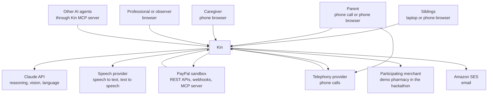

**People**

- **Siblings** set up the circle, contribute, approve and review.
- **The parent** listens, asks, approves and photographs letters.
- **The caregiver** bills hours and receives pay.
- **Professionals and observers** read and export.

**Outside systems**

- **PayPal** moves every dollar and reports every event.
- **Claude** reads documents, runs the agent and writes language.
- **The speech provider** turns audio into text and text into audio.
- **The telephony provider** connects phone calls.
- **A participating merchant** sells what the parent needs. In the hackathon this is a demo pharmacy that ships in the repository.

---

## 4. Services and stores

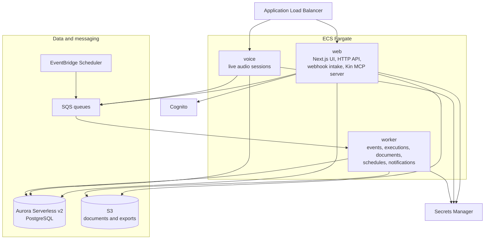

| Part                            | Responsibility                                                                                                                               | Never does                             |
| ------------------------------- | -------------------------------------------------------------------------------------------------------------------------------------------- | -------------------------------------- |
| **web**                   | Serves the app. Exposes the HTTP API. Receives PayPal and telephony webhooks. Hosts the Kin MCP server. Runs typed agent conversations.      | Call PayPal to move money in a request |
| **voice**                 | Holds live audio connections. Streams speech in and out. Runs spoken agent turns. Records voice approvals.                                   | Execute payments                       |
| **worker**                | Verifies and applies PayPal events. Executes approved proposals. Reads photographed documents. Runs settlement, schedules and notifications. | Serve user requests                    |
| **Aurora**                | Ledger, circles, bills, approvals, PayPal events, audit log                                                                                  |                                        |
| **S3**                    | Photographs, statements, audit exports                                                                                                       |                                        |
| **SQS**                   | Hands work from web and voice to worker, with retries                                                                                        |                                        |
| **EventBridge Scheduler** | Starts timed work                                                                                                                            |                                        |
| **Cognito**               | Signs people in and issues tokens                                                                                                            |                                        |
| **Secrets Manager**       | Holds every credential                                                                                                                       |                                        |

**Why three services and not one.** Live audio needs connections that stay open for minutes and must not be disturbed by a web deployment. Payment execution must continue when the web tier is busy and must be retried independently. Separating them keeps each simple.

**Why not more.** The three services share one codebase and one database. Splitting further would add network calls and failure modes without solving a problem Kin has.

---

## 5. Code structure

One repository with shared packages.

```
kin/
  apps/
    web/              Next.js app, HTTP API, webhook intake, Kin MCP server
    voice/            live audio service
    worker/           queue consumers and scheduled jobs
    demo-merchant/    stand-in pharmacy for the hackathon
  packages/
    domain/           ledger, fairness, state machines, policies. Pure code.
    db/               schema, migrations, repositories, row-level security
    paypal/           PayPal adapter, webhook verification, event mapping
    agent/            agent loop, tool gateway, prompts, number guard
    documents/        photo intake and extraction
    speech/           speech-to-text and text-to-speech adapters
    telephony/        call control adapter
    auth/             token verification, circle authorization
    notify/           email, push and narration queue
    config/           typed configuration and secrets loading
  infra/              AWS CDK stacks
  docs/
```

**The dependency rule.** `domain` depends on nothing. It has no database, no network and no AI. Every other package may depend on `domain`. Apps depend on packages and never on each other.

This rule is what makes the money logic testable in isolation and what makes the claim "the AI does not do the arithmetic" true in the code and not just in the pitch.

**Ports and adapters.** PayPal, Claude, speech, telephony and the merchant are each reached through an interface defined beside the code that needs it. The real adapters live in their own packages. Tests use fakes. Replacing a provider means writing one adapter.

---

## 6. Domain model

### 6.1 Concepts

| Concept                | Meaning                                                                                |
| ---------------------- | -------------------------------------------------------------------------------------- |
| **Circle**       | One person cared for and the people who share responsibility for them                  |
| **Member**       | A person's role within one circle                                                      |
| **Agreement**    | The versioned rules of a circle: shares, thresholds, care-hour rate, the parent's role |
| **Pool account** | The PayPal account that holds the circle's shared money                                |
| **Contribution** | Money a member puts in, by subscription, top-up or out-of-pocket spending              |
| **Care entry**   | Hours of hands-on care logged by a member                                              |
| **Bill**         | Something to be paid: a utility, a caregiver's hours, a repair                         |
| **Payee**        | A biller, caregiver or merchant, with an approval status                               |
| **Proposal**     | A requested movement of money, awaiting approval                                       |
| **Approval**     | One person's recorded yes or no, with evidence                                         |
| **Execution**    | The attempt to carry out an approved proposal through PayPal                           |
| **Ledger entry** | A balanced, permanent record of a financial fact                                       |
| **Settlement**   | The month-end calculation and the movements that restore the agreed shares             |
| **Document**     | A photographed or forwarded letter, bill or receipt                                    |
| **Claim check**  | A payment demand the parent asked Kin to verify                                        |
| **Narration**    | A money event prepared for the parent to hear                                          |

### 6.2 Entity relationships

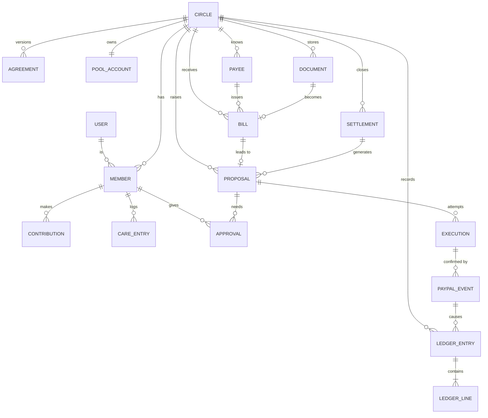

### 6.3 Tables

Every table except `users` carries a `circle_id`.

| Table               | Key contents                                                                        |
| ------------------- | ----------------------------------------------------------------------------------- |
| `users`           | Cognito subject, contact details, language, linked PayPal payer ID                  |
| `circles`         | Name, timezone, currency, status, pause flag                                        |
| `members`         | User, circle, role, status, parent participation level                              |
| `agreements`      | Version, shares in basis points, thresholds, care rate, effective date, acceptances |
| `pool_accounts`   | PayPal merchant ID, credential reference, webhook ID, mode                          |
| `payees`          | Name, type, PayPal recipient, status, auto-pay rule                                 |
| `subscriptions`   | Member, PayPal subscription ID, plan ID, amount, state                              |
| `contributions`   | Member, kind, amount, period, source reference                                      |
| `care_entries`    | Member, date, hours, note, approval state                                           |
| `documents`       | S3 key, kind, extraction result, confidence, state                                  |
| `bills`           | Payee, amount, due date, category, state, duplicate link                            |
| `proposals`       | Kind, amount, payee, origin, required approvals, state, expiry                      |
| `approvals`       | Proposal, member, decision, method, evidence reference                              |
| `executions`      | Proposal, idempotency key, PayPal resource IDs, state, attempts                     |
| `paypal_events`   | PayPal event ID, type, raw body, headers, verification state, processing state      |
| `ledger_entries`  | Date, kind, description, source reference, period                                   |
| `ledger_lines`    | Entry, account, direction, amount in cents                                          |
| `ledger_accounts` | Account code, type, member or payee link                                            |
| `settlements`     | Period, inputs snapshot, results, state                                             |
| `claim_checks`    | What was claimed, what was found, verdict, alerts sent                              |
| `narrations`      | Parent, event reference, text, priority, delivery state                             |
| `conversations`   | Channel, participant, turns, tool calls                                             |
| `call_sessions`   | Call reference, verification result, transcript reference                           |
| `outbox`          | Pending messages written in the same transaction as state changes                   |
| `audit_log`       | Who did what, when, from where                                                      |

---

## 7. The money core

This is the part of Kin that must never be wrong. It lives in `packages/domain` and is plain, deterministic code.

### 7.1 The ledger

Kin keeps a double-entry ledger for each circle.

- **Every entry balances.** The debits equal the credits, or the entry is rejected.
- **Entries are permanent.** There is no update and no delete. A mistake is corrected by a new reversing entry that points to the original.
- **Amounts are integer cents** with a currency code. There is no floating-point arithmetic.
- **Every entry names its cause:** a PayPal event, an approval or a settlement.

**Accounts per circle**

| Account                | Type      | Holds                                                                  |
| ---------------------- | --------- | ---------------------------------------------------------------------- |
| `pool_cash`          | Asset     | Mirrors the pool's PayPal balance                                      |
| `pool_clearing`      | Asset     | Money in motion, awaiting PayPal confirmation                          |
| `member:{id}`        | Equity    | What each member has contributed                                       |
| `expense:{category}` | Expense   | Care costs by category                                                 |
| `payable:{payee}`    | Liability | Approved bills not yet paid                                            |
| `fees`               | Expense   | PayPal fees                                                            |
| `care_credit:{id}`   | Memo      | Valued care hours. Tracked beside the cash ledger, never mixed into it |
| `care_received`      | Memo      | The other side of every care credit, so memo entries balance too       |

**Example entries**

| Event                                              | Debit                               | Credit                   |
| -------------------------------------------------- | ----------------------------------- | ------------------------ |
| Marcus's monthly share of 200.00 arrives, fee 7.28 | `pool_cash` 192.72, `fees` 7.28 | `member:marcus` 200.00 |
| Elena's 42.00 pharmacy receipt is approved         | `expense:pharmacy` 42.00          | `member:elena` 42.00   |
| Amara's 240.00 bill is approved                    | `expense:care` 240.00             | `payable:amara` 240.00 |
| The payout to Amara is confirmed                   | `payable:amara` 240.00            | `pool_cash` 240.00     |
| The refill of 42.00 is captured                    | `expense:pharmacy` 42.00          | `pool_cash` 42.00      |
| Settlement pays Elena 126.00                       | `member:elena` 126.00             | `pool_cash` 126.00     |

A member is credited with the gross amount they paid. PayPal fees are a shared cost of the circle.

**How the code holds these rules** (`packages/domain`, `ledger*.ts` and `postings.ts`)

- An entry touches cash accounts or memo accounts, never both. Approved care is posted as debit `care_received`, credit `care_credit:{id}`, valued once at approval to the nearest cent, halves up.
- The entry's source (a PayPal event, an approval or a settlement, with its ID) is its idempotency key. Applying an entry whose source is recorded changes nothing. A different entry claiming a recorded source is refused.
- A reversal mirrors its original line for line, keeps the original's kind and names it. An entry is reversed at most once, and a reversal is never itself reversed.
- `postings.ts` holds one builder per row of the table above, plus settlement collections and care credit. Callers state what happened. Which accounts move is decided there.

### 7.2 The fairness calculation

At any moment, and formally at month end, Kin answers one question for each member: are you ahead of your agreed share or behind it?

**Inputs for a period**

- `s_i`: the member's share, in basis points. All shares total 10,000.
- `P_i`: cash the member paid into the pool, net of refunds.
- `O_i`: approved out-of-pocket spending by the member.
- `C_i`: care credit, which is approved hours multiplied by the agreed rate. Zero if the family has not enabled it.
- `B_i`: the balance carried in from the previous period.

**Calculation**

1. Total contribution: `K = sum of (P_i + O_i + C_i)`.
2. Target for each member: `T_i = s_i × K ÷ 10,000`, rounded by the largest-remainder method so the targets total exactly `K`.
3. Cash due from each member: `D_i = max(0, T_i − C_i)`. Care hours reduce what a member owes in cash.
4. Cash position: `X_i = P_i + O_i − D_i + B_i`.
5. If `X_i` is positive, the pool owes the member. If negative, the member owes the pool.

**Rules**

- **Care credit lowers what a member owes. It is not paid out in cash** unless the family switches that on in the agreement. When it is on, step 3 is skipped and `X_i = P_i + O_i + C_i − T_i + B_i`.
- **Rounding never creates or loses a cent.** The largest-remainder method assigns leftover cents in a fixed, documented order: largest remainder first, and between equal remainders, the member whose ID sorts first. The result does not depend on the order members are listed in.
- **The calculation is a pure function.** The same inputs always give the same result, and the inputs are stored with each settlement so the result can be reproduced years later.
- **Inputs come from the ledger.** `P_i`, `O_i` and `C_i` are the period's net credits to the member's accounts from contribution, out-of-pocket and care-credit entries. A refund is a reversal, so it nets out. Settlement collections and payouts are left out, because they close an earlier period and reach the next one through `B_i`. A member who gave something but holds no share stops the calculation.
- **Care credit beyond the target earns nothing by default.** When `C_i > T_i`, the excess still counts in `K`, so the others' targets include it, but the carer is not paid for it. The pool keeps that cash. Each position reports it as unused care credit, so positions total `ΣB_i` minus the unused credit.

### 7.3 Settlement

Settlement turns the calculation into movements. Money moves through the pool, so a settlement holds exactly one movement for each member who is not level, which is the smallest set that closes every gap.

1. **Snapshot.** At period close, Kin freezes the inputs.
2. **Calculate.** The fairness function produces each member's position.
3. **Propose.** Members who owe receive a top-up request. Members who are owed become payout proposals.
4. **Approve.** The circle approves the settlement as a whole, under the agreement's rules.
5. **Collect, then pay.** Payouts are released only as far as the pool's confirmed balance allows, less every approved bill not yet paid. Kin never pays out money that has not arrived, nor money already promised to a caregiver or a biller. When the balance cannot cover every payout, it is shared among them in proportion to what each member is owed, by the same largest-remainder method, and the rest waits for collections.
6. **Close.** When every movement is confirmed or carried forward, the period is closed and the statement is produced. Unpaid amounts carry into the next period as `B_i`.

### 7.4 State machines

Each money-related record moves through explicit states. A transition that is not listed cannot happen.

**Proposal**

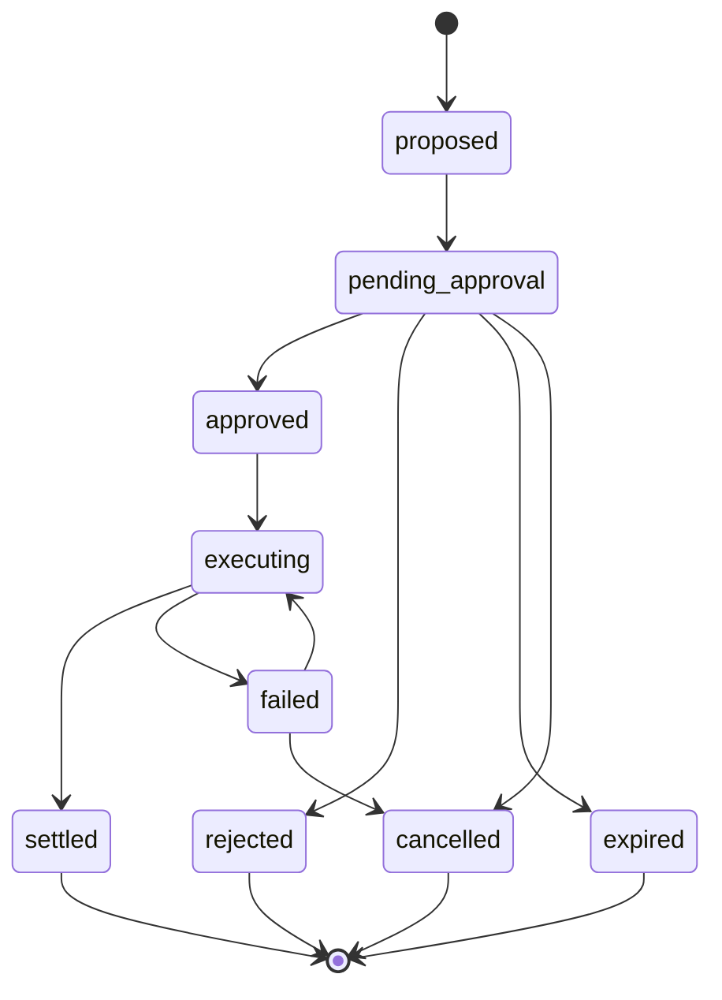

**Bill**

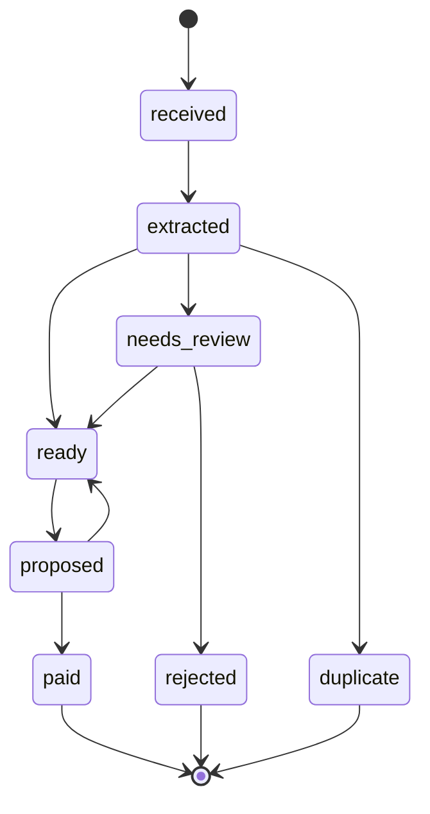

**Execution**

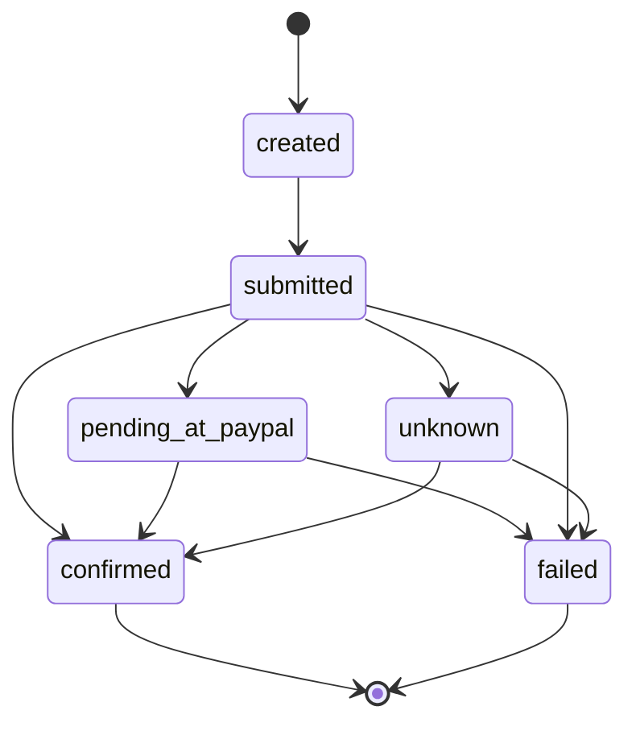

The `unknown` state matters. If a call to PayPal times out, Kin does not assume success or failure. It asks PayPal for the resource by its idempotency key and waits for the webhook.

### 7.5 The approval engine

Before any proposal can execute, the approval engine decides who must say yes.

**Inputs:** the kind of movement, the amount, whether the payee is known and approved, who raised the proposal, the current agreement and the parent's participation level.

**Output:** the set of approvals required and an expiry time.

**Rules, in order**

1. **Pause.** If the circle is paused, nothing is approved.
2. **Hard limits.** An amount above the agreement's ceiling is refused, whoever asks.
3. **Auto-pay.** A recurring bill from an approved payee, within its expected range, needs no new approval. The standing rule is recorded as the approver.
4. **The parent's decisions.** If the parent's level is "decides" and the amount is above their threshold, the parent's approval is required.
5. **Organizer approval** for everything else.
6. **Second approval** above the agreement's large-payment threshold.
7. **No self-approval.** A member cannot be the only approver of a payment to themselves.
8. **New payees** always need a person, and the whole circle is told.

**Evidence.** Each approval records how it was given:

| Method         | Evidence stored                                                                 |
| -------------- | ------------------------------------------------------------------------------- |
| Tap in the app | Cognito session, device, time, and a fresh multi-factor check for payouts       |
| Voice          | Call reference, verification result, the sentence read back, the parent's reply |
| Standing rule  | The rule's ID and the agreement version                                         |

### 7.6 Execution, the outbox and idempotency

Moving money involves a database and an outside API, which cannot share a transaction. Kin handles this with the outbox pattern.

1. In one database transaction, Kin marks the proposal approved, creates an execution with a fresh idempotency key, and writes an outbox row.
2. The worker reads the outbox and sends the message to the executions queue.
3. The worker calls PayPal, passing the idempotency key.
4. The worker records PayPal's reply and marks the execution submitted.
5. The execution is confirmed only when the matching PayPal event is verified and applied.

**Idempotency at each layer**

- **To PayPal:** the `PayPal-Request-Id` header carries the execution's key. For payouts, the `sender_batch_id` does. A retry cannot pay twice.
- **From PayPal:** each event's ID is unique in `paypal_events`. A redelivered event is ignored.
- **In the ledger:** each entry has a unique source reference. Applying the same event twice cannot write two entries.
- **In the queues:** per-circle ordering means two workers never act on the same circle at once.

---

## 8. PayPal integration

### 8.1 The pool account

Each circle has one PayPal account that holds its shared money. Kin does not hold funds.

**In the hackathon,** each demo circle maps to a sandbox business account. Its API credentials are stored in Secrets Manager and referenced from `pool_accounts`.

**In production,** Kin would act on a family's account through PayPal's partner model, with the family's consent and without holding their credentials. The code reaches the pool through a credential provider interface, so that change is confined to one adapter. This is the largest open question in the architecture and is listed in section 22.

### 8.2 Which PayPal capability does what

| Kin need                              | PayPal capability                                             | Direction         | Confirmed by                                           |
| ------------------------------------- | ------------------------------------------------------------- | ----------------- | ------------------------------------------------------ |
| Monthly share                         | Subscriptions, with a Catalog product and one plan per amount | Sibling to pool   | `PAYMENT.SALE.COMPLETED`, `BILLING.SUBSCRIPTION.*` |
| One-off top-up in the app             | Orders v2 with JavaScript SDK v6, PayPal or Pay Later         | Sibling to pool   | `PAYMENT.CAPTURE.COMPLETED`                          |
| Top-up or settlement request by email | Invoicing v2, with reminders and QR code                      | Sibling to pool   | `INVOICING.INVOICE.PAID`                             |
| Caregiver pay                         | Payouts                                                       | Pool to caregiver | `PAYMENT.PAYOUTS-ITEM.SUCCEEDED`                     |
| Settlement payout                     | Payouts                                                       | Pool to sibling   | `PAYMENT.PAYOUTS-ITEM.SUCCEEDED`                     |
| Purchases for the parent              | Vault payment token and Orders v2 at a participating merchant | Pool to merchant  | Merchant order status, then reconciliation             |
| Refund of a contribution              | Refunds                                                       | Pool to sibling   | `PAYMENT.CAPTURE.REFUNDED`                           |
| Delivery tracking                     | Shipment tracking on the merchant's order                     | Read              | Tracking status                                        |
| Disputed contribution                 | Disputes                                                      | Read and respond  | `CUSTOMER.DISPUTE.*`                                 |
| The record of truth                   | Webhooks and Transaction Search                               | Read              |                                                        |
| Identity of a payer                   | Log in with PayPal                                            | Read              |                                                        |
| Agent access to PayPal data           | Agent Toolkit and sandbox MCP server                          | Read              |                                                        |

### 8.3 Three corrections to the earlier documents

Checking the APIs changed three things. The PayPal tables in `project-description.md` and `tech-stack.md` have been updated to match.

1. **Caregivers are paid by payout, not by a PayPal invoice.** PayPal has no API for an account to pay an invoice it has received. The payer must sign in and pay by hand. So the caregiver's bill is a Kin record, and the payment is a PayPal payout from the pool. This is simpler and is paid the same day.
2. **Invoicing is used for requests to siblings.** When Kin asks a sibling for a top-up or a settlement amount, it sends a PayPal invoice from the pool. The sibling pays from the email or the QR code, and Kin can send reminders.
3. **Agent purchases need a saved payment method at the merchant.** A payer cannot be charged without either approving in PayPal or having saved their wallet with that merchant. Kin uses the second: the pool's wallet is saved once with a participating merchant, and later purchases are created by the merchant after Kin's approval. Saving a wallet this way works in the sandbox. In production PayPal must approve the merchant for it.

### 8.4 Contributions

**Subscriptions**

1. When a circle is created, Kin creates a Catalog product for it in the pool account.
2. For each sibling's share, Kin creates a plan for that amount and a subscription.
3. The sibling approves the subscription in PayPal. Kin uses the approval link PayPal returns, which works without depending on any SDK feature.
4. Each billing cycle, PayPal charges the sibling and sends `PAYMENT.SALE.COMPLETED`.
5. Kin credits the member in the ledger.
6. A failed charge arrives as `BILLING.SUBSCRIPTION.PAYMENT.FAILED`. Kin tells the circle and the fairness ledger shows the gap.

**Top-ups in the app**

1. Kin creates an order in the pool account for the sibling's amount.
2. The browser starts a one-time payment session with JavaScript SDK v6. Where the sibling is eligible, a Pay Later session is offered beside it.
3. On approval the server captures the order.
4. `PAYMENT.CAPTURE.COMPLETED` confirms it and Kin credits the member.

**Requests by invoice**

1. Kin creates and sends an invoice from the pool to the sibling's email.
2. The sibling pays from the email or the QR code.
3. `INVOICING.INVOICE.PAID` confirms it.
4. If it stays unpaid, Kin sends a reminder on the schedule in the agreement.

### 8.5 Payouts

Used for caregiver pay and for settlement payouts to siblings.

1. The approved proposal becomes a payout batch with one item.
2. The recipient is identified by PayPal email, phone or payer ID.
3. The batch ID is the execution's idempotency key.
4. PayPal reports the result per item. Kin acts on each outcome:

| Item outcome                           | Kin's action                                                                     |
| -------------------------------------- | -------------------------------------------------------------------------------- |
| Succeeded                              | Confirm the execution, write the ledger entry, tell the recipient and the circle |
| Unclaimed                              | Tell the recipient how to claim. Keep the money in`pool_clearing`              |
| Returned, failed, blocked or cancelled | Reverse the clearing entry, mark the execution failed, alert the organizer       |
| Held                                   | Wait and tell the organizer                                                      |

### 8.6 Purchases for the parent

1. **Linking, once.** The pool account holder saves the pool's PayPal wallet with the merchant. PayPal returns a setup token, the holder approves in PayPal, and the merchant receives a payment token.
2. **Finding.** The agent searches the merchant's catalog and builds a cart.
3. **Proposing.** The cart becomes a proposal with the exact items and total.
4. **Approving.** The parent or the family approves under the agreement's rules.
5. **Buying.** Kin sends the merchant a signed instruction that names the cart, the total and the approval. The merchant creates and captures a PayPal order with the saved payment token.
6. **Confirming.** Kin reads the order's status from the merchant and writes the ledger entry. The nightly reconciliation checks it against the pool's own transaction history.
7. **Tracking.** The merchant adds tracking to the order and Kin follows it.

**The amount is bound to the approval.** The signed instruction carries the approved total. The merchant must charge exactly that. A different amount is refused.

**The fallback.** If a merchant cannot save the pool's wallet, the purchase is paid from a member's own PayPal wallet with their approval in PayPal. Kin records it as that member's out-of-pocket contribution, and settlement reimburses them. The fairness model absorbs this case without any special handling.

**The demo merchant.** `apps/demo-merchant` is a small pharmacy with its own sandbox business account. It exists so the hackathon can show a complete purchase. It is labelled as a stand-in everywhere it appears.

### 8.7 The webhook pipeline

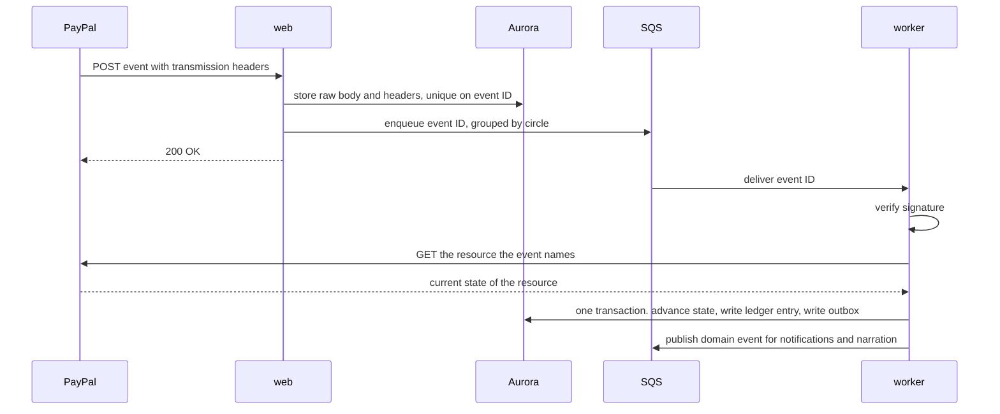

**Rules**

- **Store first.** The raw body is saved before anything else, so no event is lost and the signature can be checked against the exact bytes received.
- **Answer quickly.** PayPal retries a delivery that does not return success, up to 25 times over three days. Kin returns success once the event is safely stored.
- **Verify before applying.** An event that fails verification is kept for inspection and never applied.
- **Read the resource back.** Kin does not trust the event body for amounts or status. It fetches the resource from PayPal and uses that.
- **Tolerate disorder.** Events can arrive late or out of order. State machines only move forward, so a stale event changes nothing.
- **One circle at a time.** Events are queued in a group per circle, so they are processed in order for that circle.

**Simulator events.** PayPal's webhook simulator sends events that cannot be verified by PayPal's verification call. Kin accepts them only in the test environment, behind an explicit setting, and marks them as simulated.

### 8.8 Reconciliation

Webhooks are fast but can be missed. Every night Kin reads the pool's transaction history and balance from PayPal and compares them with the ledger.

- **A PayPal transaction with no ledger entry** means a missed event. Kin fetches the resource and applies it through the normal path.
- **A ledger entry with no PayPal transaction** is a serious fault. Kin alerts and does not correct it automatically.
- **A balance difference** is reported to the organizer with the entries that explain it.

PayPal's transaction history can lag behind real time, so reconciliation looks at a window that ends several hours in the past.

### 8.9 The PayPal adapter

`packages/paypal` is the only code that talks to PayPal.

- **Token handling.** Access tokens are fetched per pool account, cached until shortly before expiry and never logged.
- **One method per business action,** such as `createPayout` or `captureOrder`, each requiring an idempotency key.
- **Typed results and typed errors,** so callers can tell a decline from an outage.
- **Debug IDs.** PayPal returns a debug ID with each response. Kin logs it with every call, which makes support requests to PayPal possible.
- **Retry policy.** Network errors and server errors are retried with backoff, using the same idempotency key. Client errors are not retried.

---

## 9. AI architecture

### 9.1 The principle

The agent is powerful at understanding and powerless over money. It reads documents, holds conversations, explains balances and drafts proposals. It cannot approve, execute or alter a record of what happened.

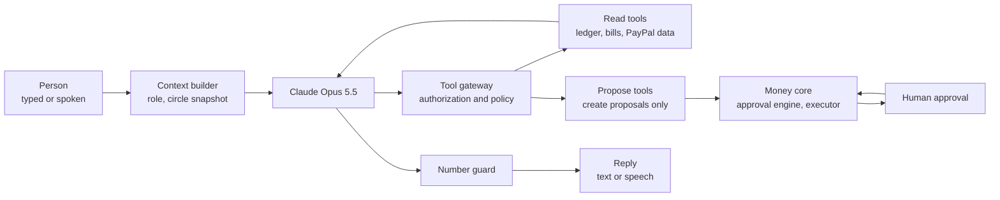

### 9.2 The agent loop

One agent serves every channel. What changes is who it is speaking to.

1. **Build context.** The context builder loads the speaker's role, language and permissions, and a compact snapshot of the circle: balances, open bills, pending approvals and recent events. This snapshot is produced by the money core, not by the model.
2. **Run the model** with the tools the speaker's role allows.
3. **Route tool calls** through the tool gateway.
4. **Check the reply** with the number guard.
5. **Deliver** as text or speech and store the turn.

**Model configuration**

- Model `claude-opus-5-5` through the Anthropic TypeScript SDK and its tool runner.
- Effort is set explicitly on every call: low for spoken turns, medium for typed conversation, high for documents and statements.
- Tool choice is automatic, with strict tool schemas. This model rejects forced tool choice.
- Structured output for anything Kin stores.
- Streaming for every reply a person waits for.
- The stop reason is checked on every response. A refusal is handled as a normal outcome, and server-side fallbacks are enabled.
- The system prompt and tool list are stable and cached. The changing circle snapshot comes after the cached part.

### 9.3 The tool gateway

Every tool call passes through one gateway, which does four things before any tool runs.

1. **Identity.** Confirms who is speaking and in which circle.
2. **Scope.** Confirms the role may use this tool.
3. **Validation.** Validates arguments against the tool's schema.
4. **Record.** Writes the call to the conversation log.

**Tools by role**

| Tool                                | Parent | Sibling | Caregiver | Kind                             |
| ----------------------------------- | ------ | ------- | --------- | -------------------------------- |
| `get_circle_summary`              | Yes    | Yes     | No        | Read                             |
| `list_bills`, `get_bill`        | Yes    | Yes     | Own only  | Read                             |
| `get_ledger`, `explain_balance` | Yes    | Yes     | No        | Read                             |
| `get_payment_status`              | Yes    | Yes     | Own only  | Read                             |
| `search_paypal_transactions`      | No     | Yes     | No        | Read, through the PayPal toolkit |
| `search_merchant_catalog`         | Yes    | Yes     | No        | Read                             |
| `check_payment_claim`             | Yes    | Yes     | No        | Read                             |
| `submit_document`                 | Yes    | Yes     | Yes       | Write to inbox                   |
| `log_care_hours`                  | No     | Yes     | No        | Write, needs approval            |
| `propose_bill_payment`            | Yes    | Yes     | No        | Proposal                         |
| `propose_purchase`                | Yes    | Yes     | No        | Proposal                         |
| `propose_caregiver_bill`          | No     | No      | Yes       | Proposal                         |
| `record_voice_decision`           | Yes    | No      | No        | Approval, after read-back        |
| `alert_circle`                    | Yes    | Yes     | Yes       | Notification                     |

**No tool pays anyone.** The strongest tools create a proposal. The approval engine and a person stand between every proposal and PayPal.

**How the PayPal Agent Toolkit is used.** The agent receives PayPal's read tools, such as listing transactions and reading an order, an invoice, a subscription or a shipment, filtered to an allowed list. PayPal's write tools are not given to the model. Writes go through Kin's proposals and are carried out by the executor through the PayPal adapter.

### 9.4 Reading documents

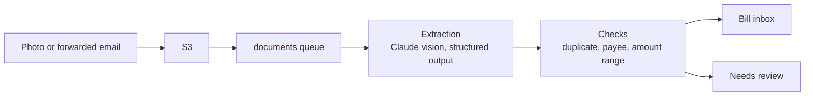

1. The photograph is uploaded directly to S3.
2. The worker sends it to Claude with a fixed schema: document type, sender, amount, currency, due date, account reference, and a confidence for each field.
3. Deterministic checks run on the result:
   - **Duplicate:** same payee, amount and period as an existing bill.
   - **Payee:** known and approved, known and new, or unknown.
   - **Range:** within the usual range for this payee, or not.
   - **Confidence:** every required field above its threshold.
4. A document that passes becomes a bill. One that does not goes to a person with the reason stated.

**The document is untrusted.** Its text is treated as data to extract, never as instructions to follow. This matters because a scam letter may be written to manipulate whoever reads it.

### 9.5 The claim check

When the parent asks whether a demand for money is real, the answer must not depend on the model's judgment.

1. **Extract.** The model turns what the parent said, or the photographed letter, into a structured claim: who is asking, how much, for what.
2. **Look up.** Plain code searches the circle's payees, bills and ledger.
3. **Decide.** Plain code picks one of four verdicts.

| Verdict                  | Condition                              | What the parent hears                                                           |
| ------------------------ | -------------------------------------- | ------------------------------------------------------------------------------- |
| **Already paid**   | A matching bill was paid               | "That bill was paid on the 2nd. Nothing is owed."                               |
| **Known and due**  | A matching bill is open                | "That is a real bill. It is on the family's list and will be paid on the 30th." |
| **No record**      | The payee is known but nothing matches | "I find no bill like that. Please do not pay. I have told the family."          |
| **Unknown sender** | The payee is not known at all          | "I do not know this sender. Please do not pay. I have told the family."         |

4. **Phrase.** The model words the verdict in the parent's language. The facts are filled in from the lookup.
5. **Alert.** For the last two verdicts the circle is told at once.

Kin never says a caller is a criminal. It says what its records show and what to do.

### 9.6 Narration and the number guard

Every sentence about money that reaches a person is built the same way.

1. **Facts from the ledger.** A money event produces a small record: kind, payee, amount, date, source.
2. **Wording from the model.** The model turns the record into a natural sentence in the listener's language.
3. **The number guard.** Before delivery, code extracts every amount, date and name from the sentence and compares them with the record. If anything differs or is missing, the sentence is discarded and a fixed template is used.

This means the parent can never hear an amount that the ledger does not contain. The same guard checks statements and explanations.

### 9.7 Defense against manipulation

| Threat                                            | Defense                                                                                                            |
| ------------------------------------------------- | ------------------------------------------------------------------------------------------------------------------ |
| A letter contains instructions aimed at the agent | Document text is passed as data. The extraction step has no tools at all.                                          |
| A caller tells the parent to instruct Kin to pay  | The agent can only propose. New payees always need a family member's approval.                                     |
| A user asks the agent to ignore its rules         | The rules are enforced in the gateway and the approval engine, not in the prompt.                                  |
| The model invents an amount                       | The number guard rejects it.                                                                                       |
| A caregiver asks about the family's finances      | The gateway refuses tools outside the caregiver's scope.                                                           |
| The model's reply drifts out of role              | Replies are checked against a short list of things Kin never says, such as requests for passwords or card numbers. |

### 9.8 Measuring the AI

Three fixed test sets run before every release.

- **Documents:** photographs of bills and letters with known contents. Measures extraction accuracy per field.
- **Claims:** true and false payment demands. Measures verdict accuracy. A false "already paid" is treated as the worst error.
- **Conversations:** scripted exchanges per role. Measures correct tool use and refusal of out-of-scope requests.

---

## 10. Voice architecture

### 10.1 Two voice paths, one agent

| Path                   | Used by                                  | Transport                                                           |
| ---------------------- | ---------------------------------------- | ------------------------------------------------------------------- |
| **Phone call**   | The parent, on any phone                 | Telephony provider to the voice service over a streaming connection |
| **In-app voice** | The parent and caregiver, in the browser | Browser microphone to the voice service over a WebSocket            |

Both paths end in the same voice session, which runs the same agent with the same tools.

### 10.2 Inside a voice session

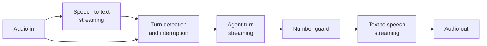

- **Streaming end to end.** Speech is transcribed as it arrives, the model's reply is spoken as it is produced, and each sentence is checked and voiced before the next is complete.
- **Interruption.** If the parent starts speaking, playback stops at once and Kin listens.
- **Patience.** Pauses are allowed to be long. Kin repeats on request and slows down if asked.
- **Short context.** A voice turn carries a small snapshot, which keeps replies quick.
- **State.** The session is held in the voice service's memory and checkpointed to the database after each turn, so a dropped call can resume.

### 10.3 Calls Kin makes

1. A schedule or an event creates a narration for the parent.
2. The worker checks the parent's preferences: immediately, daily or weekly, and the hours when calls are welcome.
3. The worker asks the telephony provider to place a call to the registered number.
4. When the parent answers, the call is connected to a voice session.
5. Kin introduces itself in the same words every time.
6. If voicemail answers, Kin leaves no money details. It says only that Kin called and will call again.

### 10.4 Calls the parent makes

1. The telephony provider receives the call and asks Kin what to do.
2. Kin matches the caller's number to a parent.
3. The call is connected to a voice session.
4. Before any money is discussed, the parent confirms with their spoken phrase or PIN.
5. An unknown number hears a short neutral message and nothing else.

### 10.5 Voice approvals

A spoken yes is a real approval, so it is handled carefully.

1. Kin states the request in full: what, for whom and how much.
2. The parent answers.
3. Kin reads back the decision and asks for confirmation.
4. Only after the confirmation does Kin record the approval.
5. The record holds the call reference, the verification result, the sentence read back and the reply.

Three failed verifications end the call and alert the organizer. The parent's level drops to "informed" until a family member restores it.

### 10.6 Latency target

The target is that Kin begins speaking within about one and a half seconds of the parent finishing. That budget is shared between detecting the end of speech, the model's first words and the first audio. It is a target to measure against, not a measured result.

---

## 11. Key flows

### 11.1 A monthly contribution arrives

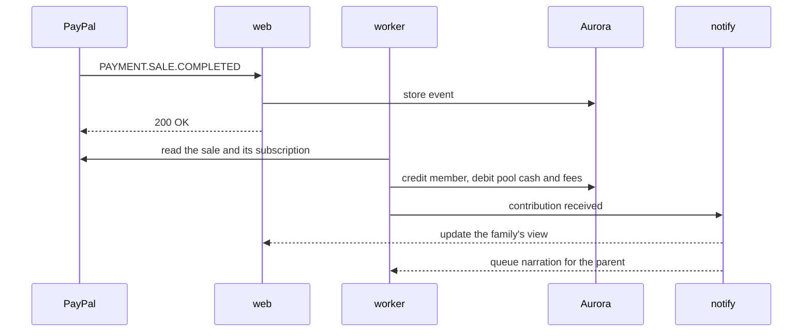

### 11.2 The caregiver bills by voice and is paid

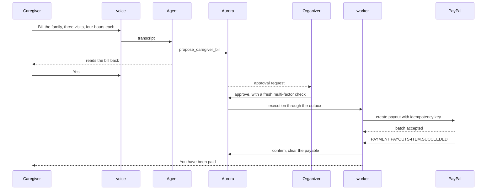

### 11.3 A refill, approved by the parent's voice

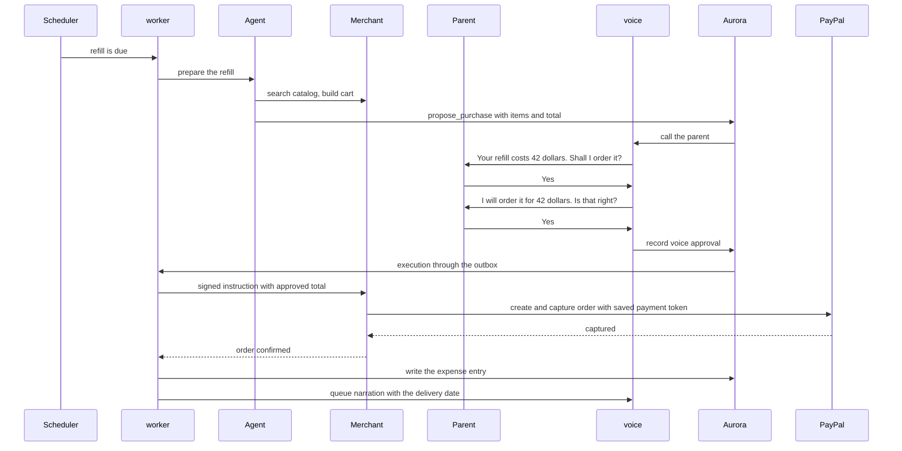

### 11.4 The parent photographs a letter

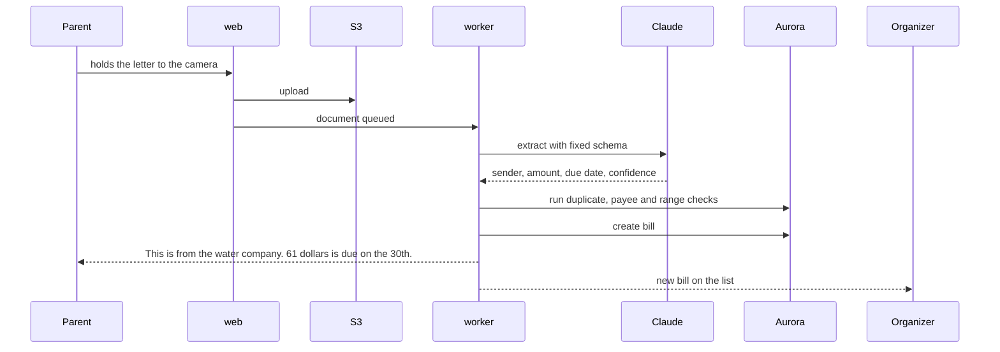

### 11.5 A false demand is caught

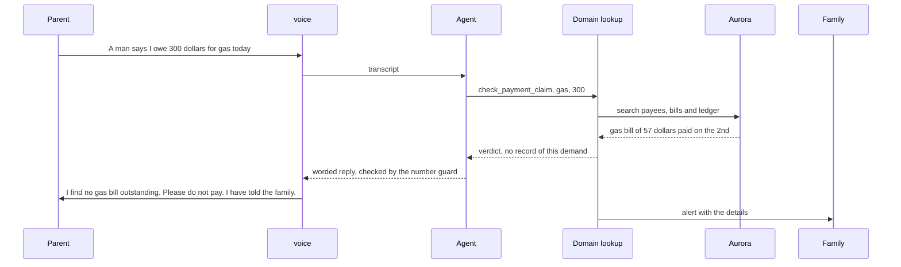

### 11.6 Month-end settlement

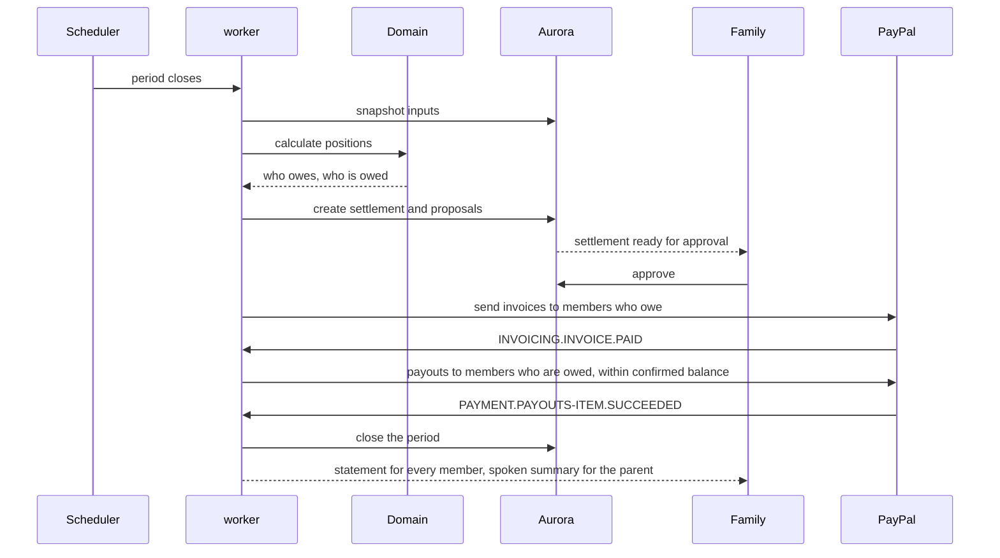

---

## 12. Identity and access

### 12.1 Signing in

- **Amazon Cognito** holds one user pool for every person.
- **Passwordless sign-in** by emailed code or passkey, through Cognito's managed pages.
- **Multi-factor authentication** is required for organizers and for anyone approving a payout. Approving a payout asks for a fresh check even inside an active session.
- **Tokens** are verified by every service on every request.

### 12.2 Linking a PayPal account

Signing in to Kin and connecting a PayPal account are separate steps.

- A member connects PayPal through Log in with PayPal. The web service handles the exchange directly and stores the member's payer ID and verified email.
- That identity is what payouts are sent to, which prevents a payout going to a mistyped address.
- **Signing in to Kin with PayPal through Cognito is optional.** PayPal's login uses its own endpoints, and whether it fits Cognito's federation needs a trial. Kin does not depend on it.

### 12.3 Authorization

Three layers, each independent of the others.

| Layer                        | Question                                     | Where enforced                                       |
| ---------------------------- | -------------------------------------------- | ---------------------------------------------------- |
| **Account type**       | May this person use this part of Kin at all? | Cognito group, checked at the edge                   |
| **Circle role**        | What may this person do in this circle?      | Service, on every request, from the`members` table |
| **Row-level security** | Can this query see this row?                 | Aurora, on every query                               |

**How row-level security works.** At the start of each request, the service opens a transaction and sets the user's ID as a session setting. Every table has a policy that allows a row only if the user is an active member of that row's circle, with further limits for caregivers and observers. A query that forgets its filter returns nothing instead of another family's data.

**Service access.** The worker acts for the system, not for a user. It uses a separate database role, and each job names the single circle it is working on.

### 12.4 The parent on a call

Covered in section 10. A phone call has no browser session, so identity comes from the registered number and a spoken phrase or PIN. The voice service is limited to the circle of the verified parent.

---

## 13. Interfaces

### 13.1 HTTP API

Served by `web`. All routes require a Cognito token except webhooks, which carry their own signatures.

| Group                   | Purpose                                         |
| ----------------------- | ----------------------------------------------- |
| `/api/circles`        | Create and read circles, members and agreements |
| `/api/contributions`  | Subscriptions, top-ups, out-of-pocket receipts  |
| `/api/care`           | Log and approve care hours                      |
| `/api/documents`      | Upload links, document status                   |
| `/api/bills`          | List, review, approve payees                    |
| `/api/proposals`      | List, approve, reject, cancel                   |
| `/api/ledger`         | Entries, balances, fairness positions           |
| `/api/settlements`    | Preview, approve, history                       |
| `/api/statements`     | Monthly statement, yearly review, audit export  |
| `/api/agent`          | Typed conversation with the agent, streamed     |
| `/api/paypal/connect` | Link a PayPal identity                          |
| `/api/admin/pause`    | Pause and resume a circle                       |

### 13.2 Inbound webhooks

| Route                                | From                   | Protection                  |
| ------------------------------------ | ---------------------- | --------------------------- |
| `/webhooks/paypal/{poolAccountId}` | PayPal                 | Signature verification      |
| `/webhooks/telephony/*`            | Telephony provider     | Signature verification      |
| `/webhooks/merchant/{merchantId}`  | Participating merchant | Signed with a shared secret |

### 13.3 Live connections

| Route             | Used for                               |
| ----------------- | -------------------------------------- |
| `/voice/stream` | Call audio from the telephony provider |
| `/voice/app`    | In-app voice from the browser          |

### 13.4 The Kin MCP server

Kin is itself usable by other AI agents. A sibling can connect their own assistant and ask about the circle.

- Protected by Cognito-issued OAuth tokens.
- Exposes the same tools as the sibling role, through the same tool gateway.
- Every write is a proposal. An outside agent can never approve or execute.

---

## 14. Infrastructure on AWS

### 14.1 Layout

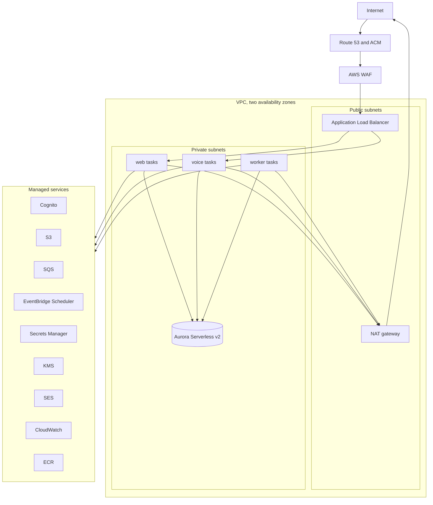

### 14.2 Network

- One VPC across two availability zones.
- The load balancer sits in public subnets. Services and the database sit in private subnets with no public address.
- Outbound calls to PayPal, Claude, speech and telephony leave through a NAT gateway.
- Security groups allow only the load balancer to reach the services, and only the services to reach the database.

### 14.3 Compute

| Service | Tasks     | Notes                                                             |
| ------- | --------- | ----------------------------------------------------------------- |
| web     | 2         | Rolling deployment, health-checked                                |
| voice   | 1 or more | Connections are drained before a task stops, so calls are not cut |
| worker  | 1 or more | Scales on queue depth                                             |

The load balancer routes `/voice/*` to the voice service, with a long idle timeout for live audio. Everything else goes to web.

### 14.4 Data

- **Aurora Serverless v2,** PostgreSQL-compatible, one writer, in private subnets. Minimum capacity is kept above zero during judging to avoid a slow first request.
- **Backups** with point-in-time recovery.
- **Encryption** with a KMS key.
- **Migrations** run as a one-off task before each deployment.

### 14.5 Queues and schedules

| Queue             | Carries                              | Ordering    |
| ----------------- | ------------------------------------ | ----------- |
| `paypal-events` | Stored event IDs to verify and apply | Per circle  |
| `executions`    | Approved proposals to carry out      | Per circle  |
| `documents`     | Photographs to read                  | None needed |
| `notifications` | Emails, pushes, alerts               | None needed |
| `narration`     | Items for the parent to hear         | Per parent  |

Every queue has a dead-letter queue and an alarm on it.

**Schedules:** period close per circle in its own timezone, refill reminders, the parent's calling times, invoice reminders, approval expiry and the nightly reconciliation.

### 14.6 Storage

- **Documents bucket:** private, encrypted, versioned. Objects are reached only through short-lived signed links.
- **Exports bucket:** statements and audit exports, with the same protections.

### 14.7 Configuration

- Non-secret configuration is typed and validated at startup. A service with invalid configuration does not start.
- Secrets come from Secrets Manager at startup and are never written to logs or images.

### 14.8 Sharing the AWS account

Kin runs in AWS account `707938860881`, us-east-1, beside four other projects: wick (Terraform), Hold (CDK, default bootstrap), carecircle (Terraform) and zeitzeuge. Kin shares only what an account cannot hold twice or should not: the GitHub OIDC provider and the region. Every Kin resource is its own, named `kin-*` or `Kin*` and tagged `project=kin`.

Separate names are not enough on their own. Some of the other projects' principals hold account-wide permissions, such as wick's deploy role with `s3:*`, `dynamodb:*` and `lambda:*` on every resource. So Kin keeps them out in its own resource policies:

| Boundary | How it holds |
| --- | --- |
| Encryption | One customer key, `alias/kin`, for Aurora, both buckets, every queue and the database secret. |
| Explicit deny | Every bucket, queue and secret, and the key itself, deny all actions to the other projects' roles and users, listed in `cdk.json` as `kin:neighbourPrincipalPatterns`. An explicit deny overrides any allow they hold. Add a pattern when a project joins the account. |
| Network | Kin's own VPC. The database admits only the `kin-services` security group, on port 5432, from isolated subnets with no internet route. |
| Sign-in | Kin's own Cognito pool, `kin-people`. Nobody signs in across projects. |
| Deployment | Kin's own CDK bootstrap, qualifier `kin`, stack `KinCDKToolkit`. The GitHub role `kin-github-deploy` trusts one repository and one branch, and may assume only `cdk-kin-*` roles. |
| Cost | The budget `kin-monthly` counts only resources tagged `project=kin`. |

**What the deny cannot cover.** Cognito user pools, Lambda functions, log groups and ECR repositories have no resource policy that a deny can sit in, or none that covers management actions. Wick's deploy role can change any of them. Closing that needs wick's role narrowed to `wick*` resources, in wick's repository. The account's Lambda concurrency quota is 10 and is shared, so Kin adds one function, the deploy-time custom resource that locks the VPC's default security group.

The stacks are `KinOps` (alerts and budget, deployed first), `KinNetwork`, `KinData` and `KinCi`, in `infra/`. Compute, the load balancer and the Fargate services, follows when the apps have images. Aurora's capacity is `kin:databaseCapacityAcu` in `cdk.json`: a minimum of 0 lets it pause while nobody is using it, and it is raised above zero for judging.

---

## 15. Security

### 15.1 Threats and controls

| Threat                                              | Control                                                                                                                                                                   |
| --------------------------------------------------- | ------------------------------------------------------------------------------------------------------------------------------------------------------------------------- |
| **A family member drains the pool**           | Payments only to approved payees and members. Limits from the agreement. Second approval above a threshold. No self-approval. Every change announced to the whole circle. |
| **An account is taken over**                  | Passwordless sign-in, multi-factor authentication, a fresh check for payouts, alerts on new devices.                                                                      |
| **A stranger pressures the parent**           | New payees need a family member. The claim check. Alerts on unusual requests.                                                                                             |
| **Someone impersonates the parent on a call** | Registered number plus spoken phrase or PIN. Lockout after three failures. Voice approvals capped at the parent's threshold.                                              |
| **A caregiver over-bills**                    | Bills checked against the visit pattern and usual amounts. Organizer approval on every caregiver bill.                                                                    |
| **A forged webhook**                          | Signature verification and reading the resource back from PayPal.                                                                                                         |
| **A replayed request**                        | Idempotency keys at every layer.                                                                                                                                          |
| **A malicious document**                      | Extraction has no tools. Document text is data.                                                                                                                           |
| **One family reads another's data**           | Circle checks in the service and row-level security in the database.                                                                                                      |
| **A credential leaks**                        | Secrets only in Secrets Manager. Each service has its own minimal IAM role. Keys are rotated.                                                                             |
| **The merchant charges the wrong amount**     | The approved total is bound into the signed instruction and checked on confirmation.                                                                                      |

### 15.2 Data protection

- **In transit:** TLS everywhere.
- **At rest:** KMS encryption in Aurora and S3.
- **Minimal data:** financial records and documents only. No medical records.
- **Logs:** no tokens, no credentials, no document contents. Personal details are masked.
- **Model calls:** only the fields needed for the task are sent.
- **Retention:** documents and recordings are kept only as long as the circle's policy and the law require.
- **Call recordings are off by default.** Only the text of approvals is kept.

### 15.3 The pause switch

Any member can pause the circle. For 24 hours no proposal is approved and no execution is submitted. Movements already submitted to PayPal continue to be tracked. Every member is told who paused it and why.

---

## 16. Reliability and failure handling

| Failure                                           | What Kin does                                                                                                            |
| ------------------------------------------------- | ------------------------------------------------------------------------------------------------------------------------ |
| **PayPal call times out**                   | Marks the execution unknown, queries PayPal by idempotency key, waits for the webhook. Never assumes.                    |
| **PayPal declines a payment**               | Marks the execution failed with PayPal's reason. Tells the organizer in plain words.                                     |
| **A webhook is missed**                     | Nightly reconciliation finds and applies it.                                                                             |
| **A webhook arrives twice or out of order** | Duplicate IDs are ignored. State machines only move forward.                                                             |
| **A payout is unclaimed**                   | Money stays in clearing. The recipient is told how to claim.                                                             |
| **Claude is unavailable**                   | Reading and conversation pause. Scheduled payments, webhooks and the ledger continue. Narration falls back to templates. |
| **The speech provider is unavailable**      | The parent receives a text or email instead. In-app use continues on screen.                                             |
| **A call drops mid-approval**               | No approval is recorded unless the confirmation was heard. Kin calls back.                                               |
| **The merchant is unavailable**             | The purchase stays approved and is retried. The parent is told of the delay.                                             |
| **A worker crashes mid-job**                | The message returns to the queue. Idempotency makes the retry safe.                                                      |
| **A message keeps failing**                 | It moves to the dead-letter queue and raises an alarm.                                                                   |
| **The database is briefly unavailable**     | Web returns a clear error. Webhooks are not acknowledged, so PayPal retries them.                                        |
| **A deployment goes wrong**                 | Rolling deployment with health checks rolls back automatically.                                                          |

**The governing rule:** when Kin is unsure whether money moved, it stops, finds out from PayPal and tells a person. It never guesses and never retries blindly.

---

## 17. Observability and audit

### 17.1 Logs, metrics and alarms

- **Structured logs** from every service, each line tagged with the circle, the proposal, the execution and PayPal's debug ID.
- **A correlation ID** follows one piece of work from the first request through every queue and service.

| Metric                      | Why                              |
| --------------------------- | -------------------------------- |
| Webhook processing delay    | Shows how current the ledger is  |
| Executions by outcome       | Shows payments are succeeding    |
| Executions in unknown state | Should be near zero              |
| Dead-letter queue depth     | Should be zero                   |
| Reconciliation differences  | Should be zero                   |
| Time to first spoken word   | The voice experience             |
| Number guard rejections     | Shows how often the model strays |
| Extraction confidence       | Shows document reading quality   |
| Model cost per circle       | Keeps running costs known        |

**Alarms** on any dead-lettered message, any reconciliation difference, any execution unknown for more than a few minutes, and any failed deployment.

### 17.2 The audit trail

The audit trail is a product feature as well as an operational one. For any movement of money, Kin can show:

1. What caused it: the bill, receipt or settlement.
2. The document behind it, as photographed.
3. Who proposed it.
4. Who approved it, how and when, with the evidence.
5. The request sent to PayPal and its identifier.
6. The PayPal event that confirmed it.
7. The ledger entry it produced.

The audit export assembles these into one dated record per movement.

---

## 18. Performance and scale

**For the hackathon,** load is a handful of demo circles and occasional judge visits. The architecture is sized well above that.

**Where it would be stressed first, and the answer**

| Pressure                   | Answer                                                                    |
| -------------------------- | ------------------------------------------------------------------------- |
| Many simultaneous calls    | The voice service scales by adding tasks. Sessions are independent.       |
| Bursts of webhooks         | Intake only stores and queues. Workers scale on queue depth.              |
| Month-end for many circles | Settlements are spread by timezone and processed per circle from a queue. |
| Database load              | Aurora scales capacity automatically. Reads can move to a replica.        |
| Model cost and latency     | Cached prompts, small snapshots, low effort for speech.                   |

**The ledger grows forever by design.** Balances are computed from entries, with periodic checkpoints so that reading a current balance does not require scanning all history.

---

## 19. Testing

| Level                 | What is tested                                                        | How                                                           |
| --------------------- | --------------------------------------------------------------------- | ------------------------------------------------------------- |
| **Domain**      | Ledger invariants, fairness, rounding, state machines, approval rules | Unit tests and property-based tests. No database, no network. |
| **Adapters**    | PayPal mapping, webhook verification, event handling                  | Tests against recorded PayPal responses                       |
| **Integration** | A full flow through the database and queues                           | A real PostgreSQL and a fake PayPal                           |
| **Sandbox**     | Real calls to the PayPal sandbox                                      | Run on demand and before release                              |
| **Negative**    | Declines, failures and reversals                                      | PayPal's negative testing and the webhook simulator           |
| **End to end**  | The main journeys in a browser                                        | Playwright                                                    |
| **AI**          | Extraction, claims and conversations                                  | The three fixed test sets in section 9.8                      |
| **Voice**       | Spoken flows                                                          | Recorded audio played into the voice service                  |
| **Security**    | Isolation between circles                                             | Tests that try to read another circle's data and must fail    |

**Properties the domain tests assert for any input**

- Every ledger entry balances.
- Fairness targets always total the contributions exactly.
- A settlement never proposes paying out more than the pool holds.
- Applying the same event twice changes nothing.
- No sequence of events can move a record backwards.

---

## 20. Environments, deployment and demo mode

### 20.1 Environments

| Environment     | Purpose                                                                    | PayPal                   |
| --------------- | -------------------------------------------------------------------------- | ------------------------ |
| **Local** | Development. Services and PostgreSQL in containers. A tunnel for webhooks. | Sandbox                  |
| **Test**  | Automated tests in continuous integration                                  | Fake, plus the simulator |
| **Demo**  | The hosted environment judges use                                          | Sandbox                  |

### 20.2 Deployment

1. A push to the main branch starts the pipeline in GitHub Actions.
2. Lint, type-check and tests run.
3. The container image is built and pushed to ECR.
4. Database migrations run as a one-off task.
5. The CDK deploys infrastructure changes.
6. Services roll forward one task at a time, with health checks and automatic rollback.

GitHub signs in to AWS through OpenID Connect. No AWS keys are stored in GitHub.

### 20.3 Demo mode

The hackathon needs a month of family life to be shown in minutes.

- **Seeded data.** One complete circle: Rose, Elena, Marcus, Ana and Amara, each with a Cognito account and a sandbox PayPal account.
- **A demo clock.** The current date is supplied by a clock that the demo environment can move forward. Settlement and schedules follow it. In every other environment it is the real time.
- **Simulated billing cycles.** PayPal's sandbox bills subscriptions in real time. To show several months, the demo replays subscription payment events through the normal webhook path.
- **Honest labelling.** Anything simulated is marked as simulated in the interface and in the ledger entry. Real sandbox transactions and simulated ones are never presented as the same thing.
- **Reset.** One command returns the circle to its starting state.

---

## 21. Decision record

| #  | Decision                                                    | Alternatives considered                    | Reason                                                                                      |
| -- | ----------------------------------------------------------- | ------------------------------------------ | ------------------------------------------------------------------------------------------- |
| 1  | Double-entry, append-only ledger                            | A table of balances                        | Auditability is the product. Balances alone cannot explain themselves.                      |
| 2  | Webhooks plus read-back as the source of truth              | Trusting API responses                     | A response can be lost. The event and the resource cannot both lie.                         |
| 3  | The agent proposes and never executes                       | Giving the model PayPal's write tools      | A parent's money cannot depend on a model's judgment.                                       |
| 4  | Number guard on all money language                          | Trusting the model's wording               | One wrong spoken amount would destroy trust.                                                |
| 5  | Three services                                              | One service, or many                       | Voice and execution have different lifetimes from web. More would add cost without benefit. |
| 6  | One PayPal account per circle, owned by the family          | One Kin account with internal sub-balances | Kin must not hold customers' money.                                                         |
| 7  | Caregivers paid by payout                                   | PayPal invoice from the caregiver          | PayPal offers no API for paying a received invoice.                                         |
| 8  | Saved payment method at the merchant for purchases          | Parent approves in PayPal each time        | A parent with low vision cannot sign in to PayPal by voice.                                 |
| 9  | Per-circle roles in the database, not in Cognito            | Cognito groups for everything              | One person holds different roles in different circles.                                      |
| 10 | Row-level security as well as service checks                | Service checks only                        | A single coding mistake must not expose a family.                                           |
| 11 | SQS with per-circle ordering                                | Unordered processing with locks            | Simpler and removes a class of race conditions.                                             |
| 12 | Phone calls as the parent's main channel                    | App notifications only                     | Works on any phone and needs no skill.                                                      |
| 13 | Members credited gross, fees shared                         | Members credited net                       | A member should not be penalized for PayPal's fee.                                          |
| 14 | Care hours reduce cash owed and are not paid out by default | Always pay care hours in cash              | Avoids turning family care into wages unless the family chooses that.                       |
| 15 | Public pages live in the web app, prerendered, under a language segment | A separate marketing site | One design system and one deployment. Static pages cost nothing at request time. |
| 16 | Languages by dictionary files and a proxy rewrite, with English unprefixed | An internationalization library | Seven static dictionaries and one routing function need no dependency. A test keeps every translation in step with English. |
| 17 | Theme by an attribute on the root element, set by an inline script | A theme library | A few lines of our own code, no flash of the wrong theme, and pages stay static. |
| 18 | Example money on public pages comes from one data module and the shared formatter | Amounts written into the copy | The figures shown and the figures spoken cannot drift apart, and a test checks every language. |
| 19 | Care credit balanced against a `care_received` memo account | Care credit outside the ledger | Every entry balances, including memo entries, and care hours share the ledger's audit trail without ever touching cash. |
| 20 | A short pool is shared among payouts pro rata | First come, first paid | No member's payout depends on the order of a list. |
| 21 | The site's settlement figures are calculated from Rose's month in `packages/domain` | Figures written into the example data | The page can show only what the money core produces. |
| 22 | Property tests use a small seeded generator in `packages/domain` | A property-testing library | No new dependency for the first slice. Failures name the seed. A library with shrinking is worth proposing when inputs grow. |
| 23 | Kin's own resources in a shared AWS account, with an explicit deny for the other projects | Partitions inside wick's table, bucket and user pool | Wick's roles hold table-wide and account-wide permissions, so a key prefix would isolate nothing. Separate idle resources cost nothing extra. |
| 24 | A CDK bootstrap of Kin's own, qualifier `kin` | The account's default bootstrap, used by Hold | Kin's assets and deploy roles stay apart from Hold's, and Kin's CI role can reach only Kin's. |
| 25 | Settlement payouts are bounded by pool cash less unpaid bills | Bounded by pool cash alone | A settlement must not spend money already owed to Amara or a biller. |

---

## 22. Risks, assumptions and open questions

### 22.1 Assumptions the design depends on

- A sandbox business account can receive subscriptions, send payouts and act as a payer with a saved wallet at a merchant.
- Payouts and saved payment methods can be enabled on the sandbox accounts used.
- The telephony and speech providers support streaming in both directions.

Each should be confirmed on day one. Section 8.6 gives the fallback if the pool cannot act as a payer.

### 22.2 Open questions

| Question                                                      | Why it matters                                                                                                                                                                     | Affects the hackathon           |
| ------------------------------------------------------------- | ---------------------------------------------------------------------------------------------------------------------------------------------------------------------------------- | ------------------------------- |
| **How does Kin act on a family's real PayPal account?** | Holding a family's API credentials is not acceptable in production. PayPal's partner model is the likely answer and needs PayPal's approval.                                       | No                              |
| **What do PayPal's fees do to the pool?**               | A business account pays fees on money received. Contributions would lose a percentage on the way in. This affects the product's economics and possibly the choice of account type. | No, but judges may ask          |
| **Who legally owns the pool account?**                  | Tax, liability and PayPal's own account rules.                                                                                                                                     | No                              |
| **Which merchants will accept agent purchases?**        | Saving a wallet for merchant-initiated charges needs PayPal's approval of the merchant.                                                                                            | No, the demo merchant covers it |
| **Does Log in with PayPal fit Cognito federation?**     | Decides whether sign-in with PayPal is offered.                                                                                                                                    | No, it is optional              |
| **How are subscriptions shown over several months?**    | The sandbox bills in real time.                                                                                                                                                    | Yes, answered by demo mode      |
| **What is the shortest sandbox billing cycle?**         | Decides how much can be shown with real sandbox billing.                                                                                                                           | Yes, to confirm                 |

### 22.3 Risks

| Risk                                               | Likelihood | Effect                      | Mitigation                                                                                                                                    |
| -------------------------------------------------- | ---------- | --------------------------- | --------------------------------------------------------------------------------------------------------------------------------------------- |
| Voice latency feels slow                           | Medium     | Weakens the central demo    | Measure early. Streaming, low effort, short context, and a faster model for speech if needed.                                                 |
| Document reading is unreliable on poor photographs | Medium     | Wrong bills                 | Confidence thresholds, guided retakes and human review.                                                                                       |
| A sandbox feature is unavailable                   | Medium     | A flow cannot be shown live | Day-one trials and the fallbacks in section 8.                                                                                                |
| The demo environment fails during judging          | Low        | Judges cannot test          | Alarms, automatic rollback, a reset script and a recorded walkthrough.                                                                        |
| The scope is large                                 | High       | Unfinished parts            | The money core, one contribution path, caregiver payout, the claim check and settlement form the essential spine. Everything else can follow. |

---

## 23. How certain each part is

**Checked against PayPal's documentation during this work**

- Webhook event names.
- Webhook signature verification, its headers and PayPal's retry behavior.
- The payout endpoints.
- Saving a PayPal wallet for merchant-initiated payments, its steps and its eligibility conditions.
- The JavaScript SDK v6 setup and its one-time and Pay Later payment sessions.
- Log in with PayPal's endpoints and its configuration.
- The Agent Toolkit's tool list and the sandbox MCP server address.

**Written from general knowledge and to be confirmed**

- Details of the payout request, its statuses and its duplicate-detection window.
- The delay and date-range limits of Transaction Search.
- Whether JavaScript SDK v6 offers subscription and save-payment sessions. The design does not depend on either.
- That a PayPal account has no API for paying an invoice it has received. This is the basis of the first correction in section 8.3.
- AWS specifics: load balancer timeouts for live audio, Aurora's pause behavior and Cognito's sign-in options.
- The streaming capabilities of the speech and telephony providers.

**Built and tested**

- The ledger, the fairness calculation and settlement planning in sections 7.1 to 7.3, in `packages/domain`, with unit and property tests. Rose's month from the project description is a fixture there, and the public site's settlement figures are calculated from it.

**Not yet tested**

- Everything else in this document. The state machines, the approval engine and execution in sections 7.4 to 7.6 are not built. The latency figure is a target. The diagrams describe the intended design.
