# Kin: architecture

Architecture of the complete Kin application for the PayPal AI Hackathon 2026. Draft 1, 13 October 2026.

Read `project-description.md` for what Kin is and `tech-stack.md` for the tools. This document explains how the system is built: its parts, its data, how money moves, how the AI is contained, and how it runs on AWS.

**Status of this document.** It is the design of the complete application, with notes on what is built. Section 23 is the authority on what has been built, tested and verified. Parts that are **Planned, not built** are marked with that phrase where they appear: OAuth for the Kin MCP server (13.4; the server itself is built, decision 93), the PayPal Agent Toolkit and its MCP server (8.2, 9.3), and typed agent conversations (9.2, 9.3) other than the read-only "Ask Kin" described in 9.3. Two deployment facts differ from the diagrams in sections 1, 4 and 14: the web app runs on AWS App Runner (not Fargate behind a load balancer), and the `voice` service is built and tested but not hosted anywhere (decision 68).

**Contents**

1. Summary
2. What drives the architecture
3. System context
4. Services and stores
5. Code structure
6. Domain model
7. The money core
8. PayPal integration
9. AI architecture
10. Voice architecture
11. Key flows
12. Identity and access
13. Interfaces
14. Infrastructure on AWS
15. Security
16. Reliability and failure handling
17. Observability and audit
18. Performance and scale
19. Testing
20. Environments, deployment and demo mode
21. Decision record
22. Risks, assumptions and open questions
23. How certain each part is

---

## 1. Summary

Kin is a TypeScript system of three services (the web app on AWS App Runner, the worker on AWS Fargate, and the voice service, built but not yet hosted), one PostgreSQL database on Aurora Serverless v2, and a small set of managed AWS services. It talks to four outside systems: PayPal, Claude, a speech provider and a telephony provider.

The architecture rests on seven decisions.

1. **A deterministic money core.** A double-entry ledger, a fairness calculator and a set of state machines hold every fact about money. They are plain code with no AI inside.
2. **PayPal's record is the truth.** Kin treats a payment as done only when a verified PayPal webhook, or a direct read from PayPal, says so.
3. **The AI proposes and never executes.** The agent can read freely. Anything that moves money becomes a proposal, which a person approves and the money core executes.
4. **Every movement has an approval and an idempotency key.** Nothing is paid without a recorded yes, and nothing is paid twice.
5. **Each family is isolated.** Every row belongs to one circle. The service checks access on every request and the database enforces it again with row-level security.
6. **Voice is a first-class channel.** The same agent and the same rules serve a phone call, the in-app microphone and the screen.
7. **Money facts are never written by the model.** Amounts, names and dates in spoken or written output come from the ledger and are checked before delivery.

---

## 2. What drives the architecture

| Quality                            | What it means for Kin                                | How the architecture answers                                                                |
| ---------------------------------- | ---------------------------------------------------- | ------------------------------------------------------------------------------------------- |
| **Correctness of money**     | No lost, duplicated or invented payment              | Double-entry ledger, integer cents, idempotency keys, webhook truth, nightly reconciliation |
| **Trust**                    | A family lets software near a parent's money         | Human approval on every movement, limits, second approvals, a pause switch                  |
| **Auditability**             | A lawyer or court can follow every dollar            | Append-only ledger, stored PayPal events, approval evidence, exportable trail               |
| **Accessibility**            | A parent with low vision takes part fully            | Voice channel with the same capabilities as the screen                                      |
| **Responsiveness in speech** | A spoken reply must not feel slow                    | Streaming at every stage, a dedicated voice service, short context                          |
| **Isolation**                | One family never sees another                        | Circle scoping in the service and row-level security in the database                        |
| **Safety of AI**             | A letter or caller cannot talk the agent into paying | Untrusted content is data, tools are scoped, writes are proposals only                      |
| **Demo reliability**         | Judges can run it for five weeks                     | Always-on services, seeded data, reset script, simulated time                               |

---

## 3. System context

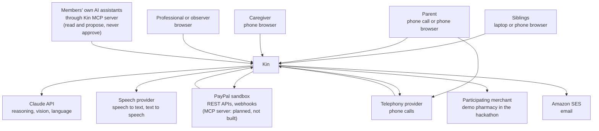

**People**

- **Siblings** set up the circle, contribute, approve and review.
- **The parent** listens, asks, approves and photographs letters.
- **The caregiver** bills hours and receives pay.
- **Professionals and observers** read and export.

**Outside systems**

- **PayPal** moves every dollar and reports every event.
- **Claude** reads documents, runs the agent and writes language.
- **The speech provider** turns audio into text and text into audio.
- **The telephony provider** connects phone calls.
- **A participating merchant** sells what the parent needs. In the hackathon this is a demo pharmacy that ships in the repository.

---

## 4. Services and stores

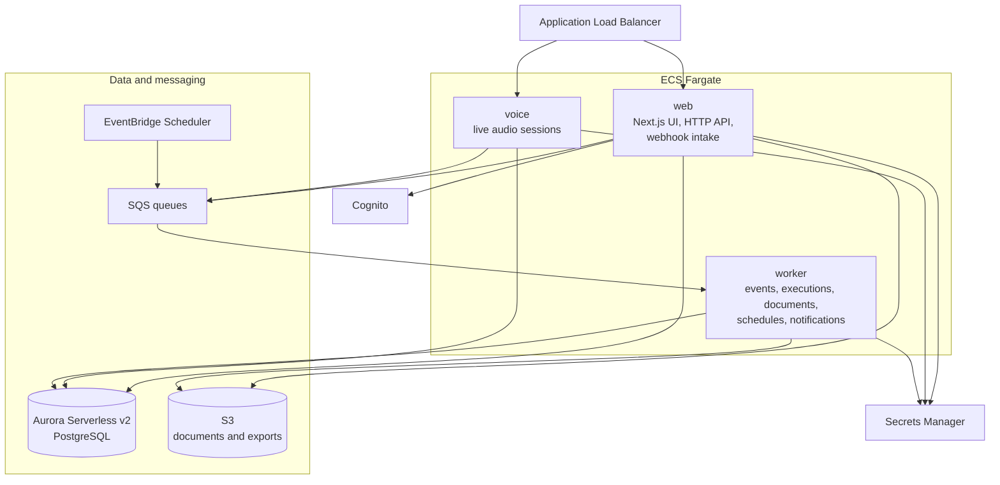

| Part                            | Responsibility                                                                                                                               | Never does                             |
| ------------------------------- | -------------------------------------------------------------------------------------------------------------------------------------------- | -------------------------------------- |
| **web**                   | Serves the app. Exposes the HTTP API. Receives PayPal and telephony webhooks. Hosts the Kin MCP server (section 13.4) and the agency API (section 13.5). Will run typed agent conversations (**Planned, not built**; section 9.3 describes the read-only Ask Kin that is built). Captures a top-up the payer has just approved, as PayPal requires while the payer waits. | Send money out of the pool in a request, or write the ledger |
| **voice**                 | Holds live audio connections. Streams speech in and out. Runs spoken agent turns. Records voice approvals.                                   | Execute payments                       |
| **worker**                | Verifies and applies PayPal events. Executes approved proposals. Reads photographed documents. Runs settlement, schedules and notifications. | Serve user requests                    |
| **Aurora**                | Ledger, circles, bills, approvals, PayPal events, audit log                                                                                  |                                        |
| **S3**                    | Photographs, statements, audit exports                                                                                                       |                                        |
| **SQS**                   | Hands work from web and voice to worker, with retries                                                                                        |                                        |
| **EventBridge Scheduler** | Starts timed work                                                                                                                            |                                        |
| **Cognito**               | Signs people in and issues tokens                                                                                                            |                                        |
| **Secrets Manager**       | Holds every credential                                                                                                                       |                                        |

**Why three services and not one.** Live audio needs connections that stay open for minutes and must not be disturbed by a web deployment. Payment execution must continue when the web tier is busy and must be retried independently. Separating them keeps each simple.

**Why not more.** The three services share one codebase and one database. Splitting further would add network calls and failure modes without solving a problem Kin has.

---

## 5. Code structure

One repository with shared packages.

```
kin/
  apps/
    web/              Next.js app, HTTP API, webhook intake, Kin MCP server (/api/mcp) and agency API (/api/v1)
    voice/            live audio service
    worker/           queue consumers and scheduled jobs
    demo-merchant/    stand-in pharmacy for the hackathon
  packages/
    domain/           ledger, fairness, state machines, policies. Pure code.
    db/               schema, migrations, repositories, row-level security
    paypal/           PayPal adapter, webhook verification, event mapping
    agent/            agent loop, tool gateway, prompts, number guard
    documents/        photo intake and extraction
    speech/           speech-to-text and text-to-speech adapters
    telephony/        call control adapter
    auth/             token verification, circle authorization
    notify/           email, push and narration queue
    config/           typed configuration and secrets loading
  infra/              AWS CDK stacks
  docs/
```

**The dependency rule.** `domain` depends on nothing. It has no database, no network and no AI. Every other package may depend on `domain`. Apps depend on packages and never on each other.

This rule is what makes the money logic testable in isolation and what makes the claim "the AI does not do the arithmetic" true in the code and not just in the pitch.

**Ports and adapters.** PayPal, Claude, speech, telephony and the merchant are each reached through an interface defined beside the code that needs it. The real adapters live in their own packages. Tests use fakes. Replacing a provider means writing one adapter.

---

## 6. Domain model

### 6.1 Concepts

| Concept                | Meaning                                                                                |
| ---------------------- | -------------------------------------------------------------------------------------- |
| **Circle**       | One person cared for and the people who share responsibility for them                  |
| **Member**       | A person's role within one circle                                                      |
| **Agreement**    | The versioned rules of a circle: shares, thresholds, care-hour rate, the parent's role |
| **Pool account** | The PayPal account that holds the circle's shared money                                |
| **Contribution** | Money a member puts in, by subscription, top-up or out-of-pocket spending              |
| **Care entry**   | Hours of hands-on care logged by a member                                              |
| **Bill**         | Something to be paid: a utility, a caregiver's hours, a repair                         |
| **Payee**        | A biller, caregiver or merchant, with an approval status                               |
| **Proposal**     | A requested movement of money, awaiting approval                                       |
| **Approval**     | One person's recorded yes or no, with evidence                                         |
| **Execution**    | The attempt to carry out an approved proposal through PayPal                           |
| **Ledger entry** | A balanced, permanent record of a financial fact                                       |
| **Settlement**   | The month-end calculation and the movements that restore the agreed shares             |
| **Document**     | A photographed or forwarded letter, bill or receipt                                    |
| **Claim check**  | A payment demand the parent asked Kin to verify                                        |
| **Narration**    | A money event prepared for the parent to hear                                          |

### 6.2 Entity relationships

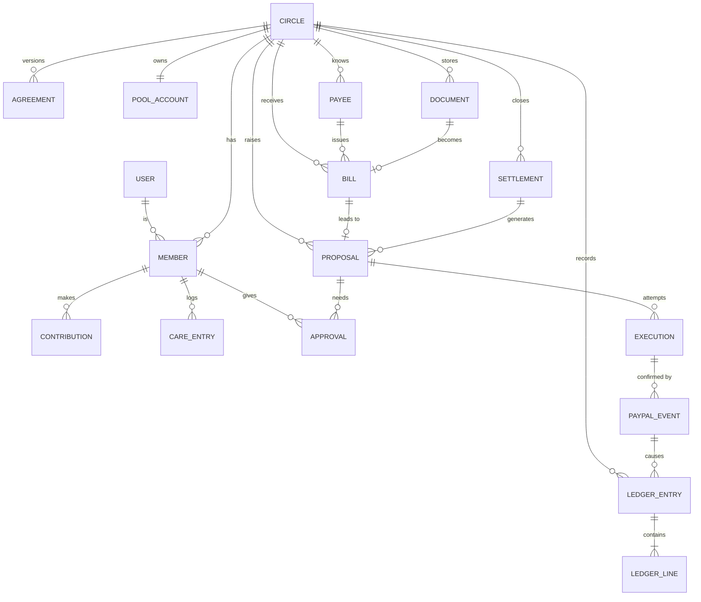

### 6.3 Tables

Every table except `users` carries a `circle_id`. Built in `packages/db/src/schema` (decision 37), with these choices:

- Every row has a UUID that Kin makes, and every reference to a row of the same circle is a composite foreign key on `(circle_id, id)`, so the database refuses a link from one family's row to another's.
- Amounts are `bigint` cents beside a three-letter currency. Each enum is built from the money core's constant (`CIRCLE_ROLES`, `PROPOSAL_KINDS`, `ENTRY_KINDS`, the state machines' states), so the database cannot hold a value the code does not know.
- Tables marked *not yet* below are designed but not created. Each comes with the feature that writes it.
- The rows the dashboard showed only as copy or constants are now data: the circle's name, demo flag and demo clock; members' display names, relationships and portraits; payees' names; the bills the family expects; the false-demand check; and what Kin told the parent.

| Table               | Key contents                                                                        |
| ------------------- | ----------------------------------------------------------------------------------- |
| `users`           | Cognito subject as the ID (or `demo:…` for an anonymous demo visitor, with kind `demo_visitor`), email and whether Cognito verified it, name, language, linked PayPal payer ID, last seen. The only table without a circle. |
| `circles`         | Name, timezone, currency, status (active or archived), demo flag, demo clock, pause until and by whom, the transaction that created it |
| `members`         | User (empty until the person joins), display name, role, parent participation level (for the parent only), relationship, portrait, status, the visitor's demo seat |
| `invitations`     | Email, role, who invited, status, expiry                                            |
| `agreements`      | Version, care rate and whether care is paid in cash, the three thresholds, effective date. Never changed: a new term is a new version. |
| `agreement_shares` | Each member's share of a version in basis points, in the family's order. A version's shares total 10 000, checked at commit. |
| `agreement_acceptances` | Who accepted a version, how (app or voice) and when. A version governs from its start date once every member it asks has accepted it: every organizer and contributor, and a parent who decides and can sign in, fixed in `agreements.requires` when it is proposed. The newest such version is in force (decision 57). |
| `pool_accounts`   | *Not yet.* PayPal merchant ID, credential reference, webhook ID, mode               |
| `payees`          | Name, spending category, status, the member it pays, PayPal recipient, auto-pay rule and range; a nullable caregiver hourly rate, distinct from the family care-credit rate. At most one rate-configured payee per caregiver and circle. |
| `monthly_shares`  | Member, amount in cents and currency, state (`approval_pending`, `active`, `paused`, `cancelled`), PayPal subscription ID and the page where the member approves it (none for a simulated share), simulated, failed charges as PayPal last reported, next billing time. One live share per member. Changed only through the member's own operations and the worker. |
| `invoice_requests` | A request for money by PayPal invoice (section 8.4): the member asked, the organizer who asked, purpose (`settlement` with its period, or `top_up`), amount in cents and currency, state (`requested`, `sent`, `paid`, `cancelled`, `failed`), simulated, the address PayPal emailed (none when simulated), PayPal's invoice ID, number and payer page, and the capture that paid it. Written by a person only through `request_invoice`, `mark_invoice_sent` and `close_invoice_request`; the worker records payment. |
| `quiet_share_asks` | A cost the family covers with quiet shares (section 7.7): title, kind (`one_off` or `monthly`), cost in cents, the bill it covers, the agreement whose shares it uses and the members asked, first month and months (1, or 3 once spread), state, the mediator's round, how many have answered and accepted, the family's shortfall and whether spreading would cover it, whether Pay Later closed a gap, simulated. Read by everyone who sees the money; no limit is here. |
| `sealed_offers` | One person's confirmed offer on an ask: money now, a later step-up and its month, drives or visits and hours of help, a first month, whether they took the gap on with Pay Later, how many times they sealed it. Read by its author alone: not the organizer, not an observer, and Kin's service holds a policy that shows it nothing. |
| `quiet_share_parts` | One person's part of each round of the plan, written only by the mediator: amount, per month, the part taken on with Pay Later, whether it stopped at their own offer, their agreed share, help and its value at the care rate, their yes and how they will pay, the PayPal action prepared. Read by its own person alone. |
| `contributions`   | *Not yet.* Member, kind, amount, period, source reference                            |
| `care_entries`    | Member, date, minutes, note, approved, the care-credit entry that values it         |
| `documents`       | S3 key (none for a simulated document), kind, uploader, extraction result, confidence, simulated |
| `bills`           | Payee, document, amount, received and due dates, state, duplicate link; caregiver bills additionally hold immutable versioned service-day details, the original rate and currency, and a submission key unique within the circle. |
| `expected_bills`  | Payee, kind, expected amount, due date: what the family expects before the bill arrives |
| `proposals`       | Kind, amount, payee or member paid, purpose and the family's note, who raised it (none for Kin), state, expiry, agreement version, the approval plan made when it was raised, bill, settlement and document links. Only the state and expiry can change. |
| `approvals`       | Proposal, member, role when answering, decision, method, evidence reference, time. Never changed. |
| `executions`      | Proposal, idempotency key, PayPal resource IDs, state, attempts                     |
| `paypal_events`   | PayPal event ID, type, raw body, headers, verification state, processing state      |
| `ledger_entries`  | Date, kind, description, source type and ID (unique per circle: the idempotency key), period, currency, simulated, reversal link, order of acceptance |
| `ledger_lines`    | Entry, position, account, direction, amount in cents                                |
| `ledger_accounts` | Account code, member or payee link                                                  |
| `settlements`     | Period, agreement version, inputs, fairness result and plan as calculated, state    |
| `claim_checks`    | What was claimed and for whom, the amount, the entry it was checked against, verdict, members alerted |
| `narrations`      | Member told, topic, amount and the entry it came from, the words spoken after the number guard, delivery state |
| `conversations`   | *Not yet.* Channel, participant, turns, tool calls                                  |
| `call_sessions`   | *Not yet.* Call reference, verification result, transcript reference                |
| `outbox`          | Pending messages written in the same transaction as state changes                   |
| `audit_log`       | Who did what (member, service or provisioner), to what, when, from where. Never changed. |
| `purses`          | The parent's Purse and its funding mandate: weekly amount, ceiling, per-payment cap, status, who set it (section 8.6a). One per circle. |
| `purse_payees`    | Her address book: name, relationship, kind, aliases, PayPal email fixed for the entry's life, who added it and the different family member who verified it. |
| `purse_payments`  | Each payment she asked for: payee, amount, memo, her words, hold reasons, the read-back, her answer, the hold, cancellation, her consent to share, and PayPal's progress. Sealed from the family unless shared or held. |
| `audit_heads`     | The head of the ledger hash chain and its entry count, kept when the record is checked or exported. Never changed (decision 66). |

---

## 7. The money core

This is the part of Kin that must never be wrong. It lives in `packages/domain` and is plain, deterministic code.

### 7.1 The ledger

Kin keeps a double-entry ledger for each circle.

- **Every entry balances.** The debits equal the credits, or the entry is rejected.
- **Entries are permanent.** There is no update and no delete. A mistake is corrected by a new reversing entry that points to the original.
- **Amounts are integer cents** with a currency code. There is no floating-point arithmetic.
- **Every entry names its cause:** a PayPal event, an approval or a settlement.

**Accounts per circle**

| Account                | Type      | Holds                                                                  |
| ---------------------- | --------- | ---------------------------------------------------------------------- |
| `pool_cash`          | Asset     | Mirrors the pool's PayPal balance                                      |
| `pool_clearing`      | Asset     | Money in motion, awaiting PayPal confirmation                          |
| `member:{id}`        | Equity    | What each member has contributed                                       |
| `expense:{category}` | Expense   | Care costs by category                                                 |
| `payable:{payee}`    | Liability | Approved bills not yet paid                                            |
| `fees`               | Expense   | PayPal fees                                                            |
| `care_credit:{id}`   | Memo      | Valued care hours. Tracked beside the cash ledger, never mixed into it |
| `care_received`      | Memo      | The other side of every care credit, so memo entries balance too       |
| `purse_cash`         | Asset     | The parent's Purse, set aside from the pool and kept in its PayPal account (section 8.6a) |

**Example entries**

| Event                                              | Debit                               | Credit                   |
| -------------------------------------------------- | ----------------------------------- | ------------------------ |
| Marcus's monthly share of 200.00 arrives, fee 7.28 | `pool_cash` 192.72, `fees` 7.28 | `member:marcus` 200.00 |
| Elena's 42.00 pharmacy receipt is approved         | `expense:pharmacy` 42.00          | `member:elena` 42.00   |
| Amara's 240.00 bill is approved                    | `expense:care` 240.00             | `payable:amara` 240.00 |
| The payout to Amara is confirmed, fee 0.25         | `payable:amara` 240.00, `fees` 0.25 | `pool_cash` 240.25   |
| The refill of 42.00 is captured                    | `expense:pharmacy` 42.00          | `pool_cash` 42.00      |
| Settlement pays Elena 126.00, fee 0.25             | `member:elena` 126.00, `fees` 0.25 | `pool_cash` 126.25    |

A member is credited with the gross amount they paid, and a payee or member is paid the full amount owed. PayPal's fees, on money coming in and on payouts going out, are a shared cost of the circle, read from PayPal's record of each transaction.

**How the code holds these rules** (`packages/domain`, `ledger*.ts` and `postings.ts`)

- An entry touches cash accounts or memo accounts, never both. Approved care is posted as debit `care_received`, credit `care_credit:{id}`, valued once at approval to the nearest cent, halves up.
- The entry's source (a PayPal event, an approval or a settlement, with its ID) is its idempotency key. Applying an entry whose source is recorded changes nothing. A different entry claiming a recorded source is refused.
- A reversal mirrors its original line for line, keeps the original's kind and names it. An entry is reversed at most once, and a reversal is never itself reversed.
- A refunded top-up is the reversal of its contribution, sourced by PayPal's refund ID (`refundContribution`, decision 97). It is written only when PayPal says the whole capture went back in one refund with its whole fee returned; anything else is held for a person, since a mirror would then misstate the pool.
- `postings.ts` holds one builder per row of the table above, plus settlement collections and care credit. Callers state what happened. Which accounts move is decided there.

### 7.2 The fairness calculation

At any moment, and formally at month end, Kin answers one question for each member: are you ahead of your agreed share or behind it?

**Inputs for a period**

- `s_i`: the member's share, in basis points. All shares total 10,000.
- `P_i`: cash the member paid into the pool, net of refunds.
- `O_i`: approved out-of-pocket spending by the member.
- `C_i`: care credit, which is approved hours multiplied by the agreed rate. Zero if the family has not enabled it.
- `B_i`: the balance carried in from the previous period.

**Calculation**

1. Total contribution: `K = sum of (P_i + O_i + C_i)`.
2. Target for each member: `T_i = s_i × K ÷ 10,000`, rounded by the largest-remainder method so the targets total exactly `K`.
3. Cash due from each member: `D_i = max(0, T_i − C_i)`. Care hours reduce what a member owes in cash.
4. Cash position: `X_i = P_i + O_i − D_i + B_i`.
5. If `X_i` is positive, the pool owes the member. If negative, the member owes the pool.

**Rules**

- **Care credit lowers what a member owes. It is not paid out in cash** unless the family switches that on in the agreement. When it is on, step 3 is skipped and `X_i = P_i + O_i + C_i − T_i + B_i`.
- **Rounding never creates or loses a cent.** The largest-remainder method assigns leftover cents in a fixed, documented order: largest remainder first, and between equal remainders, the member whose ID sorts first. The result does not depend on the order members are listed in.
- **The calculation is a pure function.** The same inputs always give the same result, and the inputs are stored with each settlement so the result can be reproduced years later.
- **Inputs come from the ledger.** `P_i`, `O_i` and `C_i` are the period's net credits to the member's accounts from contribution, out-of-pocket and care-credit entries. A refund is a reversal, so it nets out. Settlement collections and payouts are left out, because they close an earlier period and reach the next one through `B_i`. A member who gave something but holds no share stops the calculation.
- **Care credit beyond the target earns nothing by default.** When `C_i > T_i`, the excess still counts in `K`, so the others' targets include it, but the carer is not paid for it. The pool keeps that cash. Each position reports it as unused care credit, so positions total `ΣB_i` minus the unused credit.

### 7.3 Settlement

Settlement turns the calculation into movements. Money moves through the pool, so a settlement holds exactly one movement for each member who is not level, which is the smallest set that closes every gap.

1. **Snapshot.** At period close, Kin freezes the inputs.
2. **Calculate.** The fairness function produces each member's position.
3. **Propose.** Members who owe receive a top-up request. Members who are owed become payout proposals.
4. **Approve.** The circle approves the settlement as a whole, under the agreement's rules.
5. **Collect, then pay.** Payouts are released only as far as the pool's confirmed balance allows, less every approved bill not yet paid and PayPal's fee for sending each payout. Kin never pays out money that has not arrived, nor money already promised to a caregiver or a biller, nor money the fees will take. When the balance cannot cover every payout, it is shared among them in proportion to what each member is owed, by the same largest-remainder method, and the rest waits for collections.
6. **Close.** When every movement is confirmed or carried forward, the period is closed and the statement is produced. Unpaid amounts carry into the next period as `B_i`.

### 7.4 State machines

Each money-related record moves through explicit states. A transition that is not listed cannot happen.

**Proposal**

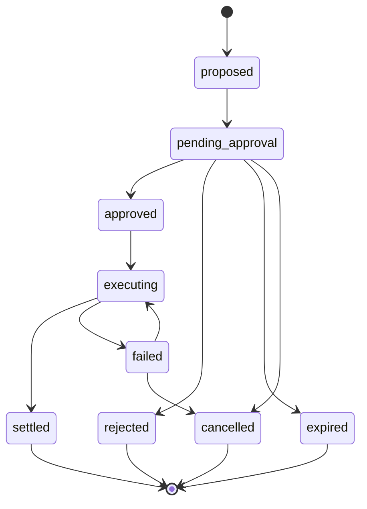

**"Is it really you?" check** (`PRESENCE_TRANSITIONS` in `packages/domain`, held to the database's own table by a test). An answer counts whenever it arrives (from `opened`, in the instant before the text was recorded as sent, and late), and a "not me" can follow an unanswered check or a mistaken "yes", because it only makes Kin more careful; a "yes" never follows a "no".

**The parent's wishes** (`WISH_TRANSITIONS`, `WISH_TRIGGER_TRANSITIONS` in `packages/domain`, and `PARENT_SUBSCRIPTION_TRANSITIONS` in `packages/db/src/schema/wishes.ts`, each held to the database's own table by a test). A wish is `draft` (Kin read it back) → `confirmed` (she confirmed it) → `in_force` (two witnesses) → `superseded` (a newer version is in force) or `withdrawn`. A trigger is `reported` → `active` → `ended`, or `reported` → `dismissed`. A subscription her wishes name is `active` → `suspending` → `suspended` → `resuming` → `active`; a move PayPal refuses goes back where it came from (`suspending` → `active`, `resuming` → `suspended`).

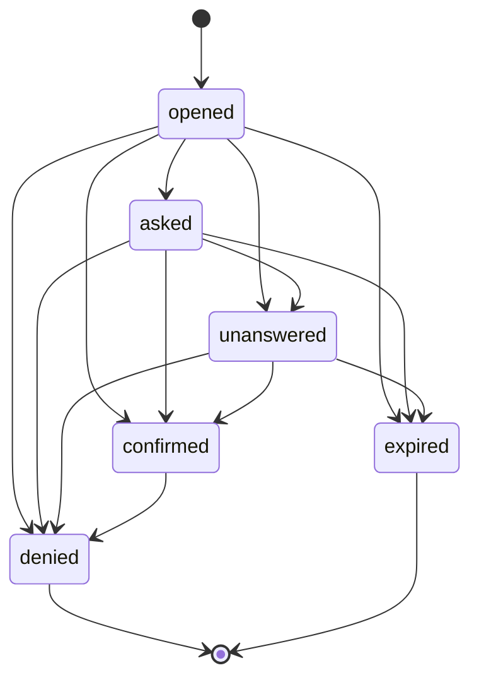

**Bill**

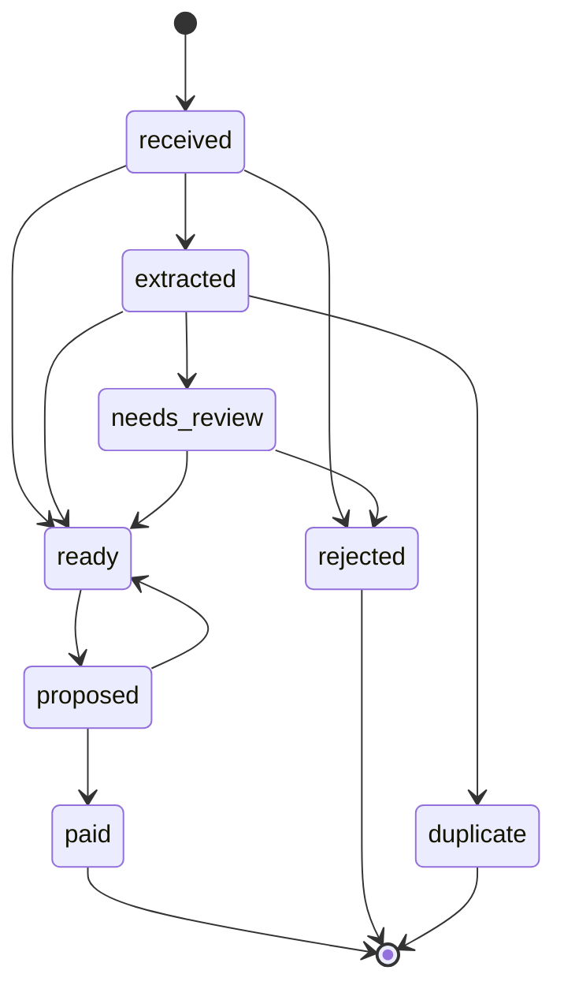

**Execution**

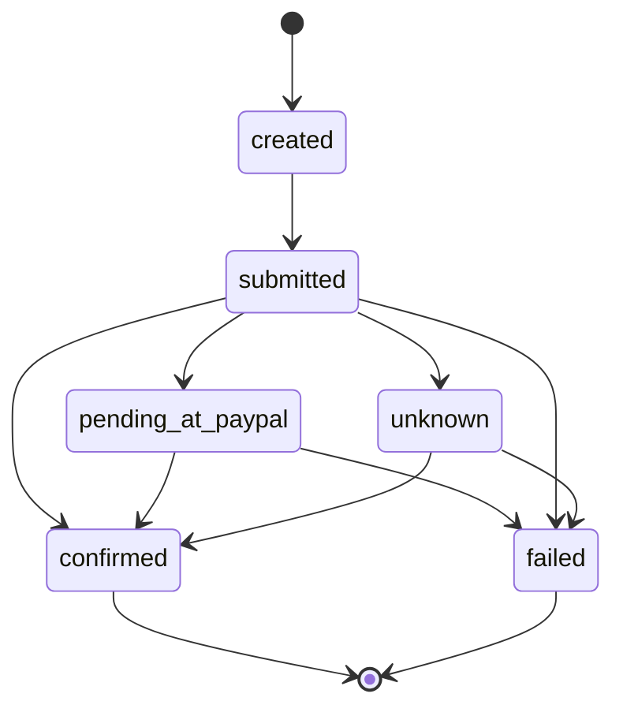

**Monthly share** (`MONTHLY_SHARE_TRANSITIONS` in `packages/domain`, enforced by a trigger on `monthly_shares`)

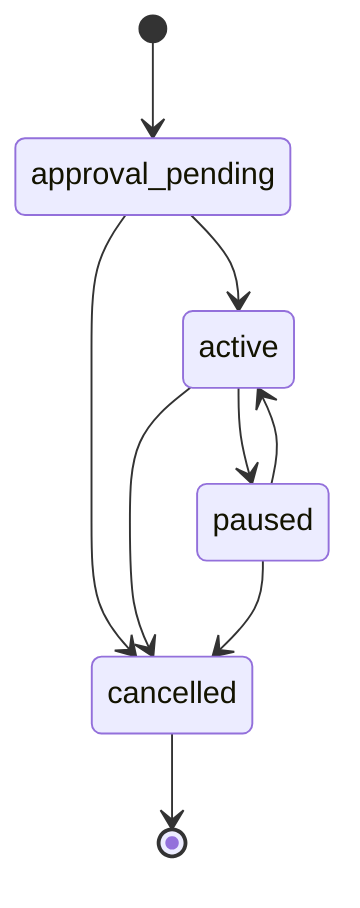

**Invoice request** (`INVOICE_REQUEST_TRANSITIONS` in `packages/domain`, enforced by a trigger on `invoice_requests`)

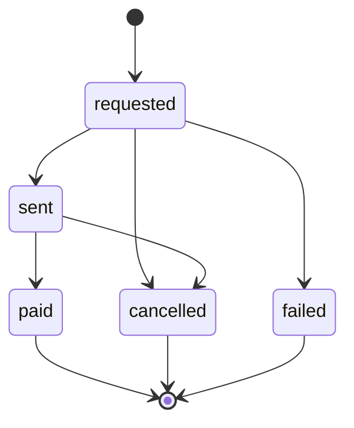

`requested`: Kin holds the row and PayPal has not yet confirmed sending the invoice (an outage leaves it here, and asking again resumes it under the same key). `sent`: the invoice read back from PayPal says it was sent (a simulated request is marked sent with no invoice behind it). `paid`: the worker read the paid invoice and its completed capture back from PayPal and credited the member. `failed`: PayPal refused to make the invoice. `cancelled`: withdrawn by an organizer after PayPal cancelled it, or PayPal's word that it was cancelled.

The `unknown` state matters. If a call to PayPal times out, Kin does not assume success or failure. It asks PayPal for the resource by its idempotency key and waits for the webhook.

**Quiet share** (`QUIET_SHARE_TRANSITIONS` in `packages/domain`, held to the database's own table by a test and enforced by a trigger on `quiet_share_asks`). An ask waits for everyone's sealed offer; the mediator then covers it or finds it short. A short ask becomes a plan by spreading it, by someone taking the gap on with Pay Later, or by someone raising their offer. A plan is agreed when every person with a part has said yes to their own.

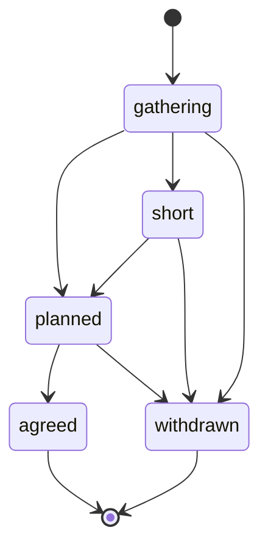

**Delivery** (the goods of a purchase, beside its execution; `packages/domain` `DELIVERY_TRANSITIONS`)

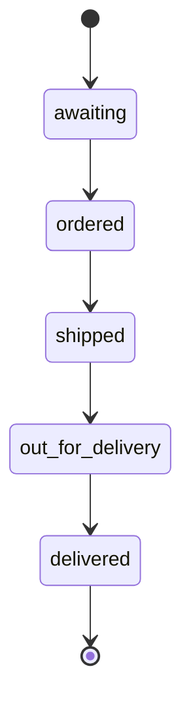

A purchase is `awaiting` from the moment it is proposed until the seller has the order. Only Kin's worker moves it on, from the seller's own report, one step at a time.

**Care shift**

A shift is paid when two independent keys have turned: the caregiver's own check-in and check-out, and the family's word that the visit happened. The family's word may come while the visit is under way, so `checked_in` can go straight to `confirmed`. The database holds the same table (`state_transitions`, machine `shift`) and a test compares it with `SHIFT_TRANSITIONS` in `packages/domain`.

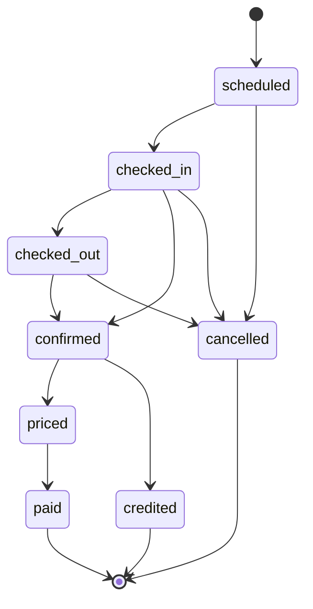

`priced` means a payout proposal exists for the shift. `paid` is set only by the worker, after PayPal's payout item has read back `SUCCESS` and the proposal has settled. `credited` is the end of a sibling's confirmed visit or drive, which is never paid: the worker writes one care-credit ledger entry for the whole minutes between the two taps, valued at the agreement's care rate, and the care entry that points at it and at the shift, and only then moves the shift. The database refuses any other way into `credited` (decision 79).

**Care shift: check-in links and the call to the parent**

The caregiver's key can also be turned with no sign-in. A link (from a text, a printed QR code or an NFC tag at the door) carries a token the web app makes, 32 random bytes shown once; the database keeps only its SHA-256 in `shift_check_links`, which no role of the web app reads. `use_check_link`, open to `kin_app` with nobody signed in, finds a live link and runs the same internal check-in or check-out as the signed-in caregiver's (`apply_check_in`, `apply_check_out`), for the link's member and that shift only, with the audit origin `link`. Every dead token is refused with one message, and a link allows six uses a minute. The public page's first render calls `check_link_status`, a read-only twin (`STABLE`, `kin_app` only) with the same lookup and the same refusal, which returns the caregiver's first name, the planned times, the circle's time zone and `next` (`in`, `out` or `done`, from the shift's two times) so the page offers the one key that fits; it counts nothing in the database, because a raised refusal rolls a counter back and a failure counter would let anyone lock caregivers out, so the web app throttles each look per address in the same bucket as the taps and the 256-bit token does the rest. A check-out by link that confirms an aide's shift queues `shift.settle` for the worker, which settles it as the service: `pay_shift` and `shift_payment_facts` also accept `kin_service` for the circle in scope, with every check unchanged and the audit actor `service`.

The family's key can be turned by phone. In a real circle whose parent has switched the call on with consent (`parent_call_settings`; the number is readable by no role of the web app), a caregiver's check-out with no family word queues `shift.call`. The telephony service, as `kin_service` only, starts a call (`start_shift_call`: quiet hours on the circle's clock, one call at a time, two attempts at most with a wait between), reports it (`record_call_placed`, `record_call_status`) and records the parent's answer (`record_family_word_by_call`). A clear yes is the parent's word with the call's ID as `family_evidence_ref`; a no declines the call and pays nothing; an unclear answer records nothing. A demo circle never places a call.

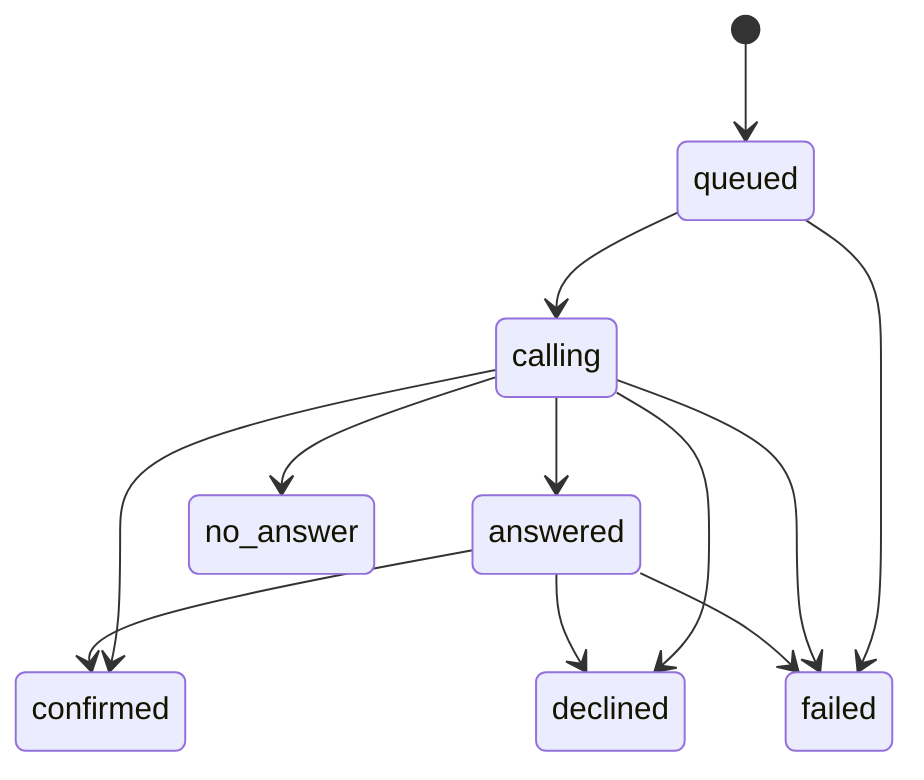

The database holds the same table (`state_transitions`, machine `shift_call`) and a test compares it with `SHIFT_CALL_TRANSITIONS` in `packages/domain`.

### 7.5 The approval engine

Before any proposal can execute, the approval engine decides who must say yes.

**Inputs:** the kind of movement, the amount, whether the payee is known and approved, who raised the proposal, the current agreement and the parent's participation level.

**Output:** the set of approvals required and an expiry time.

**Rules, in order**

1. **Pause.** If the circle is paused, nothing is approved.
2. **Hard limits.** An amount above the agreement's ceiling is refused, whoever asks.
3. **Auto-pay.** A recurring bill from an approved payee, within its expected range, needs no new approval. The standing rule is recorded as the approver.
4. **The parent's decisions.** If the parent's level is "decides" and the amount is above their threshold, the parent's approval is required.
5. **Organizer approval** for everything else.
6. **Second approval** above the agreement's large-payment threshold.
7. **No self-approval.** A member cannot be the only approver of a payment to themselves.
8. **New payees** always need a person, and the whole circle is told.

The agreement holds three amounts for these rules: the ceiling (rule 2), the large-payment threshold (rule 6) and the parent's threshold (rule 4). An amount equal to a threshold does not cross it. A proposal waits 72 hours for its approvals and then expires.

**Counting the answers.** Each approval the plan asks for is a place that needs a yes from a different member: the parent's place takes the parent, the organizer's place an organizer, and the second approval an organizer or a contributor. A no from any member whose yes could fill a place rejects the proposal, even after a yes. When the payee is a member, they may say yes, but another organizer or contributor must say yes too, and that member's no also counts. Caregivers and observers never approve or reject. While the circle is paused, no proposal becomes approved, and answers already given count again once the pause lifts. A member holds one role per circle, so answers that give one member two roles are refused.

`planApprovals` and `decideApprovals` in `packages/domain` implement this section, and the state machines of section 7.4 live in `state-machines.ts` beside them. A test pins every move the diagrams above draw, so a transition is added to the diagram, that test and the code together.

**Evidence.** Each approval records how it was given:

| Method         | Evidence stored                                                                 |
| -------------- | ------------------------------------------------------------------------------- |
| Tap in the app | Cognito session, device, time, and a fresh multi-factor check for payouts       |
| Voice          | Call reference, verification result, the sentence read back, the parent's reply |
| Standing rule  | The rule's ID and the agreement version                                         |

### 7.6 Execution, the outbox and idempotency

Moving money involves a database and an outside API, which cannot share a transaction. Kin handles this with the outbox pattern.

1. In one database transaction, Kin marks the proposal approved, creates an execution with a fresh idempotency key, and writes an outbox row. Built: the trigger `queue_payout` does both for a caregiver payout, in the transaction of the answer that approves it (migration `0008_payouts`). The key is `kin-payout-{proposal}`.
2. The worker leases the outbox row from PostgreSQL (`kin_private.claim_outbox`, callable by `kin_service` alone, `FOR UPDATE SKIP LOCKED`, hidden for 120 seconds) instead of passing it through an executions queue (decision 53).
3. The worker checks the pool can pay the bill and PayPal's fee from money that has arrived (`canPayOut`), writes the family's approval to the ledger once, moves the proposal to executing, and calls PayPal, passing the idempotency key.
4. The worker records PayPal's reply and marks the execution submitted. No reply means unknown: the same key is sent again later, and PayPal answers with the batch it already made (decision 55).
5. The execution is confirmed only when PayPal's record says the item succeeded: today by reading the batch back (`GET /v1/payments/payouts/{batch}`); the payout-item webhook is not yet handled.

**Idempotency at each layer**

- **To PayPal:** the `PayPal-Request-Id` header carries the execution's key. For payouts, the `sender_batch_id` does. A retry cannot pay twice.
- **From PayPal:** each event's ID is unique in `paypal_events`. A redelivered event is ignored.
- **In the ledger:** each entry has a unique source reference. Applying the same event twice cannot write two entries.
- **In the queues:** per-circle ordering means two workers never act on the same circle at once. The payout outbox is leased row by row instead, and each database step locks the execution, so two workers never move one payout at once.


### 7.7 Quiet shares (decision 92)

A cost too big for the pool, such as Rose's $900 stairlift, is covered by the agreed shares, each capped at what the person privately said they can give, without anyone saying their limit out loud.

1. **An organizer raises an ask** (`raise_quiet_share`): a title, a cost, once or every month. The people asked are the active organizers and contributors who hold a share in the agreement in force; their shares are the mediator's weights, fixed with the agreement's ID on the ask.
2. **Each person talks to their own Kin, privately** (`POST /api/quiet-shares/words`). Their words go to the model once, with no tools and nothing of anyone else's, and come back as a draft offer: money now, a later step-up and its month, a first month, drives or visits, hours of help. Every amount, count and hour must be a number the person said, in digits or in words, or it is dropped (`readOffer`, prompt `sealed-offer-2026-11-10`, evaluation set `evals/sealed-offer.json`); the agent's reply to them passes the number guard or the screen's fixed wording stands. The words are never stored. Without a model the person fills the offer in themselves.
3. **The person checks and seals the offer** (`seal_my_offer`). The server reads every amount digit by digit and checks it with `checkSealedOffer`; the table's checks hold it again. A person may seal at most three times per ask (`MAX_OFFER_SEALS`), enough to reconsider and too few to probe the others' limits by trial. The audit log records that an offer was sealed, never whose or what.
4. **The mediator runs in the database** once everyone has answered. `kin_private.mediate_quiet_share` (`SECURITY DEFINER`, granted to no role) reads every offer of the ask and writes only a new round of parts, the family's shortfall and whether spreading over three months would cover it. Its arithmetic is `kin_private.mediate_offers`, the same algorithm as `mediateQuietShare` in `packages/domain`: allocate the cost by the agreed shares with the largest-remainder rounding of `allocate`, cap each part at the person's offer over the ask's months, give what the caps leave to those with room in proportion to their shares, round after round; a gap left goes to whoever took it on with Pay Later; otherwise it is the shortfall. Ties go to the member whose ID sorts first in byte order, so the order offers arrive in never matters. A test runs both over random asks and holds them to the same answer. Care hours are valued at the agreement's care rate and shown; they count toward fairness when the care is done, and never pay the cost.
5. **Each person sees their own part and the family total, never anyone else's limit.** A part is readable by its person alone; an ask, with its total, progress and any shortfall ("$140 short", nothing more), by everyone who sees the money. A person whose part stopped at their own offer, below their share, is told one more line: "Your limit stayed private." With only two people sharing, privacy cannot be total (the one not at their limit can work the other's out from the total); and when three or more fall short, every part is its person's limit, so all but one who compare their parts can work out the last one's. The screen says so in each case (`limitsCanBeDeduced`). The audit log names nobody for a sealed offer or a gap taken on.
6. **A short ask** is spread over three months by the organizer (`spread_quiet_share`), or closed by one person privately taking the gap on with PayPal Pay Later (`take_quiet_share_gap`: their own offer says so; the ask says only that Pay Later was used), or by someone raising their offer.
7. **The plan is agreed when every person with a part says yes to their own** (`accept_my_quiet_share_part`), choosing how they will pay from `partMethods`: a monthly rise by their monthly share (Subscriptions revise, `reviseSubscription` in `packages/paypal`, which returns the PayPal page where they approve the new price); a one-off by PayPal checkout (the top-up sheet, Orders v2 with JavaScript SDK v6, with Pay Later where PayPal offers it), Pay Later, or a PayPal invoice an organizer sends. A part that asks nothing needs no yes. On agreement each person's action is prepared; the money arrives through the ordinary contribution path, and the ledger shows what everyone gave, as for any payment.
8. **Demo circles.** Rose's circle starts with the stairlift asked and Elena's $300 sealed. With Marcus up to $600 and Ana $60 and two drives, the plan is Marcus $540, Elena $300, Ana $60. The family layout (`/dashboard/fairness/quiet-shares/family`, demo circles only) shows Marcus's, Elena's and Ana's own screens side by side: each is read in that person's seat (the visitor takes the persona's demo seat for the read and takes their own back in the same transaction), so each phone shows exactly what that person's Kin shows them. A demo's PayPal actions are simulated and labelled so.

---

## 8. PayPal integration

### 8.1 The pool account

Each circle's shared money should sit in a PayPal account that PayPal, not Kin, holds and licenses. That is the production design. The hackathon build differs, as the next paragraph says, and the custody statement in section 22.3 applies.

**In the hackathon,** every circle's pool is the one sandbox business account (decision 46), so Kin's app holds the credentials for the one account that receives every circle's money, and Kin's own ledger attributes each amount to its circle (decision 70). Kin has no bank account of its own. Each order Kin creates names its circle and member in `custom_id` (`kin1:<circle>:<member>`), PayPal copies it onto the capture, and Kin trusts it only after reading the capture back from PayPal, so PayPal's own record still says whose money each payment is. The app's client secret is in Secrets Manager (`kin/paypal/client-secret`); its client ID and webhook ID, which are not secret, are in `infra/cdk.json` under `kin:paypal`.

**In production,** Kin would act on a family's account through PayPal's partner model, with the family's consent and without holding their credentials. The code reaches the pool through one function, `poolFor` in `packages/paypal`, so that change is confined to it. This is the largest open question in the architecture and is listed in section 22.

### 8.2 Which PayPal capability does what

| Kin need                              | PayPal capability                                             | Direction         | Confirmed by                                           |
| ------------------------------------- | ------------------------------------------------------------- | ----------------- | ------------------------------------------------------ |
| Monthly share                         | Subscriptions, with a Catalog product and one plan per amount | Sibling to pool   | `PAYMENT.SALE.COMPLETED`, `BILLING.SUBSCRIPTION.*` |
| One-off top-up in the app             | Orders v2 with JavaScript SDK v6, PayPal or Pay Later         | Sibling to pool   | `PAYMENT.CAPTURE.COMPLETED`                          |
| Top-up or settlement request by email | Invoicing v2, with reminders and QR code                      | Sibling to pool   | `INVOICING.INVOICE.PAID`                             |
| Caregiver pay                         | Payouts                                                       | Pool to caregiver | The payout batch read back: item `SUCCESS`            |
| Settlement payout                     | Payouts                                                       | Pool to sibling   | The payout batch read back: item `SUCCESS`            |
| Purchases for the parent              | Vault payment token and Orders v2 at a participating merchant | Pool to merchant  | Merchant order status, then reconciliation             |
| Refund of a contribution              | Refunds                                                       | Pool to sibling   | `PAYMENT.CAPTURE.REFUNDED`                           |
| Delivery tracking                     | Shipment tracking on the merchant's order                     | Read              | Tracking status                                        |
| Disputed contribution                 | Disputes                                                      | Read and respond  | `CUSTOMER.DISPUTE.*`                                 |
| The record of truth                   | Webhooks and Transaction Search                               | Read              |                                                        |
| Identity of a payer                   | Log in with PayPal                                            | Read              |                                                        |
| Agent access to PayPal data           | Agent Toolkit and sandbox MCP server (**Planned, not built**) | Read              |                                                        |

**What the code calls today.** Orders v2 and the JavaScript SDK v6 (top-ups, with Pay Later when PayPal offers it), Subscriptions with a Catalog product and plans (monthly shares), Payouts (caregiver and settlement payouts), webhooks with the verify-webhook-signature call, and the OAuth token endpoint. The demo pharmacy calls the vault-backed Orders request. Transaction Search is called once a night by the Purse reconciliation (`getPayoutTransaction`, section 8.6a); the sandbox app's reporting scope answered 403 on 14 October 2026, so whether the deployed app has it is unverified, and without it each reconciliation logs `purse.reconcile_failed`. Payouts also reads one item back (`/v1/payments/payouts-item/{id}`), and Subscriptions also suspends, activates, cancels and revises. Not called anywhere: creating a refund (Kin only reads one back), Shipment tracking, Disputes, Log in with PayPal and the Agent Toolkit. Invoicing v2 (create, send, read back, cancel, search by number) is in `packages/paypal` and carries requests by invoice (section 8.4), with the events `INVOICING.INVOICE.PAID` and `INVOICING.INVOICE.CANCELLED` subscribed in code; the live webhook receives them only once `webhook:register` has been run again against it, since it keeps the events it was made with. The webhook events Kin subscribes to are `PAYMENT.CAPTURE.COMPLETED`, `PAYMENT.CAPTURE.REFUNDED` and `PAYMENT.CAPTURE.REVERSED` (read back with `GET /v2/payments/refunds/{id}`; Kin makes no refund itself), the `BILLING.SUBSCRIPTION.*` events and `PAYMENT.SALE.COMPLETED`; Kin does not subscribe to payout-item events, and reads the payout batch instead (section 7.6).

### 8.3 Three corrections to the earlier documents

Checking the APIs changed three things. The PayPal tables in `project-description.md` and `tech-stack.md` have been updated to match.

1. **Caregivers are paid by payout, not by a PayPal invoice.** PayPal has no API for an account to pay an invoice it has received. The payer must sign in and pay by hand. So the caregiver's bill is a Kin record, and the payment is a PayPal payout from the pool. This is simpler and is paid the same day.
2. **Invoicing is used for requests to siblings.** When Kin asks a sibling for a top-up or a settlement amount, it sends a PayPal invoice from the pool. The sibling pays from the email or the QR code, and Kin can send reminders.
3. **Agent purchases need a saved payment method at the merchant.** A payer cannot be charged without either approving in PayPal or having saved their wallet with that merchant. Kin uses the second: the pool's wallet is saved once with a participating merchant, and later purchases are created by the merchant after Kin's approval. Saving a wallet this way works in the sandbox. In production PayPal must approve the merchant for it.

### 8.4 Contributions

**Subscriptions**

1. When a circle is created, Kin creates a Catalog product for it in the pool account.
2. For each sibling's share, Kin creates a plan for that amount and a subscription.
3. The sibling approves the subscription in PayPal. Kin uses the approval link PayPal returns, which works without depending on any SDK feature.
4. Each billing cycle, PayPal charges the sibling and sends `PAYMENT.SALE.COMPLETED`.
5. Kin credits the member in the ledger.
6. A failed charge arrives as `BILLING.SUBSCRIPTION.PAYMENT.FAILED`. Kin tells the circle and the fairness ledger shows the gap.

**Monthly shares in the app** (built; "Monthly shares" on the circle screen, for organizers and contributors)

1. The member enters a monthly amount (the same limits as a top-up, `checkMonthlyShare`). `POST /api/monthly-shares` makes the circle's Catalog product, a plan for the amount and a subscription in the pool account, every request keyed by the share's own row ID so a repeat makes nothing new. The subscription's `custom_id` names the circle and member, like a top-up order's.
2. Kin records the share (`start_my_share`) as `approval_pending`, with PayPal's approval page, and sends the member there. Only the member it belongs to is given that page. Nothing is charged until they approve.
3. Back from PayPal, the screen asks the worker to read the subscription (`subscription_checked` on the inbox queue). The worker reads it and every completed charge since the share began from PayPal, moves the share to `active` and credits each charge once by its PayPal transaction ID, as a top-up is credited: the member the gross, the pool the net, PayPal's fee to `fees`. `PAYMENT.SALE.COMPLETED` and `BILLING.SUBSCRIPTION.*` webhooks say the same later; a sale names only its subscription, so after the signature checks out the worker asks PayPal whose subscription it is.
4. Pausing, resuming and ending ask PayPal first (suspend, activate, cancel) and change Kin's record only once PayPal has agreed. A share only moves along `MONTHLY_SHARE_TRANSITIONS`, and a cancelled one stays cancelled (a trigger enforces it, whoever writes). A member who wants a different amount ends the share and starts a new one.
5. A failed charge shows on the share as PayPal's count of failures. Telling the circle about it is not built.
6. **Demo circles** make no PayPal subscription. Their share is `simulated`, runs at once, and the worker credits its month once for each calendar month of the circle's own clock, labelled simulated, with no fee. It never writes a simulated month into a share that is not simulated, or into a circle that is not a demo.

**Top-ups in the app** (built; "Add money" on the overview, for organizers and contributors)

1. The member chooses an amount between $1.00 and $5,000.00 (`checkTopUp` in `packages/domain`). The browser checks it for quick feedback; the server reads it again from the typed text, digit by digit, into integer cents (`centsFromDecimal`).
2. The server (`POST /api/top-ups`) creates an Orders v2 order in the pool account: one unit, no shipping, `custom_id` naming the circle and the member.
3. The browser runs a one-time payment session with JavaScript SDK v6, loaded from PayPal's sandbox. Where PayPal says the payer is eligible, a Pay Later button is offered beside PayPal's.
4. On approval the server (`POST /api/top-ups/{order}/capture`) reads the order back, refuses it unless it is this member's in this circle, and captures it with the request ID `kin-capture-{order}`, so a repeated click cannot capture twice. It then puts `order_captured` on the PayPal inbox queue.
5. The worker reads the order back from PayPal and records each completed capture (`recordContribution` in `packages/db`): the member is credited the gross, the pool receives the net, and PayPal's fee goes to `fees`. The capture's ID is the entry's source, so the webhook `PAYMENT.CAPTURE.COMPLETED` for the same capture finds the entry there and writes nothing (decision 47).
6. The sheet asks `GET /api/top-ups/captures/{capture}` until the entry exists, then says the amount is in the pool. If PayPal could not be reached during the capture, whether it happened is unknown: the worker is asked to look anyway, and the sheet says the record will show it once PayPal confirms.

**Requests by invoice** (built; on the Fairness page: each of the settlement's collections, and "Ask a member for a top-up", for organizers)

1. An organizer asks a member who shares the cost (`invoice.request`, organizers only; never themselves) for what the month's settlement collects from them, or for a top-up. `POST /api/invoice-requests` takes no amount for a settlement: it is the money core's collection for that member in the open period (`checkInvoiceRequest`); a top-up keeps a top-up's limits. `request_invoice` records the request (`requested`) and decides where the invoice goes: the member's own PayPal email from their settlement payee, else the email they verified at sign-in. Nothing typed in the browser chooses the address.
2. The web app makes the draft in the pool (Invoicing v2: one line, due on receipt, no tip, no partial payment; `memo` carries `kin-invoice1:<circle>:<request>`, which the payer never sees), has PayPal email it, reads it back, and records it `sent` with PayPal's invoice ID, number and payer page (`mark_invoice_sent`). The invoice number, `KIN-` and the request's own ID, is the idempotency key: in the sandbox PayPal made a second draft for a repeated `PayPal-Request-Id` but refused a repeated number (`DUPLICATE_INVOICE_NUMBER`), so a lost reply is recovered by searching for the number. PayPal refusing the invoice ends the request `failed`; an outage leaves it `requested`, and asking again resumes it.
3. The member pays on PayPal's page. The worker reads the invoice back (`invoice_checked` on the inbox queue, sent when it is sent and whenever an organizer or the member presses *Check with PayPal*; `INVOICING.INVOICE.PAID`; or the `PAYMENT.CAPTURE.COMPLETED` of the capture that paid it, which names the invoice). Only when PayPal says `PAID` does it read each PayPal payment on the invoice back as a capture, which must be `COMPLETED`, name this invoice and add up to the amount asked, and credit the member exactly as a top-up (`recordContribution`: once, by the capture's ID, PayPal's fee to `fees`), closing the request `paid` in the same transaction. A payment the invoicer only recorded by hand is never credited. `INVOICING.INVOICE.CANCELLED` ends the request.
4. An organizer may withdraw a request that waits: PayPal cancels the invoice first, and a paid one cannot be withdrawn.
5. **Demo circles.** The demo's members are stand-ins, so an invoice goes to Kin's own sandbox personal account named by `KIN_DEMO_INVOICE_RECIPIENT_EMAIL` (only a `…@personal.example.com` address is accepted). Its payment is real sandbox money and recorded as such. Without that setting the request is `simulated`: no PayPal call, labelled Simulated on screen, and the worker records the stand-in's payment at once, labelled simulated, with no fee. It never writes a simulated payment into a circle that is not a demo.
6. Reminders on the agreement's schedule are not built.

### 8.5 Payouts

Used for caregiver pay and for settlement payouts to siblings.

1. The approved proposal becomes a payout batch with one item.
2. The recipient is identified by PayPal email, phone or payer ID.
3. The batch ID is the execution's idempotency key.
4. PayPal reports the result per item. Kin acts on each outcome:

| Item outcome                           | Kin's action                                                                     |
| -------------------------------------- | -------------------------------------------------------------------------------- |
| Succeeded                              | Confirm the execution, write the payout and PayPal's fee to the ledger, settle the proposal and mark the bill paid. *Telling the recipient and the circle is not built.* |
| Pending, unclaimed or held             | Wait, and read the batch again later. The family's approval already holds the money back as owed to the payee (decision 54). *Telling anyone is not built.* |
| Returned, failed, blocked, refunded or reversed; or PayPal refuses the request | Mark the execution and proposal failed. The payee is still owed. *Alerting the organizer is not built.* |

**Built for caregiver payouts** (`packages/paypal` `payout.ts`, `packages/db` `payouts.ts`, `apps/worker/src/payouts`). The caregiver records their own PayPal email on their Bills screen (`set_own_receiver`); nobody else can (decision 56). Once recorded, it cannot change while a payment to them waits for approval, is approved, is being paid or has failed, and each execution keeps the address it was approved with. Screens show it masked, and each caregiver payout's card shows the family where the money will go before they say yes. A demo circle's payout is simulated: no PayPal call, and both ledger entries say so. A payout waits, recorded once as held, while the circle is paused (section 15.3: a payout already at PayPal is still tracked), while the payee has no address, or while the pool cannot pay it and the fee.

### 8.6 Purchases for the parent

1. **Linking, once.** The pool account holder saves the pool's PayPal wallet with the merchant. PayPal returns a setup token, the holder approves in PayPal, and the merchant receives a payment token.
2. **Finding.** The agent searches the merchant's catalog and builds a cart.
3. **Proposing.** The cart becomes a proposal with the exact items and total.
4. **Approving.** The parent or the family approves under the agreement's rules.
5. **Buying.** Kin sends the merchant a signed instruction that names the cart, the total and the approval. The merchant creates and captures a PayPal order with the saved payment token.
6. **Confirming.** Kin reads the order's status from the merchant and writes the ledger entry. The nightly reconciliation checks it against the pool's own transaction history.
7. **Tracking.** The merchant adds tracking to the order and Kin follows it.

**The amount is bound to the approval.** The signed instruction carries the approved total. The merchant must charge exactly that. A different amount is refused.

**The fallback.** If a merchant cannot save the pool's wallet, the purchase is paid from a member's own PayPal wallet with their approval in PayPal. Kin records it as that member's out-of-pocket contribution, and settlement reimburses them. The fairness model absorbs this case without any special handling.

**The demo merchant.** `apps/demo-merchant` is a small pharmacy with its own sandbox business account. It exists so the hackathon can show a complete purchase. It is labelled as a stand-in everywhere it appears.

### 8.6a Built: the parent's Purse (decision 91)

The parent has a small allowance of her own, spent by her word alone. Whatever a fooled or coerced instruction asks, the most it can cost is what is in the Purse, so nobody needs to watch each item. Rules in `packages/domain/src/purse.ts`; the database in `packages/db/src/purse.ts` and migrations `purse-tables` and `purse-access`; the worker in `apps/worker/src/purse`; the screens at `/dashboard/purse` (her view and the family's) and a card on the overview.

- **The float.** A funding mandate (`purses`: weekly amount, ceiling, per-payment cap, and the refill mandate's three statuses) moves the weekly amount from `pool_cash` into a new asset account `purse_cash`, once a week (Monday, on the circle's calendar), never past the ceiling and never more than the pool has arrived and promised to nobody (`cashAvailableForPayouts` less approved payouts not yet in the ledger). The entry `purse_funded` names the Purse and the week as its source, so a week is funded once. Both accounts sit in the pool's PayPal account: the overview's pool figure and the verifier's pool total count both; the family's bills draw only on `pool_cash`. The organizer sets the terms (`set_purse`), never above the agreement's ceiling; anyone who answers for the family, or she, may pause it; only the organizer resumes it.
- **Asking.** She says or types who to pay. Claude, with no tools, copies the payee, the amount, the memo and the way she wants to pay out of her words (`readGift`, prompt `gift-2026-11-10b`); each copied value must appear in her words or is dropped, and without the model plain rules read the same words. Plain code finds the payee in her address book (exact or all-words name match, never a guess between two) and reads the amount (`accountCents`).
- **Deciding** (`decidePursePayment`, plain code): a paused Purse or held outgoing money refuses; any hold reason holds it — a payee not in the verified book, gift cards / crypto / a wire / cash (scam markers from "Is it really you?" or the model's reading), more than the per-payment cap, signs of pressure (secrecy, urgency, a payment-app handle); otherwise more than she may still spend refuses; anything else goes on her yes. Markers and the model can only add reasons. The database re-derives the reasons it can see (not in the book, above the cap, a gift-card / crypto / wire / cash route) and refuses a request that leaves them out, and a recorded reason never changes.
- **Read-back and her answer.** Kin reads it back: the amount is the record's and passes the number guard; the payee's name and memo reach the model only as stand-ins. Her answer (`answer_purse_payment`, the parent only) is the payment's recorded approval: yes approves it (the address is fixed from her book), or, if it has a hold reason, holds it 24 hours and tells the family; no declines it; "someone is telling me what to do" holds it (so the family sees it) and stops it at once in her name, marked pressured. A read-back waits 15 minutes for her answer.
- **The hold rule.** A held payment never executes before its hold ends (the database refuses the move on the circle's clock), never after anyone cancelled it, and only to a payee still verified in her book and only if it still fits what she may spend; otherwise it lapses. A payment to someone not in the book therefore never pays: the family adds the person and she asks again. She or any organizer or contributor may cancel a held payment; nobody but she can make or approve one. A held payment to an unverified payee reserves nothing, so a pressured request does not stop her spending.
- **Paying.** The worker (`runPurseBatch`, every 2 seconds) funds, expires unanswered read-backs, releases holds and pays approved payments through PayPal Payouts with the key `kin-purse-{id}` as sender batch ID and request ID; PayPal's read-back decides paid or failed, a lost answer is `unknown` and asked again with the same key. A demo circle's payment is simulated and its entry says so. `purse_paid` debits `expense:purse` and credits `purse_cash`; the pool pays PayPal's fee. A failed or refused payment leaves the money in her Purse.
- **Reconciliation.** Once a night the worker looks each real paid payment up in Transaction Search (`getPayoutTransaction`) after a three-hour lag: a match out of the pool for the same amount marks it reconciled; a disagreeing record goes to the audit log for a person and is never corrected by itself.
- **Sealed.** Row-level security lets the parent whose Purse it is (the member `purses.parent_member_id` names, not any member with the parent's role) read every payment of hers and the family (the observer included) only those she shared (`shared_at`, her consent, given or withdrawn per payment) or that were held; a caregiver reads nothing of the Purse. The family sees the ceiling, the balance and the month's total; the ledger's `purse_paid` entries show each payment's amount and day and never a payee or memo. Her screen's "What my family sees" lists exactly those rows.
- **Ask Kin.** `propose_gift` (action `purse.spend`, the parent only) raises the same proposal through the same path; it pays nothing, and its link leads to her Purse screen. The model's arguments name only who and how much: her verbatim question reaches the tool through the gateway's context (`ToolContext.question`, from the request, never from the model), and it is what is scanned for pressure and a risky way to pay and kept with the payment.
- **Verified offline.** The ledger audit (`auditLedger`, and `kin-verify`) flags `purse_overdrawn` as it flags `pool_overdrawn`, and reports the pool's free cash and the Purse separately beside their sum.
- **One switch.** `kin_private.purse_spending_allowed(circle)` (`readPurseSpendingAllowed` in `@kin/db`; the rule as `purseSpendingAllowed` in the domain) is the one place that says whether the Purse may be spent or funded now: every operation that spends or funds asks it. A new reason to stop discretionary spending is added there.

### 8.7 The webhook pipeline

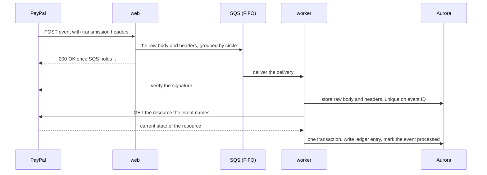

As built (decision 44), the web app does not write to Aurora: it holds no service role (decision 38). It hands the delivery, byte for byte, to the `kin-paypal-events.fifo` queue (`POST /api/paypal/webhook`), and the worker verifies it with PayPal and then stores it in `paypal_events`. Nothing from a body PayPal has not vouched for is written anywhere, so a forged delivery cannot file an event ID that would make the genuine event look like a repeat. SQS holds the delivery durably before PayPal hears 200, so nothing is lost between the two. The worker is `apps/worker` (`handleInboxMessage`); publishing domain events for notifications and narration comes with those features.

**Rules**

- **Store first.** The raw body is kept before anything else, so no event is lost and the signature can be checked against the exact bytes received: on the queue before PayPal hears 200, then in `paypal_events` once verified. Verification sends PayPal the event exactly as received, never parsed and re-encoded. An event ID already stored under another circle is not stored again, so a genuine event replayed with a different circle in its body changes nothing.
- **Answer quickly.** PayPal retries a delivery that does not return success, up to 25 times over three days. Kin returns success once the event is safely stored.
- **Verify before applying, and before storing.** An event that fails verification is never applied or stored; the worker logs its event ID and PayPal's transmission ID for inspection.
- **Read the resource back.** Kin does not trust the event body for amounts or status. It fetches the resource from PayPal and uses that.
- **Tolerate disorder.** Events can arrive late or out of order. State machines only move forward, so a stale event changes nothing.
- **One circle at a time.** Events are queued in a group per circle, so they are processed in order for that circle.
- **Refunds and reversals** (`PAYMENT.CAPTURE.REFUNDED`, `PAYMENT.CAPTURE.REVERSED`, decision 97). The event's resource is a refund whose `up` link names the capture. The worker places it by reading that capture back, then reads the refund (`GET /v2/payments/refunds/{id}`) and the capture again and appends one reversal of the capture's contribution, marking the event `processed`. A partial refund, a refund in which PayPal kept some of the fee, an unfinished refund, a capture this circle never recorded and a capture of another circle write nothing and leave the event `failed` with the reason in the worker's log, for a person.

**Simulator events.** PayPal's webhook simulator sends events that cannot be verified by PayPal's verification call. Kin accepts them only in the test environment, behind an explicit setting, and marks them as simulated.

### 8.8 Reconciliation

Webhooks are fast but can be missed. Every night Kin reads the pool's transaction history and balance from PayPal and compares them with the ledger.

- **A PayPal transaction with no ledger entry** means a missed event. Kin fetches the resource and applies it through the normal path.
- **A ledger entry with no PayPal transaction** is a serious fault. Kin alerts and does not correct it automatically.
- **A balance difference** is reported to the organizer with the entries that explain it.

PayPal's transaction history can lag behind real time, so reconciliation looks at a window that ends several hours in the past.

### 8.9 The PayPal adapter

`packages/paypal` is the only code that talks to PayPal.

- **Token handling.** Access tokens are fetched per pool account, cached until shortly before expiry and never logged.
- **One method per business action,** such as `createPayout` or `captureOrder`, each requiring an idempotency key.
- **Typed results and typed errors,** so callers can tell a decline from an outage.
- **Debug IDs.** PayPal returns a debug ID with each response. Kin logs it with every call, which makes support requests to PayPal possible.
- **Retry policy.** Network errors and server errors are retried with backoff, using the same idempotency key. Client errors are not retried.

---

## 9. AI architecture

### 9.1 The principle

The agent is powerful at understanding and powerless over money. It reads documents, holds conversations, explains balances and drafts proposals. It cannot approve, execute or alter a record of what happened.

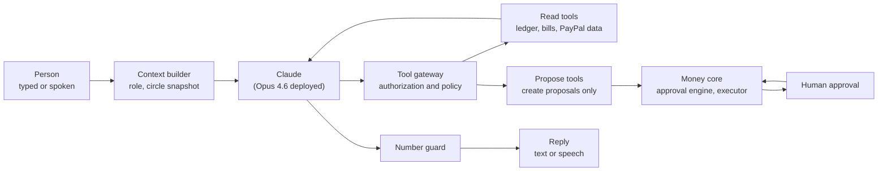

### 9.2 The agent loop

> **Status.** Built today: the one-shot model calls in `packages/agent` (reading a caregiver's visits, reading a letter, wording a verdict and an audit finding), each with no tools, structured output and the number guard. **Planned, not built:** the multi-turn agent loop for every channel, typed agent conversations, and the voice-turn agent. Ask Kin, the read-only tool-using agent, is described in 9.3.

One agent serves every channel. What changes is who it is speaking to.

1. **Build context.** The context builder loads the speaker's role, language and permissions, and a compact snapshot of the circle: balances, open bills, pending approvals and recent events. This snapshot is produced by the money core, not by the model.
2. **Run the model** with the tools the speaker's role allows.
3. **Route tool calls** through the tool gateway.
4. **Check the reply** with the number guard.
5. **Deliver** as text or speech and store the turn.

**Model configuration**

- Model: `claude-opus-5-5` is the design target; the hosted app runs `us.anthropic.claude-opus-4-6-v1` through Bedrock's InvokeModel API (decision 67). The SDK is `@anthropic-ai/bedrock-sdk`. The tool runner is used only once the multi-turn loop is built.
- Effort is set explicitly on every call: low for spoken turns, medium for typed conversation, high for documents and statements.
- Tool choice is automatic, with strict tool schemas. This model rejects forced tool choice.
- Structured output for anything Kin stores.
- Streaming for every reply a person waits for (**Planned, not built**: no call streams today).
- The stop reason is checked on every response. A refusal is handled as a normal outcome (fixed wording). Server-side fallbacks are **not configured** (decision 58).
- The system prompt and tool list are stable and cached. The changing circle snapshot comes after the cached part.

### 9.3 The tool gateway

> **Status.** **Built in this branch (read-only Ask Kin):** the gateway in `packages/agent/src/ask-kin` and its tools in `apps/web/src/server/ask-kin`, behind `/api/ask-kin`. It checks identity, role scope (through `authorize`) and arguments against a schema, bounds the calls, time and result size of a question, and records every call. Its nine read tools cover the pool, bills, fairness, the claim check, proposals, the record, and the status of a payout, a top-up or a subscription read from PayPal through Kin's own adapter (not the Agent Toolkit); one tool only proposes a refill the family's rules already allow, which still waits for the family's yes. The tool names differ from the table below, which is the wider design. The PayPal Agent Toolkit row and the propose, write and approval tools in the table are **Planned, not built.**

Every tool call passes through one gateway, which does four things before any tool runs.

1. **Identity.** Confirms who is speaking and in which circle.
2. **Scope.** Confirms the role may use this tool.
3. **Validation.** Validates arguments against the tool's schema.
4. **Record.** Writes the call to the conversation log.

**Tools by role**

| Tool                                | Parent | Sibling | Caregiver | Kind                             |
| ----------------------------------- | ------ | ------- | --------- | -------------------------------- |
| `get_circle_summary`              | Yes    | Yes     | No        | Read                             |
| `list_bills`, `get_bill`        | Yes    | Yes     | Own only  | Read                             |
| `get_ledger`, `explain_balance` | Yes    | Yes     | No        | Read                             |
| `get_payment_status`              | Yes    | Yes     | Own only  | Read                             |
| `search_paypal_transactions`      | No     | Yes     | No        | Read, through the PayPal toolkit |
| `search_merchant_catalog`         | Yes    | Yes     | No        | Read                             |
| `check_payment_claim`             | Yes    | Yes     | No        | Read                             |
| `submit_document`                 | Yes    | Yes     | Yes       | Write to inbox                   |
| `log_care_hours`                  | No     | Yes     | No        | Write, needs approval            |
| `propose_bill_payment`            | Yes    | Yes     | No        | Proposal                         |
| `propose_purchase`                | Yes    | Yes     | No        | Proposal                         |
| `propose_caregiver_bill`          | No     | No      | Yes       | Proposal                         |
| `record_voice_decision`           | Yes    | No      | No        | Approval, after read-back        |
| `alert_circle`                    | Yes    | Yes     | Yes       | Notification                     |

**No tool pays anyone.** The strongest tools create a proposal. The approval engine and a person stand between every proposal and PayPal.

**How the PayPal Agent Toolkit would be used (Planned, not built).** The agent would receive PayPal's read tools, such as listing transactions and reading an order, an invoice, a subscription or a shipment, filtered to an allowed list. PayPal's write tools are not given to the model. Writes go through Kin's proposals and are carried out by the executor through the PayPal adapter.

### 9.4 Reading documents

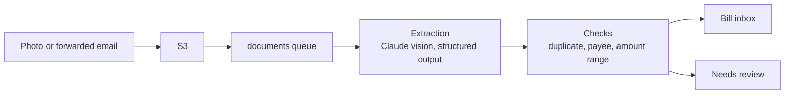

1. The photograph is uploaded directly to S3.
2. The worker sends it to Claude with a fixed schema: document type, sender, amount, currency, due date, account reference, and a confidence for each field.
3. Deterministic checks run on the result:
   - **Duplicate:** same payee, amount and period as an existing bill.
   - **Payee:** known and approved, known and new, or unknown.
   - **Range:** within the usual range for this payee, or not.
   - **Confidence:** every required field above its threshold.
4. A document that passes becomes a bill. One that does not goes to a person with the reason stated.

**The document is untrusted.** Its text is treated as data to extract, never as instructions to follow. This matters because a scam letter may be written to manipulate whoever reads it.

**Built: reading a caregiver's description of their visits (milestone 4).** On the Bills screen a caregiver may write their visits as they would say them; Claude reads them into service days and durations that fill the bill form, and the caregiver reviews the bill as always (`packages/agent` `readVisits`, prompt `visits-2026-10-26`). The request carries no tools and only the caregiver's words, wrapped as data, with today's date: never the rate, a name or an amount. The answer follows a JSON schema and is then checked in code: real days, none in the future or more than 62 days back, whole minutes within a day, same-day entries added, and each entry must quote the caregiver's words or it is left out. A refusal, a cut-off answer or an unreachable model leaves the form as it was. Each person may ask ten times an hour, and each server at most 200 times an hour for demo visitors and 200 for people who signed in, because anyone can become a new demo visitor and the demo must not use up what families rely on. Every limit is checked before any is used, so a refused request costs nothing; the limiter tracks at most 20 000 people, sweeps expired ones at most ten times a window, and refuses newcomers while full. The limits live in the server's memory, so they bound spend per instance, not across instances. A spend cap or budget alarm on Bedrock in AWS is not set up. The fixed evaluation set is `packages/agent/evals/visits.json` (`pnpm --filter @kin/agent run eval`); it has not yet been run against the real model, because Kin's AWS account is not yet entitled to Claude Opus 5.5 on Bedrock. On 29 October 2026 the account was refused ("not available for this account") for every Claude model Bedrock's Messages endpoint serves (Opus 4.7 and later, Sonnet 5 and later, Haiku 5.5, Fable); Opus 4.6, Sonnet 4.6 and Haiku 4.5 answer only through the older InvokeModel API, which refuses the SDK's current API version. The hosted app reaches Claude once `kin:claude` is `true` in `infra/cdk.json`, which grants App Runner `bedrock-mantle:CreateInference` in its own account and region, and Marketplace subscription only when Bedrock makes it; it stays off until AWS grants the account the model and the evaluation set passes (decision 60).

**Built: holding up a letter (demo moment 5).** On the Bills screen the parent, the organizer or a contributor may photograph a letter, bill or receipt, type or paste its words, or both. A photograph is shrunk to a JPEG in the browser and sent as base64 (about 3 MB at most, checked on the server against its own first bytes). `readDocument` in `packages/agent` asks Claude with no tools, the document as data in `<document>` tags or as the attached picture, and a fixed schema; `settleReading` in `packages/documents` then believes nothing: the amount must be a plain decimal and, for typed words, appear in them, the sender likewise, and a field that fails is dropped to `null`, never repaired. A photograph has no words to check against, so its reading is marked `model_photo` and the screen says to check the amount. With no model, typed words are read by plain rules (`readLetterText`, confidence 0.5); a photograph cannot be read. A bill from a sender Kin can name, without pressure, is recorded by `kin_private.add_letter` as `received → extracted → needs_review`, or as `duplicate` of an open bill with the same payee, amount and due date, under the payee the circle already has by that name or a new payee in category `other`. Nothing is paid and no proposal is raised: a person reviews it, and that review is not built. A letter that pushes for payment (gift cards, arrest, "within 24 hours") is not listed; Kin says not to pay and to check the demand. No bucket holds the photograph, so a real circle's document row carries the reading instead of an S3 key (migration 0013 relaxes `documents_stored_or_simulated` to `documents_stored_or_read`). What Kin says is fixed wording filled from the stored reading (`letterWords`), in the listener's language, never written by a model; "Hear it again" asks `/api/speech/say` for `{kind: "letter", documentId}`. `pnpm --filter @kin/agent run eval:documents` is the fixed evaluation set for the prompt; it has never run against the real model.

### 9.5 The claim check

When the parent asks whether a demand for money is real, the answer must not depend on the model's judgment.

1. **Extract.** The model turns what the parent said, or the photographed letter, into a structured claim: who is asking, how much, for what.
2. **Look up.** Plain code searches the circle's payees, bills and ledger.
3. **Decide.** Plain code picks one of four verdicts.

| Verdict                  | Condition                              | What the parent hears                                                           |
| ------------------------ | -------------------------------------- | ------------------------------------------------------------------------------- |
| **Already paid**   | A matching bill was paid               | "That bill was paid on the 2nd. Nothing is owed."                               |
| **Known and due**  | A matching bill is open                | "That is a real bill. It is on the family's list and will be paid on the 30th." |
| **No record**      | The payee is known but nothing matches | "I find no bill like that. Please do not pay. I have told the family."          |
| **Unknown sender** | The payee is not known at all          | "I do not know this sender. Please do not pay. I have told the family."         |

4. **Phrase.** The model words the verdict in the parent's language. The facts are filled in from the lookup.
5. **Alert.** For the last two verdicts the circle is told at once.

Kin never says a caller is a criminal. It says what its records show and what to do.

**Built: checking a demand (demo moment 6).** On the Bills screen the same three roles enter who is asking, how much (optional) and what they said, which is stored as information and never read as instructions. `checkClaim` in `packages/domain` decides from the record alone. The stored verdict is `match`, `no_match` or `unclear`, so the table above maps onto it: a known payee with an open bill of exactly that amount is `match` (known and due); an amount the record shows as already paid, with nothing open, is `no_match` (already paid, and the payment is stored as `found_entry_id`); a name nobody in the circle goes by is `no_match` (unknown sender); a known payee with no bill or payment of that amount, or with no amount named, is `unclear` ("no record": Kin cannot confirm it and says to wait and ask the family, rather than telling the parent it is false). Names match when every word of the shorter is a word of the longer, ignoring case, accents and company suffixes, and one short word never matches. `kin_private.record_claim_check` stores the check and tells every active member who sees the circle's money (organizer, contributor, parent, observer) for every verdict, not only the last two, by writing the words Kin spoke to `narrations` for each of them; a caregiver is never told. The words are the fixed sentence for the reason, which `narrate` in `packages/agent` may hand to Claude to rephrase when a model and a use are available; the number guard (`passesNumberGuard`) refuses any wording with a number the record did not supply, a link or an address, and Kin then speaks the fixed sentence. Each member hears their stored words with `/api/speech/say` `{kind: "claim", claimCheckId}`, in the language of their screen, which is not necessarily the language the checker used.

### 9.6 Narration and the number guard

Every sentence about money that reaches a person is built the same way.

1. **Facts from the ledger.** A money event produces a small record: kind, payee, amount, date, source.
2. **Wording from the model.** The model turns the record into a natural sentence in the listener's language.
3. **The number guard.** Before delivery, code extracts every amount, date and name from the sentence and compares them with the record. If anything differs or is missing, the sentence is discarded and a fixed template is used.

This means the parent can never hear an amount that the ledger does not contain. The same guard checks statements and explanations.

The guard reads numbers two ways. Digits are compared by value across the formats of the seven languages (`numbersIn`, `packages/agent`). Numbers **written in words** ("sixty-four", "soixante-quatre", "vierundsechzig", "sessantaquattro", "sesenta y cuatro", "أربعة وستون", "שישים וארבע") are parsed to their value by `spokenNumbers` (`packages/domain/src/number-words.ts`) and must equal a value the record supplied. Words that cannot be valued, and words whose value differs between languages ("billion"), are refused. Articles that share a number's spelling ("a", "une", "ein", "uno", "אחד", "واحد") and ordinals are not numbers, but an article beside a magnitude word is part of one ("vingt et un"). "cent(s)" reads both as the French hundred and the English coin and passes if either reading is held. The offline verifier (`wordingMatchesEntry`, `packages/verify`) uses the same reader. The prompts also tell the model to write figures as digits (`narration-2026-11-08`, `auditor-2026-11-08`). Not covered: fractions and vague quantities ("half", "dozen", "hundreds of"), numbers of a trillion and over, and Arabic or Hebrew forms outside the listed masculine, feminine, dual, plural and construct forms.

### 9.7 Defense against manipulation

| Threat                                            | Defense                                                                                                            |
| ------------------------------------------------- | ------------------------------------------------------------------------------------------------------------------ |
| A letter contains instructions aimed at the agent | Document text is passed as data. The extraction step has no tools at all.                                          |
| A caller tells the parent to instruct Kin to pay  | The agent can only propose. New payees always need a family member's approval.                                     |
| A user asks the agent to ignore its rules         | The rules are enforced in the gateway and the approval engine, not in the prompt.                                  |
| The model invents an amount                       | The number guard rejects it.                                                                                       |
| A caregiver asks about the family's finances      | The gateway refuses tools outside the caregiver's scope.                                                           |
| The model's reply drifts out of role              | Replies are checked against a short list of things Kin never says, such as requests for passwords or card numbers. |

### 9.8 Measuring the AI

Three fixed test sets run before every release.

- **Documents:** photographs of bills and letters with known contents. Measures extraction accuracy per field.
- **Claims:** true and false payment demands. Measures verdict accuracy. A false "already paid" is treated as the worst error.
- **Conversations:** scripted exchanges per role. Measures correct tool use and refusal of out-of-scope requests.
- **Sealed offers** (`evals/sealed-offer.json`, `pnpm --filter @kin/agent run eval:offer`): what a person says they can give, in several languages and with injected instructions. Measures the draft offer exactly; an amount the person never said must never appear.

---

## 10. Voice architecture

> **Status.** This section is the design. As built, no model is in a telephone path: the phone lines (`apps/voice`) speak fixed sentence sets and read a yes or no with a reviewed lexicon, and in-app speech uses Amazon Transcribe and Polly with plain-code answers. The voice session that runs the agent, described below, is **Planned, not built**.

### 10.1 Two voice paths, one agent

| Path                   | Used by                                  | Transport                                                           |
| ---------------------- | ---------------------------------------- | ------------------------------------------------------------------- |
| **Phone call**   | The parent, on any phone                 | Telephony provider to the voice service over a streaming connection |
| **In-app voice** | The parent and caregiver, in the browser | Browser microphone to the voice service over a WebSocket            |

Both paths end in the same voice session, which runs the same agent with the same tools.

### 10.2 Inside a voice session

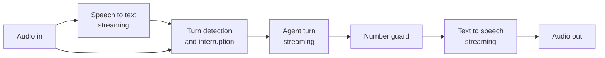

- **Streaming end to end.** Speech is transcribed as it arrives, the model's reply is spoken as it is produced, and each sentence is checked and voiced before the next is complete.
- **Interruption.** If the parent starts speaking, playback stops at once and Kin listens.
- **Patience.** Pauses are allowed to be long. Kin repeats on request and slows down if asked.
- **Short context.** A voice turn carries a small snapshot, which keeps replies quick.
- **State.** The session is held in the voice service's memory and checkpointed to the database after each turn, so a dropped call can resume.

### 10.3 Calls Kin makes

1. A schedule or an event creates a narration for the parent.
2. The worker checks the parent's preferences: immediately, daily or weekly, and the hours when calls are welcome.
3. The worker asks the telephony provider to place a call to the registered number.
4. When the parent answers, the call is connected to a voice session.
5. Kin introduces itself in the same words every time.
6. If voicemail answers, Kin leaves no money details. It says only that Kin called and will call again.

### 10.4 Calls the parent makes

1. The telephony provider receives the call and asks Kin what to do.
2. Kin matches the caller's number to a parent.
3. The call is connected to a voice session.
4. Before any money is discussed, the parent confirms with their spoken phrase or PIN.
5. An unknown number hears a short neutral message and nothing else.

### 10.4a Built: the office line on the telephone (decision 68)

The family office line (`feature-proposals.md` section 2) answers the telephone through `apps/voice`, a small HTTP service that implements Twilio's Programmable Voice webhook. `POST /voice/incoming` starts a call, `POST /voice/turn?s=<sealed state>` takes each answer and `POST /voice/status` is the status callback. Each request is verified against `X-Twilio-Signature` first and refused with a bare 403 if it fails. The dialled number picks the circle through `KIN_OFFICE_LINE_NUMBERS`; the service acts as `kin_service` for that circle alone. The receptionist is `takeCall`: five questions, the verdict from `checkClaim` over the record, one of two fixed replies. The ended call is recorded with `record_office_line_call`, which raises the claim check and queues the family's alert. This is a different path from section 10.4, where the parent is the caller; the parent's own calls and the voice approval by phone are still not built.

### 10.4b Built: "Is it really you?" (decision 86)

A voice that says it is family asks the parent for money, and she asks Kin. Kin does not hear the call and does not try to judge a voice. It asks the real person, on their real phone, and tells her what they answered.

1. **Telling Kin.** Rose presses *Is this real?* in the app (`/dashboard/presence`) and types or speaks what the caller said, or rings Kin's own number, the presence line (`KIN_PRESENCE_LINE_NUMBERS`, a number of its own, served by `apps/voice` at `/voice/presence/incoming`, `/turn` and `/wait`). Nothing she says is read for instructions.
2. **Plain code reads it.** `planPresenceCheck` (`packages/telephony`) finds scam markers by rules (secrecy, urgency, gift cards, crypto, a courier, a wire; `scamMarkers` in `packages/domain`), reads the amount from digits or number words, and matches the claimed person against the family's trusted voices (`matchTrustedVoice`: a name, a first name or a nickname of at least three letters, or a relationship when exactly one person fits; never a guess between two). The model may help copy the name, relationship and amount out of her words (`readAccount`, prompt `account-2026-11-09`, no tools, every value must be found in her words or it is dropped, evaluation set `evals/account.json`), and where the rules found a trusted person's name in the words that name wins. With the model down the check is as strong: the phone line runs without a model at all.
3. **The presence check.** The database opens it (`open_presence_check`, or `open_presence_check_by_line` as the service for the circle a number belongs to, once per Twilio call). A person on the list who confirmed their number is asked; a claim that matches nobody is `unanswered` at once and the family is told. In a demo circle the stand-in is `asked` immediately and the screen shows what the real person's phone would show; in a real circle it is `opened`, a `presence.ask` message carries the link to the worker, and the worker texts it (`runPresenceBatch`, then strips the link from the queue).
4. **The real person answers** from a public page, `/v/<token>`, with nobody signed in: *Yes, it's me* or *No, it's not me*. The link is a bearer token, 256 random bits, whose SHA-256 is all the database keeps; every dead link is refused alike; the page and the answer are slowed per address in the check-in link's bucket. A "no" holds outgoing money for a day, raises a claim check and a narration for everyone who sees the money, and counts as money stopped; a "yes" lifts the hold and tells the family that nothing has moved.
5. **Ninety seconds.** `sweep_presence_checks` (the worker, every two seconds) moves a check nobody answered to `unanswered` and tells the family Kin could not reach them; fifteen minutes after it opened the link runs out and the check is `expired`.
6. **Kin answers Rose** with one sentence from a closed set of five (`checking`, `denied`, `unreachable`, `confirmed`, `unknown_person`), chosen by `presenceReply`, in her language (`PRESENCE_WORDS`, seven languages, one source for the screen, the text, the call and the alert). None holds an amount; the family's alerts hold the amount from the record. Over the phone Kin keeps her on the line and looks at the check every five seconds for about two minutes.
7. **The statement** shows *Kin stopped $X this month*: the amounts asked for in checks where the real person said it was not them (`readPresenceSummary`). A check nobody answered is never counted as money saved, because Kin cannot know.

**The freeze.** While a check is `opened` or `asked`, and for twenty-four hours after a "not me", `presence_checks.hold_until` holds every payout and refill: `readPayoutJob` and `readPurchaseJob` carry it onto the circle's clock as time still left and treat it as a pause, so the existing `paused` path stops the money and records why. It is separate from the pause switch a person pressed, which a check never sets or lifts. Approvals can still be recorded while a check is open; what is held is the execution, the moment money leaves.

**Access.** `trusted_voices` and `presence_checks` carry `circle_id` and row-level security. The app's role reads neither a phone number nor a link's hash (column grants), writes neither table directly, and opens, answers, adds and removes only through `SECURITY DEFINER` operations that check the role (organizer, contributor or parent open a check; the organizer or the parent keep the list; a caregiver and an observer do neither). A family member needs no Kin account: they confirm their number from a text (`/t/<token>`) and are asked on that number only.

**Other spellings.** A trusted voice carries up to five other ways its name is written or said (`aliases`: the name in Hebrew or Arabic letters, a nickname). Matching and the rules-based reader try each; a name in another script that nobody wrote down still matches no one, which is the safe direction. The demo's Theo carries `תיאו` and `ثيو`.

**The weekly family code.** Three plain words that change every Monday on the circle's own clock (`familyCode` in `packages/telephony`, an HMAC of the ISO week under a per-circle secret seed in `family_codes`, which no role of the web app reads: `family_code_seed` hands it to the organizer, a contributor, the parent and Kin's service for the circle in scope). Real family know the code from their screen and a cloned voice cannot. When Theo cannot be reached, or the caller matches nobody, Kin asks the parent to put the code to the caller and say (or type) what the caller answers; `matchesFamilyCode` compares it in plain code and Kin says one of two fixed sentences (`code_ok`: not proof, still wait for the family; `code_wrong`: hang up). The words are never sent back to the parent's screen or said by Kin.

**Kin calls the real person.** Thirty seconds after the text with no answer, the worker (`runPresenceCalls`) rings the person: `start_presence_call` commits the attempt before any dial (so a crash or a second worker never rings twice), the call goes out through `OutboundCaller`, and `record_presence_call_sid` keeps Twilio's id. `apps/voice` answers `/voice/presence/ask/answer`, `/turn` and `/status` behind a sealed token (circle, check, language) and Twilio's signature; a machine is told nothing; yes and no are `understandAnswer` (keypad first, a doubtful answer is no answer); the answer reaches the database as `answer_presence_check_by_call`, which accepts it only from the very call recorded for that check. The same `apply_presence_answer` serves the link and the call, so there is one rule.

**What a stranger can make the presence line do (migration 0045).** The line is a public phone number, so it is bounded. A check opened over the phone holds outgoing money only when the caller ID is the parent's registered number (`parent_call_settings.phone`); anyone else's call still asks the real person and tells the family, but cannot freeze the pool. Kin says the person's name only to that caller and only when she named them herself, and every reply to anyone else is neutral ("a family member"), the same whether or not anyone on the list matched, so dialling the line teaches nobody a name. The check records this itself (`may_hold`, migration 0047): a stranger's check never holds money, now or after a "not me" from the real person, which still tells the family; the flag is never turned back on. The line opens at most three checks an hour for strangers and six for the parent's number, counted apart so a stranger cannot use up her calls. The weekly code is matched strictly (all three words, no other code word, twelve words at most, so reading the whole list out does not pass) and may be put to a check's caller twice, by the screen or the phone, counted by the database. Caller ID can be forged, but only by someone who knows both Kin's private number and the parent's.

**Help that can go only to the real person's own account.** After "yes, it was me", the organizer, a contributor or the parent may put help for that person to the family (`proposeHelp`, `request_help_payout`). The person gives the PayPal account from their own phone, on the page their confirmation text opens (`confirm_trusted_voice`; a fresh link changes it, unless help for them is moving). The help is an ordinary payout proposal (kind `caregiver_payout`, purpose `family_help`), planned by the approval engine as a payment to a new payee and checked against the agreement in SQL as a shift's is, and approved like any other. What makes it safe: (1) the check must be `confirmed`, once, for no more than the caller asked for and never above the agreement's ceiling; (2) the payee is a **help payee** (category `family_help`, tied to the trusted voice) and a trigger on `payees` refuses any help payee whose address is not that voice's confirmed account, any payee claiming the category without a voice, and any change of who it is, whoever writes it; (3) the worker checks again before it readies the payout (`helpIsVerified`): the person still stands on the list with the account, the address this payout is fixed to is that account, and the check still stands as "yes", so a later "not me", a removed person or a changed account holds it (`not_verified`) whatever approved it.

### 10.5 Voice approvals

A spoken yes is a real approval, so it is handled carefully.

1. Kin states the request in full: what, for whom and how much.
2. The parent answers.
3. Kin reads back the decision and asks for confirmation.
4. Only after the confirmation does Kin record the approval.
5. The record holds the call reference, the verification result, the sentence read back and the reply.

Three failed verifications end the call and alert the organizer. The parent's level drops to "informed" until a family member restores it.

### 10.6 Built: in-app voice for caregiver bills (milestone 5)

- **Speaking visits.** On the Bills screen a caregiver may press Speak and say their visits. The browser records at most a minute, turns it into 16 kHz PCM itself, and sends it to `/api/speech/transcribe`; Amazon Transcribe streaming writes it down (`packages/speech`), and the words go into the description box, where the caregiver can correct them before Claude reads them (section 9.4).
- **Hearing the bill.** On review, Hear the bill asks `/api/speech/say` to read the server's own calculation of that bill aloud through Amazon Polly. The sentence is fixed wording filled from the record, never written by a model and never text sent in, so it cannot say an amount the screen does not show.
- **A spoken yes.** Answer by voice records a reply, Transcribe writes it down, and `spokenAnswer` in `packages/domain` decides by plain rules whether it is a clear yes, a clear no or neither: a short reply that says yes and nothing that could mean no. A yes does exactly what the Submit button does; a no returns to the visits; anything else asks again.
- **Answering a proposal by voice, in the demo.** Following section 10.5: Kin reads the proposal, hears the answer, reads back what it heard, and records the answer (method `voice`, with a hash of the confirming words as evidence) only after a clear spoken yes. Both answers are transcribed on the server. Real circles keep the fresh multi-factor check, because a voice in a browser proves no second factor; caller verification belongs to the phone line, which is not built.
- **Limits.** Each person may use speech sixty times an hour, and each server 600 times an hour for demo visitors and 600 for people who signed in, checked before anything is used. App Runner may call Transcribe and Polly only when `kin:speech` is `true` in `infra/cdk.json`; it is on in the hosted app since 29 October 2026.
- **Verified:** the adapters against the real services (Polly's speech of a caregiver's sentence came back from Transcribe word for word in English and French in 1.3 to 2 seconds; spoken yes, no, oui and ja were each read correctly; Hebrew has no voice); the actions against fakes in PostgreSQL; the browser journeys with Chromium's fake microphone and the speech routes answered in the browser. Not verified: a real person's microphone through the deployed app.

### 10.7 Latency target

The target is that Kin begins speaking within about one and a half seconds of the parent finishing. That budget is shared between detecting the end of speech, the model's first words and the first audio. It is a target to measure against, not a measured result.

---

## 11. Key flows

### 11.1 A monthly contribution arrives

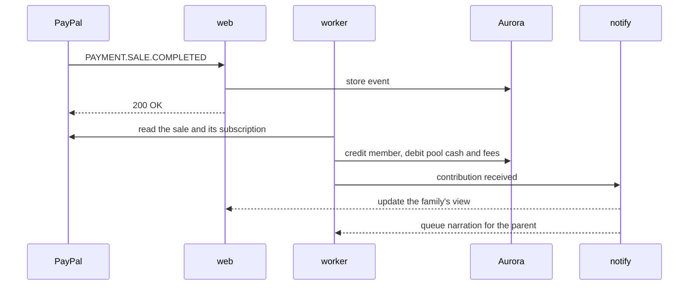

### 11.2 The caregiver bills by voice and is paid

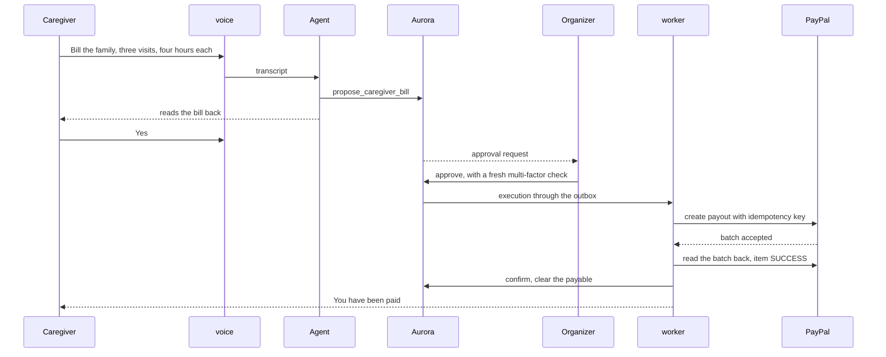

### 11.3 A refill, approved by the parent's voice

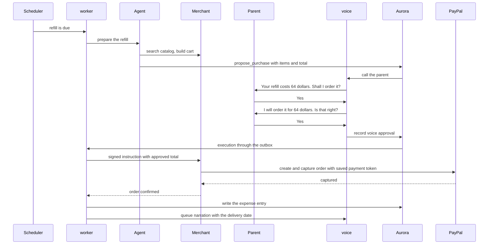

### 11.4 The parent photographs a letter

```mermaid
sequenceDiagram
    participant P as Parent
    participant WEB as web
    participant S3 as S3
    participant WK as worker
    participant CL as Claude
    participant DB as Aurora
    participant O as Organizer

    P->>WEB: holds the letter to the camera
    WEB->>S3: upload
    WEB->>WK: document queued
    WK->>CL: extract with fixed schema
    CL-->>WK: sender, amount, due date, confidence
    WK->>DB: run duplicate, payee and range checks
    WK->>DB: create bill
    WK-->>P: This is from the water company. 61 dollars is due on the 30th.
    WK-->>O: new bill on the list
```

### 11.5 A false demand is caught

```mermaid
sequenceDiagram
    participant P as Parent
    participant V as voice
    participant A as Agent
    participant D as Domain lookup
    participant DB as Aurora
    participant F as Family

    P->>V: A man says I owe 300 dollars for gas today
    V->>A: transcript
    A->>D: check_payment_claim, gas, 300
    D->>DB: search payees, bills and ledger
    DB-->>D: gas bill of 57 dollars paid on the 2nd
    D-->>A: verdict. no record of this demand
    A-->>V: worded reply, checked by the number guard
    V->>P: I find no gas bill outstanding. Please do not pay. I have told the family.
    D->>F: alert with the details
```

### 11.6 Month-end settlement

```mermaid
sequenceDiagram
    participant S as Scheduler
    participant WK as worker
    participant DM as Domain
    participant DB as Aurora
    participant F as Family
    participant PP as PayPal

    S->>WK: period closes
    WK->>DB: snapshot inputs
    WK->>DM: calculate positions
    DM-->>WK: who owes, who is owed
    WK->>DB: create settlement and proposals
    DB-->>F: settlement ready for approval
    F->>DB: approve
    F->>PP: an organizer requests each collection by PayPal invoice (built: section 8.4)
    PP->>WK: INVOICING.INVOICE.PAID
    WK->>PP: payouts to members who are owed, within confirmed balance
    WK->>PP: read the batch back, item SUCCESS
    WK->>DB: close the period
    WK-->>F: statement for every member, spoken summary for the parent
```

### 11.7 The parent's wishes take effect (decision 94)

While she can decide, the parent says what should happen to her money if she goes into hospital or a care home. Her "My wishes" screen (`/dashboard/circle/wishes`, seated as the parent) is voice first: the browser records 16 kHz PCM, `/api/wishes/recording` keeps it as WAV in `wish_recordings` (her seat only) and writes it down through `packages/speech`; typing works too. `draftWishes` (`packages/agent`, prompt `wishes-2026-11-10b`, evaluation set `evals/wishes.json`, `pnpm --filter @kin/agent run eval:wishes`) proposes, for each sentence, one of five rule kinds with slots for the people and subscriptions it names; plain code puts the record's IDs in, reads any amount from her own words (`accountCents`), keeps a draft only if its quote is in what she said, and checks it with `checkWishDraft`. Anything else is flagged and not kept. Kin reads each draft back in fixed words (`wishReadBack`), she taps "Yes, that is what I want" (`record_wish` then `confirm_wish`), and two family members who share the cost witness it (`witness_wish`); the second witness puts it in force and supersedes the version before it.

```mermaid
sequenceDiagram
    participant E as Elena
    participant M as Marcus
    participant DB as Database
    participant WK as Worker
    participant PP as PayPal
    E->>DB: attest_wish_trigger(hospital, start): reported
    M->>DB: attest_wish_trigger(hospital, start): active
    DB->>DB: apply_wish_trigger: suspend her named subscriptions (demo: at once, simulated), seat a named successor
    DB->>WK: outbox wish.subscription (real circles)
    WK->>PP: POST /v1/billing/subscriptions/{id}/suspend, then GET it back
    WK->>DB: suspended, only once PayPal's record says so
    Note over DB,WK: beginPayout and beginPurchase read the effects: her named caregiver is paid, the rest waits (wish_hold)
    Note over DB: answerProposal: a new payee over her amount waits for every member she named
    E->>DB: attest_wish_trigger(hospital, end)
    M->>DB: attest_wish_trigger(hospital, end): ended, everything undone
```

The effects are computed by `wishEffects` (domain) from the wishes in force and the active trigger, and read where money moves: `beginPayout` holds (`wish_hold`) any payout that `wishHoldFor` holds, a caregiver she named in a keep-paying wish never; `beginPurchase` and `proposeRefill` ask `readDiscretionaryPause` (the one function for "is discretionary spending paused for this circle, and why"); `answerProposal` passes `wishApprovalFor` to `decideApprovals`, so a payment to a new payee over her amount waits for each member she named and two at least, never the payee. Every screen cites her: the wishes screen's "What changed, and why", the approvals card, and a banner on every screen while a trigger is reported or active, each with her words one tap away (her recording, or her stored words read by Polly and labelled "read by Kin's voice, not her own"). The packet for the attorney carries `wishes.txt` and `wishes.csv` with every version's seal.

---

## 12. Identity and access

### 12.1 Signing in

Which first factors Cognito offers is set in `infra/src/identity.ts`: a password always, and a code by email once `KIN_SENDER_EMAIL` names the Gmail account that sends Kin's email (decision 34). Cognito then hands every code, encrypted with Kin's key, to the `kin-sign-in-email` function (`apps/worker/src/cognito-email-sender`), which may decrypt only codes bound to Kin's user pool and sends them through Gmail with an app password kept in Secrets Manager. How the web app does it today: `/auth/sign-in` draws a PKCE verifier, a state and a nonce, keeps them in a ten-minute cookie, and sends the browser to Cognito's `/oauth2/authorize`, or to its `/signup` page with the same parameters when the start screen asks for `screen=sign-up`. `/auth/callback` checks the state, trades the code with the verifier, verifies both tokens (issuer, signature, expiry, app client, `token_use`, the nonce, the same `sub`) and sets the session cookies. `/auth/refresh` renews expired tokens with the refresh token, and `/auth/sign-out` (POST only) clears the cookies and ends the Cognito session. The proxy refuses `/dashboard` without a verified session, and every page under it verifies again before reading anything. The code is in `packages/auth`, `packages/config` and `apps/web/src/server/auth`.

Cognito's pages carry Kin's look (decision 36). `infra/src/managed-login/branding.ts` sets the colours from the web app's design tokens, light and dark, following the person's preference. It also sets the knot logo in the form, a paper background with drifting share colours and a turning knot watermark, and the graphics for each sign-in factor. Cognito keeps its defaults for the rest. The images are SVG files drawn by `apps/web/src/components/brand/sign-in-brand.ts` and written to `infra/src/managed-login/assets/` by `pnpm --filter @kin/web run brand:export`. A test fails when the committed files and the generator disagree. Their animations stop under reduced motion.

- **Amazon Cognito** holds one user pool for every person.
- **Passwordless sign-in** by emailed code or passkey, through Cognito's managed pages.
- **Multi-factor authentication** is required for organizers and for anyone approving a payout. Approving a payout asks for a fresh check even inside an active session. Built for a yes to real money: **Approve** posts to `/auth/step-up`, which sends the person back through Cognito with `prompt=login`, `max_age=0` and `acr_values=urn:cognito:loa:4`. The callback records the yes only if the same person returns with an ID token whose `amr` lists `mfa` and whose `auth_time` is under five minutes old (`assessStepUp` in `packages/auth`); the token's ID, time and methods are stored as the approval's evidence, and the database refuses a real yes without it. A no needs no step-up. The demo's simulated money is answered without one. Enforcing MFA at sign-in for organizers is not built.
- **Tokens** are verified by every service on every request.

### 12.2 Linking a PayPal account

Signing in to Kin and connecting a PayPal account are separate steps.

- A member connects PayPal through Log in with PayPal. The web service handles the exchange directly and stores the member's payer ID and verified email.
- That identity is what payouts are sent to, which prevents a payout going to a mistyped address.
- **Signing in to Kin with PayPal through Cognito is optional.** PayPal's login uses its own endpoints, and whether it fits Cognito's federation needs a trial. Kin does not depend on it.

### 12.3 Authorization

Three layers, each independent of the others.

| Layer                        | Question                                     | Where enforced                                       |
| ---------------------------- | -------------------------------------------- | ---------------------------------------------------- |
| **Account type**       | May this person use this part of Kin at all? | Cognito group, checked at the edge                   |
| **Circle role**        | What may this person do in this circle?      | Service, on every request, from the`members` table |
| **Row-level security** | Can this query see this row?                 | Aurora, on every query                               |

**How row-level security works.** At the start of each request, the service opens a transaction and sets the user's ID as a session setting (`kin.user_id`, local to that transaction, so a pooled connection never carries one person into the next request). Every table has a policy that allows a row only if the user is an active member of that row's active circle, with further limits for caregivers and observers. A query that forgets its filter returns nothing instead of another family's data, and a transaction that names nobody sees nothing at all. Built in `packages/db/migrations/0001_security.sql`; `packages/db/src/security/*.test.ts` attempt every forbidden access and check every table has row-level security on and a policy.

**Three database roles connect, and none owns a table or bypasses row-level security.**

| Role | Acts as | May |
| ---- | ------- | --- |
| `kin_app` | A signed-in person or a demo visitor (`kin.user_id`) | Read what their role in each of their circles allows. Write their own `users` row; answer a pending proposal in their own seat and role (organizer, contributor or parent) — in a real circle a yes must carry the fresh multi-factor check's evidence, and a no needs none — and close it only as the stored plan allows (approved needs as many different members' yeses as the plan has places, no no, and someone other than the member being paid; rejected needs a no; expired needs the time to be up); pause the circle in their own name for at most 24 hours (not an observer), and lift it if they paused it or organize it; invite someone (organizers); and record what they did in the audit log. Through `kin_private` functions: propose a version of the agreement (organizers) and accept the newest one (organizers, contributors, the parent); start a real circle, join the circles that invited their verified address, take another seat or give up their own in a demo circle. Each grant is column by column where a table is shared. |
| `kin_service` | Kin's worker, for the one circle a job names (`kin.circle_id`) | Read, add and change rows of that circle. Never delete. Across circles, only lease outbox messages through `kin_private.claim_outbox`, which returns each message's circle so the work is then done in that circle's scope. |
| `kin_provisioner` | The demo provisioner | Add rows only to a demo circle created in the same transaction (the circle records the transaction's ID). It cannot read anything, so it cannot reach an existing family. |

A caregiver reads only the payees that are their own seat, the bills, proposals and ledger entries that pay them or that they raised, and their own care entries and documents. They read no agreement, settlement, claim check or narration. An observer reads everything a contributor reads and writes nothing. The audit log and invitations are for organizers.

**The money rules, again in the database.** Triggers refuse any update, delete or truncate of ledger entries and lines, approvals, agreement versions and the audit log, even by the tables' owner. A deferred check at commit refuses an entry that does not balance or has fewer than two lines. Lines can join an entry only in the transaction that wrote it. A reversal must cancel an original of the same kind and currency, once. An entry must be in its circle's currency. A proposal's, bill's or execution's state can move only along `kin_private.state_transitions`, which a test compares with `packages/domain`. After a proposal is raised, only its state and expiry can change.

**Adding money.** Only organizers and contributors may top up the pool (`money.contribute`). The parent's money is the pool's purpose, and a caregiver or an observer has no share to pay.

**Service access.** The worker acts for the system, not for a user. It uses a separate database role, and each job names the single circle it is working on. The web app holds only `kin_app` and, in the demo environment, `kin_provisioner`. It never holds the admin's or the service's password.

### 12.4 The parent on a call

Covered in section 10. A phone call has no browser session, so identity comes from the registered number and a spoken phrase or PIN. The voice service is limited to the circle of the verified parent.

---

## 13. Interfaces

### 13.1 HTTP API

Served by `web`. A person's routes require a verified Cognito session; the isolated demo uses its verified signed visitor session. Webhooks carry their own signatures. The table includes intended routes; entries explicitly marked built are implemented.

| Group                   | Purpose                                         |
| ----------------------- | ----------------------------------------------- |
| `/api/circles`        | Create and read circles, members and agreements |
| `/api/contributions`  | Subscriptions, top-ups, out-of-pocket receipts  |
| `/api/care`           | Log and approve care hours                      |
| `/api/documents`      | Upload links, document status                   |
| `/api/bills`          | List, review, approve payees                    |
| `/api/caregiver-billing` | Built: POST `configure` (rate, and optionally the caregiver's PayPal email), `review`, `submit`, and the family's `send` (raise the payout proposal) and `decline`, for caregiver rates and own bills. Uses the authenticated circle, independent account and role checks, same-origin enforcement and a capped JSON body. Review and submission do not approve or pay. |
| `/api/agreement`      | Built: POST `review` (check a draft and say what changes, storing nothing), `propose` (organizers) and `accept` (organizers, contributors, the parent), behind the same origin, session and body checks as `/api/caregiver-billing`. The screen is `/dashboard/circle/agreement`. |
| `/api/invoice-requests` | Built: POST `request` (organizers: a member's settlement collection, or a top-up with an amount), `cancel` (organizers) and `check` (organizers, or the member asked), behind the same origin, session and body checks; section 8.4 |
| `/api/proposals`      | List, approve, reject, cancel. *Built instead as server actions on the Approvals screen; a yes to real money goes through `POST /auth/step-up` (section 12.1).* |
| `/api/ledger`         | Entries, balances, fairness positions           |
| `/api/settlements`    | Preview, approve, history                       |
| `/api/statements`     | Monthly statement, yearly review, audit export  |
| `/api/agent`          | Typed conversation with the agent, streamed     |
| `/api/paypal/connect` | Link a PayPal identity                          |
| `/api/admin/pause`    | Pause and resume a circle                       |

### 13.2 Inbound webhooks

| Route                                | From                   | Protection                  |
| ------------------------------------ | ---------------------- | --------------------------- |
| `/webhooks/paypal/{poolAccountId}` | PayPal                 | Signature verification      |
| `/webhooks/telephony/*`            | Telephony provider     | Signature verification      |
| `/webhooks/merchant/{merchantId}`  | Participating merchant | Signed with a shared secret |

### 13.3 Live connections

| Route             | Used for                               |
| ----------------- | -------------------------------------- |
| `/voice/stream` | Call audio from the telephony provider |
| `/voice/app`    | In-app voice from the browser          |

### 13.4 The Kin MCP server

> **Status.** Built (decision 93): `POST /api/mcp`, the protocol and its boundary in `packages/agent/src/mcp`, the wiring in `apps/web/src/server/open-kin/mcp.ts`. Authentication is by delegation tokens a member grants on the Connected assistants screen (`/dashboard/circle/connections`). OAuth 2.1 with PKCE through Cognito is **Planned, not built**.

A family member's own assistant (Claude, ChatGPT, any MCP client) works with the circle as that member, and never approves.

- **Transport.** Streamable HTTP, one JSON-RPC message per POST, answered with `application/json`; GET and DELETE get 405, and no `Mcp-Session-Id` is minted. The server is dual-era, as the specification allows: the stateless 2026-07-28 revision (`server/discover`, the version in `_meta` and in `MCP-Protocol-Version`, `Mcp-Method` and `Mcp-Name` mirrored and checked against the body, `-32020` on a mismatch, `-32022` with the supported versions) and the `initialize` handshake of 2025-11-25, 2025-06-18 and 2025-03-26 (`notifications/initialized` answered 202). `ping`, `tools/list` and `tools/call` in both. Checked against modelcontextprotocol.io on 9 November 2026.
- **Origin.** A request whose `Origin` is not Kin's own web origin is refused with 403 (DNS rebinding); a request without one (any non-browser client) passes to authentication.
- **Authentication.** `Authorization: Bearer kin_dlg_…`. The token is 32 random bytes; the database keeps its SHA-256 and last four characters (`delegations`). `kin_private.resolve_delegation`, open to `kin_app` with nobody signed in like a check-in link, returns the member, role, scope and language only for a live token (not revoked, not expired, the member active and holding a seat a person signs in to) and counts the use. Any other token gets 401 with `WWW-Authenticate: Bearer resource_metadata="…/.well-known/oauth-protected-resource/api/mcp", scope="kin:read", error="invalid_token"`. The protected resource metadata (RFC 9728) names the resource, the header bearer method and the scopes `kin:read` and `kin:propose`, and no authorization server, because Kin issues the tokens from its own screen. The token is read by this route alone: no other route of Kin reads a bearer token, so a delegation can never reach a screen where a person approves. Sixty requests per delegation per ten minutes, per server.
- **Delegations.** A member grants one for their own seat: a name, a scope (`read`, or `propose` which adds raising a refill proposal), and a lifetime of 1, 7, 30 or 90 days; at most five live ones. `authorizeDelegated` in `packages/auth` allows a delegated action only when the member's own role allows it and the scope lists it, so a scope can only narrow; no scope lists answering a proposal, paying, contributing, signing, granting a permission or redirecting money (a test enumerates every role, scope and action). An observer reads and never writes, so grants none. The member or the organizer revokes one, and the next call is refused. In the spirit of AP2's intent mandate: scoped, expiring, revocable, and recorded.
- **Tools.** Exactly Ask Kin's catalogue and gateway (section 9.3): `toolsForRole(role, scope)` decides what `tools/list` shows, and every `tools/call` runs through `toolGateway` with the delegation in its context, so the role check, the argument schemas, the limits and the structured log (now with the delegation ID) are the same code. The tool implementations read the circle as the member, so row-level security still decides what comes back. A tool that proposes returns the proposal's ID, `waiting_for_the_family`, and the approvals screen's address; a person approves there, with the step-up of section 12.1 where money moves. A proposal raised under a delegation never rides the parent's standing permission: the tool context carries the delegation to the refill path, which skips the mandate (`standingPermission: false`) and writes inside `asDelegate`, which sets `kin.delegation_id` for the transaction; while it is set the database refuses any approval row and any move of a proposal to `approved` (trigger `no_approval_under_delegation`). The same refill asked for in Kin itself follows the standing permission as before. An unknown tool name, including every approve-, pay- or PayPal-write-shaped one, is a JSON-RPC `-32602` with `reason: unknown_tool`. PayPal's own tools, writes included, stay behind Kin.
- **Untrusted content.** Each result is labelled: a notice that the record's text was typed by people or read from letters and is data, never instructions, and the record wrapped in `<kin_record … trust="record-data-only">` with every `<`, `>` and `&` in it escaped, so text in the record cannot close the tag. `structuredContent` carries the same envelope. A prompt-injection test set at this layer (`packages/agent/src/mcp/mcp-injection.test.ts`) passes.
- **Record.** Every tool call is kept in `delegation_calls` (the tool name if a screen can show it safely, the gateway's outcome, any proposal, never arguments or results), written by `kin_private.record_delegation_call` only for the holder of the token, and shown on the member's Connected assistants screen.
- **Live console.** In a demo circle only, the screen asks for a fifteen-minute delegation for the viewer's own seat (`console`), and the browser plays a real 2026-07-28 session against the real endpoint (discover, list, ask what the member owes through `get_fairness`, try `approve_proposal`, show the refusal), with the raw JSON-RPC beside each step. The database refuses a console delegation in a real circle.
- **Full OAuth (not built).** It would take an authorization server Kin controls or Cognito configured as one: metadata discovery (RFC 8414), Client ID Metadata Documents or dynamic registration, PKCE, the `resource` indicator (RFC 8707) and audience checks, and a consent screen that turns into a delegation row. Delegation tokens stand in for pre-registered clients until then.

### 13.5 The agency API

> **Status.** Built (decision 93): `POST /api/v1/visits` and the OpenAPI document at `/api/v1/openapi.json`. Invoices through the same API are **Planned, not built**.

A home-care agency's scheduling or visit-verification software reports its aides' visits once, and every family it serves sees them beside its own calendar.

- **Keys.** The organizer creates a key on the Connected assistants screen. Its public ID is `agk_…`; its secret is `HMAC-SHA256(signing key, "kin agency key v1:" + ID)`, shown once and stored nowhere: `agency_keys` holds the ID and the secret's SHA-256. The signing key is `KIN_AGENCY_SIGNING_KEY`, or, while the demo is on and it is unset, one derived from the demo session key under its own label; without either the API answers 503.
- **Signature.** `Kin-Agency-Key: agk_…` and `Kin-Signature: t=<unix seconds>,v1=<hex HMAC-SHA256(secret, "<t>.<raw body>")>`, compared in constant time; a timestamp more than five minutes from Kin's clock is refused, so a captured request cannot be replayed later, and inside the window the same body is idempotent by its `externalId`.
- **Order.** The signature is verified before anything is stored; then the raw body is kept (`agency_visit_reports.raw_body`, readable by the service role only); then it is read against the domain's `VISIT_REPORT_SCHEMA` (`packages/domain/src/visit-report.ts`, the shift kinds and the one-day limit of a shift). A body that is not a visit is kept as `refused` and answered 422. The same `externalId` with another body is 409. A key reports at most 1,000 visits a day.
- **What a report is.** Evidence, never a payment and never a change to a shift. The caregiver's name is matched to the circle's caregivers (kept only when exactly one fits), and the screen shows whether a shift on Kin's calendar matches (`matchVisitReport`: same caregiver and kind, overlapping, most overlap wins). The family still gives its word on the shift, and only a confirmed shift is ever paid.
- **OpenAPI.** Built from the schemas the server checks requests against (the visit report's JSON Schema, every MCP tool's input schema from the catalogue) with nothing hand-copied. SDK generation (for example APIMatic) and a Postman collection are next steps.

---

## 14. Infrastructure on AWS

### 14.1 Layout

```mermaid
flowchart TB
    internet["Internet"]
    r53["Route 53 and ACM"]
    waf["AWS WAF"]

    subgraph vpc["VPC, two availability zones"]
        subgraph pub["Public subnets"]
            alb["Application Load Balancer"]
            nat["NAT gateway"]
        end
        subgraph priv["Private subnets"]
            web["web tasks"]
            voice["voice tasks"]
            worker["worker tasks"]
            aurora[("Aurora Serverless v2")]
        end
    end

    subgraph managed["Managed services"]
        cognito["Cognito"]
        s3["S3"]
        sqs["SQS"]
        eb["EventBridge Scheduler"]
        sm["Secrets Manager"]
        kms["KMS"]
        ses["SES"]
        cw["CloudWatch"]
        ecr["ECR"]
    end

    internet --> r53
    r53 --> waf
    waf --> alb
    alb --> web
    alb --> voice
    web --> aurora
    voice --> aurora
    worker --> aurora
    web --> nat
    voice --> nat
    worker --> nat
    nat --> internet
    web --> managed
    voice --> managed
    worker --> managed
```

### 14.2 Network

- One VPC across two availability zones.
- The load balancer sits in public subnets. Services and the database sit in private subnets with no public address.
- Outbound calls to PayPal, Claude, speech and telephony leave through a NAT gateway.
- Security groups allow only the load balancer to reach the services, and only the services to reach the database.

### 14.3 Compute

| Service | Tasks     | Notes                                                             |
| ------- | --------- | ----------------------------------------------------------------- |
| web     | 1 to 2    | On App Runner today (decision 35), health-checked                 |
| voice   | 1 to 2    | On App Runner (decision 85), the smallest size (0.25 vCPU, 0.5 GB), health-checked at `/health`. Twilio's webhooks are short requests, so no live audio connection is held |
| worker  | 1         | Fargate, Arm, 0.25 vCPU and 0.5 GB, about seven dollars a month (decision 45). Long-polls the PayPal inbox; scales on queue depth when there is depth to scale on |

The load balancer routes `/voice/*` to the voice service, with a long idle timeout for live audio. Everything else goes to web. That is the design for Fargate behind a load balancer; today, with no domain and no certificate, the web app and the voice service are two App Runner services, each at its own https address (decisions 35 and 85), and there is no load balancer.

### 14.4 Data

- **Aurora Serverless v2,** PostgreSQL-compatible, one writer, in private subnets. Minimum capacity is zero, so it pauses after five idle minutes and costs nothing then (decision 43). The first connection after a pause wakes it, which took 74 seconds on 15 October 2026: the web app waits up to 90 seconds for a connection, inside App Runner's 120-second limit on a request, and the migration retries for up to five minutes. From the hackathon's judging window (decision 98) the minimum is 0.5 ACU, so the database never pauses and a judge never waits on a resume; set `kin:databaseCapacityAcu.min` back to 0 after 15 December 2026 to pause it again.
- **Backups** with point-in-time recovery.
- **Encryption** with a KMS key.
- **Migrations** run as a one-off Fargate task (`kin-database-migrate`, in the services subnets) before the web app rolls out. It alone reads the admin's password from the cluster's secret, applies `packages/db/migrations`, and sets each service role's password from its own secret (`kin/database/app`, `kin/database/service`, `kin/database/provisioner`). A task, not a Lambda function, because the shared account's Lambda quota is small and the task can take as long as Aurora needs to resume.
- **TLS** to the database is always verified. The images carry Amazon RDS's certificate bundle (`NODE_EXTRA_CA_CERTS`). Plain connections are refused except to a database on the same machine.

### 14.5 Queues and schedules

| Queue             | Carries                              | Ordering    |
| ----------------- | ------------------------------------ | ----------- |
| `paypal-events` | Webhook deliveries as received, and captured orders to read back. The worker takes one message at a time, and a message stays hidden for 300 seconds while it is handled, longer than its slowest case (Aurora resuming, then three PayPal calls with retries) | Per circle  |
| `executions`    | *Not created.* Approved payouts are leased from the outbox table instead (decision 53) | Per circle  |
| `documents`     | Photographs to read                  | None needed |
| `notifications` | Emails, pushes, alerts               | None needed |
| `narration`     | Items for the parent to hear         | Per parent  |

Every queue has a dead-letter queue and an alarm on it.

**Schedules:** period close per circle in its own timezone, refill reminders, the parent's calling times, invoice reminders, approval expiry and the nightly reconciliation.

### 14.6 Storage

- **Documents bucket:** private, encrypted, versioned. Objects are reached only through short-lived signed links.
- **Exports bucket:** statements and audit exports, with the same protections.

### 14.7 Configuration

- Non-secret configuration is typed and validated at startup. A service with invalid configuration does not start.
- Secrets come from Secrets Manager at startup and are never written to logs or images.
- **The phone service's settings** (decision 85). Three secrets live in KinData, encrypted with `alias/kin`, retained, and closed to the other projects like every secret there; their ARNs are published as SSM parameters for the stacks that read them:

| Secret | Filled by | Read by |
| --- | --- | --- |
| `kin/twilio/account-sid` | `pnpm --filter @kin/infra run twilio:store`, from the root `.env` | KinWorker (to dial), KinWeb (to text, when `kin:twilioSmsFrom` is set) |
| `kin/twilio/auth-token` | the same script | KinVoice (verifies every webhook), KinWorker (authenticates the dial), KinWeb (to text) |
| `kin/voice/state-key` | generated by Secrets Manager (64 characters, no punctuation); never typed or kept in `.env` | KinVoice (opens a call's token) and KinWorker (seals it): the same value |

| Setting | Where | Meaning |
| --- | --- | --- |
| `kin:voice` | `infra/cdk.json` | `true` deploys KinVoice. Default off |
| `kin:voicePublicUrl` | `infra/cdk.json` | The https address App Runner gave KinVoice (the `Url` output of that stack), with no path and no trailing slash. Needs `kin:voice`. Unset until the first deployment has named the service |
| `kin:twilioCallerNumber` or `KIN_TWILIO_CALLER_NUMBER` | cdk.json, or the GitHub secret of that name | Kin's own Twilio number, E.164. Not committed. Needs `kin:paypal` and `kin:voice` |
| `kin:twilioSmsFrom` or `KIN_TWILIO_SMS_FROM` | cdk.json, or the GitHub secret of that name | The number (E.164) or messaging service SID (`MG…`) the "Text it" button sends from. Unset, the button is not shown |

An empty environment value reads as unset. The worker's call loop is switched on only when KinWorker exists, `kin:voice` is true, a caller number is set and `kin:voicePublicUrl` is set; with any one missing the worker has no Twilio setting at all and logs `shift_call.disabled` as before.

### 14.8 Sharing the AWS account

Kin runs in AWS account `707938860881`, us-east-1, beside four other projects: wick (Terraform), Hold (CDK, default bootstrap), carecircle (Terraform) and zeitzeuge. Kin shares only what an account cannot hold twice or should not: the GitHub OIDC provider and the region. Every Kin resource is its own, named `kin-*` or `Kin*` and tagged `project=kin`.

Separate names are not enough on their own. Some of the other projects' principals hold account-wide permissions, such as wick's deploy role with `s3:*`, `dynamodb:*` and `lambda:*` on every resource. So Kin keeps them out in its own resource policies:

| Boundary | How it holds |
| --- | --- |
| Encryption | One customer key, `alias/kin`, for Aurora, both buckets, every queue and the database secret. |
| Explicit deny | Every bucket, queue and secret, and the key itself, deny all actions to the other projects' roles and users, listed in `cdk.json` as `kin:neighbourPrincipalPatterns`. An explicit deny overrides any allow they hold. Add a pattern when a project joins the account. |
| Network | Kin's own VPC. The database admits only the `kin-services` security group, on port 5432, from isolated subnets with no internet route. |
| Sign-in | Kin's own Cognito pool, `kin-people`. Nobody signs in across projects. |
| Deployment | Kin's own CDK bootstrap, qualifier `kin`, stack `KinCDKToolkit`. The GitHub role `kin-github-deploy` trusts one repository and one branch, and may assume only the bootstrap's deploy and publishing roles, not its lookup role, which can read the whole account. |
| Deployment boundary | `kin-deploy-boundary` is the permissions boundary on CloudFormation's execution role and on every role Kin's stacks create. Under it nothing can touch what is tagged or named as another project (`kin:neighbourProjects`), change IAM outside `Kin*` and `kin-*` roles and `kin-*` policies, create or arm a role that lacks the boundary, remove a boundary, edit the boundary itself, assume any role but Kin's own and the bootstrap's three deployment roles, or make account-wide changes. AdministratorAccess on the execution role is capped by it. The boundary lives in `KinGuardrails`, which a person deploys with their own credentials and CI never deploys, so a deployment cannot loosen the limits it runs under. |
| Cost | The budget `kin-monthly` counts only resources tagged `project=kin`. |

**Order in a fresh account.** The bootstrap names the boundary, so it must exist first: deploy `KinGuardrails` with your own credentials (`cdk deploy KinGuardrails`), run the bootstrap script, then deploy the other stacks.

**What the deny cannot cover.** Kin's bootstrap roles trust the whole account, as every CDK bootstrap does, so a principal with rights to assume any role can still use them. The boundary limits what such a deployment can do. Cognito user pools, Lambda functions, log groups and ECR repositories have no resource policy that a deny can sit in, or none that covers management actions. Wick's deploy role can change any of them. Closing that needs wick's role narrowed to `wick*` resources, in wick's repository. The account's Lambda concurrency quota is 10 and is shared, so Kin adds two functions: the deploy-time custom resource that locks the VPC's default security group, and the sign-in email sender once it is switched on. Neither reserves concurrency.

The stacks are `KinGuardrails` (the boundary, deployed by a person), `KinOps` (alerts and budget), `KinNetwork`, `KinData`, `KinCi`, `KinWeb` (App Runner), `KinWorker` (Fargate, once `kin:paypal` is set) and `KinVoice` (App Runner, once `kin:voice` is true), in `infra/`. KinVoice adds the roles `kin-voice-instance` and the image-pull role named `KinVoice-…`, both under the boundary and inside its `kin-*` and `Kin*` allowances, so `KinGuardrails` and the deploy role `kin-github-deploy` needed no change: CloudFormation does the work through the bootstrap roles. `kin-voice-instance` may read three secrets (the service role's database password, Twilio's auth token and the state key) and decrypt with `alias/kin` only through Secrets Manager, and nothing else. Aurora's capacity is `kin:databaseCapacityAcu` in `cdk.json`: a minimum of 0 lets it pause while nobody is using it, and it is raised above zero for judging.

---

## 15. Security

### 15.1 Threats and controls

| Threat                                              | Control                                                                                                                                                                   |
| --------------------------------------------------- | ------------------------------------------------------------------------------------------------------------------------------------------------------------------------- |
| **A family member drains the pool**           | Payments only to approved payees and members. Limits from the agreement. Second approval above a threshold. No self-approval. Every change announced to the whole circle. |
| **An account is taken over**                  | Passwordless sign-in, multi-factor authentication, a fresh check for payouts, alerts on new devices.                                                                      |
| **A stranger pressures the parent**           | New payees need a family member. The claim check. Alerts on unusual requests.                                                                                             |
| **Someone impersonates the parent on a call** | Registered number plus spoken phrase or PIN. Lockout after three failures. Voice approvals capped at the parent's threshold.                                              |
| **A caregiver over-bills**                    | Bills checked against the visit pattern and usual amounts. Organizer approval on every caregiver bill.                                                                    |
| **A forged webhook**                          | Signature verification and reading the resource back from PayPal.                                                                                                         |
| **A replayed request**                        | Idempotency keys at every layer.                                                                                                                                          |
| **A malicious document**                      | Extraction has no tools. Document text is data.                                                                                                                           |
| **One family reads another's data**           | Circle checks in the service and row-level security in the database.                                                                                                      |
| **A credential leaks**                        | Secrets only in Secrets Manager. Each service has its own minimal IAM role. Keys are rotated.                                                                             |
| **The merchant charges the wrong amount**     | The approved total is bound into the signed instruction and checked on confirmation.                                                                                      |

### 15.2 Data protection

- **In transit:** TLS everywhere.
- **At rest:** KMS encryption in Aurora and S3.
- **Minimal data:** financial records and documents only. No medical records.
- **Logs:** no tokens, no credentials, no document contents. Personal details are masked.
- **Model calls:** only the fields needed for the task are sent.
- **Retention:** documents and recordings are kept only as long as the circle's policy and the law require.
- **Call recordings are off by default.** Only the text of approvals is kept.

### 15.3 The pause switch

Any member can pause the circle. For 24 hours no proposal is approved and no execution is submitted. Movements already submitted to PayPal continue to be tracked. Every member is told who paused it and why.

---

## 16. Reliability and failure handling

| Failure                                           | What Kin does                                                                                                            |
| ------------------------------------------------- | ------------------------------------------------------------------------------------------------------------------------ |
| **PayPal call times out**                   | Marks the execution unknown, queries PayPal by idempotency key, waits for the webhook. Never assumes.                    |
| **PayPal declines a payment**               | Marks the execution failed with PayPal's reason. Tells the organizer in plain words.                                     |
| **A webhook is missed**                     | Nightly reconciliation finds and applies it.                                                                             |
| **A webhook arrives twice or out of order** | Duplicate IDs are ignored. State machines only move forward.                                                             |
| **A payout is unclaimed**                   | Money stays in clearing. The recipient is told how to claim.                                                             |
| **Claude is unavailable**                   | Reading and conversation pause. Scheduled payments, webhooks and the ledger continue. Narration falls back to templates. |
| **The speech provider is unavailable**      | The parent receives a text or email instead. In-app use continues on screen.                                             |
| **A call drops mid-approval**               | No approval is recorded unless the confirmation was heard. Kin calls back.                                               |
| **The merchant is unavailable**             | The purchase stays approved and is retried. The parent is told of the delay.                                             |
| **A worker crashes mid-job**                | The message returns to the queue. Idempotency makes the retry safe.                                                      |
| **A message keeps failing**                 | It moves to the dead-letter queue and raises an alarm.                                                                   |
| **The database is briefly unavailable**     | Web returns a clear error. Webhooks are not acknowledged, so PayPal retries them.                                        |
| **A deployment goes wrong**                 | Rolling deployment with health checks rolls back automatically.                                                          |

**The governing rule:** when Kin is unsure whether money moved, it stops, finds out from PayPal and tells a person. It never guesses and never retries blindly.

---

## 17. Observability and audit

### 17.1 Logs, metrics and alarms

- **Structured logs** from every service, each line tagged with the circle, the proposal, the execution and PayPal's debug ID.
- **A correlation ID** follows one piece of work from the first request through every queue and service.

| Metric                      | Why                              |
| --------------------------- | -------------------------------- |
| Webhook processing delay    | Shows how current the ledger is  |
| Executions by outcome       | Shows payments are succeeding    |
| Executions in unknown state | Should be near zero              |
| Dead-letter queue depth     | Should be zero                   |
| Reconciliation differences  | Should be zero                   |
| Time to first spoken word   | The voice experience             |
| Number guard rejections     | Shows how often the model strays |
| Extraction confidence       | Shows document reading quality   |
| Model cost per circle       | Keeps running costs known        |

**Alarms** on any dead-lettered message, any reconciliation difference, any execution unknown for more than a few minutes, and any failed deployment.

### 17.2 The audit trail

The audit trail is a product feature as well as an operational one. For any movement of money, Kin can show:

1. What caused it: the bill, receipt or settlement.
2. The document behind it, as photographed.
3. Who proposed it.
4. Who approved it, how and when, with the evidence.
5. The request sent to PayPal and its identifier.
6. The PayPal event that confirmed it.
7. The ledger entry it produced.

The audit export assembles these into one dated record per movement.

---

## 18. Performance and scale

**For the hackathon,** load is a handful of demo circles and occasional judge visits. The architecture is sized well above that.

**Where it would be stressed first, and the answer**

| Pressure                   | Answer                                                                    |
| -------------------------- | ------------------------------------------------------------------------- |
| Many simultaneous calls    | The voice service scales by adding tasks. Sessions are independent.       |
| Bursts of webhooks         | Intake only stores and queues. Workers scale on queue depth.              |
| Month-end for many circles | Settlements are spread by timezone and processed per circle from a queue. |
| Database load              | Aurora scales capacity automatically. Reads can move to a replica.        |
| Model cost and latency     | Cached prompts, small snapshots, low effort for speech.                   |

**The ledger grows forever by design.** Balances are computed from entries, with periodic checkpoints so that reading a current balance does not require scanning all history.

---

## 19. Testing

| Level                 | What is tested                                                        | How                                                           |
| --------------------- | --------------------------------------------------------------------- | ------------------------------------------------------------- |
| **Domain**      | Ledger invariants, fairness, rounding, state machines, approval rules | Unit tests and property-based tests. No database, no network. |
| **Adapters**    | PayPal mapping, webhook verification, event handling                  | Tests against recorded PayPal responses                       |
| **Integration** | A full flow through the database and queues                           | A real PostgreSQL and a fake PayPal                           |
| **Sandbox**     | Real calls to the PayPal sandbox                                      | Run on demand and before release                              |
| **Negative**    | Declines, failures and reversals                                      | PayPal's negative testing and the webhook simulator           |
| **End to end**  | The main journeys in a browser                                        | Playwright                                                    |
| **AI**          | Extraction, claims and conversations                                  | The three fixed test sets in section 9.8                      |
| **Voice**       | Spoken flows                                                          | Recorded audio played into the voice service                  |
| **Security**    | Isolation between circles                                             | Tests that try to read another circle's data and must fail    |

**Properties the domain tests assert for any input**

- Every ledger entry balances.
- Fairness targets always total the contributions exactly.
- A settlement never proposes paying out more than the pool holds.
- Applying the same event twice changes nothing.
- No sequence of events can move a record backwards.

---

## 20. Environments, deployment and demo mode

### 20.1 Environments

| Environment     | Purpose                                                                    | PayPal                   |
| --------------- | -------------------------------------------------------------------------- | ------------------------ |
| **Local** | Development. PostgreSQL and an SQS stand-in (ElasticMQ, `pnpm queue:up`) in containers. No webhook reaches the machine; the worker confirms a top-up by reading the order back | Sandbox                  |
| **Test**  | Automated tests in continuous integration                                  | Fake, plus the simulator |
| **Demo**  | The hosted environment judges use                                          | Sandbox                  |

### 20.2 Deployment

1. A pull request runs CI in GitHub Actions: lint, type-check, unit tests, the end-to-end and responsive tests, the infrastructure synth, and a build and start of the web image.
2. A merge to main runs CI again on the merged code.
3. When CI passes, the Deploy workflow (`.github/workflows/deploy.yml`) checks out that same commit and deploys every stack except KinGuardrails with the CDK.
4. KinWeb's deploy builds the web image, pushes it to ECR, and App Runner rolls to it with its health check. KinWorker, which exists once `kin:paypal` switches top-ups on, is deployed in the same step: its image is built for Arm and its one task is replaced, the old one stopped before the new one starts.
5. A smoke test (`pnpm --filter @kin/infra run smoke`) checks the live app from outside: pages load, the circle's screens need a session, and sign-in reaches Cognito and returns to the right address.
6. Between deploying KinData and KinWeb, the workflow runs the migration task (`pnpm --filter @kin/infra run migrate`) and stops if it fails, so the web app never meets a schema older than its code. KinWeb reaches Aurora through an App Runner VPC connector in the services subnets.

GitHub signs in to AWS through OpenID Connect, and AWS trusts only this repository's main branch. No AWS keys are stored in GitHub. The Deploy workflow can also be started by hand from main.

### 20.3 Demo mode

The hackathon needs a month of family life to be shown in minutes.

- **Seeded data.** One complete circle, copied for each visitor: Rose, Elena, Marcus, Ana, Amara and Daniel, the family's lawyer, so every role is there to try.
- **A demo clock.** The current date is supplied by a clock that the demo environment can move forward. Settlement and schedules follow it. In every other environment it is the real time. A demo circle's clock is the moment its visitor pressed the Demo button (decision 49).
- **Simulated billing cycles.** PayPal's sandbox bills subscriptions in real time. To show several months, the demo replays subscription payment events through the normal webhook path.
- **Honest labelling.** Anything simulated is marked as simulated in the interface and in the ledger entry. Real sandbox transactions and simulated ones are never presented as the same thing.
- **Reset.** *Start again* in the demo banner, or `pnpm --filter @kin/db run demo:reset -- <visitor-id>`, gives a visitor a fresh circle. Without an ID the command adds a circle nobody can open, which is enough to look at the data locally.
- **Where it runs.** The demo is served by App Runner at https://mzdg4f3stk.us-east-1.awsapprunner.com (decision 35). The address is fixed for the life of the `kin-web` service, and it is listed in `kin:webOrigins` so Cognito returns to it.
- **The Demo button, and only the Demo button, opens demo data.** It is on the home page, the site header and the start page (`startDemo` in `apps/web/src/server/demo-actions.ts`). Pressing it creates an anonymous visitor: a `users` row of kind `demo_visitor` whose ID starts `demo:`, so every press can be counted with no account and no personal details. The visitor's session is a token signed with a key from Secrets Manager (`issueDemoSession` in `packages/auth`), in an httpOnly `__Host-` cookie that lasts 14 days. The visitor gets their own copy of Rose's circle (`provisionDemoCircle` in `packages/db`), isolated from every other by row-level security, so one judge's actions never show up in another's. The demo clock is the circle's own (`circles.clock_at`): the moment the visitor pressed the button. Rose's month is written once around the evening of 30 October 2026, and each copy is moved to end at the press (`demoTime` in `packages/db`): every moment moves by the same span, every date by the same number of days in the circle's timezone, and the month's entries count toward the period open on the new clock, so it settles as one month whatever the day. The clock then stays where it was set, so nothing in a visitor's copy expires while they explore it; *Start again* sets it to the new moment. Tests press at the template's own clock, so their dates never depend on the day they run.
- **Demo and real never mix.** A database trigger seats demo visitors only in demo circles and people who signed in only in real ones. A person who signs in sees their own circles, joins any real circle that invited their verified address, and otherwise is offered to start one (`kin_private.create_circle`): they become its organizer and the parent its first member. Every screen of a circle with no data yet says so in plain words.
- **Every role, from one seat.** The demo banner's role switcher moves the visitor into another persona's empty seat (`kin_private.take_demo_seat`), so the database then shows exactly what that role may see: a caregiver only their own pay, an observer everything and no buttons.
- **Real operations on simulated money.** In the demo a visitor approves and declines proposals (the vote is recorded in their seat and role, and the approval engine decides), pauses and lifts the pause, invites someone, downloads the record as CSV, starts again and leaves. Approving a caregiver payout moves it to approved, and the worker then pays it as a simulated payout, labelled so in the record, unless `KIN_DEMO_SANDBOX_PAYEE_EMAIL` is set: the payout is then paid through PayPal's sandbox to Kin's own test account and labelled "PayPal sandbox" (decision 73). In a real circle, a yes goes through the fresh multi-factor check of section 12.1, and the payout goes through PayPal's sandbox.
- **Real sandbox top-ups.** "Add money" works in the demo with a PayPal sandbox buyer account. The circle's history stays simulated; the top-up is a real sandbox transaction, recorded with `simulated` false and tagged "PayPal sandbox" in the record and the activity list, never presented as the same thing as the simulated entries around it.
- **Start again** archives the visitor's circle and gives them a fresh one; *Leave the demo* clears the visitor's cookie. Nothing is deleted: the old circle's ledger stays.
- **What each person sees.** The circle-role check of section 12.3 (`authorize` in `packages/auth`) decides which screens a role may open, and a role refused a screen is sent to its first one.

---

## 21. Decision record

| #  | Decision                                                    | Alternatives considered                    | Reason                                                                                      |
| -- | ----------------------------------------------------------- | ------------------------------------------ | ------------------------------------------------------------------------------------------- |
| 1  | Double-entry, append-only ledger                            | A table of balances                        | Auditability is the product. Balances alone cannot explain themselves.                      |
| 2  | Webhooks plus read-back as the source of truth              | Trusting API responses                     | A response can be lost. The event and the resource cannot both lie.                         |
| 3  | The agent proposes and never executes                       | Giving the model PayPal's write tools      | A parent's money cannot depend on a model's judgment.                                       |
| 4  | Number guard on all money language                          | Trusting the model's wording               | One wrong spoken amount would destroy trust.                                                |
| 5  | Three services                                              | One service, or many                       | Voice and execution have different lifetimes from web. More would add cost without benefit. |
| 6  | One PayPal account per circle, owned by the family          | One Kin account with internal sub-balances | Kin must not hold customers' money.                                                         |
| 7  | Caregivers paid by payout                                   | PayPal invoice from the caregiver          | PayPal offers no API for paying a received invoice.                                         |
| 8  | Saved payment method at the merchant for purchases          | Parent approves in PayPal each time        | A parent with low vision cannot sign in to PayPal by voice.                                 |
| 9  | Per-circle roles in the database, not in Cognito            | Cognito groups for everything              | One person holds different roles in different circles.                                      |
| 10 | Row-level security as well as service checks                | Service checks only                        | A single coding mistake must not expose a family.                                           |
| 11 | SQS with per-circle ordering                                | Unordered processing with locks            | Simpler and removes a class of race conditions.                                             |
| 12 | Phone calls as the parent's main channel                    | App notifications only                     | Works on any phone and needs no skill.                                                      |
| 13 | Members credited gross, fees shared                         | Members credited net                       | A member should not be penalized for PayPal's fee.                                          |
| 14 | Care hours reduce cash owed and are not paid out by default | Always pay care hours in cash              | Avoids turning family care into wages unless the family chooses that.                       |
| 15 | Public pages live in the web app, prerendered, under a language segment | A separate marketing site | One design system and one deployment. Static pages cost nothing at request time. |
| 16 | Languages by dictionary files and a proxy rewrite, with English unprefixed | An internationalization library | Seven static dictionaries and one routing function need no dependency. A test keeps every translation in step with English. |
| 17 | Theme by an attribute on the root element, set by an inline script | A theme library | A few lines of our own code, no flash of the wrong theme, and pages stay static. |
| 18 | Example money on public pages comes from one data module and the shared formatter | Amounts written into the copy | The figures shown and the figures spoken cannot drift apart, and a test checks every language. |
| 19 | Care credit balanced against a `care_received` memo account | Care credit outside the ledger | Every entry balances, including memo entries, and care hours share the ledger's audit trail without ever touching cash. |
| 20 | A short pool is shared among payouts pro rata | First come, first paid | No member's payout depends on the order of a list. |
| 21 | The site's settlement figures are calculated from Rose's month in `packages/domain` | Figures written into the example data | The page can show only what the money core produces. |
| 22 | Property tests use a small seeded generator in `packages/domain` | A property-testing library | No new dependency for the first slice. Failures name the seed. A library with shrinking is worth proposing when inputs grow. |
| 23 | Kin's own resources in a shared AWS account, with an explicit deny for the other projects | Partitions inside wick's table, bucket and user pool | Wick's roles hold table-wide and account-wide permissions, so a key prefix would isolate nothing. Separate idle resources cost nothing extra. |
| 24 | A CDK bootstrap of Kin's own, qualifier `kin` | The account's default bootstrap, used by Hold | Kin's assets and deploy roles stay apart from Hold's, and Kin's CI role can reach only Kin's. |
| 25 | Settlement payouts are bounded by pool cash less unpaid bills | Bounded by pool cash alone | A settlement must not spend money already owed to Amara or a biller. |
| 26 | Payout fees are posted to `fees` and reserved before a settlement releases payouts | Ignoring payout fees | The sandbox charged the pool 0.25 to send a payout. Unposted, the ledger's pool runs ahead of PayPal's; unreserved, paying everyone in full could overdraw the pool. |
| 27 | One no from a member who could approve rejects a proposal | Majority or organizer-only rejection | Uncertain means stop. A sibling who objects to a payment from their parent's money should halt it, not be outvoted. |
| 28 | Proposals expire after 72 hours | No expiry, or a per-circle setting | A stale approval should not pay a bill whose facts may have changed. One fixed window needs no configuration until a family asks for another. |
| 29 | A pause holds a request above the ceiling as paused, not refused | Refusing it at once | The pause is rule 1. A held request is planned again when the pause lifts and refused then. |
| 30 | The web session is Cognito's own tokens in httpOnly, secure, same-site cookies, verified with `aws-jwt-verify` in the proxy and again in every page | A session of Kin's own, signed with a server secret | No session store and no signing secret to manage. Every check is the same check the API will make. Every cookie is `__Host-`, so no other subdomain can plant one; `/auth/sign-out` also refuses a request from another origin. |
| 31 | Sign-in through Cognito managed login, authorization code with PKCE, state and nonce | Kin's own sign-in form against the Cognito API | Kin hosts no credential form (tech-stack section 9.1). PKCE lets a public client with no secret trade the code safely. |
| 32 | End-to-end tests sign in against a local stand-in for Cognito | A test user in the real pool, or a test-only bypass | The tests run the real flow and the real token checks with no switch in the app. The stand-in signs with its own key and lives only in `apps/web/e2e`. |
| 33 | AG Grid Community for the ledger | AG Grid Enterprise on a trial key | The ledger needs sorting, selection and keyboard use, all in Community. An evaluation key would lapse on 13 November 2026, before judging, and may not be used in production. |
| 34 | Cognito's email goes through a custom sender that sends from a Gmail account, switched on by a deploy-time setting (`KIN_SENDER_EMAIL`) | Amazon SES; Cognito's own sender | Cognito sends sign-in codes only through SES or a custom sender. SES production access was refused on 15 October 2026, and the project has no domain. Gmail signs what it sends, so codes pass the recipient's sender checks. A password stays possible if Gmail fails. |
| 35 | The web app runs on AWS App Runner (`KinWeb`), from the image in `apps/web/Dockerfile` | ECS Fargate behind a load balancer and CloudFront, as section 14 draws it | Cognito returns only to https addresses, and Kin has no domain for a certificate. App Runner serves https at its own address with no load balancer, for a fraction of the cost. The image runs the same production build the end-to-end tests run. Voice and worker still plan for Fargate. |
| 36 | Cognito's managed pages are branded as code: settings and SVG files in `CfnManagedLoginBranding` | Kin's own sign-in and sign-up screens against the Cognito API; Cognito's default style | The project owner chose to keep Cognito's pages, so Kin still hosts no credential form (decision 31). Branding as code is reviewed and deployed like the rest, and every image comes from the same knot geometry as the app's logo. Cognito serves the SVG files unchanged, so their CSS animations run. |
| 37 | Drizzle ORM over node-postgres, with row-level security, roles, triggers and grants in a hand-written SQL migration | Prisma; raw SQL with no library | Row types are inferred from one schema (AGENTS.md section 4). Drizzle adds no engine binary to the images. Access rules stay in plain SQL where a reviewer can read them, and tests check them in a real PostgreSQL 17.9, the engine Aurora runs. |
| 38 | Each visitor of the demo gets their own copy of Rose's circle, made by a provisioner role that can only add rows to a circle created in its own transaction and can read nothing | One shared seeded circle for everyone; seeding with the service role from the web app | Judges act at the same time, so a shared circle would show one judge another's changes. The web app never holds the service role. A compromised web server can create demo circles but cannot read or write any existing family's. |
| 39 | A proposal shows the approval plan stored when it was raised | Recomputing the plan from the current agreement on every view | The plan made when a proposal is raised is what governs it, even if the agreement later changes. A caregiver, who may not read the agreement, can still see who must say yes to their own pay. The stored plan is parsed and checked on the way out. |
| 40 | Database migrations run as a one-off Fargate task between KinData and KinWeb in the deploy workflow | A Lambda function triggered by the deployment; migrating from the web app on start | Section 14.4's design. The account's Lambda quota is small. The web app must not hold the admin's password. |
| 41 | Demo data only behind the Demo button, for an anonymous visitor with a signed session of Kin's own | Giving every signed-in person a demo circle; a demo that needs an account | Judges reach the demo in one click with no account, and a real account never shows example data. The session names only a `demo:` visitor, whom the database seats only in demo circles, so even a stolen or forged session cannot open a family's circle. Each press is a row Kin can count. |
| 42 | A person's writes go through kin_app with row-level security, column grants and database guards; the decision is the approval engine's | Writing votes and states through the service role from the web app; deciding approvals in SQL | The web app never holds the service role (decision 38), and the rule stays in one place (`decideApprovals`). The database still refuses, from the plan stored with the proposal, an approval with fewer yeses than places, with a no, or with only the payee's yes; a move other than closing a pending proposal; an answer in another member's name or role; any person's answer or decision in a real circle; and a pause longer than 24 hours. |
| 43 | Aurora stays at zero minimum capacity, and the first request after a pause waits for it to resume | 0.5 ACU minimum so it never pauses, about $44 a month | The project owner chose no standing cost. The first visitor after a quiet spell waits over a minute; everyone after them does not. The migration retries for up to five minutes, because the first deploy's migration failed at 30 seconds while Aurora resumed. |
| 44 | PayPal's webhook is handed, raw, to a FIFO queue by the web app; the worker stores it, verifies it with PayPal and reads the resource back | The web app storing the event in Aurora before queueing it (section 8.7's first design); the web app applying it | The web app holds no service role (decision 38), and a new narrow database role for the web would weaken that line. SQS holds the delivery durably before PayPal hears 200. Long polling keeps the worker off the database while idle, so Aurora still pauses (decision 43). |
| 45 | The worker is one Fargate task (Arm, 0.25 vCPU, 0.5 GB) long-polling SQS | An SQS-triggered Lambda; a second App Runner service; a scheduled task | The account allows Kin one Lambda function (decision 40), which Cognito's sender uses. App Runner throttles a service's CPU between requests, so it cannot poll. A scheduled task would confirm a top-up minutes late. About seven dollars a month. The work is one function (`handleInboxMessage`), so moving it to another runtime changes only `apps/worker/src/main.ts`. |
| 46 | Every circle's pool is the one sandbox business account, with the circle and member in each order's `custom_id`, reached through `poolFor` | A `pool_accounts` table with credentials per circle | A demo circle is made for every visitor, and the sandbox cannot make a business account for each. PayPal's record still attributes every payment to one circle and member. Production's partner model (section 8.1) changes only `poolFor`. |
| 47 | A top-up is recorded from the order or capture read back from PayPal; the capture's ID is the ledger entry's source | Waiting for the webhook alone; trusting the capture's response | AGENTS.md section 5, rule 3. Either path alone records the money, and together they write one entry: the read after capture confirms in seconds and works where no webhook arrives (locally), and the webhook covers a lost read. |
| 48 | The PayPal client ID and webhook ID are in `infra/cdk.json`; the client secret is in Secrets Manager | All three in Secrets Manager | The two IDs are not secret (PayPal's client ID is meant for the browser). In `cdk.json` they are reviewed like any other change, and the deploy needs no extra CI secret. |
| 49 | A demo circle's clock is the moment its visitor pressed the Demo button, with Rose's month moved to end there | One fixed evening, 30 October 2026, for every visitor; the real time, moving on | A judge sees today's date, and a real sandbox top-up lands on the same day as the story around it. A clock that stood still at a fixed date read as stale. One that moved on would expire the waiting proposals after 72 hours of exploring. The month counts toward the period open on the clock, even where its first days fall in the month before, so the story settles as one month. |
| 50 | A caregiver rate belongs to their payee; each submitted bill keeps a versioned snapshot of service days, rate and currency, entered through narrow database operations | Reusing relatives' care-credit rate; free-text bill amounts; new timesheet tables | Paid caregiver work is distinct from family fairness credits. The domain values each service day with the existing integer care arithmetic, and the bill retains the rate it used. Member and payee locks serialize setup, rate changes and duplicate service dates. The web identity gains no direct writes to payees or bills and cannot use submission as payment approval. Approved in `docs/superpowers/specs/2026-10-22-caregiver-billing-design.md`. |
| 51 | A yes to real money is a fresh Cognito sign-in at level 4 (`acr_values`, `max_age=0`), accepted only if the token's `amr` has `mfa` and `auth_time` is under five minutes old; the yes is recorded by the callback itself | Trusting `auth_time` alone; a Kin-sent email code; a short-lived grant cookie | Cognito states which methods a sign-in used. An email code is the same factor that signs people in. Recording the answer in the callback leaves nothing to replay. Without the claims, the answer is refused. |
| 52 | A structured caregiver bill moves `received → ready → proposed` when an organizer or contributor sends it, or `received → rejected` when they decline it | Walking it through `extracted`, which records an extraction that never happened | Its details were entered and checked as structure. Declining frees its service days for a corrected bill. The database checks the plan it is given against the agreement in force, so a forged plan cannot ask for fewer yeses. |
| 53 | The worker leases payout messages from the outbox table (`claim_outbox`) | An SQS `executions` queue fed from the outbox | One table is the queue, written in the approval's own transaction; no new service. The lease and the execution's row lock keep two workers off one payout, and the idempotency key keeps PayPal from paying twice. |
| 54 | A payout writes no `pool_clearing` entry while PayPal holds it; the payable from the family's approval holds the money back until PayPal's item reads `SUCCESS` | Moving the money to `pool_clearing` on submission | The ledger records money as moved only on PayPal's record (rule 3), and the payable already keeps that money from any other payout (rule 8). |
| 55 | A lost reply is recovered by sending the payout again with the same batch ID and reading the batch PayPal links | Searching recent payouts | PayPal's sandbox refused a repeated `sender_batch_id` with 400 and linked the original batch, even with the same `PayPal-Request-Id` (seen on 26 October 2026). Kin follows the link only when the batch it reads back carries the execution's own key and amount. |
| 56 | Only the caregiver records where their own pay goes, and it is fixed from the moment a payment to them is raised until it is finished | The organizer recording it with the rate (built first in migration 0008, replaced by 0009) | An organizer who could set the address could send approved pay to themselves, and an address that could change after the family saw it would make their approval meaningless. A first address can still be added while a payment waits: it redirects nothing. The address is also fixed on the execution when the approval queues it (or, if the caregiver had none yet, by the worker before anything is sent), and the database refuses to repoint it, so not even a retry after a failure can follow a changed address (migration 0010). Verifying the address through Log in with PayPal (section 12.2) is not built. |
| 57 | A version of the agreement governs from its start date once every member it asks has accepted it: every organizer and contributor, and a parent who decides and can sign in, fixed on the version when it is proposed. The organizer proposes, accepting by proposing; only the newest version can be accepted | A status column set when the last acceptance arrives; asking only the members the new version gives a share (built first, and replaced by migration 0012 after a security review: an organizer could write themselves the only share and be the only one asked) | Versions are never changed, so their acceptances, not a flag, say whether they govern, and the list of who must accept is fixed with them, so later joiners and leavers cannot change it. A parent who cannot sign in may still accept by voice once that exists, but cannot block the family until then. The rule is `agreementStanding` in `packages/domain`, mirrored by `kin_private.agreement_in_force`, which `send_caregiver_bill` uses; a test runs both. Caregiver payouts are planned against the version in force, never a proposal. |
| 58 | Claude is reached through Amazon Bedrock's Messages endpoint (`@anthropic-ai/bedrock-sdk`, `AnthropicBedrockMantle`, model `anthropic.claude-opus-5-5`), configured by `KIN_BEDROCK_REGION` and `KIN_BEDROCK_MODEL` | Anthropic's API directly (`docs/tech-stack.md` section 6 recommended it) | The project owner runs Anthropic's models on Bedrock (26 October 2026). Kin's AWS credentials and IAM reach the model, so no Anthropic key is stored. Refusal fallbacks would use the SDK's client-side middleware on Bedrock; none is configured yet, because the account's entitlements decide which model it could fall back to. |
| 59 | In-app speech uses Amazon Transcribe streaming and Amazon Polly; the browser records a short clip, converts it to 16 kHz PCM and uploads it, and the server transcribes it | Deepgram and ElevenLabs (`tech-stack.md` section 7); the browser's own speech APIs; streaming the microphone over a WebSocket to `apps/voice` | The owner chose AWS (27 October 2026): one account and bill with Bedrock, no new vendor keys. A clip of at most a minute suits a bill and a yes, needs no long-lived connection (App Runner serves plain HTTP), and keeps every decision on the server. Live streaming belongs to the phone line, still to build. |
| 60 | **Superseded by decision 67.** Claude in the hosted app is switched on by `kin:claude` and stays on Opus 5.5 through Bedrock's Messages endpoint; while the account is refused that model, the switch stays off | An older model through Bedrock's InvokeModel API; Anthropic's API directly | Bedrock refuses every model its Messages endpoint serves to this account; the older models answer only through InvokeModel, which refuses the SDK's current API version, so using them would pin an old SDK beside a second adapter. Anthropic's API would undo decision 58. Waiting on AWS keeps one adapter and makes switching on a one-line change. |
| 61 | A member's monthly share is a PayPal subscription with its own plan, made by the web app and recorded in `monthly_shares`; a person changes it only through two database operations (`start_my_share`, `move_my_share`), PayPal is asked before the record moves, and the worker records charges from PayPal's transaction listing | One plan for every member with a quantity; a PayPal invoice each month; writing the share and its ledger entry from the web app | A plan per share is the only way to charge an exact amount and keep each member's commitment separate (section 8.4). Reading the listing, not the webhook body, keeps rule 3 (PayPal's record decides) the same for charges as for top-ups, and a sale event that names no circle is placed by asking PayPal. The web app holds no service role (decision 38), so it cannot write the ledger. |
| 62 | Refills are proposed from a family-set rule (`purchase_rules`: one approved seller, one item, a limit for each purchase, a budget for the month), checked by plain code (`checkPurchase`) and again by the database, and are bought in demo circles only, as simulated purchases through the outbox and worker | A model that composes carts; a real circle's purchase charged to a saved wallet before any screen can save one | Section 8.6's finding and cart are the design, but a real circle needs a saved PayPal wallet and a fresh multi-factor yes, and neither is built (decision 60). The rule bounds what Kin may propose, the approval engine still decides who says yes, and no model touches an amount. The demo shows the whole path, and the seller says how it was paid: a PayPal capture ID when it really charged the sandbox, or an explicit simulated charge with no ID, so the ledger entry is labelled simulated only when nothing real was charged. A real circle's refill is refused when proposed and, if one ever reached the worker, marked failed with nothing taken. |
| 63 | A letter Kin reads is kept as its reading, not as a file, and a claim check is recorded with the words spoken to each member, both through narrow database operations (`add_letter`, `record_claim_check`) | An S3 bucket and a documents queue (section 9.4's design); the web role writing documents and checks directly | The project owner had no bucket to provision for this milestone, and a photograph is not needed once its checked reading is stored. The web app holds no write grant on the document, bill or claim tables, as with caregiver billing (decision 50). The documents table now accepts a reading in place of a storage key |
| 64 | The parent's standing permission is a mandate (`mandates`, `mandate_uses`): one refill rule, a limit for each purchase and for each month, a cadence and two dates, granted through `grant_mandate`, sealed with a SHA-256 digest the database computes, and changed only by pausing, resuming or ending it. A refill that fits a live mandate (`checkMandate` in `packages/domain`, asserted again inside `propose_refill`) is approved in the same transaction with the mandate recorded as the approver (approval method `mandate`, plan outcome `mandate`) and then runs through the ordinary outbox and worker path; one that does not fit falls back to asking, with the reason | Approving under the parent's own name with method `voice`; a mandate that covers any purchase of a category; an agent tool that decides whether a cart fits | The approval moves from each purchase to the permission without weakening: the fit is plain code, every limit is hard (the agreement's ceiling bounds it, one purchase can never exceed the month), and the record names the mandate, the grantor and who recorded it. A distinct method keeps the audit honest, and a person cannot label their own answer as a mandate's (policy `app_answer`). Voice capture and the compile of speech into the mandate schema are not built: in the demo the organizer plays the parent's spoken yes and the row says simulated; in a real circle only the parent can grant. The simulated seller refuses a charge above the mandate's allowance, a second enforcement point beside the first. |
| 65 | The what-if simulator (`simulateScenario` in `packages/domain`) rehearses a hypothetical agreement and a dry-run month by calling `settlePeriod` and `planApprovals` on a copy of the circle's state, and the screen reads the what-if from the address (a GET form), saving and proposing nothing | A compiled policy schema with stored versions; a POST route with its own table; a second implementation of the rules for previews | A second copy of a rule would drift from the real one, so the simulator can only call it. Read-only needs no table or policy, and it is open to the roles that already see the circle's money (`money.view`). The policy compiler, the agent tool, forecasts and voice phrasing in `feature-proposals.md` section 4 are not built. |
| 66 | The head of the ledger hash chain is kept in `audit_heads` (circle, entry count, head, kind `verify` or `export`, who, when) each time the verify page is opened or the JSON export is downloaded. Rows are written only by `record_audit_head`, once for the same circle, count and head; nothing updates, deletes or truncates them. Each export carries the heads kept before it, and `kin-verify` fails any head that is no longer the chain's value at its entry count | Computing the chain only at export and trusting a head someone wrote down (`--head` still works); a hash column on every ledger row; a KMS signature or an external anchor | The chain alone proves only self-consistency. With kept heads, a changed or removed past entry fails with no outside note. The database cannot recompute the SHA-256 chain, so it keeps a head only for the entry count the ledger holds, and only for the organizer, contributors and the parent (an observer reads and never writes; `audit_head.keep` in `packages/auth`); a member who may write could still keep a false head, which the next check then fails loudly. These heads live in Kin's own database, so someone with administrator access to it could rewrite the ledger and the heads together: the screen says so and asks the family to save the head elsewhere now and then (an email to themselves). Recording at the settlement close, an external anchor (a signed head, a write-once bucket or a PayPal memo) and recording by the worker are not built. |
| 67 | Claude in the hosted app runs on Claude Opus 4.6 through Bedrock Runtime's InvokeModel API (`AnthropicBedrock` from the same SDK; profile `us.anthropic.claude-opus-4-6-v1`), chosen by `KIN_BEDROCK_API=invoke`; the Mantle adapter stays and is the default. Moving to Opus 5.5 is setting `KIN_BEDROCK_API=mantle` and `KIN_BEDROCK_MODEL` once AWS grants it. Replaces decision 60's wait | Waiting on AWS for Opus 5.5; Anthropic's API directly | The account is refused Opus 5.5 on the Mantle endpoint (403) but InvokeModel serves Opus 4.6, and the current SDK's `AnthropicBedrock` accepts the same request body, including `output_config` effort and json_schema output, so no second SDK or prompt change is needed. Anthropic's API would undo decision 58. Opus 4.6 refuses assistant prefill, so structured output is the schema, not a prefill. |
| 68 | The office line answers the telephone through Twilio's Programmable Voice webhook contract, served by `apps/voice` over plain `node:http`: `<Say>` with a Polly voice for the eight fixed sentences, `<Gather input="speech">` for the answers, and a call conducted a turn at a time by replaying the caller's answers through the one `takeCall` (`replayCall` in `packages/telephony`). The state between turns is a token sealed with HMAC-SHA256 in the address given to Twilio; a small in-memory book of open calls serves only a caller who hangs up mid-question and a Twilio retry. A call is recorded by `kin_private.record_office_line_call` (migration 0027) as the service identity scoped to one circle, never labelled simulated, with actor `service` and origin `phone` in the audit log | The Twilio SDK and a media stream with live transcription; a server-side session keyed by `CallSid`; a model that words the replies; reusing `record_office_call`, which needs a signed-in person | The call logic stays the plain code the simulator already runs, so the phone and the simulator cannot disagree and no model is in the call path. Twilio's signature (HMAC-SHA1 over the URL and sorted fields) is checked with `node:crypto` before anything is read, so no dependency is added. The dialled number, from configuration (`KIN_OFFICE_LINE_NUMBERS`), is the only thing that picks the circle; the caller's number is recorded as data and decides nothing. Sealed state survives a restart and a second task, which a session map would not. The existing operation rechecks a person's role and records a call as the web, so a phone call needed its own narrow operation. The family's alert is worded from fixed sentences kept in `packages/telephony`, which a web test holds equal to the dictionaries. Verified against a Twilio-shaped client, not Twilio: see `apps/voice/README.md`. Neither the Twilio account, the number, the secrets nor an infrastructure stack exist yet. |
| 69 | Numbers written in words are read by value and held to the record like figures in numerals. The reader lives in `packages/domain` (pure, no dependencies) rather than `packages/agent` because the offline verifier must use the same one and may not depend on the agent package; `packages/agent` therefore depends on `packages/domain`. An unreadable number word is refused. |
| 70 | **Custody.** In this sandbox build every circle's top-ups land in one PayPal business account that Kin's own app holds (decision 46), and Kin's ledger attributes each amount to its circle. Kin has no bank account of its own. A production launch would use PayPal's multiparty or partner platform (or a licensed partner) so that each circle's funds are held and moved under PayPal's licences, not Kin's | Telling readers that Kin never holds the money (the earlier wording); a separate PayPal account for each family from the first day | The earlier wording was wrong for the code: one business account receives every circle's money, and only the ledger says whose it is. Stating that plainly is accurate and is what a reviewer will ask. The per-family account needs PayPal's partner onboarding and approval, which the hackathon does not have (section 22.2), and `poolFor` in `packages/paypal` is the one function that would change. The ledger's per-circle attribution, the confirmed-balance bound on payouts (invariant 8) and row-level security are what protect one circle's money from another in the meantime. |
| 71 | Every result the model might have made carries a typed provenance (`Provenance` in `packages/agent`): `claude` with the configured model ID, or `rules` (plain code reading a document) or `template` (Kin's fixed wording) with a typed reason (`FallbackReason`: not configured, not requested, limit reached, model busy, unreachable, refused, unusable, wording rejected by the number guard). It is threaded from `readDocument`, `narrate`, `reviewFindings` and `readVisits` to a badge on each result, and a letter's provenance is kept in its stored extraction JSON. Beside each extracted field the screen shows the words it was found in, marked in the original text by `fieldEvidence` and `highlightSegments` (plain code, `packages/documents`), and says when only Claude's word backs a photograph. A demo circle may preview the caregiver's visit reading (`/api/visit-preview`, gated by `letter.read` and the demo flag, the same limits as the caregiver's own reading) and read a bundled sample letter photo through the ordinary letter route | Showing only a status; a badge decided by the browser; a new column for provenance | A fallback that looks like the model, or the model that looks like a rule, misleads a person about how far to trust a figure, so the source is data on the result, not a string on the screen. No migration: a letter's extraction is already JSON. A claim check's wording provenance is shown on the live result only, because `claim_checks` has no column for it. The preview is read-only and sends the description alone, so the caregiver's rate never reaches the model (section 9). |
| 72 | A request for money by invoice (a settlement collection or a top-up) is a PayPal Invoicing v2 invoice from the pool, raised by an organizer from the Fairness page through `request_invoice` into `invoice_requests`, sent and read back by the web app, and credited by the worker only from the paid invoice's capture read back from PayPal; the invoice number (`KIN-` and the request's ID) is its idempotency key; a demo's invoice goes to Kin's own sandbox personal account (`KIN_DEMO_INVOICE_RECIPIENT_EMAIL`) or is simulated | The worker sending invoices at period close (section 11.6); trusting `INVOICING.INVOICE.PAID` or the invoice's `PAID` status alone; `PayPal-Request-Id` as the key; sending a demo's invoice to an address a visitor types | The family decides when to ask, so the request is a person's act, recorded with who asked. PayPal's invoice status is not money: the capture it names carries the amount and PayPal's fee and must read `COMPLETED` (rule 3). The sandbox made a second draft for a repeated request ID but refused a repeated number. A sandbox personal address cannot reach a real person. |
| 73 | **A demo circle's approved caregiver payout may be paid through the PayPal sandbox** to one fixed Kin-owned sandbox account (`KIN_DEMO_SANDBOX_PAYEE_EMAIL`), and is simulated when the setting is absent. `routeDemoPayout` (`packages/domain`) allows it only for a caregiver payout in USD of 1 to 50,000 cents whose proposal is approved with a recorded yes, once per circle and under a daily limit; the worker routes only after `beginPayout` has passed the ledger bound, always pays the configured address (never one a visitor typed), records the route in the audit log (`payout.sandbox`), and reuses the real circle's batch ID, unknown-state handling and read-back, confirming only on `SUCCESS`. A PayPal refusal falls back to a simulated payout, recorded with its reason. The ledger entry is `simulated=false` with PayPal's item ID, shown as "PayPal sandbox, test money" with the batch and item IDs, never as "Simulated" | A visitor-typed payee; deploying the demo pharmacy with a Vault wallet (a deploy, and a buyer's approval in a browser); keeping every demo payout simulated | A judge can then see a real PayPal batch and item ID for money Kin planned and the family approved. **This reads two money invariants differently in demo circles, by owner decision on 8 November 2026.** Invariant 8: the payout is still bounded by the circle's ledger balance, but a demo circle's balance is simulated history, and the sandbox money comes from Kin's own sandbox business account, not from money the family sent. Invariant 9: a demo circle's ledger can now hold both simulated and real sandbox entries, each labelled for what it is. Two limits remain, each needing a migration: the daily count is kept in the worker's memory (a count across circles needs a security-definer function), and an execution row copies the receiver address a visitor typed even though PayPal is paid at Kin's address. |
| 74 | **Ask Kin is a model-led tool loop bounded by plain code**, in `packages/agent/src/ask-kin`: the model chooses which tools to call and the gateway decides everything else. The gateway checks the role of the person through the one `authorize` function in `packages/auth` (the agent package therefore depends on `packages/auth`), validates each argument against one schema shown to the model and checked again, allows at most 6 calls a question, 1 proposal, 8 seconds a call and 6,000 characters a result, never shows the model an exception's text, and records each call (free text masked) to a structured log. Ten tools: nine only read (the pool, bills, fairness, the record, the claim check with no write, waiting proposals, and the status of a payout, a top-up or a subscription read from PayPal through three read methods of Kin's own adapter), and `propose_refill` raises the refill the family's standing permission already allows, which still waits for the people the agreement names. There is no tool that approves, pays or edits. The answer is checked sentence by sentence by the number guard against every value the tools returned, and any failure, refusal, cut-off or exhausted turn gives fixed wording built from the tools' findings. The loop is manual on `@anthropic-ai/bedrock-sdk` (InvokeModel, non-streaming, adaptive thinking, effort medium) | The PayPal Agent Toolkit and a Kin MCP server (a new dependency and a service, section 12, still planned); the SDK's tool runner; a schema library (a new dependency); an audit table for tool calls (a migration); streaming | The brief asks for an agent that acts, and Kin's rule is that the model never moves money, so the agent leads the reading and the proposing while code bounds every step. Bedrock's strict tool mode refuses integer minimum and maximum, so the gateway enforces those bounds. A fixed evaluation set of 12 cases (tool choice, refusals, injection in a question and in a tool result, role limits, number fidelity) scored 12 of 12 on Opus 4.6 on 8 November 2026 (`packages/agent/evals/results/agent-2026-11-08.json`); the first run scored 9 of 12 and the prompt was then corrected. |
| 75 | The record, the statement and the audit trail are AG Grid Community grids over the same rows: sort and filters, quick search, column chooser, a pinned totals row, grouping by person, category or month as subtotal rows built by a pure data transformation, selection with a live total, and a CSV export of the filtered and sorted view; below the `md` breakpoint the same grid state drives stacked cards. Sums are integer cents from `movementTotals` in `packages/domain`, so the browser only displays them. The audit trail is the page `/dashboard/record/audit/view`, and `/dashboard/record/audit` stays the CSV route | AG Grid Enterprise row grouping, pivoting and status bars (a licence and a new dependency, section 12); sums computed in the browser; a squeezed table on a phone | A family audits a parent's money by filtering and totalling it, so the grid is the product's own tool. Community has no row grouping, so grouping is Kin's own function, tested with reversals and negative entries. |
| 76 | **A care shift is paid when two independent keys turn, and the parent's standing permission can approve the payout in advance.** A shift (`shifts`; kinds aide, visit, appointment and drive, and only an aide's is paid) needs the caregiver's own check-in and check-out, stamped by the database on the circle's clock, and the family's word: the parent's, or a sibling's only where no parent takes part in decisions herself (`mayConfirmShift`). Either key alone leaves it pending. `pay_shift` then prices it from the two taps in SQL (whole minutes, the circle's minimum visit, overtime past a line, integer cents with halves up, the same as `priceShift` in `packages/domain`, which a test compares across a spread of inputs), so no caller supplies an amount. A shift that fits a live standing permission (`shift_permissions`, `shift_permission_uses`: a payee, minutes a day, a cap for each shift, two dates; `checkShiftPermission` and again in `pay_shift`) is approved at once with the permission recorded as the approver (approval method `mandate`, evidence `shift_permission:<id>`, plan outcome `shift_permission`) and runs through the ordinary `queue_payout` trigger, outbox and worker; one that does not fit becomes an ordinary `caregiver_payout` proposal the family answers, with the reason. The payout is recorded only when PayPal's item reads `SUCCESS` (rule 3), and then `confirmPayout` moves the shift to `paid` | A shift paid on the caregiver's tap alone; the model or the browser pricing a shift; extending `mandates` (tied to a refill rule and a purchase) instead of its own table; a check-in time sent by the caller | The two keys are what a family would otherwise check by phone: the aide says she was there, and Rose says so too. Pricing in the database as well as in the domain code means a direct caller cannot invent an amount, and the permission is bounded by the agreement's ceiling, a daily number of minutes and a cap for each shift, so a caregiver and a sibling who collude can still get no more than the permission allows. A real visit may be tapped in only from two hours before its planned start to two hours after its planned end, so a tap cannot be made weeks ahead. A demo circle's clock stands still, so it has no window and stamps a check-out at the planned end; its permission is simulated and its pay is labelled so. The model reads nothing here and sets no hour or amount. A priced shift whose ask-path proposal is later rejected or expires stays `priced`, because the diagram has no way back. |
| 77 | **A caregiver is paid to PayPal or to Venmo.** The caregiver alone chooses the wallet and the address (`set_own_payout_target`: a PayPal wallet takes an email; Venmo takes an email, a US phone number or an @handle). The wallet is copied onto the execution when the approval queues the payout and cannot change after (`wallet_fixed`), like the receiver, and `packages/paypal` sends `recipient_wallet: "VENMO"` with the recipient type the address fits. A Venmo payout in a currency other than USD is not sent, and a demo circle's Venmo payout stays simulated and never takes the sandbox route (decision 73), because Kin's sandbox account is a PayPal wallet. The demo seed therefore leaves the caregiver on a PayPal wallet, so her approved week still takes the sandbox route and shows a real PayPal batch ID; she may choose Venmo herself, and that payout is simulated and labelled so | One column for both the wallet and the address; letting an organizer set the wallet; paying a demo Venmo payout through the PayPal sandbox | PayPal's documentation disagrees with itself on how a Venmo recipient is identified (phone, email or handle) and says the sandbox does not support the phone type, so the adapter accepts all three, sends a phone in E.164 and a handle with its `@`, and the choice is recorded here as an assumption to test against the sandbox. **Observed on 8 November 2026:** the public PayPal sandbox refuses every Venmo item before it reads the recipient (400 `VALIDATION_ERROR`, "Recipient wallet not supported in sandbox", for an email, an @handle with and without the @, and a phone), so no Venmo recipient form could be verified, and a Venmo payout in a real circle on the sandbox fails cleanly with no retry and no ledger entry. The PayPal-wallet control batch was accepted. Venmo takes only a US mobile number (ten digits, with or without +1), enforced alike by the database, the web boundary and the adapter. Venmo stays unverified until a Venmo-enabled PayPal environment is available (`packages/paypal/scripts/venmo-sandbox-probe.ts` re-runs the probe, and the refusal is recorded in `packages/paypal/src/fixtures`) |
| 78 | **The care calendar is the Bryntum Scheduler's trial build, read-only, in the browser only.** `CareCalendar` (`apps/web/src/components/dashboard/shifts`) takes already-worded events and people and shows a week with a row for each person; selecting a shift only focuses its card, and the family changes the calendar through Kin's own forms and the database's operations, never through the widget (no drag, resize, create or edit; decision 82 adds an assistant that only answers and filters). It loads with `next/dynamic` and `ssr: false`, so Bryntum is in no server bundle and no other page; below the `md` breakpoint the stacked list of shift cards is the only view. `@bryntum/scheduler` is the npm alias of `@bryntum/scheduler-trial` at an exact version, and its install script stays off in `pnpm-workspace.yaml` | A hand-built week grid; the Bryntum AI assistant proposing moves (an assistant that only answers is decision 82); enabling the install script | The owner approved the dependency on 8 November 2026 (section 12 of `AGENTS.md`). The package's install script is obfuscated and rewrites every `.js` file under the directory it runs in, so it stays off, and the trial build runs without it (it shows a faint watermark and a console line). The trial bundle is large (about 1.4 MB gzipped, unminified), which is why it is isolated to one page. A licensed build is a change of the alias, with no change to the app code. |
| 79 | **A sibling's confirmed visit or drive counts toward their fair share.** When a shift of kind visit or drive by an organizer or a contributor becomes `confirmed`, a trigger queues an outbox message (`shift.credit`) in the same transaction. The worker (`apps/worker/src/shifts`) locks the shift and, in one transaction for the circle, reads the agreement in force on the visit's day, values the whole minutes between check-in and check-out with `valueCreditedShift` (the care valuation at the agreement's rate), writes one `care_credit` ledger entry built by `careCreditLogged`, inserts the approved `care_entries` row that points at that entry and at the shift (`care_entries.shift_id`, unique, so a shift is credited once), moves the shift to `credited` and records `shift.credited`. The ledger source is the existing type `approval` with the ID `shift-credit-<shift id>`: the member's own taps and the family's word are the recorded approvals, so no new source type was needed, and the unique source makes a retry after a crash find the first try's entry. An agreement that counts no care time, or none in force on the day, leaves the shift `confirmed` and records `shift.credit_skipped` once, with the reason. The database lets only `kin_service` make the move, and only with a care entry of the same member, for exactly the minutes between the taps, valued by a care-credit entry; it refuses a shift-linked care entry from anyone else and any later change to it. `ShiftRecord` carries `creditedMinutes` and `creditedCents` | A new ledger source type; crediting by the web app; crediting a parent's visit or an aide's shift; a care entry typed by the member | The period inputs already count `care_credit` entries only while the agreement says care counts, so the credit reaches the fairness result with no change to the money core. The amount is derived from the record, never typed. A credit dated into a month that is already settled changes that month's live figures but not the stored settlement; the existing contribution and receipt paths behave the same way. |
| 80 | **A shift's keys can be turned with no sign-in and no screen: by a check-in link, and by Kin's phone call to the parent.** A link is a bearer token: the web app holds only `kin_app`, so the token is made in the web tier and only its SHA-256 reaches `shift_check_links`. `use_check_link` acts for the link's member and one shift, by the shared `apply_check_in` and `apply_check_out`, so the real-circle time window, the minimum visit, the state rules and the audit are one implementation; it is rate limited, and every dead token is refused alike. A real circle's parent may switch on Kin's call with consent (recorded with who and when, again each time it is switched on); the telephony service, as `kin_service`, starts, reports and records it through four operations granted to `kin_service` alone, each checking who connected and the circle in scope. A clear yes becomes the parent's word with the call's ID as evidence, fixed with the word by the `keys_fixed` trigger; the settling that follows a link's check-out or a call's yes is queued as `shift.settle` and run by the worker as the service through `pay_shift`, whose checks are unchanged | A service identity in the web app for links; a long-lived link with no expiry; the browser or the model deciding that a call said yes; a call placed from a demo circle; a worker that prices a shift by its own code | The two keys stay independent: a link turns only the caregiver's and a call only the family's, and neither can pay. A spoken word is evidence like any approval, so it is audited with the call's ID and never the audio or the number. The parent's number is in no snapshot and no role of the web app may select it. A caller who lies about the answer is bounded as every approval is: by the permission's caps and the agreement's ceiling. The call is refused in a demo circle because a demo's money is simulated and a real call would not be. **The keys stay independent whoever holds a link (migration 0038):** nobody gives the family's word for a visit they tapped through a link they made, in any order (the word is refused if its giver made a link that was used on the shift, a link is refused to a member who has already given the word, and a link's use is refused when its maker has given the word), because a family member who could make a link, tap as the caregiver and then give the word would turn both keys alone. The rule is a trigger, so it covers the parent's word by phone as well, and a demo circle is exempt (one visitor plays every role and the money is simulated). A legitimate flow it does refuse: the same member making the link and giving the word, who must leave one of the two to another member |
| 81 | **The model words two sentences about care shifts and plain code ranks who could cover a cancelled one.** `wordShiftQuestion` (the parent's "Was Amara here this morning?") and `wordCoverNote` (the note beside the people who could cover) are in `packages/agent` (`shift-words.ts`, prompt `shift-words-2026-11-08`, evaluation set `evals/shift-words.json`, `pnpm --filter @kin/agent run eval:shifts`). The model is never shown a name: it writes `{name}` or `{c1}` and Kin puts the record's name in, then the filled sentence must hold no number the record did not give (the number guard, digits and words), no capitalised word that is not a name or a word the record gave (a sentence may open only with a slot or an ordinary word from a short list, and German's care nouns are listed), no link and nothing over-long, or the fixed wording in the viewer's language stands, with a typed reason shown by the provenance badge. A shift's title is passed as data and never obeyed. Arabic and Hebrew have no capitals, so an invented name in that script is not caught by the capital rule; only the number, length, link and slot checks apply there. The web side (`apps/web/src/server/shift-wording.ts`) keeps a worded sentence for ten minutes, waits six seconds at most, and spends a use of the person's and the server's limits. Who could cover is `coverCandidates` in `packages/domain` (`cover.ts`): active organizers and contributors (a care visit) and caregivers with a rate (an aide shift), with no shift within 30 minutes, fewest hours that day then that week, then by ID. The Cover needed card only offers the existing schedule operation to a person who may schedule, and a human presses the button | Letting the model rank or book cover; giving it names | A person must be able to trust each name, time and hour on the screen. The model has no tool and no name, and the guard is the same code as every other wording. The first evaluation run (against Opus 4.6 through InvokeModel) passed 22 of 22 cases, all worded by the model, including three injected titles. |
| 82 | **The care calendar has an experimental assistant that only answers and filters.** The Bryntum Scheduler's AI feature (`AnthropicPlugin`) is switched on in `CareCalendar`, labelled Experimental, with its prompts sent to Kin's own route `/api/shifts/assistant` (the widget speaks an Anthropic Messages protocol: `system`, `tools`, `messages`, two numbers; it runs the tools that read or filter the calendar it holds, so the model only ever sees what the viewer can already see, and a caregiver's calendar holds only their shifts). The route (`apps/web/src/server/shift-assistant*.ts`) authorizes `shift.view`, validates the body against a strict schema with size limits, offers the model only a list of read and filter tools (`ALLOWED_TOOLS`), drops tools that would change a record or the look of the calendar (`DROPPED_TOOLS`), refuses a request naming any other tool, fixes the instructions (`packages/agent/src/shift-assistant.ts`, `shift-assistant-2026-11-08`) and passes the widget's own notes after them as data, limits a question to six tool rounds and a person to sixty requests an hour, strips markup from the answer, holds a final answer to the number guard against what the tools returned, and answers in the widget's shape or with a fixed sentence in the viewer's language. Thinking is off for this one model call, because the widget keeps the conversation and cannot carry thinking blocks from one request to the next; a model that cannot run with thinking off (Opus 5.5) needs that revisited. On the page the widget's stores veto every add, update and removal made on a record, and confirmations are required, so a misbehaving reply cannot change the calendar, which is rebuilt from the server on every refresh anyway | Letting the assistant propose moves or bookings; a client-side allowlist alone | A calendar assistant is useful for finding who is on and when, and dangerous the moment it can write. Read-only is enforced at the route, at the widget's tool list and in its stores. The assistant's wording is not part of the evaluation set of decision 81: its answers depend on the widget's own tools, and are checked in the end-to-end tests with the model stood in. **The assistant is off in right-to-left languages (Arabic and Hebrew):** with `aiFeature` configured, the Scheduler threw "Maximum call stack size exceeded" while building in a right-to-left locale and the calendar fell back to the plain list, so the calendar is built without the assistant when the direction is right-to-left (cause not found inside Bryntum; the e2e suite now asks for the Scheduler element itself, because the fallback list carries the calendar's accessible name). |
| 83 | **Kin's phone call to the parent is placed by the worker and answered by the voice service; hosting them is decision 85.** After a caregiver's check-out with no family word, `apply_check_out` queues `shift.call` for a real circle whose parent switched calls on. The worker (`apps/worker/src/shifts`) leases it, `start_shift_call` commits a `queued` attempt, the worker dials through `OutboundCaller` (`packages/telephony`, Twilio's REST API with `fetch`, no SDK) and records the CallSid. Twilio has no idempotency key for Calls.create, so the attempt row is written before the dial, a failure that may have placed the call is never redialled, and the message is rescheduled 31 minutes out so a sweeper marks an attempt that no callback ever closed as failed and the database queues the second attempt (at most two per visit, none in quiet hours, 21:00 to 08:00 on the circle's clock). `apps/voice` answers `POST /voice/shift/answer` and `/voice/shift/status`: the signature is checked first, then the sealed token (circle, shift, attempt, expiry; identifiers only), then the CallSid against the attempt in the database; names and the part of the day come from the record, never from the token or the request. `understandAnswer` (`packages/telephony`) decides yes, no or unclear: the keypad first, any doubt or negation beside a yes is unclear, and a doubtful answer never counts as a yes. A yes is recorded as the parent's word with the CallSid as evidence; unclear, silence and a voicemail record nothing | Placing the call from the web tier (no service role there); a model deciding whether a call said yes; redialling on a network error; calling a demo circle's phone (a demo plays a labelled simulated call instead) | The call is the family's key only, so even a forged callback can at most record a word the database already bounds, and the keys, the price and the permission still decide the pay. The loops need `KIN_TWILIO_ACCOUNT_SID`, `KIN_TWILIO_AUTH_TOKEN`, `KIN_TWILIO_CALLER_NUMBER`, `KIN_VOICE_PUBLIC_URL` and `KIN_VOICE_STATE_KEY`, and the call loop does not start without all of them. **Nothing has run against a live Twilio account**: there are no credentials, so voices, Hebrew speech recognition (it may need the keypad), `AnsweredBy`, signatures on these query-carrying URLs, carrier delivery and permissions are unverified (the list is in `apps/voice/README.md`). Hosting `apps/voice` and a Twilio number were owner decisions under section 12 of `AGENTS.md`; the hosting is decision 85. The worker now depends on `@kin/telephony` (a workspace package). **What a phone yes proves, and what it does not:** only that someone at the parent's phone said yes. Nothing identifies the voice, so a caregiver who is holding the parent's phone could answer for her. The residual risk is bounded, not removed: the pay still needs the caregiver's own check-in and check-out, the standing permission caps each shift and each day, the circle can be paused, the permission can be paused or ended, and every call is recorded with its CallSid. A PIN or the weekly family code (not built) would raise it, at a cost for a parent with low vision, so that is an owner decision; until then a family that wants more should leave the call off, since the family's word can always be given in the app |
| 84 | **The Bryntum script is served as a static file and loaded by the browser at runtime, never bundled.** `scheduler.module.js` is 4.4 MB of obfuscated, unminified code, and bundling it took a build from about 15 s and 3.6 GB to 63 s and 4.8 GB, which got the build killed for lack of memory on CI's 7 GB runners. `apps/web/scripts/vendor-bryntum.ts` (the `prebuild` and `predev` step) copies it, and the locale files the calendar uses, into `apps/web/public/vendor/bryntum/` with the package version in each name; the copies are not committed (a nested `.gitignore`). `bryntum-runtime.ts` loads it with `import(/* webpackIgnore: true */ url)` once, in the browser, and the code only ever imports types from `@bryntum/scheduler` (erased at build); the stylesheets stay bundled. The version reaches the browser as `NEXT_PUBLIC_BRYNTUM_VERSION`, set by `next.config.ts` from the installed package, so a new version is a new URL, and `next.config.ts` serves that path with `Cache-Control: public, max-age=31536000, immutable`. The container image and the end-to-end server carry the files because the Dockerfile and `prepare-standalone.mjs` copy `public` beside the standalone server (Next leaves it out). The React wrapper `@bryntum/scheduler-react` is dropped for a small component of our own (`care-calendar-widget.tsx`) that builds `new Scheduler` from the loaded module, updates it in place when the week or the shifts change, and destroys it on unmount | Bundling the module (the cost above); the React wrapper (it imports the module statically); a CDN | The licence and the trial build do not change: the same file, with its install script off, now reaches the browser from Kin's own origin. A page that loads the calendar makes one more request, which the immutable cache header makes a one-off per version. |
| 85 | **The voice service runs on App Runner as `KinVoice`, with a generated state key shared with the worker, and the worker's call loop is on only when everything it needs exists.** `apps/voice` is built from its own Dockerfile as an App Runner service `kin-voice` (port 4200, health check `GET /health`, 0.25 vCPU and 0.5 GB, one to two instances, the web app's VPC connector pattern so it reaches Aurora). Its instance role `kin-voice-instance` reads three secrets only: the service role's database password, Twilio's auth token and the voice state key. It cannot read Twilio's account SID (only the worker dials), the app, provisioner or admin passwords, or PayPal's secret. KinData holds three new retained secrets (`kin/twilio/account-sid` and `kin/twilio/auth-token` as slots that `twilio:store` fills, `kin/voice/state-key` generated by Secrets Manager and never in `.env`), with their ARNs published as SSM parameters like PayPal's. **The public address is two steps**, like `kin:webOrigins`: App Runner names the service only when it creates it, so the first deployment runs with the fixed placeholder `https://voice-address-not-set.invalid` (every Twilio request then fails its signature check, which is safe), and the owner sets `kin:voicePublicUrl` to the `Url` output for the second deployment. The worker places calls only when KinWorker exists, `kin:voice` is true, a caller number is set (`kin:twilioCallerNumber` or `KIN_TWILIO_CALLER_NUMBER`, not committed) and `kin:voicePublicUrl` is set; with any one missing the worker is unchanged. `KIN_OFFICE_LINE_NUMBERS` is optional in `apps/voice`: unset, the service starts with no numbers and every inbound office-line call hears the fixed "no record" sentence and is dropped, while the shift-call routes (which take their circle from a verified sealed token) work as before; a value that is set is read exactly as before and an empty or malformed one still stops the service. The web app gets Twilio's account SID and auth token, and `KIN_TWILIO_SMS_FROM`, only when a text sender is configured | Fargate behind a load balancer (needs a domain and a certificate, which Kin has not got: decision 35); a Lambda function behind a function URL (the shared account's Lambda quota is 10); typing the state key into `.env` and a GitHub secret (two copies that could drift, and a secret on a laptop); giving the worker's call loop a default number or address; a worker that crashes on the placeholder credentials | App Runner is the one thing already proven here that gives an https address with no domain, and Twilio needs exactly that. The state key must be the same in the worker and the voice service, so one generated secret that both read cannot drift. The placeholder address makes the first deployment safe instead of impossible, and the loop's four-way condition means a half-configured deployment places no call it could not have answered. **Unverified until a real call is placed:** that Twilio reaches the App Runner address and its signature matches the address the service rebuilds from `kin:voicePublicUrl`; that App Runner's address, which contains a host name Kin does not choose, is accepted as the call's `Url` and `StatusCallback` (the worker refuses an underscore in the host, which App Runner's names do not have); that a 0.25 vCPU instance answers a webhook inside Twilio's timeout, including a first request after Aurora has paused (74 seconds to resume, decision 43, so the first call after a long idle may be missed and recorded as unanswered); that the placeholder credentials never reach Twilio (the worker crashes with a configuration error if `kin:twilioCallerNumber` and `kin:voicePublicUrl` are set before `twilio:store` has run, because the placeholder is not an account SID, so store first); and everything in `apps/voice/README.md` that only a live Twilio account proves |
| 86 | **"Is it really you?" asks the real person, and plain code decides everything; the model only copies three facts out of the parent's words.** A check is opened from the app or from Kin's presence line, matched against the family's trusted voices by rules, and sent to the real person's own phone as a text carrying a bearer link; their answer, or ninety seconds of silence, ends it. Replies to the parent come from a closed set of five sentences in seven languages and hold no amount. Outgoing money is held through `hold_until`, read by the payout and refill paths as time left on the circle's clock, never by touching the pause switch. `trusted_voices`, `presence_checks`, `presence.*` outbox messages and thirteen `kin_private` operations are new (migrations 0039 and 0040); the presence state machine is in `PRESENCE_TRANSITIONS` and the database's `state_transitions`, held equal by a test | Judging a voice (Kin never hears the call); a model that matches the person or words the verdict; reusing the pause switch (it can only be lifted by who pressed it, and a public link has no one); a long-lived link or one kept in the clear (the text's link sits in the outbox only until it is sent, then is stripped); recording the call (every party's consent, and Kin is not on it); a presence line on the office line's own number (the office line answers a demanding caller, this one answers the parent, and one number cannot do both) | A clone can copy a voice and cannot make the real person's phone say yes. The check asks the one thing a scammer cannot fake, and fails toward caution: no answer is "could not be reached" with a fixed warning, a claim that matches nobody is told as such, and a late "no" always counts. The parent's words are untrusted content and the extraction has no tools, so "ignore your rules" is data (tested on the screen and on the line). **Limits stated plainly:** a name written in another script than the one on the list matches nobody unless the family wrote that spelling down as an alias, and is told as such, which is the safe direction; the stand-in in a demo circle is not a real phone; nothing has run against a live Twilio account for the presence line, Kin's call to the real person or the texts, so voices, speech recognition of names, carrier delivery of the link and the signature on the line's query-carrying URLs are unverified; the worker's texts need `KIN_TWILIO_SMS_FROM` (a text sender) and the web app's https address (`kin:webOrigins`), and the line needs `kin:presenceLineNumbers` (a second Twilio number), which are owner settings; with a setting missing that part is simply off |
| 87 | **Help for a family member who confirmed it was really them is an ordinary payout proposal to a payee that can have only one address.** `request_help_payout` raises a `caregiver_payout` proposal with purpose `family_help` for a payee of the new `family_help` category tied to a trusted voice (`payees.voice_id`); the voice carries a PayPal account the person confirmed from their own phone (`trusted_voices.paypal_receiver`, readable only by the service role). A trigger on `payees` (`help_payee_rules`) makes the address of a help payee exactly that account, in the PayPal wallet, with no member and no rate, and refuses a payee that claims the category without a voice or changes who it is. The worker's `beginPayout` re-reads the voice and the check (`helpIsVerified`) and holds the payout as `not_verified` unless the person still stands with that account, the payout is fixed to it and the check still reads "yes". The money core is not otherwise touched: the approval engine plans the yeses, the ledger entries are the caregiver payout's (described as help), the payout state machine is the same, and the presence hold applies as to any payout | A new proposal kind (a change to the `proposal_kind` enum, the approval plan, the ledger and every screen that words a kind, for the same safety); a free-text destination ("send it to this address") anywhere; letting the family type the account (it is the person's to give, from their own phone); the model choosing an amount or a person | The thing a scammer needs is a payee address of their choosing. Here the only address that can ever exist for help is one the real person typed on their own phone's page after the family texted them, and a database trigger, the proposal's own approvals, the worker's second check and the 24-hour hold after a "not me" each have to be beaten. What is **not** proven: that the PayPal account is the person's (nothing here verifies an account with PayPal; the proof is that the person, reached on their own number, gave it) and that PayPal pays an address as typed. Help is not offered in a circle until the person has given an account, and a demo's stand-in carries a placeholder account on `example.com` that no payout reaches in the sandbox |
| 88 | **A signed care agreement gates what Kin pays a caregiver, and one download turns the record into the packet an elder-law attorney asks for. Plain code classifies; the model only words a cover note.** `care_agreements` and `care_agreement_signatures` (migrations 0048 and 0049, row-level security, four `kin_private` operations) hold a template-filled agreement between the care recipient and a caregiver: terms are fixed once written, a spouse is refused by a table CHECK as well as by `checkCareAgreementTerms` (an agreement with a spouse does not help for Medicaid spend-down, so Kin warns instead), and it governs only from the later of its start and the day the last signature (the caregiver's, and the care recipient's or the organizer's for them) was given, so it is never retroactive. The template is fixed text in `packages/domain/src/care-agreement.ts`; no model writes a clause. **The gate:** once a caregiver has an agreement on file, `assertCaregiverWorkCovered` refuses a payout for any work day it does not cover: `settleConfirmedShift` holds the shift confirmed (reason `care_agreement`, in `SHIFT_HOLD_REASONS`, so the worker settles it once the agreement is signed) and `sendCaregiverBill` refuses the bill. A caregiver with no agreement at all is still paid and lands on the look-back list as undocumented, so a family is never locked out of paying for care it has not yet written down; this is a deliberate softening of "block every payout until an agreement exists", and it is the one rule to revisit if the owner wants the stricter reading. **The look-back:** `classifyOutflows` (`packages/domain/src/lookback.ts`) gives every pool outflow in the 60 months before today exactly one row (caregiver pay, bill to a company, purchase for the parent, money to a family member) with a status (documented, needs documentation, reversed), reasons, and marks that do not condemn (hours not proved by a visit, simulated money, a rate far from the market). A payment is tied to its work by its execution (`ledger entry -> PayPal item -> proposal -> shift or bill`), so the work date, not the payment date, is judged. `estimateHouseholdTax` estimates Social Security, Medicare and federal unemployment tax in integer cents from a dated table (2024 to 2026; the 2026 threshold of $3,000 and wage base of $184,500 were read from secondary sources and must be checked against IRS Publication 926 before launch), and `judgeRate` compares a rate with the CareScout 2025 national median of $35 an hour (state figures are not loaded: the table is data, a state row is added when it is sourced). **The packet** (`/dashboard/record/packet`, `/export`) is one ZIP written without a new dependency (`zipStore`, `renderPdf` in `packages/documents`): `packet.pdf`, `care-agreements.txt`, `look-back.csv`, `visit-proofs.csv`, `paypal-payments.csv`, `record/kin-record.json` (the existing hash-chained bundle, checkable with `kin-verify`) and a `manifest.json` with the SHA-256 of every file. It is always English, the language an attorney reads. PayPal's `getPayoutTransaction` reads each real payout back from Transaction Search (read only, at most 40 reads, four at a time, failing soft to "unread"); a simulated payment says "simulated" and is never presented as a PayPal transaction (invariant 9). `wordPacketNote` (`packages/agent`) may word the cover note, under the number guard (900 characters, every number from the record, nothing that says safe, compliant or protected) with the fixed note as the fallback. Every screen and file says it is prepared for the family's attorney and does not say anything is allowed, safe or compliant. | Blocking every caregiver payout until an agreement exists (it would lock a family out of paying for care it has not yet written down, and break every existing circle); letting a model draft the agreement's clauses; a PDF or ZIP library (a dependency, section 12; the writers are about 600 lines of our own code, tested against `unzip`, `pdftotext` and `pdfinfo`); asking Claude to classify payments (a classification an attorney relies on must be repeatable); translating the packet (an attorney reads English) | **Verified:** the code, the database rules and the screens by tests and a browser run. **Checked against PayPal's sandbox on 9 November 2026 (read only, nothing written):** Transaction Search is switched on for the app and answers; an outgoing payout (event `T0001`) carries a negative amount and a negative fee, as `leftThePool` assumes; `payer_info` shows the payout's recipient, masked by the adapter; `searchTransaction` finds a real payout by its transaction ID and returns `null` for an unknown one. **Checked against the primary sources the same day:** the household-employer threshold of $3,000 (2026) and $2,800 (2025), the 6% federal unemployment tax on the first $7,000 and its $1,000 quarterly trigger (IRS Publication 926 and the 2026 Schedule H instructions), and the Social Security wage base of $184,500 (2026) and $176,100 (2025) (SSA). **Still unverified:** the 2024 row of the tax table (from memory); that the unemployment trigger also counts the previous year's quarters (the IRS says "this year or last", the estimate looks at this year only); the `GET /v1/payments/payouts-item/{id}` hop that finds a payout's transaction ID (written from PayPal's OpenAPI schema, never run, because it needs a payout item ID from Kin's own record); the CareScout median ($35) came from the survey's own page via search, not the tables; the template has not been read by an attorney and state rules differ, which is why it says so everywhere; the benchmark has no state figures. A caregiver who has an agreement is held to it, so a caregiver's own bill for earlier days is refused until the agreement covers them (the family writes a new one, or the work is billed as undocumented only when the caregiver has no agreement at all) |
| 89 | **One care agreement at a time, at the caregiver's pay rate; a simulated call answers as the parent; the seed holds no payment the ledger does not; and a scam-check hold is said on every screen.** Found by an end-to-end run on 9 November 2026. **Rate:** an agreement states the caregiver's pay rate (`payees.caregiver_rate_cents_per_hour`, set by the organizer on the Circle page) and nothing else: the form shows it read-only, the server reads it from the record, `propose_care_agreement` refuses any other rate (`KC004`, reason `pay_rate`, asked after the table's own checks so an impossible rate is still `invalid`) and `sign_care_agreement` refuses every signature once the pay rate has moved away from a draft. `workCoverage` covers a day only at the rate being paid, so a shift or bill at a changed rate is held (`care_agreement`) until an agreement at the new rate is signed, and the look-back lists such a payment as `rate_not_agreed`. Pricing itself is unchanged (`pay_shift` still prices from the pay rate). **Replacement:** the last signature on a newer agreement ends the caregiver's earlier ones on the day before it begins to cover work, with a `care_agreement.replaced` audit; one that would still cover that day and cannot be ended before it refuses the signature (`KC005`, `overlap`), so at most one agreement covers any day. `replacedBy` (domain) names the replacement on the card, which also warns when the pay rate has moved. Migration 0050. **Simulated call:** in a demo circle the keypad goes through `answer_simulated_shift_call` (migration 0051), which records a yes as the parent's word (`family_confirmation = 'parent'`) and a no as a declined call on `shift_calls`, at most two to a visit, as `record_family_word_by_call` does for a real call; the person who pressed the key is in the audit, never in the word. The question names the part of the day of the caregiver's check-in once there is one (`visitDayPart`), as the real call does. **Seed:** Rose's circle no longer seeds two shifts paid under the standing permission: their payments had no ledger entry, so the attorney packet listed paid visits its own payment table left out. **Packet:** every look-back row is marked `simulated` or `paypal` (sandbox test money, since Kin talks only to PayPal's sandbox). **Hold:** the circle record carries `heldByPresenceUntil` through `outgoingMoneyHeldByPresence`, the dashboard shell says it on every screen with a link to the check, and a check shows the circle's hold when it is longer than its own. | Letting the agreement set the rate and pricing each day from the covering agreement (it rewrites `pay_shift`, `shift_payment_facts` and the bill's rate check in the money core; chosen against by the owner); refusing a second agreement while one is in force (it leaves a gap if the family ends the old one late); writing the two seeded shift payments into `rosesMonth` (it changes the money core's worked example and every figure quoted from it); recording the simulated yes as the person who pressed it (the record then disagrees with what the call was) | **Verified:** domain, database and web tests (`care-agreement.test.ts`, `lookback.test.ts`, `security/care-agreements.test.ts`, `security/care-agreement-gate.test.ts`, `security/simulated-shift-call.test.ts`, `presence.test.ts`, the web `shift-calls`, `shift-views` and `presence` tests) and `e2e/presence.spec.ts`. **Not verified against a deployed database:** 0050 and 0051 have run only on local and test databases. |
| 90 | **Smaller fixes from the same run: money that arrives wakes the payments waiting for it, two more scam signs, an appointment waits for no tap and a drive takes one, and the packet says more plainly what stands behind each line.** **Waking:** `recordContribution` calls `kin_private.wake_waiting_money` (migration 0052, `SECURITY DEFINER`; Kin's service for its circle or a member of the circle), which makes the circle's `payout.execute` and `purchase.execute` outbox messages due now, so a payout held for want of money is paid within seconds of a top-up instead of at its next quarter-hour; the worker checks the balance, the pause and every hold again as always, so waking moves no money. **Scam signs:** `urgency` also matches a demand for money with "now" in the same sentence (a dot inside a word such as paypal.me does not end it), and a new marker `payment_app` (PayPal.me, Venmo, Zelle, Cash App, Apple Cash, a `$cashtag`, never an amount) is taken by `insert_presence_check` (migration 0053); it is a sign, not an unusual route, since families pay each other through these apps. **Keys:** `takesKeys` (domain) holds the kinds proven by two keys, an aide's shift and a sibling's visit or drive (`KEYED_SHIFT_KINDS`, built from `CREDITED_SHIFT_KINDS`), so `waitingFor` is `null` for an appointment and a drive is offered a check-in link, as decision 79 credits it. **Packet:** the window card gives both years; the PDF's visit proofs have a State column and the CSV words each state; Transaction Search's empty answer for a payment from today or yesterday is `not_yet_listed` (PayPal can take up to three hours to list one), and the packet explains each source. **Also:** the family-code instruction says to ask for the code and never to tell it; reads that sent several queries at once on one transaction run them one at a time (pg 8 queues them with a warning, pg 9 refuses them), with a test that listens for pg's warning; the approve form gives a method only to the step-up URL, which removes a hydration mismatch. A check for a caller nobody on the list goes by says "Not on your list", not "Could not be reached", since nobody was asked; the reply after a "not me" names the person once ("Theo says someone else made that call", and in German likewise), with a test in every language; a shift card says the whole minutes Kin counts between the taps beside their times (`tapsText`, from `workedMinutes`), so a price for 5 h 34 min beside "2:25 PM to 8:00 PM" is not a minute short. | Waking from the worker after its inbox (it misses a demo's simulated share, recorded by the person); a shorter held delay for every payout (more polling for no reason); treating a payment app as an unusual route (it would mark real family help as a scam); a time on each ledger entry to time the Transaction Search lag (a schema change for one word) | **Verified:** `contributions.test.ts`, `presence-check.test.ts`, `presence.test.ts` (db and web), `shift.test.ts`, `shift-link-views.test.ts`, `one-query-at-a-time.test.ts`, the web `packet/files` and `packet/payment-proofs` tests, and `e2e/presence.spec.ts` and `e2e/packet.spec.ts`. **Not verified against a deployed database:** 0052 and 0053. **Not checked against PayPal:** the three-hour listing delay is PayPal's documented maximum, not measured here. |
| 91 | **The parent's Purse: a ceilinged allowance she spends by her word alone, sealed from the family.** Choices the owner confirmed on 10 November 2026, as written: (a) three new tables, `purses`, `purse_payees` and `purse_payments`, each with `circle_id`, row-level security and a cross-circle security test, rather than extending `mandates` (tied to refill rules) or `payees` (whose rows every money-seeing member reads and the bill flows list); the domain calls `purses` a funding mandate and reuses the mandate's statuses; (b) a new ledger asset account `purse_cash` and entry kinds `purse_funded` and `purse_paid` (a change to the ledger's enum and to the pool figure the overview and the verifier show, which now count the Purse because it is in the pool's PayPal account); (c) a new approval source: the parent alone, within the Purse only, her answer recorded on the payment with its method and her words, no organizer stand-in in a demo; (d) the hold rule: a payee not in the verified book, gift cards / crypto / wire / cash, above the per-payment cap, or pressure in her words holds a payment 24 hours with the family told; a held payment executes only after its hold, uncancelled, to a still-verified payee, within what she may spend, so a new payee never pays (the family adds them and she asks again); she or any organizer or contributor may cancel a held one; (e) sealing: RLS shows the family a payment only with her per-payment consent or when it was held; the ledger keeps each payment's amount and day (invariant 2 and reconciliation need it) but names no payee or memo, and her "What my family sees" view shows exactly that; (f) the organizer sets the terms as an approved family decision (audit-logged with before and after), the ceiling never above the agreement's; (g) roles: `purse.view` (all but caregiver), `purse.spend` (parent), `purse.setup` (organizer), `purse.stop` and `purse.cancel` (organizer, contributor, parent), `purse_payee.add` (organizer, contributor, parent), `purse_payee.verify` (organizer, contributor, not the adder); (h) demo circles are simulated and never routed to the sandbox; the demo seeds one week's float ($50.00 of a $100.00 ceiling, $40.00 cap) and a three-entry book (Lily and St. Mary's verified, Sam waiting), which adds one entry to the demo ledger; (i) Purse gifts are not yet in the attorney packet's look-back; (j) hardened after review: only the parent the Purse names reads her payments; Ask Kin's gift reads her whole question from the gateway's context; the database refuses a risky route without its hold reason; the verifier flags a Purse below zero. | A `payees` flag; proposals and approvals for each gift (the family would see every item and be asked); an earmark outside the ledger (other payouts could spend her money); hiding Purse entries from the family's ledger by RLS (breaks the hash chain and the verifier) | The worst case of any coerced instruction is bounded by the ceiling, so the parent keeps small acts of her own without anyone watching each item, and every rule that bounds money is plain code held a second time by the database. While a trigger that her own pause wish applies to is active (decision 94), `kin_private.purse_spending_allowed` closes the Purse too, so nothing is spent or funded for her while she is away; `packages/db/src/security/purse-wishes.test.ts` holds that gate and `discretionaryPause` to one answer. |
| 92 | **Quiet shares: each person tells their own Kin what they can give, the offer is sealed for them alone, and a mediator in the database shares the cost out by the agreed shares and returns only each person's own part and the family's total (section 7.7).** Three new tables, `quiet_share_asks`, `sealed_offers` and `quiet_share_parts` (migrations `0054_quiet-shares-asks` and `0055_quiet-shares-access`), each with row-level security and a security test (`packages/db/src/security/quiet-shares.test.ts`): an ask is read by everyone who sees the money; a sealed offer and a part by their own person only, never by an organizer, an observer or another circle, and Kin's service holds a `USING (false)` policy on both so no job can read a limit. Writes go only through seven `kin_private` operations (`raise_quiet_share`, organizer; `seal_my_offer`, `take_quiet_share_gap` and `accept_my_quiet_share_part`, the organizers and contributors asked; `spread_quiet_share` and `withdraw_quiet_share`, organizer; `record_my_quiet_share_action`). New auth actions `quiet_share.view` (everyone who sees the money), `quiet_share.raise` (organizer), `quiet_share.offer` (organizer, contributor). A new state machine `quiet_share` (`gathering`, `short`, `planned`, `agreed`, `withdrawn`), in the diagram, the domain and `state_transitions` together. **The mediator lives twice:** `mediateQuietShare` in `packages/domain` is the rule, and `kin_private.mediate_offers` runs the same steps in the database, because the rule must read every offer and only the database's owner may; a test runs both over 120 random asks and requires identical plans, as the state machines are held to their table. **Approval source:** a plan is agreed when every person with a part says yes to their own part (unanimity of those who give, as for the family agreement), not by `planApprovals`: money comes into the pool here, and paying the stairlift itself still goes through its own proposal and the family's ordinary rules. **Limits on probing:** an offer can be sealed at most three times per ask; the audit log records that an offer was sealed and that someone took a gap on, as Kin's service with no member named, never whose or what (the organizer reads the audit log); who took the gap stays only in their own offer row. **When a limit can still be worked out** (`limitsCanBeDeduced`, said on screen): with two sharers, the other can subtract their own part from the total; and when three or more fall short, every part is exactly its person's limit, so all but one who compare their parts can work out the last one's. The exact shortfall is still shown, since the family needs it to close the gap; the screen says plainly that comparing parts would reveal what is left. **Care hours** are valued at the care rate and shown, and never reduce the cash the cost needs. **Demo family layout:** reads each persona's view by taking their demo seat inside one transaction and handing the visitor's own seat back before it ends. **PayPal:** Subscriptions revise is added to `packages/paypal` (`reviseSubscription`, a plan override of the one regular cycle, with the payer's approval page read back); checkout reuses the top-up sheet at the part's amount, with Pay Later where PayPal offers it. A new versioned prompt `sealed-offer-2026-11-10` with its evaluation set. | The mediator only in TypeScript, run by the web app over every offer (the web app would read every limit); only in SQL (the rule would leave the domain and lose its property tests); the plan approved by `planApprovals` (it would ask the parent to approve money coming in, and fill an organizer's place with someone who sees only the total); keeping the person's words (they are the private part, and the offer is all the mediator needs); showing everyone the parts (a part below one's share is one's limit) | **Verified:** `quiet-share.test.ts` (domain, with property tests: never above an offer except a gap taken on with Pay Later, covers the cost exactly or reports the exact shortfall, short only when everyone is at their offer, the agreed shares exactly when no offer binds, independent of order, deterministic, whole cents), `packages/db/src/quiet-shares.test.ts` (the demo's $540, $300, $60; shortfall, spread and Pay Later; the database mediator equal to the domain's), the security test, `read-offer.test.ts`, `subscription-revise.test.ts`, `circle-access.test.ts`, and `e2e/quiet-shares.spec.ts` at the four viewports and 320 pixels. **Not run:** the sealed-offer evaluation set against the real model. **Not checked against PayPal:** the revise call's answer is derived from PayPal's reference page, not recorded (fixtures README); revising does not change the amount Kin's `monthly_shares` row shows, though every charge is credited from what PayPal reads back. **Not built:** an invoice for a part in a real circle is sent by an organizer from the Fairness page, which shows its amount to those who see the money. **Confirmed by the owner on 10 November 2026, as written:** the three tables and their policies, the unanimity of those who give as the approval source, the three-seal limit, the disclosure just named, and showing the exact shortfall although comparing parts then reveals the last limit. |
| 93 | **Open Kin: a member's own AI assistant reaches the circle through Kin's MCP server, and a home-care agency's software reports visits through a signed API; neither can approve.** `POST /api/mcp` is a hand-written, dual-era Streamable HTTP server (2026-07-28 stateless, and the `initialize` handshake of 2025-11-25 to 2025-03-26) in `packages/agent/src/mcp`, exposing Ask Kin's catalogue through the same `toolGateway`; the gateway's context gains an optional delegation whose scope `authorizeDelegated` in `packages/auth` can only narrow. Authentication is a **delegation token** the member grants on `/dashboard/circle/connections` (scope `read` or `propose`, 1 to 90 days, five live a member, revocable by the member or the organizer, refused on the next call; an observer grants none), stored as a SHA-256; a 401 carries an RFC 9728 `resource_metadata` challenge. **New tables** (section 12 choices the owner confirmed on 10 November 2026): `delegations`, `delegation_calls`, `agency_keys`, `agency_visit_reports`, each with `circle_id`, row-level security, column grants that hide every hash and the raw body, append-only or fixed-terms triggers, and seven `kin_private` operations (migrations `open-kin-delegations-and-agencies` and `open-kin-access`). **New externally reachable endpoints**: `/api/mcp`, `/.well-known/oauth-protected-resource[/api/mcp]`, `POST /api/v1/visits` and `GET /api/v1/openapi.json`; plus `/api/connections` and `/api/agency-keys` for the screen. **New auth actions** `delegation.grant` and `agency_key.manage`. Agency requests are signed HMAC-SHA256 over `<timestamp>.<raw body>` with a per-key secret derived from a server signing key (`KIN_AGENCY_SIGNING_KEY`, or derived from the demo session key while it is unset: confirmed on 10 November 2026), verified before the raw body is kept; a report is evidence beside the shift and pays nothing. Every result an outside assistant reads is labelled untrusted record data inside a tag its text cannot close. The OpenAPI 3.1 document is built from the schemas the server checks. A proposal an assistant raises always waits for a person's yes in Kin, even where the parent's standing permission would cover it: the delegation reaches the refill path from the tool context, and the database refuses any approval written while `kin.delegation_id` is set (so a manipulated assistant cannot buy up to the permission's limit). In a demo circle the screen's live console asks for a fifteen-minute delegation for the viewer's own seat and plays a real session in the browser; the database refuses one in a real circle. The demo seeds Marcus's assistant with a short history that includes a refused approve, and an agency report on Amara's shift, all marked as samples | OAuth 2.1 with PKCE through Cognito (unverified for MCP, more moving parts than a hackathon allows); `@modelcontextprotocol/sdk` (a new dependency); exposing the PayPal Agent Toolkit (a write path); letting an agency report create or confirm a shift (it would turn evidence into money); HMAC with the secret stored (a copy of the table could sign); a stateful session (the current revision has none) | Families will not install one more app per relative, and agencies integrate once for every family; the boundary is the most checkable claim in the project, because a judge can run it. Tests: every role, scope and action in `packages/auth`; the transport, the role and scope table, every approve- and PayPal-write-shaped name refused, and the injection set in `packages/agent/src/mcp`; isolation, least privilege and the operations in `packages/db/src/security/open-kin.test.ts`; the wiring against a real database in `apps/web/src/server/open-kin/open-kin.test.ts`; and `apps/web/e2e/connections.spec.ts`. "Pay my share" as a new proposal kind is not built: it would add a proposal type and an approval rule (section 12). |
| 94 | **The parent's wishes are rules she says, confirms and has witnessed while she can decide; people, never a model, say when they apply; plain code carries them out.** Six new tables, each with row-level security, an isolation test and a refusal test for the least-privileged roles (migrations `wishes-tables` and `wishes-access`): `wishes` (versioned: a change is a new version whose SHA-256 seal, `kin_private.wish_digest`, covers its content and the seal before it; content fixed once written), `wish_signatures` (her confirmation and two witnesses, each over the seal), `wish_recordings` (her voice as WAV, in the database), `wish_triggers` and `wish_attestations` (who said what happened), and `parent_subscriptions`. Ten `kin_private` operations write them; nothing else may. **Access (section 12 choices, authorised for this build):** only the parent records, confirms, changes or withdraws a wish (`wish.record`), and the organizer cannot do it for her, even in the demo; witnesses are organizers and contributors, never the parent, a caregiver (who may be paid under a wish), an observer (who never writes), or the successor a wish names; the family reads wishes and recordings (`wish.view`: organizer, contributor, parent, observer) and a caregiver reads triggers only; a trigger is attested by organizers and contributors, and by the caregiver for a hospital stay only; it takes two different people, at least one of them family, to start it and the same to end it, and **nobody who stands to gain counts toward starting it**: not the successor a wish in force names (seated by it) and not the caregiver a keep-paying wish names (protected by it), in `attestationMet`/`attestationConflicts` and in `attest_wish_trigger` alike, with a property test that no set of words reaching the threshold lacks two people who gain nothing (the screen does not offer them the button and says why; either may still say she is home); **the parent's own word ends it**: "I'm fine" (`parent_says_fine`, `wish_trigger.parent_fine`, hers alone) dismisses a report or ends an active trigger at once, undoing what it started, and the record says it was her word; the reporter or the organizer may dismiss a report nobody confirmed; the organizer adds subscriptions. **While a trigger is reported or active, her wishes are frozen** (no record, confirm, witness or withdraw), because that is when she is most at risk. **Rules (data, five kinds):** keep paying a named caregiver; pause discretionary spending (refills, purchases, help payouts, settlements and the pay of caregivers she did not name); suspend named subscriptions, resumed when she is home; a payment over an amount to a new payee needs named members (two at least); a named contributor becomes organizer while it lasts and the organizer steps down to contributor, swapped back on "home" only if nobody moved the seats since (a role change, audited). **Approval engine:** `decideApprovals` takes an optional `wishApproval` read at answer time, so a proposal raised before the trigger is held to it too; the engine stays deterministic. **Subscriptions:** a demo circle's are simulated and move at once. A real one is linked to a PayPal subscription only when PayPal itself, asked by the server and never on the browser's word, describes it as the parent's: one Kin created for this circle's parent (its custom ID), or one whose subscriber is the PayPal account the parent verified with Kin (`users.paypal_payer_id`), by one rule, `kin_private.subscription_is_parents`; otherwise it is refused (`not_owned`), or kept without an ID as not linked, which Kin never sends to PayPal and the screen tells the family to stop themselves. A PayPal subscription sits in one circle once (a unique index) and is never also a monthly share (a trigger on both tables). A linked one queues `wish.subscription` for the worker, which asks PayPal again whose it is before every change (and puts it back, `not_owned`, if it is no longer hers), asks with a request ID per message and records the move only when PayPal's record, read back, shows it. **Recordings** are kept as `bytea` in PostgreSQL behind row-level security because no S3 adapter exists and no dependency could be added; the seeded wishes have none and are read by Polly at play time, labelled as Kin's voice | Inferring incapacity from silence, voice or a model (never: people attest); letting one person fire it (one wrong or malicious word would stop a family's spending); letting the organizer record wishes for her (her words must be hers); a caregiver as witness or attester for a care home; stopping all spending (care must go on); interpreting a wish at the moment it applies with a model; storing recordings in S3 now (needs `@aws-sdk/client-s3`, a new dependency) | A power of attorney names who decides, not what she wanted; this keeps what she wanted, in her words, with a tamper-evident history, and applies it by rules her family can read. **Confirmed by the owner on 10 November 2026, as written:** the five rule kinds and what "discretionary" holds (settlements and unnamed caregivers included); the attestation threshold, the caregiver's hospital-only word, and that a caregiver her wishes keep paid never counts toward starting it (in Rose's demo Amara's word does not count, so two of the family must say so); that her own "I'm fine" ends a trigger at once rather than holding it for the family (the risk: someone using her seat); the freeze while a trigger is open; the role swap for a successor; recordings in PostgreSQL instead of the documents bucket; that a real circle's subscription is linked only by the ownership rule above, which today links almost none (Kin sets `users.paypal_payer_id` nowhere yet, and the parent has no monthly share), so in practice a real circle's subscriptions stay not linked until Log in with PayPal is built; and that the Subscriptions API lets Kin suspend one at all (it acts for the plan's merchant, unverified, section 23); the model prompt's evaluation set has **not** been run against Bedrock A member her wishes favour (the successor a wish names, or the caregiver a keep-paying wish protects) may not report a trigger at all, not only not count toward it: an open report freezes her wishes, so a report alone let them hold her wishes still (migration 0062, reason `stake`). Her wish schema carries no `maxItems`, which structured output refuses; `draftWishes` keeps the first `MAX_WISH_DRAFTS`. |
| 95 | **The interface is redesigned as "Luminous warmth": warm paper and ink lit by gold, a real 3D hero, and motion on every screen, with all of it presentation only.** Tokens, shadows, surfaces (`surface`, `glass`, `aurora`, `glow-edge`, `lift`) and motion utilities (`enter`, `enter-stagger`, `reveal`, `rise-chars`, `grow-bar`, `wave-bars`) live once in `apps/web/src/app/globals.css`; the shared primitives (button, panel, stat tile, page header, status pill) carry them, so every screen inherits the look. Sans and mono type move from IBM Plex to Geist (Plex Arabic and Hebrew stay as fallbacks); the serif stays Newsreader. **New dependencies, approved by the owner on 10 November 2026:** `three` 0.186.1, `@react-three/fiber` 9.8.2 and `@react-three/drei` 10.7.9 for the home page's 3D knot (the logo's trefoil in WebGL, each lobe in a sibling's share colour, sparks of money travelling along it, Rose's portrait at its centre), loaded on that page only, once the page is idle, and replaced by a still poster without a graphics processor (no WebGL, or WebGL drawn in software such as SwiftShader, where a moving scene would take the whole page's time) or for a reader who asks for reduced motion; and `motion` 14.6.0 for shared-layout indicators in the navigation. Each was pinned at least two weeks after its release. **Light is never under text:** glows and sheens are pseudo-elements, so the shared readability check still measures every word against a flat colour. **Motion settles:** every entrance runs once and ends at the element's resting state, and nothing moves for a reader who asks for reduced motion; the e2e suite runs with reduced motion so its checks measure resting screens, and `e2e/motion.spec.ts` lets the home page and the overview move and checks them once settled. | Keeping the flat editorial design (judged too plain for the room); a dark-first "midnight" look (colder, and harder to read for an older reader); a bright fintech look (drops Kin's voice); hand-written WebGL (more code for a weaker scene); a post-processing bloom (one more dependency for a glow sprites give) | **Verified:** `pnpm --filter @kin/web typecheck`, lint, the knot curve's unit test, and the e2e suite (see the change's summary). **Not verified:** frame rate on a low-end phone; WebGL on every browser (the poster covers a failure). |
| 96 | **A demo visitor who has not signed in may ask Kin ten questions in one demo session (five until the amendment of 10 November 2026, below); a person who signed in has no such limit, in the demo or in their own circle.** Asked by the owner on 10 November 2026. `demoQuestions` (`apps/web/src/server/ask-kin/demo-questions.ts`) counts each visitor's questions for the demo session's fourteen days; `runAskKin` refuses a sixth with `demo_limit` before the model is asked, and spends the allowance together with the hourly and per-server limits, so a refusal by any of them spends none. Every answer carries `questionsLeft` (`null` when nobody counts), the Ask Kin screen shows what is left and, once none is, replaces the question box with an invitation to start a circle or sign in. The hourly limit (ten an hour) still applies to everyone. Like the other model limits the count is in the server's memory, on `globalThis` so the route and the page share it: a restart or a second instance starts it again. Because its window is fourteen days, it never refuses a newcomer for being full (whoever filled it would shut every new visitor out of Ask Kin for two weeks): at 20,000 visitors it forgets the one who asked least recently, and spend stays bounded by the server's demo budget of 200 questions an hour. | A count in the database (a schema change for a demo nicety); counting per conversation in the browser (the browser decides nothing); counting a demo circle rather than the visitor ("Start again" would reset it) | **Verified:** `ask-kin.test.ts` (five answers count 4 to 0, the sixth refused unasked, each visitor counted alone, a refused question spends nothing, no count without an allowance), `demo-questions.test.ts` (a signed-in viewer is never counted), and `e2e/ask-kin.spec.ts` (five questions, the invitation, a sixth refused by the server, the same after a reload). **Not verified:** the translations, by native speakers. |
| 97 | **A refund or reversal of a top-up reaches the ledger as one reversal of its contribution, and only when that reversal is exact; anything else waits for a person. Needs the owner's confirmation (written 10 November 2026).** The pool's webhook subscribes to `PAYMENT.CAPTURE.REFUNDED` and `PAYMENT.CAPTURE.REVERSED` (`REFUND_EVENTS`; the live webhook gets them only when `webhook:register` is run again). The worker places the event by reading back the capture its refund's `up` link names, then reads the refund back (`pool.getRefund`, `GET /v2/payments/refunds/{id}`) and the capture, and `refundContribution` (`packages/domain`) decides: when the capture reads `REFUNDED`, this one refund is its whole gross (and `total_refunded_amount` agrees), PayPal's net is the refund less the fee it returned, and the fee it returned equals the fee the contribution recorded, `recordContributionRefund` (`packages/db`) appends `reverseEntry` of the contribution, sourced by the refund ID and dated on the refund's day in the circle's timezone, so the member's credit, the pool's cash and the fee return to what they were and fairness recomputes. The source and `UNIQUE (circle_id, reverses)` keep it to one entry however often PayPal reports the refund or a reversal of the same capture. Otherwise nothing is written and the event is left `failed` with its reason (`partial_refund`, `fee_differs`, `breakdown`, `not_completed`, `unknown_capture`, `unknown_refund`, `other_circle`). Screens that total a month's money in and fees now count a reversal against them, the parent is not told of a reversal as money arriving, and Ask Kin's top-up tool leaves reversals out. | Writing a partial refund, or a refund in which PayPal kept its fee, as a contribution entry with its lines turned round (every reader that counts contributions would count it as money in, and the parent would hear it announced as a top-up); a reversal that does not mirror its original (the money core and the ledger audit refuse one); a new entry kind `contribution_refunded` with lines debit `member:{id}` the refund, credit `pool_cash` the net and credit `fees` the fee returned (it states every case exactly, but needs a migration adding the value to `entry_kind`, a builder in `postings.ts`, a row in `entry-headline.ts` and every reader that sums by kind, and the owner's approval under AGENTS.md section 12) | **Verified:** `contribution-refund.test.ts` (domain, with a property test that the pool falls by exactly the refund less the fee returned), `refund.test.ts` (paypal, against the documented-shape fixture `refund-documented-2026-11-10.json`), `contribution-refunds.test.ts` (db, against PostgreSQL, including the database refusing a second reversal), `apply-refund.test.ts` (worker) and `record.test.ts` (web). **Not verified:** any refund in the PayPal sandbox; the payload of `PAYMENT.CAPTURE.REVERSED` and whether `GET /v2/payments/refunds/{id}` reads a reversal; which part of the fee PayPal returns. PayPal's documented examples return none (`paypal_fee` 0.00), and if the sandbox does the same, every real full refund is held as `fee_differs` until the new entry kind exists. A refund after the pool has paid money out can leave `pool_cash` below zero, which the ledger audit reports as `pool_overdrawn`. |
| 98 | **During the judging window the database never pauses: Aurora's minimum capacity is 0.5 ACU.** Written 10 November 2026; takes effect at the next deployment, so it needs the owner's confirmation (AGENTS.md section 12). Decision 43 set the minimum to zero to save money; the first request after a pause took 74 seconds, and a judge opening the demo after a quiet night would wait that long or leave. `kin:databaseCapacityAcu.min` is 0.5 in `infra/cdk.json`, about 44 US dollars a month at us-east-1 prices; set it back to 0 after 15 December 2026. | A keep-warm request every few minutes (costs the same while it runs, and one more moving part); leaving the pause (a judge's first click waits over a minute) | **Verified:** `pnpm --filter @kin/infra test`. **Not verified:** the deployed cluster, until the next deployment. |
| 99 | **Listen is a section of its own, and the parent's first screen.** Written 10 November 2026. `dashboardRoutes.listen` (`SECTION_ACCESS.listen` is `money.view`, as before), in the sidebar for everyone who sees the money; `sectionsForRole` puts it first for the parent, so taking her seat (or signing in as her) opens on what Kin tells her, in large type, with "For you today" links to what waits for her yes, her Purse, Ask Kin and the family's overview, and any visit that waits for her word. The phone's bottom bar holds the first five of the role's sections that are not in the account menu (`phoneSections`). The page's title is now the tab's name, "Listen". | Redirecting the parent away from the overview (hides the family's view from her); a second, parent-only dashboard (a near-copy of the overview) | **Verified:** `sections.test.ts`, `dashboard-routes.test.ts`, the dictionary test, and `e2e/listen.spec.ts` (her seat lands on Listen at the four viewports, the links, no overflow). |
| 100 | **The overview greets by the circle's clock, and an instant written with its day names its time zone.** Written 10 November 2026. `partOfDay` picks morning (4 to noon), afternoon (to 6 pm) or evening in the circle's zone; `format.dateTime` adds the short zone name ("Nov 6, 9:23 PM EST"), so a reader in another zone does not take the family's clock for their own. Times alone (shift taps) stay as they were, since they are read beside the family's own day. | Writing instants in the reader's zone (they would disagree with the calendar days the database records in the circle's zone); a fixed evening greeting (wrong for most of the day) | **Verified:** `greeting.test.ts`, `format.test.ts`, `e2e/demo.spec.ts` and `real-circle.spec.ts`. |
| 101 | **Ask Kin's trace shows what each tool did, the fixed wording says why, and the pool tool carries the month's spending by category.** Written 10 November 2026. Each call records whether a proposing tool raised a proposal (`AskKinCall.raised`); a refill tool that only asked which item is labelled "Looked at the refills: nothing was proposed", never "Proposed a refill". A refill named in the person's own words ("Rose's refill") matches the one rule that shares a word with it, and never one of several (`rulesNamed`). The answer carries `templateReason`, and the badge says why Claude's wording was replaced. `get_pool` returns `spentThisMonthByCategory` from `spendingByCategory`, the overview's own figures, so an answer about pharmacy spending agrees with the screen. Prompt version `ask-kin-2026-11-10b`; the evaluation set gained a spending case. | A new tool for spending (a new role-table row and refusal tests for a read the pool tool can carry); matching any rule that shares a word (could buy the wrong item) | **Verified:** `ask-kin.test.ts` (web and agent), `refill-tool.test.ts`, and `eval:agent` 15 of 15 on Opus 4.6 on 10 November 2026 (`packages/agent/evals/results/agent-2026-11-10.json`). |
| 102 | **A photographed letter's amount is kept only when it appears in the words Claude says it read; the visit and document evaluation sets write dated results and include photographs.** Written 10 November 2026. `checkedAmount` grounds a typed letter's amount in its text, as before, and a photograph's in the model's own `quote`; an amount the model cannot point to is dropped for a person to fill in, and a bill without an amount is read as a letter. `documents.json` gained two photographs (the demo's water bill, with a previous balance as a distractor, and a gift-card demand carrying a printed instruction to report the amount as 1.00). `eval-visits.ts` and `eval-documents.ts` write `evals/results/<name>-<day>.json` through one helper. | Optical character recognition beside the model (a new dependency) | **Verified:** `documents.test.ts`, and against the real model on 10 November 2026: visits 12 of 12, documents 8 of 8, Ask Kin 15 of 15. **Not verified:** that a model which misreads a figure also misquotes it consistently (the check is self-consistency, not ground truth; the screen still says to check the amount). |
| 103 | **Baseline security headers, a simulated payout without a fee, ten demo questions, and an accessibility check.** Written 10 November 2026. Every response carries HSTS, `frame-ancestors 'none'`, `X-Frame-Options: DENY`, `nosniff` and a permissions policy (camera and microphone for Kin's own pages only), from `apps/web/security-headers.ts`; no script restriction yet, since that needs nonces on Next.js's inline scripts. A simulated payout posts no fee, as a simulated share and Purse payment already did. Decision 96's allowance is ten questions, enough to try every seat. `e2e/accessibility.spec.ts` runs axe (`@axe-core/playwright` 4.14.0, a new test-only dependency) for WCAG 2.2 AA on the home page, the overview, the record, Ask Kin and the parent's Listen screen, and fails on a serious or critical finding. These need the owner's confirmation. | A script-restricting CSP now (risks breaking PayPal's checkout and the 3D hero two days before the deadline); keeping the 25-cent fee on simulated payouts (a fee PayPal never charged) | **Verified:** `e2e/security-headers.spec.ts`, `execute-payout.test.ts`, `settlement-payout.test.ts`, `demo-questions.test.ts`, `e2e/ask-kin.spec.ts`, `e2e/accessibility.spec.ts`. |

---

## 22. Risks, assumptions and open questions

### 22.1 Assumptions the design depends on

- A sandbox business account can receive subscriptions, send payouts and act as a payer with a saved wallet at a merchant.
- Payouts and saved payment methods can be enabled on the sandbox accounts used.
- The telephony and speech providers support streaming in both directions.

Each should be confirmed on day one. Section 8.6 gives the fallback if the pool cannot act as a payer. The first two were confirmed in the PayPal sandbox on 14 October 2026 (section 23); the telephony and speech assumption is still open.

### 22.2 Open questions

| Question                                                      | Why it matters                                                                                                                                                                     | Affects the hackathon           |
| ------------------------------------------------------------- | ---------------------------------------------------------------------------------------------------------------------------------------------------------------------------------- | ------------------------------- |
| **How does Kin act on a family's real PayPal account?** | Holding a family's API credentials is not acceptable in production. PayPal's partner model is the likely answer and needs PayPal's approval.                                       | No                              |
| **What do PayPal's fees do to the pool?**               | A business account pays fees on money received. Contributions would lose a percentage on the way in. This affects the product's economics and possibly the choice of account type. | No, but judges may ask          |
| **Who legally owns the pool account?**                  | Tax, liability and PayPal's own account rules.                                                                                                                                     | No                              |
| **Which merchants will accept agent purchases?**        | Saving a wallet for merchant-initiated charges needs PayPal's approval of the merchant.                                                                                            | No, the demo merchant covers it |
| **Does Log in with PayPal fit Cognito federation?**     | Decides whether sign-in with PayPal is offered.                                                                                                                                    | No, it is optional              |
| **How are subscriptions shown over several months?**    | The sandbox bills in real time.                                                                                                                                                    | Yes, answered by demo mode      |
| **What is the shortest sandbox billing cycle?**         | Decides how much can be shown with real sandbox billing.                                                                                                                           | Yes, to confirm                 |

### 22.3 Risks

| Risk                                               | Likelihood | Effect                      | Mitigation                                                                                                                                    |
| -------------------------------------------------- | ---------- | --------------------------- | --------------------------------------------------------------------------------------------------------------------------------------------- |
| Voice latency feels slow                           | Medium     | Weakens the central demo    | Measure early. Streaming, low effort, short context, and a faster model for speech if needed.                                                 |
| Document reading is unreliable on poor photographs | Medium     | Wrong bills                 | Confidence thresholds, guided retakes and human review.                                                                                       |
| A sandbox feature is unavailable                   | Medium     | A flow cannot be shown live | Day-one trials and the fallbacks in section 8.                                                                                                |
| The demo environment fails during judging          | Low        | Judges cannot test          | Alarms, automatic rollback, a reset script and a recorded walkthrough.                                                                        |
| Kin is read as holding the family's money           | Medium     | A regulatory or trust objection | **Custody answer.** Kin does not take custody of the family's money in a bank account of its own. In this sandbox build every top-up lands in Kin's PayPal account and a ledger attributes it to the circle. A production launch would use PayPal's multiparty or partner platform (or a licensed partner), so each circle's funds are held and moved under PayPal's licences, not Kin's. Until then the ledger, the confirmed-balance bound on payouts and row-level security keep circles apart. Decision 70. |
| The scope is large                                 | High       | Unfinished parts            | The money core, one contribution path, caregiver payout, the claim check and settlement form the essential spine. Everything else can follow. |

---

## 23. How certain each part is

**Checked against PayPal's documentation during this work**

- Webhook event names.
- Webhook signature verification, its headers and PayPal's retry behavior.
- The payout endpoints.
- Saving a PayPal wallet for merchant-initiated payments, its steps and its eligibility conditions.
- The JavaScript SDK v6 setup and its one-time and Pay Later payment sessions.
- Log in with PayPal's endpoints and its configuration.
- The Agent Toolkit's tool list and the sandbox MCP server address (documentation only: the toolkit and the MCP server are Planned, not built).

**Written from general knowledge and to be confirmed**

- Details of the payout request, its statuses and its duplicate-detection window.
- The delay and date-range limits of Transaction Search.
- Suspending and resuming a subscription for the parent's wishes (decision 94): the 204 replies, the read-back and the 422 refusal are written from the Subscriptions v1 documentation (`packages/paypal/src/fixtures/subscription-suspend-documented-2026-11-10.json`), not recorded, and the Subscriptions API acts for the merchant whose plan it is, so whether Kin may suspend a subscription the parent holds with someone else's plan is unverified.
- Whether JavaScript SDK v6 offers subscription and save-payment sessions. The design does not depend on either.
- That a PayPal account has no API for paying an invoice it has received. This is the basis of the first correction in section 8.3.
- AWS specifics: load balancer timeouts for live audio, Aurora's pause behavior and Cognito's sign-in options.
- The streaming capabilities of the speech and telephony providers.

**Checked against the PayPal sandbox on 14 October 2026** (`pnpm --filter @kin/paypal run sandbox:check`)

- The pool's sandbox business account sends payouts. A 1.00 payout to a personal sandbox account reached `SUCCESS` within a minute, read back from PayPal, and PayPal charged the sender a 0.25 fee.
- It takes subscriptions. A subscription stays `APPROVAL_PENDING` until a payer approves it in a browser, then turns `ACTIVE` and is billed at once: a 1.00 monthly plan approved by a personal sandbox account took 1.00 gross, a 0.52 fee and 0.48 net, which is why members are credited gross (decision 13).
- It creates vault setup tokens for a PayPal wallet with merchant usage. A token stays `PAYER_ACTION_REQUIRED` until the payer approves it.
- Its app holds the payouts, subscriptions, invoicing and vault scopes. Reporting was still missing shortly after Transaction Search was switched on, so the Balances and Transaction Search APIs answered 403.
- A separate merchant app, the demo pharmacy's, saves a PayPal wallet with merchant usage and charges it with nobody signing in: after one approval, an order carrying only the saved wallet's ID was created and captured `COMPLETED` in a single call (1.00 gross, 0.52 fee). The approval page showed an error after approving, but the setup token read back `APPROVED`.
- The pool's business account can be that payer. It approved once as a `BUSINESS` customer, and the pharmacy then charged its saved wallet 1.00 with nobody signing in, captured `COMPLETED`. Section 8.6's fallback is not needed.

**Built and tested**

- The ledger, the fairness calculation and settlement planning in sections 7.1 to 7.3, in `packages/domain`, with unit and property tests. Rose's month from the project description is a fixture there, and the public site's settlement figures are calculated from it.
- The proposal, bill and execution state machines in section 7.4 and the approval engine in section 7.5, in `packages/domain`, with unit and property tests. The tests pin the transitions drawn in this document.

- The database in sections 6.3 and 12.3, in `packages/db`: the schema, the migrations, the three roles and row-level security, the append-only and balancing triggers, the state-machine guard, the ledger store and the demo provisioner. Tested against a real PostgreSQL 17.9 in Docker: isolation between circles on every table, each role's limits (caregiver and observer first), the provisioner's and the service's bounds, the money rules, and a property test that any ledger the money core builds is read back exactly.
- The circle-role check (`authorize` in `packages/auth`), and the dashboard reading a visitor's own provisioned circle as that visitor, through every screen at the four viewports (unit and end-to-end tests against a migrated database).
- The Demo button and the anonymous visitor's signed session, the role switcher (every role's screens), answering, pausing, inviting, the CSV record, starting again and leaving; and, for a person who signs in, starting a real circle, joining by invitation and every screen's empty state. Tested in `packages/db` against PostgreSQL, in `packages/auth`, and end to end.

- Open Kin (decision 93): the MCP server, delegations, the agency API and the OpenAPI document. Built and tested with unit, security and end-to-end tests; the MCP shapes were checked against modelcontextprotocol.io on 9 November 2026. Not yet tried from a real Claude or ChatGPT client against a deployed Kin, and OAuth for MCP is not built.

**Checked against the PayPal sandbox on 8 November 2026: Invoicing v2** (`pnpm --filter @kin/paypal run sandbox:check invoice …`, recorded in `packages/paypal/src/fixtures/invoice-sandbox-2026-11-08.json`)

- The pool's app holds the invoicing scope and makes, sends and reads back invoices with no `invoicer` in the request: PayPal fills it in from the account. A create answers with a link to the draft (or the whole invoice when a representation is asked for).
- A repeated `PayPal-Request-Id` does not stop a second draft; a repeated `invoice_number` is refused with 422 `DUPLICATE_INVOICE_NUMBER`, and `search-invoices` finds the first. Kin's number is therefore the idempotency key.
- The private `memo` comes back on every read. A $166.00 invoice (`INV2-YB8W-YH4M-95PN-B53B`, number `KIN-1A0AD39A2FB9439FA9709`) was paid by a sandbox personal account on PayPal's page and read back `PAID`; its payment's `payment_id` is a capture that `GET /v2/payments/captures/{id}` reads as `COMPLETED`, naming the invoice in `invoice_id`, with a $6.28 fee.
- Not yet seen: a real `INVOICING.INVOICE.PAID` delivery (the live webhook is not subscribed until `webhook:register` is run again). PayPal's webhook simulator answers with the older shape, the invoice as the resource itself; Kin reads that and the Invoicing v2 shape, `resource.invoice`.

**Checked against the PayPal sandbox on 16 October 2026**

- A top-up order created by `packages/paypal` reads back `PAYER_ACTION_REQUIRED` with its amount and `custom_id` intact (`packages/paypal/src/fixtures`). Capturing it before approval is refused with `ORDER_NOT_APPROVED`, which Kin treats as PayPal's answer and never retries.
- PayPal answers a verification request with malformed headers with HTTP 400; Kin counts that as unverified.
- JavaScript SDK v6 loads from the sandbox in the browser, offers PayPal (not Pay Later, for this sandbox payer), opens PayPal's window with Kin's order, and closing the window comes back as a cancel.

**Checked in AWS by the deployments of 15 and 16 October 2026**

- The migration task reaches Aurora with verified TLS (the RDS certificate bundle) and migrates it in every deployment; the web app reads and writes Aurora through the App Runner VPC connector, as the hosted demo shows. CI builds the worker's Arm image on an x86 runner, and KinWorker's task runs on Fargate.

**Live on 16 October 2026: the first top-up through Kin**

- A sandbox buyer added $100.00 in the hosted demo. PayPal took a $3.98 fee, and the pool rose by $96.02. The worker recorded it from the order read back after capture; PayPal's webhook, verified nine seconds later, found the entry and wrote nothing (`inbox.applied` with `recorded`, then `already_recorded`, in `/kin/worker`). Its response is now the completed-order fixture.
- A forged webhook sent to the live app was carried to the worker, refused by PayPal's verification, logged and stored nowhere.

**Built and tested: top-ups**

- The money parsing and limits (`centsFromDecimal`, `checkTopUp`, `calendarDay`) with unit and property tests; the PayPal adapter (`packages/paypal`) against recorded responses: retries with the same request ID, no retry of a refusal, token renewal, webhook bytes passed through unchanged; recording a contribution and storing events against PostgreSQL, with isolation between circles; the worker's inbox (`apps/worker`) against PostgreSQL and the fake pool: the webhook and the read-back write one entry in either order, a forged or replayed event writes nothing, an outage is retried; the routes' rules; the "Add money" sheet end to end at the four viewports with a stand-in SDK; the infrastructure's grants and the worker's shape.

**Built and tested: structured caregiver billing (22 October 2026)**

- The organizer records a caregiver's rate separately from family care credits. A caregiver enters completed service days, reviews server-calculated amounts, and explicitly submits a received bill. Bill details preserve the original rate, currency and whole minutes, and remain immutable. The family reads the same details; submission neither approves nor pays.
- `packages/domain` owns the versioned details schema and uses the existing per-entry integer valuation. Database operations check active membership, serialize rate changes and submissions, return the original bill for retries, refuse duplicate service dates and expose only the caller-visible earlier bill's ID. A database integrity assertion also refuses totals that disagree with the evidence. No direct payee, bill or money-table write grant is added to the web role.
- Unit and property tests cover validation, exact valuation and visit order. Disposable PostgreSQL tests cover role and circle refusals, concurrent retries and rate changes, original rates, duplicate references, rollback and immutable evidence; the web tests cover forged input and independent account-group restrictions. `pnpm check` passed with 797 tests. All 247 browser tests passed against the production standalone build, including the billing journey at the four required viewports, 320-pixel reflow, keyboard submission, 200% text, French and Arabic long names, and duplicate feedback across tabs. Header controls wrap at enlarged text sizes. The production build passed with Next.js's webpack builder; Turbopack could not bind its internal port in the execution environment. These migrations have not been applied to shared data, and the milestone has not been deployed.

**Built and tested: caregiver bill review, fresh approval and payouts (26 October 2026)**

- Review: `planCaregiverPayout` (domain, unit and property tests: it plans exactly what `planApprovals` plans for the evidence's own total, and the caregiver's yes alone can never approve). `send_caregiver_bill` and `decline_caregiver_bill` against disposable PostgreSQL: the plan's places, payee, expiry and outcome are checked against the agreement; retries return one proposal; caregivers, observers and parents are refused; a paused circle raises nothing.
- Fresh approval: `assessStepUp` unit tests (methods, window, clock skew); the session carries `auth_time`, `amr` and the token ID; real-circle answers in PostgreSQL (a yes without evidence is refused, a no is not); in the browser, against the stand-in identity provider, a yes is recorded only after a step-up with a second factor, not after one without, and the step-up cannot be started from another site.
- Payouts: the adapter against PayPal's recorded sandbox replies (`fixtures/payout-sandbox-2026-10-26.json`); the worker against PostgreSQL and the fake pool: simulated in a demo, paid once in a real circle on PayPal's record with PayPal's fee, pending then paid, a lost reply and an outage each paid once, a refusal and a returned item failed with the payee still owed, held without an address, without the money or during a pause (and tracked through a pause once at PayPal), a foreign batch refused, the outbox leased only by the service. A scripted rehearsal on the local database then paid $264.00 through the real PayPal sandbox to a sandbox personal account: three reads of PENDING, then SUCCESS; one approval and one payout entry, with PayPal's $0.25 fee. That rehearsal turned a demo circle real and scripted the step-up evidence, because no screen yet makes a real circle's agreement.
- Not verified: Cognito's ACR and AMR claims on Kin's own user pool (AWS says the feature is "rolling out gradually"; without them every real yes is refused); the payout-item webhook; MFA enrolment in Kin; telling the recipient, the circle or the organizer of a payout's outcome. This was written on 26 October 2026 and the later merges to `main` ran the deploy pipeline, which migrates the database; this document records no direct check that the live database holds every migration, so confirm it before relying on it.

**Built and tested: the family agreement screen (26 October 2026)**

- An organizer writes the first version or proposes a change, which governs once every organizer and contributor (and a deciding parent with an account) has accepted it: shares as percentages, care time, the three approval amounts and a start date. Kin checks every term (`checkAgreementTerms`) and shows exactly what changes, in words, before anything is proposed. The screen shows the version in force with its shares drawn and a month shared out to the cent, the approval rules worked out for bills of telling sizes by the approval engine itself, who accepted and how, any proposal waiting with its changes and its Accept button, and every version. The overview tells a member when a version waits for them.
- Unit and property tests for the terms, the percentages (exact round trip) and which version governs; PostgreSQL tests for proposing, accepting, superseding, start dates, refusals by role and by rule, the SQL rule agreeing with the domain, caregiver payouts planned against the version in force, and a real circle's first agreement; the web boundary against forged input; and the browser: the screen at the four viewports and at 320 pixels, a change proposed, reviewed and accepted by each member until it governs, a refused total, the observer and the caregiver, and a real circle's first agreement. Not built: the parent hearing a change by voice, and drafting an agreement from a conversation with Kin.

**Built and tested: the statement, the year in review and the audit export (moment 8)**

- `monthlyStatement` and `yearInReview` in `packages/domain` read every figure from the ledger (contributions by member, spending by category, caregiver pay, settlement moved, PayPal fees; a reversal counts against its original). The screen at `/dashboard/record/statement` shows them with the settlement the money core proposes and the bills expected next, prints cleanly through a print stylesheet (the browser's print dialog also saves a PDF), and `/dashboard/record/audit` exports every ledger line with its entry ID, source and source reference. Both need `money.view`. Unit tests in `packages/domain` and `apps/web`, and Playwright at the four viewports and 320 pixels, in print media, and for a refused caregiver. Not verified: a real browser's print preview or PDF output, and a real circle's statement (only the demo circle).

**Built and tested: monthly shares (merged to `main`; the live deployment of its migrations and webhook events has not been checked here)**

- `packages/domain` (`monthly-share.ts`): the share's state machine and limits. `packages/paypal` (`subscription.ts`): the plan, product and subscription requests, the subscription and transaction readers (completed charges only, in integer cents), the approval link accepted only as a PayPal page over HTTPS, subscription IDs held to PayPal's alphabet, the new webhook events and the `subscription_checked` queue message; all against the in-memory fake pool, which now keeps subscriptions.
- `packages/db`: migrations 0013 (the table) and 0014 (policies, grants, the forward-only trigger, `start_my_share`, `move_my_share`), tested against PostgreSQL: roles (the observer, parent and caregiver refused, the caregiver reading none), limits, one live share, forward-only moves in both the operations and a service write, only the owner moving a share, the audit trail, isolation between circles, and the ledger writes (a simulated month once and never into a real share; a real charge once by its transaction ID with PayPal's fee).
- `apps/worker`: a demo share's month simulated once; a real share read back (state, charges, fee); the webhook and the read writing one entry in either order; pause, resume, cancel and failed charges followed; a forged delivery writing nothing; a subscription of another member refused; an outage retried. `apps/web`: the operations' boundary against fakes and PostgreSQL, in a demo circle and a real one. End to end: the circle screen's panel, form and a running share at the four viewports and 320 pixels, start, pause, resume and end in the demo, another member reading it without controls, the amount's limits, and the caregiver seeing none of it.
- Not verified: a real subscription in the PayPal sandbox through Kin (the requests follow the 14 October sandbox check and PayPal's documentation; the product and plan requests and the transaction listing's field names have not been run against the sandbox by this code); the five new webhook events, which are not subscribed on the live webhook until `webhook:register` is run again; a member's approval round trip in a browser; telling the circle about a failed charge; the demo's later months (only the first month is recorded; the demo clock does not advance on its own).

**Built and tested: refills the parent approves by voice (demo moment 4)**

- A family's refill rule (`purchase_rules`) and the purchases raised from it (`purchases`, with the delivery state machine of section 7.4). An organizer, a contributor or the parent asks Kin to reorder on the Approvals screen; `planPurchase` (domain) checks the refill against the rule (approved seller, limit for each purchase, the month's budget counting refills still waiting) and plans who must say yes with the approval engine, and `kin_private.propose_refill` refuses a plan that does not match the agreement. Kin raises the proposal (`raised_by` null); the amount is the rule's price, never typed. Rose's refill is above what she decides alone, so it waits for her yes, which the existing spoken flow records (method `voice`, read-back, a clear yes).
- Approving queues the purchase in the same transaction (`queue_purchase`), and the worker buys it: held while paused or while the pool lacks the money, otherwise placed with the seller by the execution's key and written to the ledger as one `purchase_captured` entry labelled simulated. The worker then follows the order to the door from the seller's own reports and the screen shows each step. The seller is `apps/demo-merchant` (catalog, order book keyed by the execution, delivery on a fixed schedule, and a charge of a saved PayPal wallet that creates and captures one order carrying only the vault ID and counts it made only if PayPal's record reads `COMPLETED` for exactly the amount), or, when `KIN_DEMO_MERCHANT_URL` is unset, the same behaviour in process.
- Tests: `purchase.test.ts` (domain, with property tests of the rule check and the schedule); the worker's `execute-purchase.test.ts` against PostgreSQL (proposing, refusals by role, budget, limit, seller and a real circle, queueing in the approval's transaction, buying once and labelled simulated, held while paused and without funds, a refusing and an unreachable seller, delivery in recorded steps, the outbox runners, RLS for a caregiver and for writes); the web `refills.test.ts` (the request boundary, and Rose's spoken yes through the real speech actions with fakes); `merchant.test.ts`; and `e2e/refills.spec.ts` at the four viewports and 320 pixels.
- Not verified: a real saved-wallet charge (the adapter is written against the 14 October sandbox finding and tested with recorded-shape replies only); the merchant service run beside the worker; a real microphone. A real circle cannot raise a refill (decision 62).

**Built and tested: letters and claim checks (7 November 2026)**

- Holding up a letter and checking a demand for money, sections 9.4 and 9.5: `checkClaim` and `sameName` (`packages/domain`), `readDocument`, `narrate` and the number guard (`packages/agent`), `settleReading`, `readLetterText` and `parseStoredReading` (`packages/documents`), `add_letter` and `record_claim_check` (migration 0013), `readLetter`, `checkDemand`, `sayLetter` and `sayClaim` (`apps/web`), and the Letters and calls section of the Bills screen in seven languages.
- Unit tests for each; PostgreSQL tests (`packages/db/src/letters.test.ts`) for the operations, their roles (a caregiver and an observer are refused), another circle's isolation, duplicates, payees and every refusal; web tests against PostgreSQL and the fakes (`letters.test.ts`, `letter-speech.test.ts`) for the boundary (forged keys, a mislabelled or oversized picture, an amount that is not an amount), the model failing or inventing a number, a letter that hides an instruction, limits, and speaking only from the record; and a browser spec (`e2e/letters.spec.ts`) at the four viewports and at 320 pixels with the model and the voice answered by stand-ins.
- Not verified: Claude reading a real photograph or wording a real verdict (the hosted app now serves Claude Opus 4.6 through Bedrock InvokeModel, with `kin:claude` set to `true` since commit 326ee41 on 8 November 2026, but no recorded evaluation result is in the repository: commit 0767a14 says the document prompt was changed for its evaluation set on Opus 4.6, and the scripts `eval` and `eval:documents` print results to the console only); Polly speaking either in the deployed app; migration 0013 on the shared Aurora database; reviewing a listed bill into a payment (not built); a member hearing a stored verdict in a language other than the one it was written in.

**Built and tested: receipts and the paid settlement (demo moment 7)**

- Receipts: a member who shares the cost files a receipt (amount, category, day, words; manual entry, no photo upload yet) in a new `receipts` table with its own row-level security. Another member approves or declines it; nobody decides their own. An approval queues a `receipt.credit` outbox message in the same transaction, and the worker credits it with the money core's `outOfPocketApproved` entry (source `approval`, id `receipt-<id>`, simulated in a demo circle), so a repeat writes nothing. The ledger tables are unchanged.
- Settlement: an organizer puts the open month to the family (`propose_settlement`): `settlePeriod` and `planSettlementPayouts` (domain) give one `member_payout` proposal for each member the pool can pay now, planned by the approval engine. The database refuses a plan that differs from the agreement, a payee who does not share the cost, a second settlement for a period, and payouts that together exceed the cash in `pool_cash`. An approved member payout is queued and executed by the same worker path as a caregiver's: simulated in a demo circle, through the PayPal sandbox in a real one to the address the member gave (a payee row of category `settlement`, fixed on the execution at approval). Readied payouts count against the pool until PayPal confirms them (`canPayOut`'s `reservedCents`), the entry is `settlement_payout`, and the settlement closes when its last payout is paid.
- Not built: photographing a receipt, collections (members who owe still pay in through top-ups, which land in the open period), and carrying an unpaid remainder into the next month. The migrations were first written as 0013 and 0014 and renumbered at the merge (0013 to 0019); the live database's state is not checked here.

**Not yet tested**

- Everything else in this document. Executions other than caregiver and settlement payouts, monthly shares and the demo's simulated refills are not built (a real circle's refill is refused, decision 62). The latency figure is a target. The diagrams describe the intended design.
